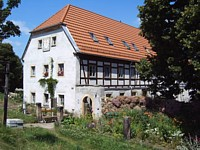
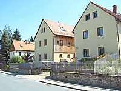
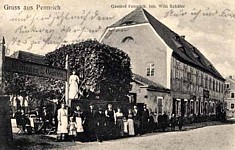
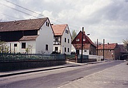
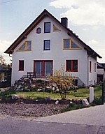
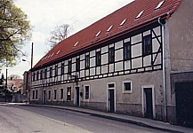
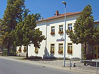
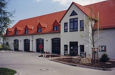

* * *

**Gemeindesiegel von Gompitz**

Pennrich wurde 1378 im Verzeichnis der Orte des Amtes Dresden erstmals erwähnt. Der Ort entstand vermutlich im 11. Jahrhundert als Gassendorf deutscher Kolonisten. Möglicherweise ging in der Ortsflur die
bereits vorhandene slawische Siedlung Ranczwicz auf, da Pennrich noch um 1469 als Penerik-Ranczwicz bezeichnet wird. Die Herkunft des Ortsnamens ist unklar. Wahrscheinlich stand das altsorbische Wort pnarik = Baumstock
bzw. Pen = Stöckigt Pate. Verschiedene Quellen erklären den Ortsnamen auch in Verbindung mit dem sagenhaften Meißner Bischof Benno: Penerich = Bennos Reich, da Pennrich einst zum Besitz des Klosters Seußlitz gehörte.

Im 15. Jahrhundert verkaufte die Dresdner Bürgerfamilie Busmann verschiedene
Zinsrechte an Pennricher Gütern an das Meißner Domkapitel. Der Ort wurde 1429 in den Hussitenkriegen zerstört, jedoch schon bald wieder aufgebaut. Die Obergerichte
lagen 1468 beim Amt Briesnitz, die Niedergerichte beim Dresdner Amt.  Mit der Reformation endete der Einfluß des Klosters Seußlitz, dessen Pennricher Besitzungen
dem Prokuraturamt Meißen zufielen. Die Bewohner des Dorfes lebten vorrangig von der Landwirtschaft und hatten immer wieder unter kriegerischen Ereignissen zu leiden.
Besonders schwer traf der Durchzug kaiserlicher Truppen während des Dreißigjährigen Krieges den Ort, der 1632 völlig niedergebrannt wurde und dann viele
Jahre wüst lag. Erst um 1652 waren die meisten Pennricher Höfe wieder aufgebaut. Deren Bewohner regelten ihr Zusammenleben im 1653 veröffentlichten Pennricher Rügenbuch, welches zu den wenigen vollständig erhaltenen
Dorfgesetzbüchern im Dresdner Raum gehört.

1655 erwarb die Gemahlin des Kurfürsten Johann Georg I., Magdalena Sibylla, ein Bauerngut in Pennrich, welches zuvor im Besitz ihres Kammerdieners Birkner
gewesen war. Dieses Gut, durch Ankäufe noch erweitert, wurde noch im gleichen Jahr zum kurfürstlichen Vorwerk erhoben und dem Kammergut Gorbitz
angeschlossen. 1693 verschenkte Kurfürst Johann Georg IV. das ererbte Gut seiner Geliebten Magdalena Sibylle von Neidschütz. Diese verstarb wenige Monate später
an den Pocken. Da sich der Kurfürst ebenfalls infiziert hatte und starb, kam dessen Bruder August der Starke an die Macht. Die als unstandesgemäß empfundene
Schenkung des Vorwerks Pennrich ließ er bereits am 27. Juni 1694 wieder rückgängig machen, so dass das Vorwerk nun wieder zu den kurfürstlichen Besitzungen gehörte.

Im 18. und 19. Jahrhundert ereilten Pennrich durch kriegerische Ereignisse
schwere Schicksalsschläge. 1745 spielte sich ein Großteil der Schlacht von Kesselsdorf auf den Feldern des Dorfes ab, welches selbst dabei schwer
beschädigt wurde. Südlich des Ortes wurde nach der Schlacht ein Massengrab für über 100 gefallene Soldaten angelegt. Nachdem sich das Dorf wieder etwas
erholt hatte, zogen 1760 die geschlagenen Truppen des Reichsheeres bei ihrem Rückzug über Pennrich nach Dresden. Zur Gewinnung von Feuerholz wurden
Zäune und Scheunen abgerissen, so dass das Dorf kaum noch bewohnbar war. Während der Napoleonischen Kriege ließ 1809 der “schwarze Herzog” bei
einem Gefecht bei Steinbach den Ort beschießen. 1813 eroberten französische Truppen des Generals Murat Pennrich
und besetzten die Güter. Murat gelang es, über 15.000 österreichische Soldaten gefangenzunehmen, bevor er mit seinen
Soldaten nach Leipzig weiterzog. Die letzten Franzosen verließen jedoch erst nach Napoleons Niederlage am 16. Oktober 1813 den Ort. Ein Massengrab am Schindanger in der Nähe der Schule erinnert noch an diese Ereignisse.

Pennrich blieb auch im 19. Jahrhundert
ein Bauerndorf und bestand 1821 aus sieben Gütern sowie dem königlichen Vorwerk, welches auch nach Bildung der Landgemeinde 1839 ein selbstständiger Gutsbezirk blieb. Gemeinsam mit dem
Nachbarort Gompitz bildete Pennrich einen “Heimatbezirk”, der u. a. die gemeinsame Armenfürsorge sowie die Bildung einer Gemeindefeuerwehr beinhaltete. Da die Bewirtschaftung des Vorwerks immer unrentabler wurde,
verpachtete der Fiskus dieses Gut ab 1857 an einen privaten Besitzer. 1869 wurde das Gut endgültig verkauft und kam 1880 als Freigut in den Besitz des
Kaiserlichen Posthalters in Dresden, August Oswald Hofmann. Erst im Zuge der Bodenreform wurde das frühere Allodialgut 1946 als Stadtgut in den Besitz der Stadt Dresden überführt.

Zu den bekanntesten Pennricher Einwohnern gehörte die Familie Luckner, die mit den Schlossbesitzern in Altfranken in
verwandschaftlicher Beziehung stand. 1844 hatte diese ein Pennricher Gut erworben. Sohn Heinrich Ludwig Wilhelm
Georg Graf von Luckner heiratete 1880 in Oberpesterwitz die bürgerliche Marie Lüdicke. Aus der Ehe ging Felix Nikolaus von Luckner hervor, der seine Kindheit auf dem elterlichen Gut in Pennrich verbrachte und später als
“Seeteufel” zu den Volkshelden des Ersten Weltkriegs gehörte. Luckner war 1945 an der Rettung der Stadt Halle als Parlamentär beteiligt und verstarb 1966 in seiner schwedischen Wahlheimat.

1870 erhielt der Ort ein neues Armenhaus, 1879 eine neue Schule, die auch für die
Nachbardörfer Gompitz und Zöllmen zuständig war. Außerdem entstanden einige kleinere Gewerbebetriebe sowie eine Ziegelei an der Wilsdruffer Straße. Trotzdem blieb die
Landwirtschaft dominierender Wirtschaftszweig. Zur besseren Verkehrsanbindung des Ortes bestanden 1908 Pläne, eine Schmalspurbahn zwischen Kesselsdorf und Pennrich bis nach
Gorbitz anzulegen, die dort eine Verbindung zur Dresdner Straßenbahn erhalten sollte. Ein entsprechendes Gesuch wurde jedoch vom Landtag abgelehnt. Obwohl Pennrich 1946 Sitz
eines aus mehreren Gemeinden bestehenden “Sprengels” geworden war, kam der Ort mit ca. 400 Einwohnern schon 1950 als Ortsteil zu Gompitz. Seit 1999 gehört Pennrich als Stadtteil
zu Dresden. Nach 1990 entstanden einige neue Wohngebäude _(Foto: Podemuser Straße)_. Im November 2008 erhielt der Ort Straßenbahnanschluss nach Dresden.

Gasthof Pennrich:

Im Jahr 1780
erhielt Gottlob Lindner die Konzession zum Betrieb eines Gasthofes in Pennrich, was wegen des bestehenden Reiheschanks zu Streitigkeiten mit den
Nachbarn führte. Erst fünf Jahre später konnte er nach einer Zahlung in die Gemeindekasse den Reiheschank käuflich erwerben und dieses Recht auf seinen
Gasthof übertragen. Bis zum Bau der neuen Chaussee nach Wilsdruff 1812/13 war die Schänke wichtige Raststätte an der alten Fernstraße nach Freiberg. Nachdem
der Ort seinen Durchgangsverkehr verloren hatte, ließ Lindner in Kesselsdorf einen “Gasthof zu Neupennrich” errichten, der im 19. Jahrhundert auch als Veranstaltungsort für Volksfeste und Konzerte bekannt wurde und als
Gerechtsame zum Pennricher Gasthof gehörte. Der eigentliche alte Dorfgasthof verlor an Bedeutung, blieb jedoch als Schankstätte erhalten. Erst 1994 wurde dieses traditionsreiche Lokal _(Foto)_ geschlossen.

Schulen in Pennrich:

Die erste Dorfschule in Pennrich wurde 1783 erwähnt. Ab 1790 wurde diese auch von den Kindern des Nachbarortes Gompitz besucht. Ein neues Schulhaus entstand
1879 für den Schulverband Pennrich - Gompitz - Zöllmen unmittelbar an der Ortsgrenze zu Gompitz. Das am 15. September 1879 feierlich eingeweihte und noch
erhaltene Gebäude wird heute als Kindergarten “Gompitzer Spatzennest” genutzt. Eine Schrifttafel an der Fassade erinnert noch an die frühere Nutzung.

Gemeindeamt:

Das Gemeindeamt für Gompitz und seine Ortsteile entstand 1994 an der Altnossener Straße in Pennrich und beherbergte bis zur Eingemeindung die Verwaltung des Ortes. Außerdem entstanden ein Gemeindesaal sowie ein
Depot der Freiwilligen Feuerwehr. Ursprünglich gehörte das Grundstück zum sogenannten Postgut. Heute hat hier die Ortschaftsverwaltung Gompitz ihren Sitz. Vor dem Haus wurde eine historische Wasserpumpe aufgestellt.

## [Pennricher Straßen](../../../sudwest/gompitz/pennrich/strassen_gompitz/)

[_Weiterführende Literatur und Quellen_](../../../impressum/quellenverzeichnis/)

 \[ [Home](../../../index.html)\] \[ [Nord](../../../nord/)\] \[ [Nordwest](../../../nordwest/)\] \[ [Neustadt](../../../neustadt/)\] \[ [Nordost](../../../nordost/)\] \[ [West](../../../west/)\] \[ [Zentrum](../../../zentrum/)\] \[ [Südwest](../../../sudwest/)\] \[ [Süd](../../../sud/)\] \[ [Südost](../../../sudost/)\] \[ [Ost](../../../ost/)\] \[ [Register](../../../Register/register.html)\] \[ [Kontakt](../../../Kontakt/kontakt.html)\] \[ [Impressum](../../../impressum/)\]
