* * *

Als Altgompitz wird seit 1999 der frühere Dorfplatz des Ortes Gompitz bezeichnet. Hier haben sich bis heute noch einige Bauernhöfe erhalten, die teilweise unter Denkmalschutz stehen. Sehenswert ist ein im Bauerngut Altgompitz 16/18 erhaltener
historischer Taubenschlag. Unweit davon erinnert ein Denkmal an die im Ersten und Zweiten Weltkrieg gefallenen Einwohner. Dieses befand sich ursprünglich hinter der Schule und wurde erst nach 1990 an seinen heutigen Standort versetzt. Im Haus Altgompitz 9 befand sich zwischen 1864 und 1897 der erste [Dorfgasthof](../../../../sudwest/gompitz/) des Ortes.

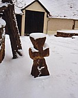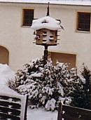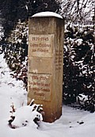

**_Fotos:_** _Steinerne Zeugnisse der Vergangenheit: links ein mittelalterliches Sühnekreuz, in der Mitte der historische Taubenschlag im ehemaligen Bauerngut Altgompitz, rechts das Kriegerdenkmal für die Opfer der beiden Weltkriege._

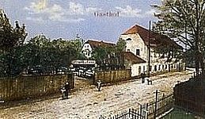Die Altnossener Straße ist Teil der ehemaligen Nossener Poststraße, die von Dresden über Gompitz nach Wilsdruff und von dort weiter nach Nossen führte. Hier befand sich ab 1780 auch der alte Pennricher Dorfgasthof _(Foto)_. Nach dem Ausbau der neuen Chaussee zwischen Kesselsdorf und Wilsdruff durch Napoleon im Jahr 1812/13 verlor die Straße an Bedeutung und ist heute nur noch Verbindung zwischen Gompitz und seinen Ortsteilen Pennrich, Zöllmen und Steinbach. Bis zur Eingemeindung trug sie deshalb in Gompitz den Namen Pennricher Straße, in Pennrich Steinbacher Straße.

An der Kreuzung Altnossener Straße / Kesselsdorfer Straße wurde 1828 eine Wegsäule aufgestellt, die heute jedoch nicht mehr vorhanden ist. Einige Wegsäulen haben sich im weiteren Verlauf der Straße noch erhalten, u.a. an der Einmündung des Hohlweges, am Abzweig Zöllmen und in Steinbach.

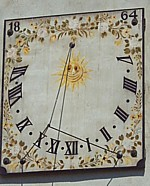In Ortszentrum von [Pennrich](../../../../sudwest/gompitz/pennrich/) blieben einige Bauerngüter erhalten. Interessant ist das frühere Allodialgut mit einer großen Sonnenuhr am Giebel _(Nr. 44 - Foto rechts)_. Dieses befand sich ab 1821 im Besitz der Wettiner und gehörte als Zubehör zum Gompitzer Kammergut. 1869 wurde das Vorwerk aufgelöst und verkauft. Noch bis 1900 bildete es einen eigenen Gutsbezirk.

Im Nachbargehöft wurde am 9. Juni 1881 Graf Felix Nikolaus von Luckner geboren. Während des Ersten Weltkrieges erlangte er als “Seeteufel” Berühmtheit. 1945 rettete Luckner als Parlamentär die Stadt Halle durch kampflose Übergabe an die Amerikaner vor der Zerstörung. 2006 wurde aus Anlass seines 125. Geburtstages ein Gedenkstein enthüllt. Historisch interessant sind auch die unter Denkmalschutz stehenden Dreiseithöfe Nr. 23 (Bormanns Hof) und Nr. 31 (Heinrichs Hof), der frühere Vierseithof Altnossener Straße 48 (Bergers Hof) sowie das sogenannte Postgut (Nr. 46).

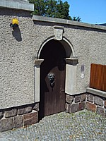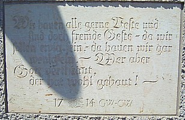

Zu den heute nicht mehr erhaltenen Höfen gehört das frühere Gut Nr. 42, welches ursprünglich um 1714 erbaut worden war. An Stelle der einstigen Wohn-und Wirtschaftsgebäude befindet sich jetzt ein Einfamilienhaus. Erhalten blieben Teile der Toranlage mit Pforte und Schlussstein sowie einer Schrifttafel _(Fotos oben)_:

_“Wir bauen alle gerne Veste und sind doch fremde Geste - da wir sollen ewig sein, - da bauen wir gar wenig ein._

_Wer aber Gott verthraut, der hat wohl gebaut! 1714 G.W. + C.W.”_

Der Straßenname Am Erlengrund ist von einem alten Flurnamen im oberen Zschonergrund  abgeleitet und bezeichnet seit 1999 den Dorfkern des Ortes  [Zöllmen](../../../../sudwest/gompitz/zollmen/). Zu den unter Denkmalschutz stehenden Gebäuden im Ort gehören die Bauernhöfe Nr. 3, Nr. 4, Nr. 6 und Nr. 8 mit ihren historischen Wirtschaftsgebäuden.

Dorfbrunnen: Der Brunnen wurde 1989 von Eberhard Wolf geschaffen. Bekrönt von einer Bäuerinnenfigur befinden sich am
Brunnen eine Reihe von Rinderköpfen, darunter eine Sandsteinsäule mit acht Wasserspeiern. Ursprünglich befand sich der Brunnen am Eingangsbereich der Milchviehanlage der Zöllmener LPG Tierproduktion. Im Zusammenhang mit dem
Autobahnbau wurde der dort beseitigt und ins Ortszentrum versetzt.

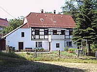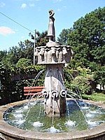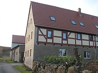

**_Fotos:_** _Historische Bauernhäuser in Zöllmen: Am Erlengrund 2 (links) und Am Erlengrund 8 (rechts)._

_In der Mitte der Dorfbrunnen._

__

Die Straße Am Mühlberg in Steinbach erinnert an die einstige Holländerwindmühle des Ortes, die hier einst ihren Standort hatte. Sie gehörte als Zubehör zur nahegelegenen [Schulzenmühle](../../../../west/kemnitz/zschonergrund/schulzenmuhle/)
im Zschonergrund, welche heute als Gaststätte genutzt wird. An der Einmündung zur Steinbacher Grundstraße steht eine historische Wegsäule aus Sandstein vom Beginn des 19. Jahrhunderts.

Seit 2002 trägt die Hauptstraße von [Unkersdorf](../../../../sudwest/gompitz/unkersdorf/) den Namen Am Schreiberbach und verbindet den Ort mit dem benachbarten [Oberwartha](../../../../west/oberwartha/). 1912 wurde sie als Fahrstraße ausgebaut, wobei auch die früher schwer zu überwindende
“Hohle” beseitigt wurde. Namensgeber ist der hier fließende Unkersdorfer Dorfbach, ein Zufluss des Oberwarthaer Stausees.

Im Ortskern sind noch zahlreiche Bauernhöfe erhalten geblieben, die heute meist nur noch Wohnzwecken dienen. In einem
der Güter befindet sich seit einigen Jahren die rustikale Gaststätte “Unkersdorfer Hof” mit Pension (Nr. 3). Historisch interessant ist der
alte Pfarrhof (Nr. 23), ein ehemaliger Dreiseithof mit Wohngebäude, Scheune und einer Pferdetränke. Hier wohnte während des Siebenjährigen Krieges für einige Wochen der preußische Prinz Heinrich.

Die Straße Am Steinhübel verbindet Unkersdorf mit Kesselsdorf und erhielt ihren Namen nach dem Steinhübel, einer kleinen Erhebung am Westrand der Fluren von
[Steinbach](../../../../sudwest/gompitz/steinbach/)
. 1869 entstand hier ein Vermessungspunkt für die mitteleuropäische Gradmessung. Die aus diesem Anlass errichtete “Nagelsche Säule” befindet sich heute im Ortszentrum, während am
ursprünglichen Standort eine Gedenktafel an die historischen Zusammenhänge erinnert.

Der Name Am Wetterbusch erinnert an einen alten Flurnamen, der 1825 als “Wetterbüschgen” erwähnt wurde. Das Wäldchen wurde zuvor auch als Pfarrbusch bezeichnet, da es sich im Besitz des Unkersdorfer Pfarrers befand. 1813
brannten napoleonische Soldaten den Pfarrbusch teilweise nieder. Von der Anhöhe bietet sich ein schöner Blick über Unkersdorf und seine Umgebung.

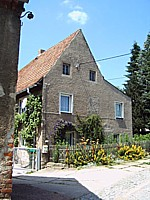Der Drei-Häuser-Weg in [Steinbach](../../../../sudwest/gompitz/steinbach/), früher auch als Dreihäuser Weg bezeichnet, erinnert an die
jahrhundertelange Teilung des Dorfes in einen Scharfenberger und Leuteritzer Teil. Beide unterstanden verschiedenen Rittergütern und Ämtern und wurden erst im 19. Jahrhundert zu einer
Gemeinde vereinigt. 1691 kam der kleinere Leuteritzer Teil zum Rittergut Maxen bei Pirna. Bis heute stehen die drei ehemaligen Kleinbauernhöfe abseits des Steinbacher Ortskerns und werden zu Wohnzwecken bzw. als Tierpension genutzt.

**_Foto:_** _Wohngebäude des Gehöftes Drei-Häuser-Weg 4_

Der Gärtnerweg wurde in den 1990er Jahren zur Erschließung des Wohngebietes am Schmiedeberg angelegt. Die
Namensgebung erinnert an den einst wichtigen Berufszweig von Gompitz und seinen Nachbarorten.

Die halbkreisförmige Straße Gompitzer Hang entstand in den 1990er Jahren im Zusammenhang mit dem Bau eines
Wohnviertels im westlichen Teil des Ortes. Zeitgleich wurde auch die Straße Am Graben angelegt und bebaut. Beide Straßennamen nehmen Bezug auf dir örtlichen Gegebenheiten

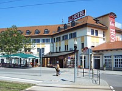
Auch die Gompitzer Höhe wurde Mitte der 1990er Jahre im Zuge der Ortserweiterung von Gompitz angelegt, liegt jedoch bereits auf Pennricher Flur. Ringförmig umschließt sie
das neue Ortszentrum und verbindet zugleich die Oskar-Maune-Straße mit der Kohlsdorfer und der Kesselsdorfer Straße. Markantestes Gebäude ist das KIM-Hotel mit öffentlicher Gaststätte _(Foto)_
. Gegenüber befindet sich ein Einkaufszentrum mit mehreren Einrichtungsmärkten. Seit Verlängerung der Straßenbahnlinie bis nach Pennrich hat die Gompitzer Höhe zudem als Umsteigepunkt für den öffentlichen Nahverkehr Bedeutung.

Der Gompitzer Wirtschaftsweg gehört zu den älteren Wegverbindungen des Ortes. Bereits vor dem Zweiten Weltkrieg ist er
als Fußweg in Plänen verzeichnet und wurde 1939 in Richtung Zschonergrund als Franz-Scheffler-Weg, in Richtung Ortskern als Ernst-Sobe-Weg bezeichnet. Die Namensgebung erfolgte wahrscheinlich nach Personen, welche im Geiste des
Nationalsozialismus als “Vorbilder” betrachtet wurden (Kapitänleutnant Ernst Sobe war Kommandeur des U-Bootes U 34). Zu DDR-Zeiten ist der Weg als Wirtschaftsweg im Stadtplan eingetragen. Um Verwechslungen mit dem Wirtschaftsweg in
Briesnitz zu vermeiden, erfolgte 1999 die Umbenennung in Gompitzer Wirtschaftsweg. Hier befinden sich neben einigen Wohnhäusern die Anlagen der Gompitzer Reitanlage mit der Gaststätte “Kapriole”.

Der Hartwigweg wurde im Zusammenhang mit dem Bau des Wohngebietes An der alten Gärtnerei in Gompitz angelegt. Seinen Namen erhielt er nach dem Baumeister und Politiker Gustav Emil Leberecht Hartwig (1839-1908). Hartwig gehörte viele Jahre dem Dresdner Stadtrat, dem sächsischen Landtag bzw. dem Reichstag als Abgeordneter an und war außerdem bis 1907 Vorsitzender des Dresdner Allgemeinen Hausbesitzervereins. Zudem setzte er sich als Wohltäter für seinen Heimatort Gompitz ein.

Der bereits vor 1945 existierende Weg hieß früher Emil-Poldrack-Straße und wurde nach dem Zweiten Weltkrieg in Hohlweg umbenannt. Er verbindet die Altnossener Straße und die Ockerwitzer Allee und führt dabei um den alten Dorfkern von Gompitz herum.

Die als Holzmichelweg bezeichnete kurze Sackgasse führt vom Pennricher Feldrain als Zufahrtsstraße in ein kleines Wohngebiet, das nach 2000 südlich der Altnossener Straße entstand. Obwohl die Straße seit ca. 2013 in verschiedenen Stadtplänen verzeichnet ist und auch ein Straßenschild besitzt, ist sie im amtlichen Dresdner Straßenverzeichnis nicht enthalten.

Der Hühndorfer Weg im Norden des Ortsteils Unkersdorf verbindet diesen mit dem benachbarten Hühndorf, einem Ortsteil von Klipphausen. Die ursprünglich durchführende Verbindungsstraße wurde Mitte der 1990er Jahre durch den Bau der Autobahn A4 unterbrochen.

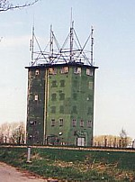Die Kohlsdorfer Landstraße, früher auch als Kohlsdorfer Weg bzw. Kohlsdorfer Straße
bezeichnet, erhielt ihren Namen nach dem heutigen Freitaler Stadtteil Kohlsdorf bei Wurgwitz. Hier waren der Legende nach im 16. Jahrhundert die ersten Steinkohlevorkommen des Döhlener
Beckens entdeckt worden. Ebenso wie die Ockerwitzer Allee war auch diese Straße Teil des alten Kohlwegs nach Dresden, über den die Kohletransporte des Zauckeroder Reviers ihren
Weg ins Elbtal nahmen. Am Abzweig des Fußweges nach Altfranken steht eine Wegsäule aus dem 19. Jahrhundert.

Im Zuge des Autobahnbaus und der Erschließung neuer Wohnsiedlungen und Einkaufsmärkte in
Gompitz erfolgte in den 1990er Jahren ein Ausbau der Straße. Diese beginnt heute am Vorplatz des KIM-Hotels, wo sich auch ein Umsteigepunkt zwischen Straßenbahn und Bus befindet. Die
Straße überquert dann die Bundesstraße 173 und die Autobahn und führt weiter in Richtung Pesterwitz und Wurgwitz.

Richtfunkturm:
Das markante Gebäude westlich der Kohlsdorfer Straße entstand in den 1950er Jahren als Funkturm und beherbergte bis 1990 technische Anlagen für das interne Richtfunketz des Zentralkomitees der SED und der NVA. Nach der
Wende wurden auf dem Turm Antennen für Radio- und Mobilfunk installiert. Der grün gestrichene Turm _(Foto)_ gilt als ein Wahrzeichen von Gompitz, soll jedoch nach Errichtung eines neuen Funkmastes abgerissen werden.

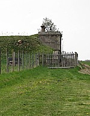Die frühere Hauptstraße von [Ockerwitz](../../../../sudwest/gompitz/ockerwitz/) wurde 1999 in Ockerwitzer Allee umbenannt. Die Straße ist Teil des
alten Kohlweges, der von Wurgwitz über Ockerwitz ins Elbtal führte. Da ihn die Bewohner des Dorfes als Weg zum Briesnitzer Friedhof benutzten, war zeitweise auch die
Bezeichnung Ockerwitzer Leichenweg in Gebrauch. 2004 wurde hier im Zusammenhang mit dem Bau des gemeindeeigenen Wasserwerkes ein Hochbehälter angelegt _(Foto)_.

Seit 2003 steht an der Ockerwitzer Allee ein mittelalterliches Steinkreuz, welches wenige Monate zuvor bei Bauarbeiten in Gompitz entdeckt worden war. Das Kreuz stammt aus dem 15. / 16. Jahrhundert, ist ca.
1,60 Meter hoch und hat eine Armbreite von 54 Zentimetern. Die Umstände seiner Entstehung, welche evtl. mit einem Mord oder Unfall in Verbindung stehen, sind unbekannt.
Vermutlich Mitte der 1960er Jahre wurde es von seinem ursprünglichen Standort entfernt und als Baumaterial zweckentfremdet. Nach seiner Bergung erfolgte eine Restaurierung und der Transport zum heutigen Platz.

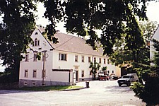Als Ockerwitzer Dorfstraße wird seit 1999 der
Dorfkern des Gompitzer Ortsteils [Ockerwitz](../../../../sudwest/gompitz/ockerwitz/)  bezeichnet. Deutlich ist noch die Anlage des slawischen Rundlings mit den
einzelnen Gehöften zu erkennen. Die Drei-und Vierseithöfe erhielten ihre heutiges Aussehen im 19. Jahrhunderts und stehen heute unter Denkmalschutz. An einigen Gebäuden, so an den Höfen  Nr. 1 _(Foto)_
und Nr. 9 haben sich Inschriftentafeln mit den Initialien der Besitzer und dem Baujahr erhalten.

Der Name Oskar-Maune-Straße erinnert an einen früheren Pennricher Gemeindevorstand. Die Geschichte der Familie Maune lässt sich bis ins 13.
Jahrhundert zurückverfolgen. Die weitverzweigte Sippe stammte ursprünglich aus dem Dorf Mauna bei Meißen und war früher in vielen Orten der Wilsdruffer Umgebung ansässig. Im 19. Jahrhundert siedelten sich die
Maunes auch in Pennrich an und waren zeitweise Besitzer des früheren Luckner-Gutes. Ab 1866 stellten Vertreter dieser Familie regelmäßig den Gemeindevorstand von Pennrich.

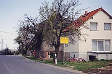

**_Foto:_** _Ortseingang Pennrich an der Oskar-Maune-Straße_

Die Paul-Breyer-Straße wurde nach einem Gompitzer SED-Funktionär benannt. Paul Breyer (1883-1965) war in der
Nachkriegszeit Bürgermeister des Ortes. Das Straßenbild dominieren bis heute Einfamilienhäuser, die meist nach 1960 errichtet wurden.

Die frühere Rennersdorfer Straße, alte Verbindungsstraße zwischen Unkersdorf und Rennersdorf, wird seit 2002 wieder als Schwarmweg bezeichnet. Der Flurname [Schwärme](../../../../sudwest/gompitz/unkersdorf/schwarme/) findet sich in zahlreichen alten Flurkarten und bezeichnet das Areal
zwischen den Dörfern Unkersdorf, Rennersdorf, Brabschütz, Podemus und Roitzsch. Durch den Autobahnbau wurde die Straße unterbrochen und seit 1936 über eine neue Brücke geführt. Diese verschwand 1999 für den Ausbau des
Autobahndreiecks Dresden-West.

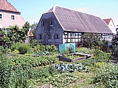
Die frühere Grundstraße zwischen Zöllmen, Steinbach und dem Abzweig nach Roitzsch erhielt nach der Eingemeindung von Gompitz den Namen Steinbacher Grundstraße, um
Verwechslungen mit einer Straße in Loschwitz zu vermeiden. Die Namensgebung geht auf den Zschonergrund zurück, welcher bei Zöllmen von dieser Straße gekreuzt wird. Im
Ortskern von Steinbach sind noch einige denkmalgeschützte Gehöfte aus dem 19. Jahrhundert erhalten, welche heute unter Denkmalschutz stehen. Hier befindet sich auch
der bereits 1561 erstmals erwähnte Dorfgasthof, später als “Schützenhaus” bezeichnet. Bis heute wird das mehrfach umgebaute Gebäude gastronomisch genutzt.

**_Foto:_** _Wohnhaus des Vierseithofes Steinbacher Grundstraße 14_

Als Teichweg wird eine nach dem früheren Dorfteich im Zentrum von [Unkersdorf](../../../../sudwest/gompitz/unkersdorf/) benannte Straße bezeichnet. Hier blieben
bis heute einige historische Gehöfte erhalten. Bemerkenswert sind die Drei- bzw. Vier-Seit-Höfe Nr. 2, 4 und 12.

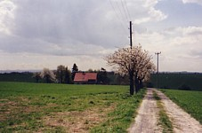Der Flurname
Jammertal zwischen Pennrich und Zöllmen wurde im Zusammenhang mit einem Landverkauf erstmals1606 erwähnt. Ein Zusammenhang mit Kämpfen während der Hussitenkriege ist nicht belegt. Vermutlich erhielt das Flurstück diese
Bezeichnung wegen seiner ungünstigen Bodenbeschaffenheit und der schweren Bestellbarkeit. Während der Schlacht von Kesselsdorf 1745 war dieser Teil des Ortes besonders schwer umkämpft.

Die im Zusammenhang mit dem Bau des Wohngebiet “Alte Gärtnereien” angelegte Straße erhielt nach einer alten Flurbezeichnung 2010 den Namen Zur Pflaumenhohle. Ursprünglich war der Name “Felix-Graf-von Luckner-Ring”
vorgesehen. Luckner wuchs im benachbarten Pennrich auf und wurde während des Ersten Weltkriegs als “Seeteufel” zum
Volkshelden. Umstritten ist jedoch seine Rolle in der Nazizeit sowie ein Ermittlungsverfahren wegen pädophiler Straftaten, weshalb dieser Name vom Stadtrat abgelehnt wurde.

* * *

 \[ [Home](../../../../index.html)\] \[ [Nord](../../../../nord/)\] \[ [Nordwest](../../../../nordwest/)\] \[ [Neustadt](../../../../neustadt/)\] \[ [Nordost](../../../../nordost/)\] \[ [West](../../../../west/)\] \[ [Zentrum](../../../../zentrum/)\] \[ [Südwest](../../../../sudwest/)\] \[ [Süd](../../../../sud/)\] \[ [Südost](../../../../sudost/)\] \[ [Ost](../../../../ost/)\] \[ [Register](../../../../Register/register.html)\] \[ [Kontakt](../../../../Kontakt/kontakt.html)\] \[ [Impressum](../../../../impressum/)\]
