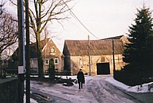

* * *

* * *

Älteste Besiedlungsspuren auf Roitzscher Flur stammen von 5.000 v. Chr. und werden der Kultur der Bandkeramiker zugeordnet. 1922 wurde an der Ortsgrenze zu Unkersdorf ein Beil gefunden, welches sich heute
in der Heimatsammlung Wilsdruff befindet. Der Ort selbst geht auf einen slawischen Rundweiler zurück, der bereits 1071 erstmals als Grodice urkundlich erwähnt ist und somit zu den ältesten Siedlungen im Stadtgebiet
gehört. Roitzsch wird in dieser Urkunde des Bischofs Benno als zugehörig zum Burgward Woz genannt. Der Name weist auf eine frühgeschichtliche Burganlage hin. In neueren Quellen wird dieses Grodice jedoch mit dem zu
Omsewitz gehörigen Burgstädtel in Verbindung gebracht.

1378 gehörte
Roitzsch zum Amt Dresden. Am 30. September 1408 vergab der Markgraf zu Meißen den Dresdner Bürgern Vinzensius, Hans Alexius und Jorge Busmann einige Güter und Zinsen in Roitzsch zum Lehen. Später kam das Dorf in
den Besitz der Familie von Miltitz und unterstand dem Rittergut Scharfenberg. Kirchlich war Roitzsch der [Unkersdorfer Kirche](../../../sudwest/gompitz/unkersdorf/unkersdorfer_kirche/) zugeordnet.

1745 war die Dorfflur Schauplatz von Gefechten im Zusammenhang mit der Schlacht von Kesselsdorf. Der spätere Sieger der Schlacht, Leopold von Dessau,
leitetet diese vom Roitzscher Hufenbusch aus, bevor er mit seinem Stab weiter nach Pennrich zog. Mit Ablösung der Fronen und Aufhebung der feudalen Abgaben wurde Roitzsch zur Landgemeinde
und gehörte ab 1850 dem Gerichtsamt Wilsdruff an. Später kam die kleine Siedlung zum Amt Dresden. Das Dorf, welches nur aus wenigen Gehöften besteht, besaß stets nur ca. 80 Einwohner und wurde 1950 nach Unkersdorf
eingemeindet. Gemeinsam mit Gompitz und weiteren Dörfern der Umgebung kam der Ort 1999 zu Dresden und gehört
heute zu den kleinsten Stadtteilen der Landeshauptstadt. Um den Dorfplatz sind noch einige historische Bauerngüter aus
dem 19. Jahrhundert erhalten geblieben. Interessant ist auch ein in einem Garten aufgestelltes Mühlenmodell, welches von Roitzscher Jugendlichen geschaffen wurde.

[_Weiterführende Literatur und Quellen_](../../../impressum/quellenverzeichnis/)
