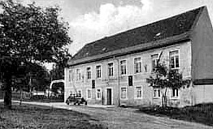
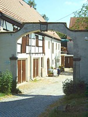

* * *

**Gemeindesiegel von Steinbach**

Steinbach entstand als Waldhufendorf deutscher Siedler im Quellgebiet des
Zschonerbaches und wurde 1361 erstmals als “Steynbach” urkundlich erwähnt. 1378 ist das Dorf im Verzeichnis der Orte des Amtes Dresden aufgeführt. Neben diesem Amt, welches die obere Gerichtsbarkeit besaß,
hatten auch der Meißner Lorenzaltar und das dortige Hospital Zinsrechte im Ort. Um 1590 gehörte Steinbach teilweise zum Rittergut Scharfenberg, teilweise zum Rittergut Rothschönberg. Diese Zweiteilung des Ortes blieb
bis ins 19. Jahrhundert erhalten. Während der größere Scharfenberger Teil aus einigen großen Bauerngütern bestand, lebten im kleineren Ortsteil
ausschließlich Häusler, die ihren Lebensunterhalt mit Obst- und Weinbau verdienten. Zur Steinbacher Flur gehört auch die abseits des Ortes gelegene [Schulzenmühle](../../../west/kemnitz/zschonergrund/schulzenmuhle/), die vermutlich ursprünglich Teil der [Wüstung Zschon](../../../west/kemnitz/zschonergrund/) war.

1691 kam der Rothschönberger Ortsteil, der sich im Besitz der Adelsfamilie von Schönberg befand, gemeinsam mit dem nahegelegenen Dorf [Leuteritz](../../../west/mobschatz/leuteritz/) an Hans Heinrich von Schönberg.
Dieser hatte kurz zuvor das Rittergut Maxen bei Pirna erworben. Grund des Besitzerwechsels waren mehrere Erbteilungen innerhalb der weitverzweigten Familie. 1760 eroberten
preußische Truppen das Dorf und brannten mehrere Gehöfte nieder, die bis 1763 wüst lagen. Auch in den Napoleonischen Kriegen fanden auf Steinbacher Flur Kampfhandlungen statt.

Mit der sächsischen Landgemeindereform wurden 1838 der Scharfenberger und der Leuteritzer Teil zu einer Gemeinde vereinigt, die ab 1850 zum Gerichtsamt Wilsdruff, später
zum Amt Meißen gehörte. Dominierender Wirtschaftszweig blieb neben der Landwirtschaft der Obstbau. Neben der Schulzenmühle existierte zeitweise auch eine Windmühle im Ort. Um
1910 verlängerte der Gebirgsverein Briesnitz den Wanderweg durch den Zschonergrund bis zur Steinbacher Schulzenmühle. 1950 erfolgte die Eingemeindung des Dorfes mit ca. 150 Einwohnern nach Unkersdorf. Ab 1974
gehörte der Ort zu Gompitz und ist seit dem 1. Januar 1999 Stadtteil von Dresden.

[_Weiterführende Literatur und Quellen_](../../../impressum/quellenverzeichnis/)
