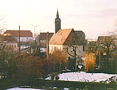
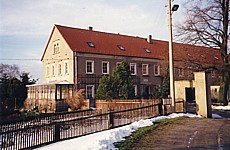
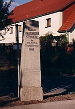

* * *

* * *

Obwohl der Ortsname (“Dorf des Unco”) auf einen deutschen Lokator hinweist,
entstand Unkersdorf vermutlich bereits im 11. Jahrhundert als slawische Siedlung. 1071 wurden die Orte Bulsice und Nicradewice erstmals in einer Urkunde des
Papstes erwähnt, in dem dieser dem Bischof von Meißen die genannten Dörfer überschrieb. Die beiden Siedlungen bilden vermutlich den Ursprung des
Doppelrundlings Unkersdorf, der am 16. Mai 1350 erstmals als villa Vnkersdorf erwähnt wurde. Als bischöfliches Lehen bildete Unkersdorf ein besonderes Gericht und besaß eine eigene [Kirche](../../../sudwest/Gompitz/Unkersdorf/Unkersdorfer_Kirche/unkersdorfer_kirche.html). 1450 gehörte der Ort als Lehen Georg von Miltitz und unterstand dem bischöflichen Amt Briesnitz.

Die von der Landwirtschaft geprägte Gemeinde wurde im Dreißigjährigen Krieg 1637 von kaiserlichen Soldaten geplündert, die sich auch in den Kirchenbüchern des Ortes “verewigten”. Während der Schlacht von Kesselsdorf
besuchte Fürst Leopold von Dessau den Ort, um sich hier einen Überblick über das Schlachtfeld zu verschaffen. Einen
weiteren prominenten Besucher beherbergte das Dorf im Jahr 1759, als der preußische Prinz Heinrich im Pfarrhaus für
mehrere Wochen sein Hauptquartier nahm. Am 29./30. Juni übernachtete sogar der preußische König in diesem Gebäude, nachdem er nach der Beschießung Dresdens mit seinen Truppen abzog. Wegen der Kriegsschäden wurde
Unkersdorf 1762 von einigen Abgaben befreit.

1764 verzeichnete eine Urkunde 14 bäuerliche Landbesitzer mit insgesamt 17 Hufen sowie vier Gärtner und den Mühlenbesitzer Christian Pietsch. Trotz des
Durchzugs russischer und französischer Soldaten 1814, die den Pfarrbusch niederbrannten, blieb Unkersdorf im 19. Jahrhundert ein wohlhabendes
Kirchdorf. Bis zur Aufhebung der Zins- und Dienstverpflichtungen gehörte der Ort als Zubehör zum Rittergut Scharfenberg, welches jahrhundertelang im
Besitz der Familie Miltitz blieb. Von den tiefgreifenden Veränderungen der Industrialisierung blieb das Dorf weitgehend verschont. Erst 1909 erhielten die
Gehöfte Elektroenergieanschluss an das Elektrizitätswerk “Elbtal” in Cossebaude. Unkersdorf blieb jedoch bis in jüngste Vergangenheit  ein Bauerndorf. 1950 wurden die Nachbarorte [Roitzsch](../../../sudwest/Gompitz/Roitzsch/roitzsch.html) und [Steinbach](../../../sudwest/Gompitz/Steinbach/steinbach.html) eingemeindet, die bereits zuvor zum Unkersdorfer Kirchspiel gehörten. Alle drei Dörfer kamen
1974 Jahren zu Gompitz und sind seit dem 1. Januar 1999 Stadtteile von Dresden.

Inschriften an Unkersdorfer Bauernhäusern:

Nagelsche Säule:

Die Säule entstand 1869 als Vermessungspunkt eines trigonometrischen Netzes auf dem Steinhübel bei Unkersdorf. Sieben Jahre zuvor war das Königreich Sachsen dem vom
preußischen General Baeyer geleiteten Projekt zur mitteleuropäischen Gradmessung beigetreten, mit welchem einheitliche Grundlagen für Landkarten und Verwaltungsaufgaben
geschaffen werden sollten. Ausgehend von der sogenannten “Großenhainer Grundlinie” entstanden an gut einsehbaren Stellen fixe Messpunkte, mit denen über trigonometrische
Formeln Entfernungen exakt bestimmt werden konnten.

Insgesamt wurden in Sachsen 36 Stationen 1. Ordnung und 122 Stationen 2. Ordnung
geschaffen. Eine dieser Säulen befand sich auf dem Steinhübel südlich von Unkersdorf. Ihren Namen trägt sie nach dem sächsischen Geodäten Christian August Nagel, der die Vermessungsarbeiten zwischen 1862
und 1882 leitete. 1980 wurde sie von ihrem ursprünglichen Platz entfernt und erst 1994 von den Mitgliedern des Heimatvereins wieder aufgespürt. Seit 2000 steht sie nach Restaurierung als Denkmal des Vermessungswesens
gegenüber der Gaststätte “Unkersdorfer Hof”. Am Steinhübel selbst erinnert eine Informationstafel an das Projekt.

[_Weiterführende Literatur und Quellen_](../../../Impressum/Quellenverzeichnis/quellenverzeichnis.html)
