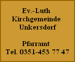
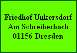
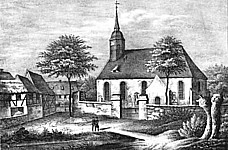
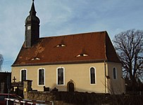

* * *

[**zur Homepage**](http://www.kirche-weistropp.de/index.php?option=com_content&view=article&id=46&Itemid=57)

Die Unkersdorfer Kirche entstand bereits im 14. Jahrhundert und war auch
für die Nachbarorte Steinbach und Roitzsch zuständig. Anläßlich einer Kirchenvisitation im Jahre 1540 wurden die bestehenden Rechte und Besitztümer penibel erfasst: Der Unkersdorfer Pfarrer besaß Zinsrechte in
Mobschatz, Merbitz und Leuteritz sowie in den zugehörigen Dörfern Steinbach und Roitzsch. Teilweise mussten die Erträge an die Briesnitzer Mutterkirche abgeführt werden. Zum Besitz der Kirche gehörten neben dem
Kirchhof das Pfarrhaus mit Baum- und Krautgarten, 1 1/4 Hufen Ackerflächen, acht Fuder Wiesen und der sogenannte Pfarrbusch. 1586 und 1613 wurde die Kirche durch den Tharandter Baumeister Johann George Lorenz umgebaut.

Die älteste erhaltene Urkunde im Pfarrarchiv stammt von 1544 und berichtet über
den Amtsantritt des ersten evangelischen Pfarrers Undertheil. Einige Jahre später ist auch ein Schulmeister erwähnt. Eine Erneuerung der Kirche erfolgte 1697,
wobei sie ihren Dachreiter erhielt. Im Siebenjährigen Krieg war das Unkersdorfer Pfarrhaus Quartier des preußischen Prinzen Heinrich, der mehrere Wochen hier
wohnte. Die durch die Einquartierung von preußischen Truppen entstandenen Schäden an der Kirche wurden 1766 beseitigt. Weitere Renovierungen erfolgten
im 19. Jahrhundert, wobei die Kirche 1896 auch neue Glocken und eine Orgel erhielt. Die Finanzierung erfolgte durch ein Legat des Sohnes eines früheren
Unkersdorfer Pfarrers. Seit 1931 gehört die Unkersdorfer Kirche als Filialkirche zu Weistropp.

Im Inneren befinden sich einige interessante historische Ausstattungsstücke, darunter einige Gemälde aus dem 17.
Jahrhundert, eine geschnitzte Kanzel mit Darstellungen biblischer Figuren und ein Rokoko-Taufstein. Zu den Zeugnissen der Vergangenheit gehören auch ein vergoldeter Kelch, der 1521 als Geschenk der Familie von
Hermsdorf nach Unkersdorf kam sowie die Kirchenbücher, die seit 1580 lückenlos vorhanden sind. 1637 wurden diese bei Plünderungen von Soldaten gestohlen und
auf dem Freiberger Markt verkauft. Nur durch Zufall gelangten sie später wieder nach Unkersdorf zurück

Friedhof:

Der Unkersdorfer Friedhof entstand zeitgleich mit der Kirche und ist bis heute letzte Ruhestätte der Bewohner des
Dorfes und seiner beiden Nachbarorte geblieben. Obwohl historische Grabdenkmale fehlen, sind dennoch einige interessante Grabsteine erhalten geblieben. In der Kirche sind die Grabplatten
früherer Unkersdorfer Pfarrer zu sehen.

* * *

 \[ [Home](../../../../index.html)\] \[ [Nord](../../../../nord/)\] \[ [Nordwest](../../../../nordwest/)\] \[ [Neustadt](../../../../neustadt/)\] \[ [Nordost](../../../../nordost/)\] \[ [West](../../../../west/)\] \[ [Zentrum](../../../../zentrum/)\] \[ [Südwest](../../../../sudwest/)\] \[ [Süd](../../../../sud/)\] \[ [Südost](../../../../sudost/)\] \[ [Ost](../../../../ost/)\] \[ [Register](../../../../Register/register.html)\] \[ [Kontakt](../../../../Kontakt/kontakt.html)\] \[ [Impressum](../../../../impressum/)\]
