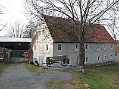
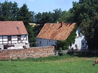
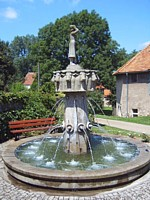
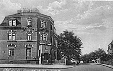

* * *

**Gemeindesiegel von Zöllmen**

Das Gebiet um Zöllmen war bereits in der Bronzezeit besiedelt, wie archäologische
Funde beweisen. Ein 1912 am Wüsteberg gefundenes Beil befindet sich heute in der Sammlung des Heimatmuseums Wilsdruff. 1186 wurde erstmals ein Arnold von
Zwlowin genannt, frühester Hinweis auf den Ort. Der Ortsname Zöllmen (Zculmyn) taucht hingegen erst 1350 auf. Der aus dem slawischen stammende Name bedeutet
übersetzt Hügeldorf und weist auf die geographische Lage des Ortes hin. Zöllmen gehörte im 14. Jahrhundert zu den Domherrengütern des Bistums Meißen, die vom
Bischof an einflussreiche kirchliche Würdenträger vergeben wurden. Die Zöllmener Bauern mussten außerdem Zinsen und Dienstpflichten zugunsten des kurfürstlichen
Amtes Dresden leisten. Zerstörungen gab es vermutlich im Zusammenhang mit den Hussitenkriegen, da Zöllmen 1486 als ein “von den Hussiten verwüsteter Ort” bezeichnet wurde.

Nach Auflösung der bischöflichen Besitzungen unterstand der Ort bis ins 19.
Jahrhundert dem Stiftsamt Meißen und war zu verschiedenen Abgaben und Dienstleistungen verpflichtet. Neben Pferde- und Handdiensten zugunsten des
Kurfürsten gehörte auch das Schneeräumen auf der Freibergischen Chaussee und die Stellung eines Heerfahrtwagens in Kriegszeiten zu diesen Aufgaben. Immer
wieder versuchten die Bewohner, die Belastungen zu verringern, was ihnen teilweise auch gelang. Endgültig erloschen die feudalen Lasten jedoch erst im Zuge der
Dienstablösungsrezesse zwischen 1830 und 1852. Zu den einschneidensten Ereignissen der Dorfgeschichte gehörte die Schlacht bei Kesselsdorf am 15.
Dezember 1745, zu deren Hauptkampfgebieten der Wüsteberg bei Zöllmen gehörte. Im Siebenjährigen Krieg befand sich zwischen Zöllmen und Kesselsdorf ein preußisches Feldlager, dessen Versorgung der Stadt Wilsdruff oblag.

Im 19.
Jahrhundert erhielt das Dorf den Status einer Landgemeinde. Die Bewohner lebten vorrangig vom Acker- und Obstbau. Eng verbunden war Zöllmen mit den Nachbardörfern [Pennrich](../../../sudwest/gompitz/pennrich/) und [Gompitz](../../../sudwest/gompitz/), die eine gemeinsame Schulgemeinde bildeten und 1911 eine Pflichtfeuerwehr ins Leben riefen. Außerhalb des alten Dorfkerns entstand um 1900 der
Ortsteil Kümmelschänke mit der gleichnamigen Gaststätte an der Kesselsdorfer Landstraße. 1904 erfolgte der Bau einer Wasserleitung nach Leutewitz, nachdem Zöllmener Bauern ihre
Wasserrechte verkauft hatten. Seit 1950 gehörte Zöllmen als Ortsteil zu Gompitz und kam mit diesem gemeinsam am 1. Januar 1999 zu Dresden. Nachdem sich auch die Zöllmener
Bauern nach 1950 zu einer LPG zusammengeschlossen hatten, entstand in Zöllmen eine moderne Milchviehanlage, die zuletzt zur LPG “Karl Marx” in Brabschütz gehörte. In den
1990er Jahren wurde auf dem Gelände die neue Anschlussstelle Gorbitz der Autobahn A 17 nach Prag gebaut. Zuvor hatten Autobahngegner für Aufsehen gesorgt, die über mehrere Monate bei Zöllmen ein
Hüttendorf gegen den Bau errichteten. Ein ehemals auf dem Gelände befindlicher Schmuckbrunnen wurde 2002 in den Ortskern versetzt _(Foto)._

Kümmelschänke:

Die Gaststätte “Kümmelschänke” entstand Ende des 19. Jahrhundert außerhalb des Dorfkerns an der Landstraße nach
Kesselsdorf. Gleichzeitig wurden hier einige Mietshäuser errichtet, die als “Neuer Anbau” bezeichnet werden. Die kleine
Siedlung erhielt 1902 eine Azetylangasanlage zur Beleuchtung der Häuser. Die Kümmelschänke wurde in den 1970er Jahren geschlossen. Das vor einigen Jahren renovierte Gebäude dient heute als Wohnhaus.

**_Foto:_** _Die Kümmelschänke in den Dreißiger Jahren_

## [Zöllmener Straßen](../../../sudwest/gompitz/pennrich/strassen_gompitz/)

[_Weiterführende Literatur und Quellen_](../../../impressum/quellenverzeichnis/)

 \[ [Home](../../../index.html)\] \[ [Nord](../../../nord/)\] \[ [Nordwest](../../../nordwest/)\] \[ [Neustadt](../../../neustadt/)\] \[ [Nordost](../../../nordost/)\] \[ [West](../../../west/)\] \[ [Zentrum](../../../zentrum/)\] \[ [Südwest](../../../sudwest/)\] \[ [Süd](../../../sud/)\] \[ [Südost](../../../sudost/)\] \[ [Ost](../../../ost/)\] \[ [Register](../../../Register/register.html)\] \[ [Kontakt](../../../Kontakt/kontakt.html)\] \[ [Impressum](../../../impressum/)\]
