* * *

**Gemeindesiegel von Obergorbitz**

**Gemeindesiegel von Niedergorbitz**

* * *

**Gorbitzer Stadtteilseiten:**

* * *

* * *

**Kultureinrichtungen**

**in Gorbitz:**

[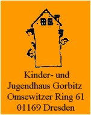](http://www.kjh-gorbitz.de)

* * *

**Schulen in Gorbitz:**

[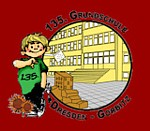](http://www.135.gs-dresden-gorbitz.de)

[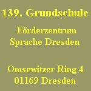](http://www.sn.schule.de/~fz-sprache-dd/hauptseite.htm)

Gorbitz wurde 1206 erstmals als Gurbewicz urkundlich erwähnt und entstand als slawische Siedlung am Westhang des Elbtals. Der Ortsname ist vom altsorbischen Wort Gora = Hügel abgeleitet und weist auf die
geografische Lage der Siedlung hin. Das Dorf besitzt zwei Dorfkerne, welche ab 1573 bis zur Eingemeindung nach Dresden die beiden selbstständigen Landgemeinden Ober- und Niedergorbitz bildeten. Dritter Ortsteil war das
frühere Kammergut an der Kesselsdorfer Straße, dessen Felder heute vom Neubaugebiet Gorbitz eingenommen werden. Bereits zum Zeitpunkt der Ersterwähnung bestand hier ein deutscher Herrenhof der Familie von Gorbitz, die
mehrfach in den Urkunden genannt wird. U.a. ist ein Hartlip von Gurbewiz in der Ersterwähnungurkunde von Dresden vom 31. März 1206 als Zeuge vermerkt.

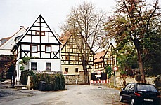Obergorbitz war ein wohlhabendes Bauerndorf, dessen Güter sich bis heute im oberen Teil der [Uthmannstraße](../../sudwest/gorbitz/strassen_gorbitz/uthmannstrasse/) noch erhalten haben _(Foto)_. In Niedergorbitz
rund um den heutigen Dorfplatz Altgorbitz wohnten hingegen vorrangig Häusler und Tagelöhner, so dass diese Gemeinde erheblich bevölkerungsreicher war.
Die Bewohner mussten ihren Lebensunterhalt meist durch Dienste auf dem nahen Kammergut verdienen, welches aus einem bereits im Mittelalter bestehenden Vorwerk hervorging. Dieses gehörte 1445 der Familie Busmann
und wurde 1644 von Kurfürstin Magdalena Sybilla, der Gemahlin Johann Georg I., erworben. Durch Ankäufe weiterer Flächen in der Umgebung wuchs
die Gutsflur auf über 150 Hektar an. Zum kurfürstlichen Besitz in Gorbitz gehörten auch zwei Weinberge, eine Brennerei und eine Brauerei. 1832 wurde das Kammergut Gorbitz vom Staat übernommen und bildete bis 1924 einen
selbstständigen Gutsbezirk. Zur Versorgung des Dresdner Schlosses ließ Kurfürst August bereit 1584 die [Gorbitzer Röhrfahrt](../../sudwest/gorbitz/gorbitzer_rohrfahrt/) anlegen, eine hölzerne Wasserleitung, deren Wartung einem im Ort ansässigen Röhrmeister oblag.

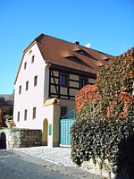1745
war auch Gorbitz von den Ereignissen der Schlacht bei Kesselsdorf betroffen. Am 15. 12. 1745 erlitten die sächsischen Truppen hier eine vernichtende Niederlage gegen die
preußische Armee. Preußens Heerführer Leopold I. von Anhalt-Dessau, besser als “der alte Dessauer” bekannt, weilte am 16. Dezember 1745 im Ort. An seinen Aufenthalt erinnerte
später der Gasthof “Zum Alten Dessauer” an der [Kesselsdorfer Straße](../../sudwest/lobtau/strassen_lobtau/kesselsdorfer_strasse/). Auch während des
Siebenjährigen Krieges kam es um Gorbitz zu Kampfhandlungen, denen einige Gehöfte zum Opfer fielen. Hinzu kamen immer wieder Truppendurchmärsche auf der bedeutenden
“Freybergischen Chaussee”. Diese bereits im Mittelalter wichtige Verkehrsverbindung führte am Dorfkern vorbei und wurde1810 von Napoleon zur Chaussee ausgebaut. 1813
verhandelten Franzosen und Verbündete am 9./10. November im Gutshaus Kesselsdorfer Straße 139 und vereinbarten dort den Abzug der französischen Besatzung, womit Dresden eine Belagerung erspart blieb.

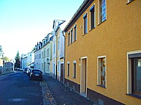Im 19. Jahrhundert wuchs die Einwohnerzahl des Ortes deutlich an. Nicht nur der
Ausbau der Kesselsdorfer Straße, sondern vor allem der Zuzug von Bergleuten aus dem Plauenschen Grund war hierfür der Grund. 1840 lebten in Niedergorbitz
bereits 1.300 Menschen, wodurch der Ort zu einer der größten Landgemeinden in der Dresdner Umgebung geworden war _(Foto)_. Die zum Teil katastrophalen
Lebensverhältnisse der Bergarbeiterfamilien begünstigten 1873 den Ausbruch der letzten großen Choleraepedemie im Dresdner Raum, die sich von Niedergorbitz bis
nach Löbtau und in die Wilsdruffer Vorstadt ausbreitete. 1872 entstand in Gorbitz eine [Diakonenbildungsanstalt](../../sudwest/gorbitz/kirchen_gorbitz/) mit einer Kapelle, die 1913 von der Kirchgemeinde
Gorbitz übernommen wurde. 1890 erhielt der Ort eine neue Schule in Niedergorbitz, 1898 ein gemeindeeigenes Wasserwerk. Stadtbekannt war die bis 1939 auf den Kammergutsfeldern veranstaltete Gorbitzer Vogelwiese, die
alljährlich Besucher aus ganz Dresden anzog. Am 1. April 1921 kamen Ober- und Niedergorbitz als Stadtteile zu Dresden. 1924 folgte das Kammergut Gorbitz. Obwohl bereits um 1880 einige neue Wohnhäuser an der
Kesselsdorfer Straße entstanden waren, blieb ein Großteil der Ortsflur weiterhin unbebaut. In den Dreißiger Jahren
entstanden Siedlungshäuser in der Nähe der Ortsgrenze zu Altfranken und an der Hirtenstraße. Bereits 1925 hatte Gorbitz mit Einrichtung der Buslinie A eine leistungsfähige Verkehrsanbindung nach Dresden erhalten.

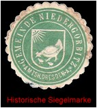

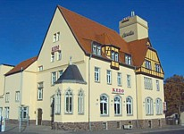Nach
dem Zweiten Weltkrieg gab es in Gorbitz einschneidende Veränderungen. Bereits 1945 wurde in der ehemaligen Gaststätte [“Zum Reichsschmied”](../../sudwest/lobtau/strassen_lobtau/kesselsdorfer_strasse/reichsschmied/) an der
Kesselsdorfer Straße _(Foto)_ das erste Dresdner Rundfunkstudio nach dem Krieg eingerichtet. Aus diesem entwickelte sich ab 1955 das Trickfilmstudio der DEFA.
Die früheren Felder des Kammergutes fielen 1946 unter die Bodenreform und wurden ab1952 von der LPG “Einheit” (Niedergorbitz) bzw. der LPG “Bergland”
(Obergorbitz) bearbeitet. Die Bauerngüter im Dorf wurden nun meist gewerblich genutzt und dabei durch Umbauten teilweise entstellt. Trotzdem blieben einige
Baudenkmale, vor allem an der Uthmannstraße, bis heute erhalten. Im Herrenhaus des früheren Kammergutes an der Kaufbacher Straße befindet sich seit 1999 eine Gaststätte.

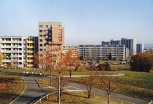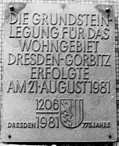Auf Beschluss des Rates der Stadt Dresden begannen 1979 die Vorbereitungen zum Bau des größten Dresdner Neubaugebietes auf den Fluren des früheren Kammergutes Gorbitz. Die Planungen der Architektengruppe um Jörg Bösche, Dr. Udo Fehrmann und Wolfgang Henke sahen eine zentrale Mittelachse mit Straßenbahntrasse vor, an der sich die öffentlichen Einrichtungen konzentrieren sollten. Die Wohngebäude wurden gestaffelt und unter Berücksichtigung der Hanglage angeordnet, um günstige Blickbeziehungen ins Elbtal herzustellen. Am 21. August 1981 wurde an der späteren Gaststätte “Grüner Heinrich” der Grundstein zum ersten Wohnkomplex gelegt _(Gedenktafel - Foto links)_. Bereits Anfang 1982 konnten die ersten neuerrichteten Wohnungen an ihre künftigen Mieter übergeben werden. Ein weiterer Meilenstein war die Übergabe der 100.000. nach 1945 in Dresden erbauten Wohnung am 19. Juli 1984 auf dem Wölfnitzer Ring 96.

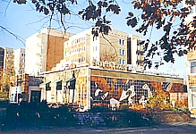Insgesamt entstanden bis Ende der 1980er Jahre in den insgesamt vier Wohnkomplexen ca. 14.000 Wohnungen für über 40.000 Einwohner. Neben den DDR-typischen Plattenbauten der Serie WBS 70 wurden auch vier 17-geschossige Wohnhochhäuser am Amalie-Dietrich-Platz errichtet. Gleichzeitig entstand 1983 eine neue Straßenbahnverbindung mit Gleisschleife. Zu beiden Seiten dieser zentralen Achse wurden einige Pavillons mit Geschäften und Gaststätten erbaut _(Foto: Gorbitzer Krug)_, wobei die ursprüngliche Planung wegen Kapazitätsmängeln nur eingeschränkt realisiert werden konnte. Hinzu kamen elf neue Schulen, zwei Seniorenheime, Kindertagesstätten und weitere gesellschaftliche Bauten. Trotz aller Bemühungen blieb die Siedlung am Gorbitzer Hang ein wenig attraktives, monotones Plattenbaugebiet, in dem vor allem Grünflächen und kulturelle Einrichtungen Mangelware blieben. Der geplante Bau einer Schwimmhalle konnte bis 1989 nicht vollendet werden.

Erst nach 1990 begann eine schrittweise Aufwertung des Viertels. So wurde 1992 ein kirchliches Gemeindezentrum mit der [St. Philippus-Kirche](../../sudwest/gorbitz/kirchen_gorbitz/) übergeben. 1992/96 folgten moderne Einkaufszentren am Amalie-Dietrich-Platz, am Merianplatz und an der Harthaer Straße. Unter Mitwirkung namhafter Architekten begann zugleich die Umgestaltung der vorhandenen Wohnblöcke, die farblich ansprechender gestaltet und zum Teil baulich verändert wurden. Dieser Prozess wurde ab 2002 vom Abriss leerstehender Wohnblocks mit ca. 1600 Wohnungen begleitet, um soziale Probleme im Neubaugebiet zu verhindern. Schwerpunkt der Arbeiten bildete die sogenannte “Kräutersiedlung”. Hier wurden die oberen Etagen der bestehenden Sechsgeschosser teilweise abgetragen, die verbliebenen Wohnungen völlig neu zugeschnitten und mit modernen Balkons bzw. Terrassen ergänzt. Das Projekt gilt als Musterbeispiel für moderne Stadtumgestaltung und wurde mehrfach prämiert. 1996 konnte an der Schlehenstraße in Obergorbitz der größte und modernste Dresdner Straßenbahnhof übergeben werden. Der moderne Betriebshof bietet Platz für 120 Bahnen und verfügt über Abstellhallen, Werkstätten, ein eigenes Umspannwerk und ca. 13 Kilometer Gleisanlagen.

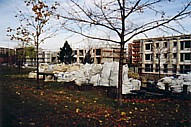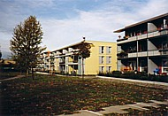

**_Foto:_** _Die Gorbitzer Kräutersiedlung während und nach dem Umbau (2003)_

Schulen in Gorbitz:

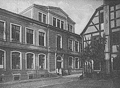Die Kinder aus Ober- und Niedergorbitz besuchten bis 1634 die Schule in Briesnitz. 1685 ist für Niedergorbitz
ein “Kinderlehrer” erwähnt, der seinen Unterricht in angemieteten Räumen im Ort durchführte. Frühe Schulräume befanden sich in Wohnhäusern an der Uthmannstraße und am Beerenhut Nr. 18.
Das erste reguläre Gorbitzer Schulhaus wurde 1827 in Niedergorbitz errichtet. Nachdem dieses nicht mehr den Anforderungen genügte, erfolgte 1860 ein
Neubau. Auch die Kinder aus Obergorbitz besuchten zunächst diese Schule. 1890/91 entstand dann das bis heute erhaltene neue Schulhaus an der Leßkestraße 1 _(Foto)_, in dem bis zu seinem Tod 1904 der Heimatforscher
Friedrich August Leßke als Direktor wirkte. Später wurde dieses Gebäude als Grundschule und Schulhort der 74. POS genutzt.

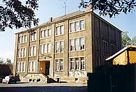1900 richtet man auch in Obergorbitz eine eigene Schule ein, wodurch sich der Schulweg der Kinder deutlich verkürzte. Das Gebäude an der Uthmannstraße 28 _(Foto)_
entstand ursprünglich für die Diakonen-Bildungsanstalt und erhielt sein späteres Aussehen bei einem Umbau 1928. Diese Schule trug zu DDR-Zeiten den Namen 74. POS “Kurt Aschenbach” (später 74. Mittelschule)
und wurde im Sommer 2003 geschlossen.

Weitere moderne Schulbauten vom Typ “Dresden” entstanden ab 1979 im Zusammenhang mit dem Neubaugebiet Gorbitz. Wegen stark rückläufiger
Schülerzahlen wurden einige dieser Schulen in den letzten Jahren wieder geschlossen bzw. von freien Schulträgern übernommen. Das 2005 geschlossene Schulhaus “Am Gorbitzbach” (bis 1990 123. POS “Ernst Kießlich”) wurde
2012 nach Plänen des Architekten Roland Gelke zu einer Wohnanlage umgestaltet. Einige 1984 vor dem Schulhaus
aufgestellte Plastiken des Bildhauers Peter Makolies sind seit 2013 in einer kleinen Parkanlage in Gorbitz aufgestellt.

Heimatstube Gorbitz:

Die Gorbitzer Heimatstube wurde 1986 vom früheren Lehrer Wolfgang Funk in den Räumen der 132. Polytechnischen
Oberschule gegründet. In Erinnerung an den bedeutenden Heimatforscher Friedrich August Leßke erhielt sie später seinen Namen verliehen. Das kleine Museum hat seit 1994 sein Domizil im Erdgeschoss der 135. Grundschule am
Amalie-Dietrich-Platz und ist auf Anmeldung zu besichtigen. Zu den Exponaten gehören neben alten Handwerks- und
landwirtschaftlichen Geräten Exponate und Dokumente zur Gorbitzer Geschichte, Einrichtungsgegenstände der alten Dorfschule sowie ein Modell des Neubaugebietes aus dem Stadtplanungsamt.

Erlebnisbad “Elbamare”:

Obwohl mit dem Bau eines Hallenbades bereits 1988 begonnen worden war, konnte das “Elbamare” erst am 21.
März 1995 eröffnet werden. Die ursprünglichen Planungen sahen zunächst nur eine einfache Schwimmhalle mit Sport- und Lehrschwimmbecken sowie einer Sauna für 20 Personen vor. Nach der Wende überarbeitete man diese Pläne.
Durch die veränderte Planung entstand am Merianplatz das erste Erlebnisbad Sachsens. Das Bad verfügt über insgesamt 610 m² Wasserfläche, darunter auch ein Freiluftbecken, eine 80 Meter lange Wasserrutsche, einen
Whirlpool, Solarium und Saunalandschaft sowie einen Restaurantbereich und Getränkebar. Betreiber ist die private Aquapark Management GmbH.

[_Weiterführende Literatur und Quellen_](../../impressum/quellenverzeichnis/)

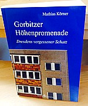**Matthias Körner: “Gorbitzer Höhenpromenade – Dresdens vergessener Schatz”**

Das Buch gibt am Beispiel der Großwohnsiedlung Dresden-Gorbitz Aufschluss zur Entstehung des Plattenbaus, des Wohnungsbauprogramms
der DDR und über die großen Plattenbaugebiete des Landes. Das umfangreiche Werk ist mehr als nur eine regionale Chronik, sondern zugleich
Neuentdeckung eines unterschätzten Dresdner Stadtteils und eine Würdigung der architektonischen und stadtplanerischen Leistungen. Mathias Körner
beleuchtet ein bisher wenig beachtetes Gebiet der deutschen Architektur- und Kunstgeschichte. Der Leser wird in die Zeit des komplexen Wohnungsbaus der 1970er und 1980er
Jahre zurückversetzt und findet auf über 450 Seiten auch teilweise unveröffentlichte Bildern und Grafiken. Erhältlich ist das Buch in den Buchhandlungen des “SachsenForum” und bei
“Dresden-Buch” im QF an der Frauenkirche. Bestellungen sind über amazon möglich.

**"Gorbitzer Höhenpromenade-Dresdens vergessener Schatz", ISBN: 978-3-86468-906-2, Verlag: winterwork)**

**+++**

 \[ [Home](../../index.html)\] \[ [Nord](../../nord/)\] \[ [Nordwest](../../nordwest/)\] \[ [Neustadt](../../neustadt/)\] \[ [Nordost](../../nordost/)\] \[ [West](../../west/)\] \[ [Zentrum](../../zentrum/)\] \[ [Südwest](../../sudwest/)\] \[ [Süd](../../sud/)\]
 \[ [Südost](../../sudost/)\] \[ [Ost](../../ost/)\] \[ [Register](../../Register/register.html)\] \[ [Kontakt](../../Kontakt/kontakt.html)\] \[ [Impressum](../../impressum/)\]
