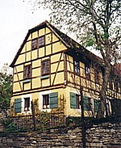

* * *

* * *

* * *

* * *

* * *

* * *

Die Gorbitzer Röhrfahrt entstand 1584 im Auftrag von Kurfürst August und sollte die
Wasserversorgung des Dresdner Residenzschlosses sichern. Dafür wurde zwischen Gorbitz und dem Stadtzentrum eine hölzerne Wasserleitung verlegt und im Ort ein Brunnen angelegt.
Die Wartung der Anlage übernahm ein in Niedergorbitz ansässiger Röhrmeister. Die Röhrfahrt versorgte u. a. die Hofküche, das Hofbackhaus, Wäscherei und Badestube mit frischem
Wasser und war bis ins 19. Jahrhundert in Betrieb. Aus einem im 18. Jahrhundert geschaffenen Reservoir in der Nähe des Postplatzes wurde zeitweise auch die Brunnenanlage des Nymphenbades im Zwinger gespeist.

* * *

**_Die Sage vom Röhrmeister zu Gorbitz_**

_Auf dem Taschenberge zu Dresden wohnte im Schlosse der Kurfürst. Damit zum Waschen, Kochen und Baden immer genügend Wasser vorhanden war, ließ er eine Wasserleitung aus Holzröhren_
_vom Dorfe Gorbitz nach Dresden bauen. Die Aufsicht über den Brunnen und die Röhrfahrt hatte der Röhrmeister. Dieser besaß eine Tochter, die nicht nur schön, sondern auch klug war. Beim_
_Röhrmeister arbeitete ein Zimmermannsgeselle, der sich in dieses Mädchen verliebt hatte. Aber der Röhrmeister wollte sie ihm nicht zur Frau geben. Da verließ der Geselle traurig das Dorf und_
_lief hinauf zur Kesselsdorfer Höhe, wo er sich unter einem Baum niederlegte und einschlief. Im Traum erschien ihm ein Frosch, der ihm die Worte zuquakte “Kehr zurück, es ist Dein Glück”._

_Als der Geselle erwachte, besann er sich nicht lange und lief wieder ins Dorf zurück. Dort war große Aufregung, denn der Kurfürst hate sich beklagt, dass seine Wasserleitung versiegt sei. Der_
_Röhrmeister jammerte “Ach wenn nur einer käme, der helfen könne”, denn er befürchtete eine harte Strafe, wenn er seiner Pflicht nicht nachkommen würde. Der Geselle erinnerte sich an seinen_
_Traum, eilte zum Brunnen und holte einen großen Frosch aus der Röhre. Sofort begann das Wasser wieder zu fließen. Als Dank für seine Tat erlaubte der Röhrmeister nun endlich die Hochzeit seiner_
_Tochter mit dem jungen Mann._

_\\*\\*\\*_

* * *

 \[ [Home](../../../index.html)\] \[ [Nord](../../../nord/)\] \[ [Nordwest](../../../nordwest/)\] \[ [Neustadt](../../../neustadt/)\] \[ [Nordost](../../../nordost/)\] \[ [West](../../../west/)\] \[ [Zentrum](../../../zentrum/)\] \[ [Südwest](../../../sudwest/)\] \[ [Süd](../../../sud/)\] \[ [Südost](../../../sudost/)\] \[ [Ost](../../../ost/)\] \[ [Register](../../../Register/register.html)\] \[ [Kontakt](../../../Kontakt/kontakt.html)\] \[ [Impressum](../../../impressum/)\]
