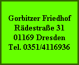
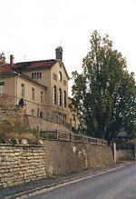
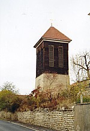
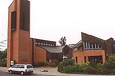
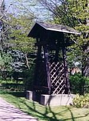

* * *

* * *

* * *

* * *

* * *

* * *

* * *

Diakonenbildungsanstalt (Kapelle Gorbitz):

Die kirchliche Bildungseinrichtung wurde am 1. Mai 1872 vom Diakonieverein der evangelischen Landeskirche auf der Uthmannstraße 26 in Obergorbitz gegründet. Ziel der
Einrichtung war die Ausbildung junger Männer für die Diakonie und die Innere Mission. Außerdem bestand ein Erziehungshaus für “entartete und gefährdete Kinder”, die hier eine
Schulbildung erhielten. Erster Leiter der Anstalt war der Pfarrer Emil Christian Fürchtegott Höhne (1843-1925), der zuvor bereits in den Anstalten Horn bei Hamburg tätig gewesen
war. Für die Bildungsanstalt wurde aus Spendenmitteln zwischen 1876 und 1880 ein ausgedehnter Gebäudekomplex errichtet, zu dem neben Schule, Kapelle und
Mädchenwohnheim auch eine Gärtnerei und zwei Wohngebäude gehörten. Diese dienten als Unterkunft der Knaben und Männer und wurden als “Bienenkorb” und “Schweizerhaus”
bezeichnet. 1893 konnte noch ein Bauerngut in Oberpesterwitz erworben werden. Unter Aufsicht der angehenden Diakonen widmeten sich die hier untergebrachten Jugendlichen dem
Obst- und Gartenbau. Der Verkauf der Erzeugnisse diente zur Finanzierung der Anstalt

Das Hauptgebäude entstand 1878/79 auf dem Grundstück Uthmannstraße 26. Im Erdgeschoss befanden sich die
Unterrichtsräume, im Obergeschoss eine Kapelle, die auch von den Bewohnern der Orte Ober- und Niedergorbitz für
ihre Gottesdienste genutzt werden konnte. Ost- und Westflügel beherbergten die Wohnräume des Anstaltsleiters Höhne
und seiner Mitarbeiter. Am 1. Advent 1879 konnte die Kapelle vom Briesnitzer Pfarrer Zehme feierlich geweiht werden.

1899 wurde die Gorbitzer Diakonenbildungsanstalt aus Platzgründen geschlossen und nach
Moritzburg verlegt, wo die Einrichtung bis heute besteht. Die Gebäude an der Uthmannstraße erwarb die Gemeinde Obergorbitz und nutzte sie ab 1900 als Schule. Die frühere Kapelle
übernahm die 1913 selbstständig gewordene Gorbitzer Kirchgemeinde als Gotteshaus. Bereits 1907 war auf dem Grundstück ein hölzerner Glockenturm _(Foto)_ aufgestellt worden,
in dem bis heute drei Gussstahlglocken läuten. Die Glockenweihe erfolgte am 1. Dezember 1907.

1925-1928 erfolgten einige Veränderungen am Gebäudekomplex. Während eines der
Gebäude bis 2003 Domizil der 74. Mittelschule war, blieb die Kapelle als Gotteshaus erhalten. Zur Ausstattung gehören mehrere vom Kunstmaler Karl Schulz gestaltete
Glasfenster, die u. a. ein Hirtenmotiv zeigen und die Namen von 194 Gefallenen des Ersten Weltkrieges tragen. Angefertigt wurden diese in der Wölfnitzer Kunstglaserei Horst Heymann. Die Orgel stammt von der
Firma Jehmlich und kam 1914 in die Kirche. Sie besitzt elf Register, zwei Manuale und 762 Orgelpfeifen. 1956 wurde
sie restauriert und um zwei Register erweitert. Bis 2010 fanden in der Kapelle regelmäßig Gottesdienste statt, zuletzt im
Wechsel mit dem modernen Gemeindezentrum am Leutewitzer Ring. Künftig wird die Koreanische Evangelische Gemeinde die Kapelle nutzen. An den Anstaltsgründer und den Beginn der Diakonenausbildung in Sachsen erinnert seit
2002 eine Gedenktafel.

Gemeindezentrum St. Philippus:

Das neue evangelische Gorbitzer Gemeindezentrum entstand im Zusammenhang mit dem Bau des Neubaugebietes am Leutewitzer Ring und wurde am 31.  Mai
1992 durch Landesbischof Johannes Hempel geweiht. Vorausgegangen waren jahrelange Diskussionen zwischen Kirchenvertretern und der DDR-Führung, die einen Kirchenbau im Neubauviertel zunächst ablehnte. Trotzdem hatte sich
bereits 1982 eine Gemeinde gebildet, die zunächst Räume benachbarter Kirchen nutzte. Nachdem ein Grundstück am Leutewitzer Ring durch Tausch in den
Besitz der Kirche gekommen war, stellten Gorbitzer Christen am Johannestag 1989 dort einen Bauwagen auf, um so ihren Anspruch auf ein eigenes Haus  zu
untermauern. Am 28. September 1990 konnte schließlich der Grundstein für das Gemeindezentrum gelegt werden.

Die Pläne für den modernen Kirchenbau stammen vom Architekten Ulf Zimmermann. Zum Gebäude gehören neben
einem 22 Meter hohen Glockenturm ein Kirchsaal mit 120 Plätzen und verschiedene Veranstaltungsräume für die Klub-
und Jugendarbeit mit einer Bibliothek und einem Café. Die farbigen Fenster des Kirchsaals stammen von Getraude und
Jürgen Seidel, die Truhenorgel von der niederländischen Firma Klop. 2001 vereinigte sich die St. Philippus-Gemeinde mit der Kirchgemeinde Altgorbitz.

Gorbitzer Friedhof:

Der Gorbitzer Friedhof wurde
im Jahr 1905 an der Rädestraße angelegt. Die erste Beisetzung erfolgte am 5. November 1905. Dieses Grab des Gorbitzer Gutsbesitzers
Heinrich August Wirthgen blieb bis heute hinter der Kapelle erhalten.  Zuvor mussten die Toten nach Briesnitz gebracht werden, weshalb die heutige Gorbitzer Straße früher auch als
Oberer Leichenweg bezeichnet wurde. In gleichen Jahr entstanden auch die Friedhofskapelle sowie das Wohnhaus für den Friedhofsverwalter. Am 20. September 1987 erfolgte die
Weihe der Glocken für den kleinen Glockenturm neben der Feierhalle _(Foto)_.

Auf dem Friedhof befinden sich die Gräber zahlreicher alteingesessener Bauernfamilien aus
Gorbitz und den benachbarten Stadtteilen Gompitz und Pennrich. Geteilt wird der nur ca. 1 Hektar große Friedhof durch eine Reihe von Familiengrüften, die ab 1915 belegt wurden.
1952 entstand eine kleine Gedenkstätte für einige in den letzten Kriegstagen gefallene Soldaten des Zweiten Weltkrieges, die zunächst anonym in Gräbern auf Gompitzer und Pennricher Flur beerdigt worden waren.

* * *

 \[ [Home](../../../index.html)\] \[ [Nord](../../../nord/)\] \[ [Nordwest](../../../nordwest/)\] \[ [Neustadt](../../../neustadt/)\] \[ [Nordost](../../../nordost/)\] \[ [West](../../../west/)\] \[ [Zentrum](../../../zentrum/)\] \[ [Südwest](../../../sudwest/)\] \[ [Süd](../../../sud/)\] \[ [Südost](../../../sudost/)\] \[ [Ost](../../../ost/)\] \[ [Register](../../../Register/register.html)\] \[ [Kontakt](../../../Kontakt/kontakt.html)\] \[ [Impressum](../../../impressum/)\]
