## Altgorbitz

Seit 1921 wird der frühere Dorfplatz der Gemeinde Niedergorbitz als Altgorbitz bezeichnet. Um den Platz befinden sich einige
ehemalige Tagelöhnerwohnhäuser, wie sie für diesen Ort typisch waren. Erst 1895 wurde das letzte strohgedeckte Gebäude
abgerissen. Größere Bauerngüter befanden sich nur in Obergorbitz an der Uthmannstraße. 1914 gründete der damalige
Fechtverein in Altgorbitz die heute als Kindertagesstätte “Wirbelwind” bezeichnete Einrichtung. Seit 2002 wird sie vom Verein “Biotop Kümmelschänke e.V.” aus dem benachbarten Omsewitz betrieben.

## Amalie-Dietrich-Platz

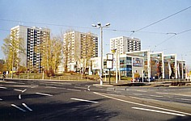Der Amalie-Dietrich-Platz wurde im Zusammenhang mit dem Bau des ersten Gorbitzer Wohnkomplexes angelegt und 1979 Platz der Bauarbeiter genannt. Seit 1993 trägt er den Namen der bedeutenden Naturforscherin Amalie Dietrich (1821-1891), die als Botanikerin und Forschungsreisende über 10 Jahre in Australien lebte und als eine der ersten Frauen auf diesem Gebiet internationalen Ruf erwerben konnte. Neben drei Wohnhochhäusern entstanden hier nach 1990 die beiden Einkaufszentren “Gorbitz-Hof” und “Kess-Zentrum”. 2010 folgte an der Mittelachse der “Kräutergarten der Bauarbeiter”, mit welchem an die Geschichte des Neubaugebietes erinnert werden soll.

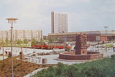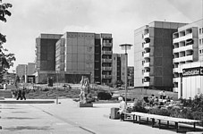

**_Fotos:_** _Der Platz der Bauarbeiter vor 1989_

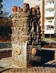Plastiken und Brunnenanlagen: In der Nähe der Straßenbahnhaltestelle befindet sich der originelle Brunnen “Nasses Haus” der Dresdner Künstlerin Heidemarie Dreßel. Das Wasser fällt auf ein Hausdach und bahnt sich dann seinen Weg durch die “Etagen” bis ins Brunnenbecken. Die aus gebrannter Keramik bestehende Anlage entstand bereits 1984, wurde jedoch erst 1993 vor der 135. Grundschule aufgestellt. In unmittelbarer Nachbarschaft steht der Gorbitzer Märchenbrunnen _(Foto)_. Schöpfer dieser Keramikplastik, welche verschiedene Tiere und Märchenfiguren zeigt, war Karl Schönherr. Nach dessen Tod 1987 wurde der Brunnen von Dieter Graupner und Egmar Ponndorf vollendet und später am Amalie-Dietrich-Platz aufgestellt. Eine weitere Großplastik “Bauarbeiter”, welche Bezug auf den früheren Namen des Platzes, stammt vom Bildhauer Miroslav Klimes und wurde 1986 übergeben. Nach 1990 wurde sie entfernt und war viele Jahre im Lapidarium der Stadt eingelagert, soll jedoch wieder aufgestellt werden.

## Am Altfrankener Park

Die Straße, ursprünglich Wilhelmstraße genannt, erhielt 1926 den Namen Am Lucknerpark. Der ursprüngliche Namensgeber,
wahrscheinlich eine Privatperson, ist unbekannt. Im Zusammenhang mit der Eingemeindung von Gorbitz erfolgte die Umbenennung nach dem angrenzenden Schloßpark des [Luckner-Schlosses](../../../sudwest/altfranken/schloss_altfranken/) in Altfranken. In den 1930er Jahren wurden hier
einige Siedlungshäuser errichtet. Seit 1950 heißt diese Straße Am Altfrankener Park.

## Am Brunnen

Die ehemalige Niedergorbitzer Talstraße wurde 1921 in Am Brunnen umbenannt. Der Name erinnert an die 1584 zur Wasserversorgung des Dresdner Schlosses angelegte [Gorbitzer Röhrfahrt](../../../sudwest/gorbitz/gorbitzer_rohrfahrt/).

## Am Ziegenberg

Die ehemalige Quergasse wurde nach der Eingemeindung am 21. Oktober 1921 nach einem Flurnamen in Am Ziegenberg
umbenannt. In diesem Teil von Niedergorbitz wurden beim Luftangriff auf Dresden 1945 einige Wohngebäude zerstört.

## Birkenstraße

Die im Zuge des zweiten Bauabschnitts des Neubaugebietes Gorbitz angelegte Birkenstraße erhielt am 18. Mai 1983 ihren
Namen. Ebenso wie die benachbarte Hainbuchen-  und die Kirschenstraße wurde auch diese nach einer Baumart benannt, weshalb das Wohnviertel umgangssprachlich auch als „Baumviertel“ bekannt ist.

## Braugässchen

Das Braugässchen erhielt seinen Namen nach der früheren Gorbitzer Brauerei, die zum Kammergut gehörte. Bis 1921 war für
diesen Weg der Name Brauereistraße gebräuchlich. Die Brauerei wurde 1648 gegründet und befand sich auf dem Eckgrundstück zur Uthmannstraße. Wegen des guten Quellwassers genoß das hier gebraute Bier einen hervorragenden Ruf
und wurde gern von den Dresdnern getrunken - sogar bei Hofe. Die Pächter besaßen seit dem 18. Jahrhundert weitgehende Rechte und waren zeitweise von verschiedenen Steuern befreit. Zur Kühlung der Bierfässer wurde das Wasser des
Gorbitzbaches genutzt, welches im Winter angestaut und in Eisblöcken in Gewölbekellern an der Uthmannstraße gelagert
wurde. Nach dem Ersten Weltkrieg wurde der Braubetrieb eingestellt und das Areal als Fabrik zur Herstellung von Essenzen und Aromen genutzt. 1980 entstand nach Abbruch der Gebäude an gleicher Stelle ein Verwaltungsgebäude der
Eisenbahner-Wohnungsbaugenossenschaft.

## Coventrystraße

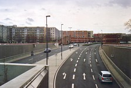
Die Coventrystraße wurde 1979 angelegt und trug zunächst den Namen Hermann- Matern-Straße. Hermann Matern (1893-1971) war nach 1945 als Funktionär der KPD und der SED in Dresden tätig und wurde 1946 zum Ehrenbürger ernannt.
Zeitweise war er stellvertretender Vorsitzender der Volkskammer der DDR.

Am 25. Februar 1993 erfolgte die Umbenennung der Straße nach der Dresdner
Partnerstadt Coventry. Zur Verkehrsentlastung der angrenzenden Wohngebiete entstand 1999-2002 der 660 Meter lange Bramschtunnel, der die Coventrystraße mit
der Fröbelstraße und von dort mit der Innenstadt verbindet (Einweihung am 30. November 2002). Heute ist die vierspurig ausgebaute Straße auch als Autobahnzubringer zur A 17 von Bedeutung.

Straßenbahnhof Gorbitz: Oberhalb des Neubaugebietes entstand zwischen 1993 und 1996 Dresdens größter und modernster
Straßenbahnhof. Die Grundsteinlegung erfolgte am 8. Dezember 1993, die Eröffnung am 18. Mai 1996. Hier befinden sich
heute die zentrale Betriebswerkstatt der DVB sowie Abstellhallen für bis zu 120 Stadtbahnwagen. Die Gleislänge beträgt insgesamt ca. 11 km. Der Betriebshof war wegen der Umstellung des Fuhrparks auf die längeren Stadtwahnwagenzüge
notwendig geworden und ersetzt zugleich mehrere kleinere Straßenbahnhöfe.

## Dahlienweg

Der Dahlienweg entstand im Zusammenhang mit dem ersten Bauabschnitt des Neubauviertes Gorbitz und wurde am 15. März
1979 benannt. Wie auch bei den benachbarten Straßen Asternweg und Sonnenblumenweg erfolgte die Namensgebung nach einer Zierpflanzenart.

## Ebereschenstraße

Die Ebereschenstraße wurde Anfang der 1980er Jahre im Zuge des zweiten Bauabschnittes des Neubaugebietes Gorbitz
angelegt und am 18. Mai 1983 offiziell benannt. Mit der Benennung nach einer Baumart knüpfte man an eine entsprechende
Tradition in diesem Stadtteil an. Die zuletzt zur Eisenbahner-Wohnungsbaugenossenschaft (EWG) gehörenden Plattenbauten
an dieser Straße wurden 2005 abgerissen. An ihrer Stelle befindet sich heute der sogenannte “Stadtblickpark” mit einem
kleinen Teich und verschiedenen Sport- und Spielanlagen. Von einer künstlich geschaffenen Erhebung bietet sich ein schöner Blick ins Elbtal.

## Espenstraße

Die Espenstraße entstand im Zusammenhang mit dem Bau des zweiten Bauabschnitts des Neubaugebietes Gorbitz und wurde
am 18. Mai 1983 benannt. Die Namensgebung erfolgte wie auch bei den benachbarten Straßen des “Baumviertels” nach einer
Laubbaumart. 1984 entstand ein Schulgebäude (Espenstraße 5), welches bis 1990 von der 137. Polytechnischen Oberschule
„Felix Edmundowitsch Dzierzynski“ genutzt wurde. Später befand sich hier die 137. Mittelschule. Seit deren Auflösung nutzen heute die Freie Laborschule Dresden des “Omse e.V.” und die Freie Fachschule für Sozialwesen die Räume.

## Fliederberg

Die Straße trug bis zur Eingemeindung den Namen Bergstraße und wurde am 21. Oktober 1921 in Fliederberg umbenannt.
Zu den historischen Gebäuden gehört das um 1755 errichtete Fachwerkhaus Nr. 2 an der Ecke zum Kuntzschberg. Seit Ende
des 19. Jahrhunderts bestand hier die beliebte Gorbitzer Apfel- und Beerenweinschänke, die wegen ihres billigen Obstweines
ein beliebtes Ziel für Sommergäste war. Der frühere Besitzer Bruno Schramm ließ das Haus um 1880 mit Weinranken bemalen, um so auf sein Lokal hinzuweisen. Neben der Gaststube mit ca. 40 Plätzen gab es auch einen Gästegarten. Zu den
Besuchern gehörten u.a. Felix von Luckner und der Niedergorbitzer Schuldirektor und Heimatforscher Friedrich August Leßke. Um 1950 schloß die Gaststätte seine Pforten. Heute wird das Gebäude nur noch für Wohnzwecke genutzt. Ein
weiteres Lokal gab es mit “Hoffmanns Restaurant” einst im Haus Fliederberg 18.

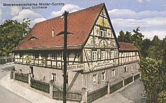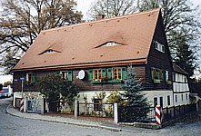

**_Fotos:_** _die ehemalige Gorbitzer Beerenweinschänke am Fliederberg um 1910 und heute_

## Forsythienstraße

Die Forsythienstraße entstand zur Erschließung des dritten Gorbitzer Bauabschnitts südlich der Coventrystraße und wurde am
29\. August 1986 nach der Zierpflanzenart Forsythie benannt. Da sich hier mehrere nach Sträuchern und Krätern benannte
Straßen befinden, wird das Wohngebiet im Volksmund “Kräutersiedlung” genannt. Im Zuge der Stadtsanierung nach 1990 erfolgten umfassende Umbauten an den bestehenden Plattenbauten. Diese wurden dabei um mehrere Geschosse reduziert,
teilweise abgetragen und mit Balkons, Terrassen und Mietergärten ergänzt.

## Georginenweg

Der Georginenweg entstand Anfang der 1930er Jahre bei der Anlage eines kleinen Wohngebietes südlich der Kesselsdorfer Straße. In Erinnerung an die einstigen deutschen Gebiete Eupen und Malmedy, welche nach dem Versailler Vertrag 1920 an Belgien abgetreten werden mussten, erhielten die neu angelegten Straßen 1933 die Namen Eupener Straße und Malmedystraße. Am 15. März 1967 wurden beide umbenannt. Die frühere Malmedystraße trägt seitdem nach einer zur Familie der Dahlien gehörenden Pflanzenart den Namen Georginenweg.

## Geyersgraben

Die frühere Straße Am Graben wurde ab 1921 Geyersgraben genannt. Die hier befindlichen Wohnhäuser gehören zum ehemaligen Niedergorbitzer Grabenviertel, welches seit dem 18. Jahrhundert nach seiner Lage diesen Namen trug. Das Wohnhaus Geyersgraben Nr. 15 steht als Baudenkmal unter Schutz.

## Hainbuchenstraße

Die Hainbuchenstraße entstand beim Bau des zweiten Bauabschnitts im Neubaugebiet Gorbitz und wurde am 18. Mai 1983 benannt. Mehrere Straßen dieses Viertels erhielten ihre Namen nach Baumarten, hier nach der Hainbuche.

## Harry-Dember-Straße

Die Straße wurde am 29. August 1986 nach einem Physiker und Hochschullehrer Harry-Dember-Straße benannt. Harry Dember (1882–1943) war zwischen 1909 und 1933 Professor an der Technischen Hochschule in Dresden und entwickelte u. a. die Grundlagen der Transistortechnik. Wegen seiner jüdischen Herkunft wurde er von den Nazis aus seinem Amt vertrieben und emigrierte in die USA.

Zur Verbesserung der Einkaufsbedingungen besonders im vierten Gorbitzer Wohnkomplex entstand 1992/93 an der Harry-Dember-Straße das Gorbitz-Center als erstes großes Einkaufszentrum des Stadtteils. Neben zahlreichen Geschäften und Praxen entwickelte sich das Gorbitz-Center in den Folgejahren auch zu einem beliebten Veranstaltungsort für verschiedene Stadtteilfeste.

## Heimkehr

Die Straße Heimkehr befindet sich am Rande des alten Niedergorbitzer Dorfkerns und führt von der Neunimptscher Straße rechtwinklig zum Fliederberg. Erstmals ist sie im Adressbuch von 1920 erwähnt, als hier die ersten Wohnhäuser entstanden.

## Helbigsdorfer Weg

Im Zusammenhang mit dem zweiten Bauabschnitt des Neubaugebietes entstand 1979 der Helbigsdorfer Weg, gelegen in einem vom Leutewitzer Ring umschlossenen Plattenbauviertel. Die amtliche Benennung erfolgte am 15. März 1979 nach dem kleinen Ort Helbigsdorf in der Nähe von Wilsdruff.

## Herzogswalder Straße

Zeitgleich mit weiteren Straßen erhielt auch die Herzogswalder Straße am 15. März 1979 ihren Namen nach einem Ort der Wilsdruffer Gegend. Herzogswalde liegt am Fuße des Landberges und gehört heute als Ortsteil zu Wilsdruff.

## Hetzdorfer Straße

Auch die Hetzdorfer Straße verdankt ihren Namen einem Dorf in der Nähe von Dresden. Hetzdorf liegt am Rande des Tharandter Waldes und ist heute vor allem durch seine Kurklinik von Bedeutung. Die Straße wurde am 15. März 1979 benannt und befindet sich im zweiten Bauabschnitt innerhalb des Leutewitzer Rings. Am 7. November 1983 eröffnete hier eine von mehreren Gorbitzer Kindertagesstätten als Kombination von Kindergarten und -krippe (Nr. 2/4).

## Hilbertstraße

Die Hilbertstraße verdankt ihren Namen dem früheren Gemeindeältesten von Niedergorbitz Carl Hilbert (1848-1923). Hilbert war ab 1887 Vorsteher des Haus- und Grundbesitzervereins und viele Jahre Mitglied des Gemeindevorstands. 1912 erfolgte ihm zu Ehren die Benennung dieser Straße, die zunächst nur zwischen Hofwiesen- und Uthmannstraße verlief. Ende der 1920er Jahre wurde sie bis zur Kesselsdorfer Straße verlängert.

## Hirtenstraße

Die heutige Hirtenstraße trug bis 1926 den Namen Pietzschstraße nach dem Gutsbesitzer und Gemeinderat Julius Pietzsch. Der Name Hirtenstraße erinnert an die ehemalige Viehtreibe des Kammergutes in diesem Bereich. In den 1930er Jahren entstand hier eine Siedlung mit Einfamilienhäusern.

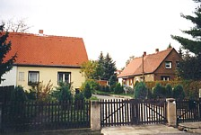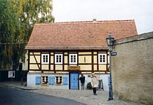

**_Fotos:_** _Siedlung Hirtenstraße (links) - “Hexenhaus” an der Hofwiesenstraße (rechts)_

## Hofwiesenstraße

Ursprünglich trug diese Straße in Niedergorbitz den Namen Dammweg, der auf das ehemalige “Dammviertel” des Ortes hinwies. Am 21. Oktober 1921 wurde der Dammweg in Hofwiesenstraße umbenannt, da hier einst die Wiesen des in kurfürstlichem Besitz befindlichen Kammergutes lagen. Zu den romantischsten Gebäuden im alten Gorbitz zählt das nach 1990 liebevoll sanierte “Hexenhaus” auf der Hofwiesenstraße 28, welches heute als historisches Gasthaus dient. Erbaut wurde dieses Fachwerkhaus im Jahr 1802.

## Höhenpromenade

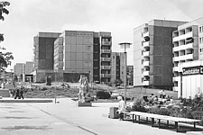Die Höhenpromenade wurde im Zusammenhang mit dem Gorbitzer Neubaugebiet angelegt und bildet die zentrale Achse des Stadtteils. Ihren Namen erhielt sie am 15. März 1979. Neben der Straßenbahntrasse sollte dieser Bereich als Fußgängerzone gestaltet werden. Geplant war der Bau individuell gestalteter Pavillons mit Geschäften, Gaststätten und Büros. Obwohl man 1984 mit der Realisierung begann, mussten die Arbeiten auf Weisung der DDR-Staatsführung eingestellt werden, da die benötigten Baumaterialien in Berlin benötigt wurden. Erst 1988 konnte die stark vereinfachte Höhenpromenade übergeben werden. Das Straßenbild prägen sechsgeschossige Punkthäuser, die ebenso wie die ursprünglich vier Pavillons mit individuell gestalteten farbigen Keramiktafeln verziert sind. Zwischen 2012 und 2015 erfolgte eine Neugestaltung der Höhenpromenade mit geschwungenen Wegen, Ruheplätzen und Bepflanzungen. 2012 wurde aus Anlass des 30. Geburtstages des Neubauviertels die Plastik “Blumenwesen” des Bildhauers Dietmar Gubsch eingeweiht.

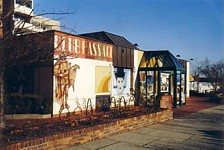Im Zuge der Gestaltung der Höhenpromenade errichtete man hier zwischen 1986 und 1989 vier einstöckige Pavillonbauten, die als Domizil für öffentlich-kulturelle Einrichtungen vorgesehen waren. Heute sind von diesen noch drei erhalten. Der erste Pavillon beherbergt den Club Passage. Am 15. April 1986 als Jugendclub eröffnet, fanden hier u.a. Tanzveranstaltungen, Lesungen und Kinovorführungen statt. An der Fassade befindet sich das aus Glasmosaiksteinen gestaltete Wandbild “Fuchs und Trauben” von Gerhard Bondzin. Das Motiv erinnert an die von Gottfried Keller verfasste Fabel “Der Fuchs und die Trauben”. Der nach 1990 sanierte Pavillon wird bis heute für verschiedene Kulturveranstaltungen und seit 2005 als Außenstelle der Jugendkunstschule genutzt _(Foto)_.

Auch die Fassade des zweiten Pavillons ist mit Keramikelementen verziert, die in einem speziellen Brandverfahren im Steinzeugwerk Crinitz entstanden. Das "Große Farbspiel" wurde 1987 angebracht und 2010 mit Spendengeldern saniert. Im Pavillon ist heute eine Zweigstelle des Sächsischen Umschulungs- und Fortbildungswerkes (SUFW) untergebracht. Im dritten Pavillon entstand mit dem "Gorbitzer Krug" eine gastronomische Einrichtung für die Bewohner des Neubaugebietes. Das abstrakte Fassadenbild mit dem Titel "Landschaften" wurde von Dieter Graupner geschaffen und zeigt verschiedene Landschaftsformen mit Bäumen, Tälern, Feldern und Flüssen. Erst 1990 konnte dieses Kunstwerk übergeben werden, wurde später verkleidet und im Mai 2010 wieder freigelegt. Nicht mehr vorhanden ist der vierte Pavillon. Nach mehrjährigen Leerstand und Vandalismus wurde das Gebäude 2010 abgerissen. Dabei ging auch das von Dietmar Gubsch geschaffene Kunstwerk "Wasserwelt" verloren.

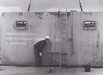Gaststätte “Zum Grünen Heinrich”: Am 21. August 1981 wurde mit der Montage der ersten Großplatte für die künftige Wohngebietsgaststätte der Grundstein für den Aufbau des Neubaugebietes Gorbitz gelegt _(Foto)_. Zunächst diente das Gebäude als Stützpunkt für die Bauarbeiterversorgung und die Essenslieferungen an Kindergärten und Schulen. Erst am 7. Oktober 1983 konnte hier eine öffentliche Gaststätte eröffnet werden und war lange Zeit einer der wenigen Treffpunkte der Gorbitzer Bevölkerung. Der Name erinnert an eine Romanfigur von Gottfried Keller. Im Foyer gab es früher ein Wandbild von Helge Leiberg, welches eine Szene aus diesem Roman darstellte, heute jedoch hinter einer Wandverkleidung versteckt ist. Ein Keramikmosaik an der Außenfassade stammt von Veit Hofmann. Im Keller des Hauses entstand eine Tanzbar mit Kegelbahn. Nach 1990 schloss das Lokal und wurde zeitweise von verschiedenen Läden bzw. als Asia-Imbiss genutzt. Die Bowling-Bahn im Kellergeschoss blieb in Betrieb. An der Fassade erinnert eine Tafel an die Grundsteinlegung des Wohngebietes Gorbitz. 2021 wurde das Gebäude abgerissen und soll künftig durch einen modernen Neubau ersetzt werden.

[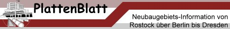](http://www.plattenblatt.wg.am)

## Julius-Vahlteich-Straße

Die Julius-Vahlteich-Straße wurde 1979 nach einem Dresdner Arbeiterfunktionär benannt. Vahlteich (1839-1915) war
Mitbegründer der SPD und ab 1867 Vorsitzender des Dresdner Arbeiterbildungsvereins. Östlich der Straße begann 1981der Aufbau des ersten Bauabschnittes des Neubaugebietes Gorbitz. Die Flächen zwischen Julius-Vahlteich-Straße und
Merianplatz wurden 1982/83 mit dem zweiten Baubschnitt bebaut.

## [Kesselsdorfer Straße](../../../sudwest/lobtau/strassen_lobtau/kesselsdorfer_strasse/)

## Leßkestraße

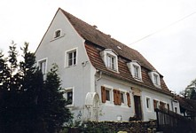Die frühere Schulstraße verdankt ihren Namen dem Heimatforscher und Lehrer
Friedrich August Leßke, der bis zu seinem Tod 1904 Direktor der Niedergorbitzer Schule war. Das Schulhaus Leßkestraße 1 entstand 1890 an Stelle eines abgerissenen
Vorgängerbaus. Hier erinnert eine Gedenktafel an Leßke. Auch das Gebäude Leßkestraße 10, erbaut um 1800 als typisches Tagelöhnerwohnhaus, gehört zu den
Sachzeugen der Niedergorbitzer Vergangenheit und wurde in den letzten Jahren saniert _(Foto)_. Im Haus Nr. 13 befand sich einst die Niedergorbitzer Dorfschänke. Unter Denkmalschutz steht auch der Dreiseithof Leßkestraße 6.

## Leutewitzer Ring

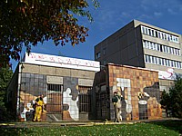
Der Leutewitzer Ring wurde im Zusammenhang mit dem Aufbau des Neubaugebietes Gorbitz angelegt und nach dem benachbarten Stadtteil Leutewitz benannt. Mit der
Namensgebung wurde eine Gorbitzer Tradition begründet, die neuen Straßen nach Orten der näheren Umgebung zu benennen. So existieren auch ein Wölfnitzer Ring, ein
Altgorbitzer und ein Omsewitzer Ring. 1987 entstand hier eines von zwei Gorbitzer Seniorenheimen. 1992 wurde am Leutewitzer Ring das [Gemeindezentrum](../../../sudwest/gorbitz/kirchen_gorbitz/) der Philippus-Kirchgemeinde eingeweiht.

Im Innenhof des Wohnblocks Leutewitzer Ring gibt es seit Ende 2011 eine sogenannte
“Leseecke” mit überdachten Sitzgelegenheiten. Hier fand auch die Sandsteinplastik “Die Lesende” von Horst Weise ihren neuen Platz. Das im Zuge der baukünstlerischen Gestaltung des Neubauviertels 1986 geschaffene Kunstwerk stand
ursprünglich vor dem Gebäude Leutewitzer Ring 9, wo von 1986 bis 1997 die Gorbitzer Stadtteilbibliothek ihr Domizil hatte.

[Club passage leutewitzer ring 5, 01169 dresden, tel. 0351/4112665 internet: www.club-passage.de](http://www.club-passage.de)

## Merianplatz

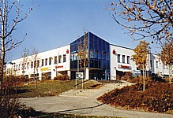Der heutige Merianplatz wurde 1979
als Platz der Eisenbahner angelegt, da die hier errichteten Neubauten teilweise von der Eisenbahner-Wohnungsbaugenossenschaft (EWG) vermietet wurden. Der Platz war von Anfang an als Stadtteilzentrum der neuen
Wohnsiedlung geplant. Die hier vorgesehene Ansiedlung von Läden und Gaststätten konnte jedoch bis 1989 nur teilweise realisiert werden. Erst 1996 entstand am 1993
umbenannten Merianplatz das Einkaufszentrum “Sachsen-Forum” mit zahlreichen Geschäften _(Foto)_. Ein 1986 aufgestellter Märchenbrunnen wurde von K. Schönherr
geschaffen. 1996 wurde am Merianplatz das Erlebnisbad “Elbamare” eröffnet.

Der Name des Platzes erinnert an die Malerin, Kupferstecherin und Naturforscherin Maria Sibylla Merian (1647-1717), die
vor allem durch ihre naturgetreuen Pflanzenzeichnungen berühmt wurde. Außerdem widmete sie sich als eine der ersten Frauen der Insekten- und Schmetterlingskunde und veröffentlichte mehrere naturkundliche Bücher.

## Rädestraße

Die Rädestraße, vor 1926 Heinrichstraße genannt, erhielt ihren Namen nach dem ehemaligen Obergorbitzer
Gemeindevorstand Friedrich Gottlieb Räde. Die Familie war über mehrere Generationen im Ort ansässig und stiftete Geld für gemeinnützige Zwecke. 1905 wurde an der Rädestraße der [Gorbitzer Friedhof](../../../sudwest/gorbitz/kirchen_gorbitz/) angelegt.

## Schreberstraße

Die Schreberstraße wurde 1933 nach dem Leipziger Arzt Daniel Moritz Schreber (1808-1861) benannt, der als Begründer der Kleingartenbewegung gilt (“Schrebergärten”). An
dieser Straße entstand im gleichen Jahr eine auch als “Schweinesiedlung” bezeichnete kleine Wohnanlage in Nachbarschaft der sogenannten “Schweinesenke” der Kammergutes.
Die bescheidenen Häuschen mit Wohn- und Stallräumen wurden von Arbeitslosen auf einem von der Stadt kostenlos zur
Verfügung gestellten Stück Land errichtet und mit zinsgünstigen Krediten finanziert. Offiziell hieß diese neue Gorbitzer Siedlung “Wetterscheide”.

## Silberfund

Die Straße, vor der Eingemeindung 1921 Mittelstraße genannt, erhielt ihren heutigen Namen Silberfund nach einem hier gemachten Fund von historischen Silbermünzen aus der Napoleonzeit. Der Fund geht vermutlich auf die Jahre der französischen Besatzung zurück, als Gorbitzer Bauern ihren Besitz zum Schutz vor Plünderungen vergruben.

## [Uthmannstraße](../../../sudwest/gorbitz/strassen_gorbitz/uthmannstrasse/)

## Wilsdruffer Ring

Der Wilsdruffer Ring wurde 1983 angelegt und so wie weitere Straßen im Neubaugebiet nach einem Ort der Umgebung
benannt. Die Kleinstadt Wilsdruff liegt zwischen Dresden und Meißen und ist Verwaltungszentrum für mehrere Dörfer der
Umgebung. Im Zuge der Stadterneuerung wurden am Wilsdruffer Ring bis 2006 zahlreiche Plattenbauten abgerissen. An ihrer Stelle entstand der ”Stadtblickpark” mit Grün- und Spielflächen sowie Sportgelegenheiten.

[Gorbitz auf OpenStreetMap](https://www.openstreetmap.org/search?query=Dresden+Gorbitz)

* * *

 \[ [Home](../../../index.html)\] \[ [Nord](../../../nord/)\] \[ [Nordwest](../../../nordwest/)\] \[ [Neustadt](../../../neustadt/)\] \[ [Nordost](../../../nordost/)\] \[ [West](../../../west/)\] \[ [Zentrum](../../../zentrum/)\] \[ [Südwest](../../../sudwest/)\] \[ [Süd](../../../sud/)\] \[ [Südost](../../../sudost/)\] \[ [Ost](../../../ost/)\] \[ [Register](../../../Register/register.html)\] \[ [Kontakt](../../../Kontakt/kontakt.html)\] \[ [Impressum](../../../impressum/)\]
