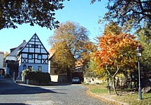
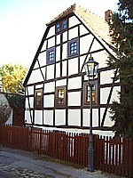
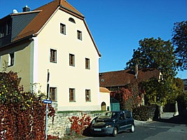
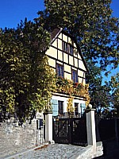
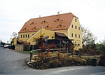
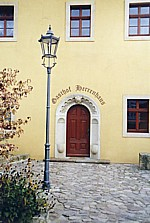

* * *

* * *

Die Uthmannstraße bildet die alte Verbindungsstraße zwischen den Ortsteilen Ober-
und Niedergorbitz und wurde früher Dorfstraße bzw. Brauereistraße genannt. 1921 erhielt sie ihren heutigen Namen nach dem Dirigenten und Komponisten Gustav Adolf
Uthmann (1867-1920). Uthmann entstammte einer Handwerkerfamilie und war später Geschäftsführer der BARMER- Krankenkasse. Zugleich betätigte er sich als
Hobbymusiker und leitete den sozialdemokratisch orientierten Arbeiter-Gesangsverein Barmen, für den er zahlreiche politische Lieder schrieb. 1934 wurde die Straße nach
dem Gründer der Diakonen-Bildungsanstalt in Gorbitz, Emil Höhne (1843-1925) in Höhnestraße umbenannt. Diese Namensgebung wurde Ende 1945 wieder aufgehoben.

Die Gebäude im unteren Teil der Straße gehören zu Niedergorbitz und wurden früher meist von
Tagelöhnern und Bergarbeitern bewohnt. Unter Denkmalschutz steht u. a. das Haus  Nr. 31  _(Foto rechts)_, welches einst Wohnsitz des Hofewiesenvogts war. Die Fundamente des heutigen
Gebäudes stammen bereits aus dem Jahr 1586. Nr. 55 war früher als Alte Weinpresse bekannt und erinnert noch an den bis 1945 um Gorbitz betriebenen Weinbau. 1872 entstand auf dem Grundstück Uthmannstraße 28 eine [Diakonenbildungsanstalt](../../../../sudwest/gorbitz/kirchen_gorbitz/), deren Gebäude später von der 74.
Mittelschule genutzt wurden. Vor dem Haus erinnert eine Wettineiche an das 800. Jubiläum des Hauses Wettin. Ein weiterer “Gedenkbaum” wurde vor der Kapelle zu Ehren des 400. Geburtstages von Martin Luther gepflanzt.

Im oberen Teil durchquert die Uthmannstraße den ehemaligen Dorfkern von Obergorbitz, der einst aus 14 Gehöften bestand.  Die meisten dieser Häuser entstanden im 19. Jahrhundert. An einigen Gebäuden erinnern
Inschriftentafeln an frühere Besitzer bzw. Ereignisse aus der Geschichte. Das gesamte Ensemble des alten Dorfkerns steht
heute unter Denkmalschutz und wurde in den letzten Jahren denkmalgerecht saniert. In den Sommermonaten finden hier gelegentlich Veranstaltungen statt.

Einzelne Gebäude:

Nr. 30: Ältestes Haus in Obergorbitz ist das frühere Winzergut Uthmannstraße 30 _(Foto links)_, welches um 1714 errichtet
wurde. 1862 befand es sich im Besitz von Hermann Goethe, der mit dem berühmten Dichter den Urgroßvater gemeinsam
hatte. Hermann und sein Bruder Rudolf Goethe veröffentlichten 1874 einen “Atlas der Traubensorten”. Das historische Gebäude dient heute als Wohnhaus und wurde in den letzten Jahren denkmalgerecht saniert.

**_Fotos:_** _historische Wohngebäude an der Uthmannstraße: Nr. 31 (links), Nr. 32 (Mitte) und Nr. 30 (rechts)_

Nr. 40:
Dieses Anwesen entstand ursprünglich als Winzergut und beherbergte früher auch eine Weinpresse. Nach Einstellung des Weinbaus wandelten die Besitzer das Haus in ein Bauerngut um. 1990 wurde das Gebäude bei einem Brand
schwer in Mitleidenschaft gezogen, konnte jedoch wenig später saniert werden und dient heute Wohnzwecken.

Herrenhaus Gorbitz:

Zu den markantesten Gebäuden im Ort gehört das Herrenhaus des früheren Kammergutes (Nr. 18), welches als letzter Rest
des einst bedeutendsten Gorbitzer Anwesens alle Wirren der Zeit überstand. Zum Gut gehörten ursprünglich eine Brauerei,
eine Brennerei, verschiedene Scheunen und Ställe und ein Gesindehaus, welche das gesamte Areal zwischen Uthmannstraße
und Kesselsdorfer Straße einnahmen. Ein Turm verschwand bereits im 18. Jahrhundert als Folge des Siebenjährigen Krieges, während die übrigen Gebäude erst 1985 abgerissen wurden.

Das mit ca. 180 Hektar Land größte Gorbitzer Gut war nach mehrfachem Besitzerwechsel 1644 in den Besitz des Kurfürsten Johann Georg I. gekommen, welcher es zur besseren Versorgung Dresdens erwarb und zum Kammergut
umwandeln ließ. Dieses bildete bis 1924 einen vom Dorf unabhängigen selbständigen Gutsbezirk und wurde erst 1946 aufgelöst und an Neubauern verteilt. Auf den Feldern des früheren Kammergutes entstand ab 1979 das heutige
Neubaugebiet.

Am 2. Juni 1647 starb im Herrenhaus Gorbitz der dänische Kronprinz Christian während eines Besuches in Dresden im
Alter von nur 47 Jahren. 13 Jahre zuvor hatte er in Kopenhagen die Tochter Johann Georg I., Magdalena Sibylla geheiratet.
Nach 1990 konnte das Herrenhaus des früheren Kammergutes rekonstruiert werden und beherbergt heute eine historische Gaststätte. Bemerkenswert ist ein Sitznischenportal aus der Zeit um 1600.

**_Fotos:_** _Herrenhaus Gorbitz - auf dem rechten Bild der Eingang mit dem romanischen Portal_

__

* * *

 \[ [Home](../../../../index.html)\] \[ [Nord](../../../../nord/)\] \[ [Nordwest](../../../../nordwest/)\] \[ [Neustadt](../../../../neustadt/)\] \[ [Nordost](../../../../nordost/)\] \[ [West](../../../../west/)\] \[ [Zentrum](../../../../zentrum/)\] \[ [Südwest](../../../../sudwest/)\] \[ [Süd](../../../../sud/)\] \[ [Südost](../../../../sudost/)\] \[ [Ost](../../../../ost/)\] \[ [Register](../../../../Register/register.html)\] \[ [Kontakt](../../../../Kontakt/kontakt.html)\] \[ [Impressum](../../../../impressum/)\]
