## Geschichte Löbtaus



 Die Geschichte Löbtaus beginnt mit der Entstehung einer slawischen Siedlung, die
bereits 1068 als Liubituwa erstmals erwähnt wurde und zu den ältesten dokumentierten Orten im Elbtal gehört. Archäologische Funde aus der jüngeren
Steinzeit belegen jedoch eine deutlich frühere Besiedlung des Gebietes. Der Ortsname ist wahrscheinlich von einem slawischen Personennamen abgeleitet
(Leute des Lubeta) und wechselte im Laufe der Zeit über Luptow (1350), Lobethaw (1589) und Loebta (1759) zum heute üblichen Löbtau. Am 28. Oktober 1068 vergab der deutsche König Heinrich IV. zwei Hufen aus seinem
Besitz an das Hochstift Meißen. Bis zur Reformation unterstand Löbtau zur Hälfte dem Domkapitel, welches hier 12 Bauernstellen vergeben hatte. Der Bereich südlich des Dorfplatzes gehörte hingegen
zum kurfürstlichen Amt Dresden.

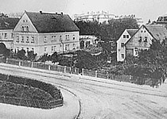1568 mussten die Löbtauer Bauern 42 Hektar Ackerland, ein Sechstel der
Gesamtfläche, an das Kammergut Ostra abgeben. Weitere Flächen gingen 1717 für die Erweiterung des [Holzhofes](../../sudwest/lobtau/weisseritzmuhlgraben/) verloren. Die verbliebene Flur wurde noch bis
ins 19. Jahrhundert landwirtschaftlich genutzt. Heute erinnern nur noch wenige Gebäude am früheren Dorfplatz [Altlöbtau](../../sudwest/lobtau/strassen_lobtau/altlobtau/) **_(Fotos)_**
an die Vergangenheit des Ortes. Wegen der verbreiteten Viehzucht wurde Löbtau früher auch spöttisch “Kuh-Löbte” genannt. Als Weidefläche diente der Anger, der sich zwischen Tharandter und Zwickauer Straße erstreckte.

Schwer getroffen wurde das strategisch günstig im Vorfeld der Stadt Dresden gelegene Dorf bei kriegerischen
Auseinandersetzungen. So brannten im November und Dezember 1428 die Hussiten den Ort vollständig nieder, was sich am 29. März 1638 nach einem Schwedeneinfall wiederholte. Vier Jahre später waren die Löbtauer Fluren
Schauplatz von Kämpfen zwischen schwedischen und kaiserlichen Soldaten. Auch im Schlesischen Krieg 1745 und im Siebenjährigen Krieg 1756-63 kam es zu Plünderungen und erheblichen Schäden im Ort, während Löbtau in der
Napoleonzeit “nur” unter häufigen Einquartierungen zu leiden hatte. Teile der Ortsflur wurden im Zusammenhang mit der [Schlacht bei Dresden](../../sud/racknitz/schlacht_bei_dresden/) am 26. / 27. August 1813 in Mitleidenschaft gezogen.

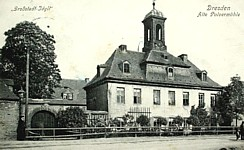Bereits im 16. Jahrhundert begannen Veränderungen im Ort. So ließ Kurfürst Johann
Georg IV. 1692 einen Garten mit einem Wasserpalais anlegen, der ab 1702 [Reisewitz´scher Garten](../../sudwest/lobtau/strassen_lobtau/tharandter_strasse/reisewitz_scher_garten/) genannt wurde. Noch wichtiger für die
spätere Entwicklung Löbtaus war die Ansiedlung einiger Gewerbebetriebe an der Weißeritz sowie am von dieser abzweigenden [Weißeritzmühlgraben](../../sudwest/lobtau/weisseritzmuhlgraben/).
Diese Mühlen **_(Foto:_** _ehemalige Pulvermühle)_ bildeten das erste bedeutende Industriegebiet Dresdens und wurden zum Teil bis 1945 als Fabriken genutzt. Der eigentliche Weißeritzmühlgraben wurde 1937
trockengelegt und ist heute nur noch in Resten vorhanden. Zu den wichtigen frühen Unternehmen auf Löbtauer Flur gehörte auch der Holzhof an der späteren Oederaner Straße. 1740 wurde auf
dem Löbtauer Anger trotz Protesten der Anwohner der Dresdner Galgen aufgestellt, an dem noch bis 1837 öffentliche Hinrichtungen stattfanden.

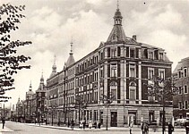Begünstigt durch die gesellschaftlichen Veränderungen in Sachsen nach 1830 und durch die Einführung der Gewerbefreiheit im Jahr 1862 wandelte sich das frühere
Bauerndorf Löbtau endgültig zum Industriestandort. 1857 entstand eine Fabrik zur Herstellung von Portlandzement, 1858 eine Eisengießerei, 1862 die bekannte Schokoladenfabrik Petzold & Aulhorn sowie das [Glaswerk](../../zentrum/wilsdruffer_vorstadt/freiberger_strasse/glaswerk_lobtau/) der Familie Siemens. Diese neuen Unternehmen siedelten sich bevorzugt entlang der Weißeritz an der [Tharandter](../../sudwest/lobtau/strassen_lobtau/tharandter_strasse/) und [Löbtauer Straße](../../sudwest/lobtau/strassen_lobtau/lobtauer_strasse/) an. Die übrigen Flächen wurden ab 1860 mit
Arbeiterwohnhäusern bebaut _( **Foto:** Nostitzstraße)_. In Folge verschwand die landwirtschaftliche Nutzung fast völlig, so dass bereits 1875 nur noch vier
Bauernhöfe in Altlöbtau existierten. Hinzu kamen einige Gärtnereien, welche um 1880 über 40 Hektar der Gemeindefläche einnahmen.

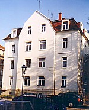Typisch für Löbtau ist das 1875 vom Geometer Emil Ueberall entworfene rasterförmige Straßennetz und die aufgelockerte Bebauung mit den “Würfelhäusern” **_(Foto:_** _Essener Straße 9)_. Bis zur Jahrhundertwende verdrängten die neuen Wohn- und Gewerbeviertel die bisherige Landwirtschaft sowie die zahlreichen Löbtauer Gärtnereien fast völlig. 1875 entstand der [Neue Annenfriedhof](../../sudwest/lobtau/friedenskirche/neuer_annenfriedhof/) an der Kesselsdorfer Straße, 1890 die [Friedenskirche](../../sudwest/lobtau/friedenskirche/),
1923 die katholische [Kirche St. Antonius](../../sudwest/lobtau/Friedenskirche/St__Antonius-Kirche/st__antonius-kirche.html), 1936 die [Hoffnungskirche](../../sudwest/lobtau/friedenskirche/hoffnungskirche/). Ab 1881 verband eine Pferdestraßenbahn Löbtau und Dresden, die 1893 bis Wölfnitz verlängert und drei Jahre
später elektrifiziert wurde. 1909 folgte die Strecke über die heutige Rudolf-Renner-Straße nach Cotta. Neben mehreren Schulbauten und dem repräsentativen Rathaus an der Weißeritz
entstanden ein gemeindeeigenes Gaswerk (1890), ein Kranken- und Versorgungshaus (Luisenhaus) und ein Marstall mit Feuerwehrdepot.

### Eingemeindung 1903

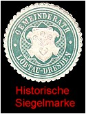

Löbtau gehörte bereits 1890 mit über 12.000 Einwohnern zu den größten Gemeinden Sachsens und war ein Zentrum
der Dresdner Arbeiterbewegung. An einige frühere Arbeiterfunktionäre erinnern bis heute Straßennamen, so an den bekannten Dresdner Fischhändler August Paschky. Um die Lebensbedingungen im dichtbesiedelten Löbtau zu
verbessern, legte die Gemeinde um 1900 kleinere Parkanlagen am heutigen Conertplatz, am Bonhoefferplatz und am
1945 zerstörten Löbtauer Rathaus an. Am 1. Januar 1903 wurde der Ort mit 39.000 Einwohner als zehntgrößte Landgemeinde Sachsens nach Dresden eingemeindet





### Zerstörung im Zweiten Weltkrieg

Die Luftangriffe des Zweiten Weltkrieges trafen auch die Vorstadt Löbtau schwer. Bereits am 16. Januar 1945, noch
vor den Großangriffen auf Dresden, zerstörten Bomben einige Gebäude an der Poststraße und der Kesselsdorfer Straße. Neben Industrieanlagen, dem Rathaus und der Friedenskirche wurden am 13./14. Februar 1945 weitere
Wohngebäude zerstört, vor allem im Bereich um den heutigen Ebertplatz und an der Kreuzung Kesselsdorfer/ Tharandter Straße. Auch der bekannte [“Drei-Kaiser-Hof”](../../sudwest/lobtau/Strassen_Lobtau/Kesselsdorfer_Strasse/Drei-Kaiser-Hof/drei-kaiser-hof.html) fiel den Bomben zum Opfer. Noch am 17. April 1945 fielen
Bomben auf mehrere Industriebetriebe und das Städtische Krankenhaus an der Löbtauer Straße, welches fast vollständig ausbrannte. Für die Opfer der Bombenangriffe befindet sich auf dem Neuen Annenfriedhof eine
Gedenkstätte.

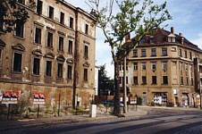Trotz der Kriegsschäden entwickelte sich Löbtau in der Nachkriegszeit zu
einem Zentrum des Dresdner Geschäftslebens. So nahm die [Kesselsdorfer Straße](../../sudwest/lobtau/strassen_lobtau/kesselsdorfer_strasse/) zeitweise eine Ersatzfunktion für die zerstörten Geschäfte der Innenstadt
ein. An der Nossener Brücke entstand 1962/64 ein Heizkraftwerk, welches 1995 durch ein modernes Gasturbinenkraftwerk an der Siebenlehner Straße ersetzt wurde. Gleichzeitig verfiel die um die Jahrhundertwende entstandene
Bausubstanz _(Foto: Tharandter Straße / Ecke Schillingstraße)_, was zu Abrissen von Gebäuden an der Kesselsdorfer Straße und am Ebertplatz führte.

### Nach der Wende

Erst 1990 begann die schrittweise Rekonstruktion vieler Wohnhäuser, wobei einige Baulücken mit Neubauten geschlossen wurden. 1994 beschloss die Stadt Dresden, Löbtau-Süd zum förmlichen Sanierungsgebiet zu erklären und
in das Förderprogramm für städtebauliche Erneuerung aufzunehmen. 2003 wurde dieses auf weitere Teile des Stadtteils
erweitert. Das Gebiet um die Kesselsdorfer Straße soll künftig wieder zu einem Einkaufs- und Geschäftszentrum
entwickelt werden, was jedoch vor allem eine Lösung der Verkehrsprobleme voraussetzt. Auf den Flächen ehemaliger Gewerbebetriebe und des früheren Kohlebahnhofes an der Freiberger Straße entstand 2007/08 der “Grünzug
Weißeritz” als Teil eines künftig bis nach Freital führenden Fuß- und Radweges.

### Rathaus

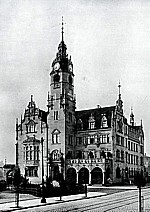Das Löbtauer Rathaus entstand ab 1895 unmittelbar am Weißeritzufer und löste das zuvor
seit 1874 in der früheren Dorfschule an der Wernerstraße 1 untergebrachte Gemeindeamt ab. Der Entwurf für den repräsentativen Neubau mit seinem Turm stammte vom Dresdner
Architektenbüro Schilling & Gräbner, die Bauausführung übernahmen die heimischen Firmen Pohle und Schreiber. Kurz vor Fertigstellung zerstörte das schwere Weißeritzhochwasser
am 31. Juli 1897 einen Teil des Gebäudes, so dass sich die Einweihung verzögerte. Vor dem Rathaus wurde am 21. April 1898 ein Kriegerdenkmal für die im Deutsch-Französischen Krieg gefallenen Einwohner aufgestellt.

Nach dem Anschluss Löbtaus nach Dresden nutzten städtische Behörden das Gebäude. U.a. zogen hier Zweigstellen des Stadtsteuer- und des Gewerbeamtes, eine Nebenstelle des
Armenamtes und ein Standesamt ein. Weitere Räume nutzten die Polizei, die Sparkasse und die Städtische Zentralbibliothek. Außerdem gab es hier die Gaststätte “Ratskeller”. In den Dreißiger Jahren wurde das
Löbtauer Rathaus Sitz des neugebildeten 10. Stadtbezirks.

1945 wurde das Rathaus durch Bomben zerstört. Lediglich ein Nebengebäude blieb erhalten und wird derzeit von
einem Jugendclub genutzt. Einige Säulen fanden beim Bau der heute als Imbiss “Am Dreikaiserhof” genutzten früheren
Straßenbahnwartehalle Verwendung. An Stelle des Löbtauer Rathauses entstand in der Nachkriegszeit eine kleine Grünanlage. 1948 wurde hier die Plastik “Danaide” aufgestellt. Die bronzene Brunnenfigur stammt von Johannes
Schilling und befand sich ursprünglich auf einem Privatgrundstück in Niedersedlitz. 2009 wurde sie zum Schutz vor Vandalismus abgebaut und kehrte nach Niedersedlitz zurück.

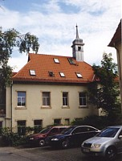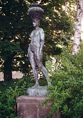

**_Fotos:_** _Nebengebäude des Löbtauer Rathauses (links) - Danaide-Figur im Park (rechts)_

## Schulen in Löbtau

### Dorfschule

Löbtau besaß spätestens ab 1786 einen eigenen Schullehrer, der seinen Unterricht meist abwechselnd in den Bauernhäusern oder im Gemeindehaus abhielt. Zuvor mussten die Kinder die Schulen in Dresden, Briesnitz oder Gorbitz besuchen. Für seine Tätigkeit erhielt dieser Lehrer sechs Taler Beihilfe sowie einen Schlaf- und Wohnraum im Schulgebäude. Dieses erste Schulhaus hatte seinen Standort am Dorfplatz und diente zugleich als Wohnhaus des Nachtwächters. 1889 musste das Gebäude wegen Baufälligkeit abgebrochen werden.

1832 errichtete die Gemeinde ein zweites, größeres Schulhaus an der Cottaer Straße (heute Lübecker Straße). Der von den Gorbitzer Baumeistern Johann Traugott und Carl Gotthelff Fichtner errichte Bau besaß im Erdgeschoss neben der Schulstube eine Küche, im Obergeschoss befanden sich Stube und Kammer des Lehrers. Wegen der bis 1866 auf 233 Kinder angestiegenen Schülerzahl genügte auch dieses nicht mehr den Anforderungen und wurde daraufhin durch einen Neubau ersetzt. Das alte Haus diente danach nur noch Wohnzwecken und fiel 1894 dem Straßenausbau zum Opfer.

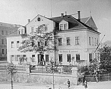Die dritte Löbtauer Dorfschule _(Foto)_ hatte ihren Standort an der Einmündung Wernerstraße / Lübecker Straße. Im Sommer 1866 wurde mit ihrem Bau begonnen und schon am 8. November 1866 erfolgte die Einweihung. Allerdings konnte auch dieses Schulgebäude nur für wenige Jahre seinen Zweck erfüllen und erwies sich bald als zu klein. Deshalb beschloss der Löbtauer Gemeinderat 1873, einen weiteren Schulneubau zu errichten. Nach dessen Fertigstellung wurde die alte Schule ab 1875 bis 1897 als Gemeindeamt genutzt. Das 1945 beschädigte Gebäude fiel 1990 dem Abriss zum Opfer. Letztes Zeugnis der Löbtauer Dorfschule ist der frühere Schlusstein, der sich heute im Dresdner [Schulmuseum](../../zentrum/friedrichstadt/) befindet.

### 36\. Volksschule
1874 wurde an der Schulstraße (Gröbelstraße 1/3) die neue
Löbtauer Schule errichtet. Die feierliche Grundsteinlegung erfolgte am 2. Februar 1874. Die Bauausführung übernahm der Plauener Baumeister Fichtner. Das
Gebäude bestand aus einem Mittel- und zwei Flügelbauten und bot Platz für 22 Klassenräume, ein Lehrerzimmer, Archiv- und Lehrmittelräume sowie Wohnungen für Lehrer und Hausmeister. Zeitweise befand sich hier auch eine
Gendarmeriestation. Die vier Jahre später entstandene zweistöckige Turnhalle diente von 1879 bis 1891 zugleich als Betsaal der evangelischen Kirchgemeinde,
im Anschluss bis 1923 als katholischen Kirche. Zunächst trug diese Schule die Bezeichnung 2. Bezirksschule, ab 1904 36. Bezirksschule. Die nach dem Ersten Weltkrieg  36. Volksschule genannte Einrichtung wurde 1945 ebenso wie die Turnhalle beim Luftangriff zerstört.

Vor dem Schulhaus stand bis zur Zerstörung ein aus Anlass des 400. Geburtstages Martin Luthers vom Löbtauer
Baumeister Schreiber und dem Sägewerksbesitzer Pohle gestiftetes Lutherdenkmal. Das Denkmal bestand aus einem Syenitstein mit einem Bronzemedaillon Luthers und trug die Inschrift: _“Eine feste Burg ist unser Gott. Zur_
_Erinnerung an den 10. Nov. 1883”_. Aus diesem Anlass war in unmittelbarer Nähe auch eine Lutherlinde gepflanzt worden. Das Denkmal wurde wahrscheinlich bei der Enttrümmerung des Grundstücks beseitigt.

### Bürgerschule Löbtau
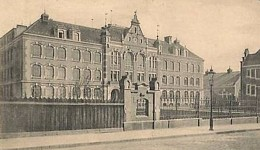Ende des 19. Jahrhunderts wurde als weiteres Löbtauer Schulhaus die bis heute erhaltene “Wallwitzschule” auf der damaligen Wallwitzstraße (heute Clara-Zetkin-Straße 20) eingerichtet. 1899/1900 entstand hier das heute noch vorhandene Schulgebäude _(Foto)_. Das Grundstück, welches ursprünglich zur Errichtung eines Schlachthofes vorgesehen war, wurde von der Gemeinde Löbtau zur Verfügung gestellt. Der am 2. April 1900 eingeweihte imposante Jugendstilbau erhielt neben den Klassenzimmern auch einige Lehrerwohnungen, eine Turnhalle und ein Uhrtürmchen mit Glockenspiel. In einem Nebengebäude befand sich ab 1901 das Löbtauer Volksbad.

Nach der Eingemeindung des Ortes wurde die Schule als 14. Bürgerschule, ab 1919 als 54.
Volksschule in das Dresdner Schulnetz eingegliedert. Während des Zweiten Weltkrieges diente das Gebäude zeitweise als Flüchtlingsquartier für Wolhyniendeutsche
und Lazarett. Nach 1945 nutzten die zerstörte 35. und die 54. Volksschule das Gebäude gemeinsam. 1972 erhielt diese Schule den Namen 35. POS “Clara Zetkin”. Wenig später wurde die 54.
POS zur Canalettostraße verlegt, während der Löbtauer Bau bis 1990 weiterhin von der 35. POS genutzt wurde. Im Zuge der Neugliederung des sächsischen Schulsystems entstanden 1992 die 35.Grundschule und die 35. Mittelschule, die das Gebäude bis 2011 gemeinsam nutzten. Heute dient es als 35. Oberschule.

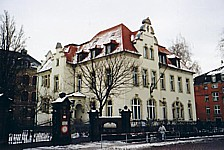Am Eingang zum Schulgelände steht die heute als Schulhort der benachbarten 35. Grundschule genutzte frühere
“Kinderbewahranstalt Löbtau”. Das Haus wurde 1901 erbaut und gehört zu den ältesten Kindergärten Dresdens. Hier wurden “schulpflichtige Kinder, die
aus Mangel an häuslicher Aufsicht in Gefahr sind, zu verwahrlosen” betreut, eine für den vorrangig von Arbeiterfamilien bewohnten Ort wichtige Aufgabe.
In dem nach 1990 renovierten Haus hat heute das “Horthaus Lö.We.” sein Domizil _(Foto rechts)_.

### 35\. Volksschule
Diese Schule (Fröbelschule) bestand ab 1888 als dritte Löbtauer Volksschule auf der Lindenstraße (Bünaustraße) 30, wurde jedoch
1945 zerstört. Die Grundsteinlegung für den Neubau, entworfen von Baumeister Pohle, fand am 13. März 1888 statt. 1894 folgte noch ein Ergänzungsflügel an der Nordseite des Gebäudes. Neben einer Aula und der
Wohnung des Schuldirektors gab es im Schulhaus 52 Klassenzimmer sowie Räume für Lehrmittel, Bibliothek und ein Konferenzzimmer. Nach der Eingemeindung Löbtaus wurde die Schule als 1. Bezirksschule, ab 1919 als
35\. Volksschule bezeichnet. Nach 1945 besuchten die Schüler die benachbarte 54. Volksschule Wallwitzstraße (Clara-Zetkin-Straße). Auf dem Gelände des früheren Schulhauses befindet sich seit 2007 eine Kindertagesstätte.

Vor dem Schulhaus stand ab 1891 ein Wettindenkmal, welches vom Löbtauer Militärverein finanziert und am 19. April
eingeweiht wurde. Mit dem Denkmal sollte an das zwei Jahre zuvor mit großem Pomp begangene 800-jährige Jubiläum des sächsischen Fürstenhauses erinnert werden. Dieses Denkmal verschwand vermutlich in der Nachkriegszeit.

### 37\. Volksschule

Die Schule am westlichen Ortsrand entstand um 1902 als 3. Bezirksschule zwischen der damaligen
Herbertstraße (Emil-Ueberall-Straße) und der Stollestraße. Um den gewachsenen Schülerzahlen gewachsen zu sein, stockte man das Gebäude 1911 nochmals auf. Ab 1919 wurde die Schule als 37. Volksschule bezeichnet. Während
des Zweiten Weltkriegs besuchten in den Wintermonaten auch die Schüler benachbarter Schulen hier den Unterricht.
Ziel war es, Brennmaterial für die Beheizung der Gebäude zu sparen. Ab 1942 war zudem die 36. Volksschule im Schulhaus untergebracht.

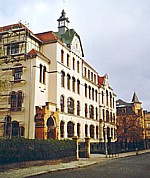Nach der Zerstörung der verbliebenen Löbtauer Schulen blieb das Schulhaus bis 1950 Domizil der 36. und 37. Grundschule. Im Turmzimmer war zu dieser Zeit für einige Jahre
eine Seidenraupenzucht untergebracht. 1950 wurden beide Schulen räumlich und organisatorisch wieder getrennt. Die 36. Grundschule bezog den Flügel an der heutigen
Emil-Ueberall-Straße 34, die 37. Mittelschule an der Stollestraße 43 erhielt den Status einer Versuchsschule mit obligatorischem
10-Klassen-Unterricht. Ab 1958/59 war dieser für alle Schulen in der DDR obligatorisch. In den 1960er Jahren wurden beide Schulen, wie vielfach
üblich, mit einem zusätzlichen Ehrennamen bezeichnet. So trug die 36. POS bis 1990 den Namen “Rudolf Renner”, benannt nach einem kommunistischen Widerstandskämpfer und
Landtagsabgeordneten, die 37. POS bekam den Namen “Heinrich Rau” verliehen. Rau (1899-1961) hatte als Kommandeur der Internationalen Brigaden am Spanienkrieg 1937/38 teilgenommen und gehörte
bis zu seinem Tod dem Politbüro des Zentralkomitees der SED an. 1960-1964 wurde ein Hortgebäude errichtet und  am 15. Dezember 1964 eröffnet.

Nach der Wiedervereinigung kam es 1991 zur Neugliederung der sächsischen Schullandschaft mit Bildung von Grund- und Mittelschulen. Dabei entstanden die 37. Grund- und die 36. Mittelschule, die bis heute im Gebäudekomplex  ihr Domizil haben _(Foto)_. Eine umfassende Sanierung des unter Denkmalschutz stehenden Schulgebäudes erfolgte in den Jahren 2002 bis 2009.

### Katholische Volksschule
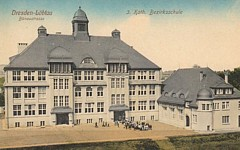
Diese Schule wurde auf einem 1910 von der katholischen Gemeinde erworbenen Grundstück an der Bünaustraße 12 errichtet und 1912 eingeweiht. Architekten des Gebäudes waren Martin
Hammitzsch, Robert Witte und Otto Miersch. Nebenan entstand 1923 die katholische [St. Antonius-Kirche](../../sudwest/lobtau/Friedenskirche/St__Antonius-Kirche/st__antonius-kirche.html). Ab 1947 diente das Gebäude als Berufsschule für Wirtschaft und wird seit 2010 von der 35. Grundschule genutzt. In der Turnhalle dieser Schule existierte in der Nachkriegszeit bis 1971 das Kino “Volkslichtspiele”. Seit 19. September 2012 trägt die 35. Grundschule den Namen “Heinrich Graf von Bünau”.

Neben den erwähnten allgemeinbildenden Schulen gab es in Löbtau seit 1896 eine Ortsfortbildungsschule für ältere Schüler, damals ein Novum in einer Landgemeinde. Eine weitere private Fortbildungsschule unterhielt ab 1884 die Aktiengesellschaft für Glasindustrie für die Aus- und Weiterbildung ihrer Glasmacher.

## Postwesen in Löbtau

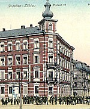Ursprünglich war das Dorf Löbtau postalisch dem Landbestellbezirk Dresden zugeordnet.
Lediglich einige außerhalb des Ortskerns liegende Gebäude und die Aktienbrauerei Reisewitz gehörten zum Postamt Plauen. Seine erste eigene Poststelle erhielt Löbtau am 1. Oktober
1876\. Diese befand sich zunächst in einem Gebäude auf der Wilsdruffer Straße (Kesselsdorfer Straße) 48 und war auch für die Drescherhäuser und das benachbarte
Naußlitz zuständig . Am 29. September 1892 bezog die Kaiserliche Reichspost ihr neues Domizil im Erdgeschoss eines Eckhauses am Schillingplatz, woran noch heute die
Straßenbezeichnung Poststraße erinnert. Nach der Eingemeindung wurde das Postamt als Dresden A 28 bezeichnet und später zur Wernerstraße verlegt, wo es als Postamt 8026
noch bis nach 1990 existierte. 1996 wurde dieses Gebäude abgetragen und die Post in einen Neubau auf der Gröbelstraße verlegt.

## Gaswerk Löbtau

Die gemeindeeigene Löbtauer Gasanstalt wurde 1890 unter Leitung des Ingenieurs Achtermann von den ortsansässigen
Bauunternehmern Pohle und Schreiber errichtet und am 20. Dezember in Betrieb genomen. Zuvor gab es bereits ab
1874 ein von der Plauener Mühlenbesitzer Familie privat betriebenes Gaswerk an der Habsburgerstraße (heute Fritz-
Schulze-Straße). Das neue Werk diente sowohl zur Versorgung der Haushalte und der Industrie als auch für die
Straßenbeleuchtung der Gemeinde. Schon 1875 waren die ersten Straßenlaternen aufgestellt worden, mussten jedoch
bis zur Fertigstellung des Gaswerkes mit Ligroin, einem petroleumähnlichen Leichtbenzin, betrieben werden. Mit dem
Anschluss des Ortes an das Dresdner Gasnetz wurde die Produktion des Gaswerks noch vor dem Ersten Weltkrieg eingestellt.

[_Weiterführende Literatur und Quellen_](../../impressum/quellenverzeichnis/)

**Stadtteilseiten Löbtau**

 \[ [Home](../../index.html)\] \[ [Nord](../../nord/)\] \[ [Nordwest](../../nordwest/)\] \[ [Neustadt](../../neustadt/)\] \[ [Nordost](../../nordost/)\] \[ [West](../../west/)\] \[ [Zentrum](../../zentrum/)\] \[ [Südwest](../../../sudwest/)\] \[ [Süd](../../sud/)\]
 \[ [Südost](../../sudost/)\] \[ [Ost](../../ost/)\] \[ [Register](../../register/)\] \[ [Kontakt](../../kontakt/)\] \[ [Impressum](../../impressum/)\]
