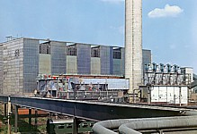
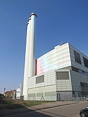
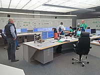
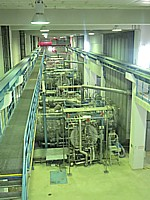

Das Kraftwerk entstand in den 1960er Jahren auf einer Freifläche nördlich der [Brücke der Jugend](../../../../sudwest/lobtau/strassen_lobtau/lobtauer_brucken/) (Nossener Brücke) zwischen Bahnanlagen und Oederaner Straße und sollte als modernes Heizkraftwerk vorrangig der Fernwärmeversorgung der geplanten Dresdner Neubausiedlungen dienen. Die 1960 begonnenen Planungen stammten von einem Kollektiv um Gerhard Liebers, Christian Wiesenhütter, Heinz Stoll und mehreren Ingenieuren. Es entstand ein 126 Meter langer und 40 Meter hoher Stahlbetonbau mit Maschinenhaus und Schaltwarte. Auf den eigentlichen Kraftwerksbau setzte man einen dreistöckigen verglasten Bürokomplex, in dem sich die Personal- und Verwaltungsräume befanden. Hinzu kam ein Kühlturm im nördlichen Teil des Grundstücks. Die ungewöhnliche architektonische Lösung brachte dem Architektenkollektiv 1966 den zweiten Preis eines Architekturwettbewerbs im Bereich Industriebau. An der Fassade zur Brücke befand sich eine elektronisch gesteuerte Uhr, seinerzeit größte in Dresden _( **Foto:** Fotothek/Wikipedia)_.

Da das Kraftwerk nach 1989 nicht mehr den technologischen Anforderungen genügte, wurde es zwischen 1990 und 1995 durch ein modernes Gasturbinen-Heizkraftwerk ersetzt. Mit Ausnahme des Kühlturms brach man alle übrigen Gebäude ab. Für den Neubau griff man wie schon beim Altbau auf einen Entwurf des Architekturbüros Christian Wiesenhütter zurück. Die farblich gestaltete Fassade stammt von Friedrich-Ernst von Garnier. 1995 ging das neue Kraftwerk ans Netz. Für die Stromerzeugung stehen drei mit Erdgas betriebene Gasturbinen zur Verfügung, deren Abwärme eine weitere Turbine treibt. Die elektrische Leistung beträgt 270 MW, die thermische Leistung 455 MW Heizwasser sowie 25 MW Dampf.

_**Fotos:** Blick in die Turbinenhalle und den Leitstand des Kraftwerks_

* * *

 \[ [Home](../../../../index.html)\] \[ [Nord](../../../../nord/)\] \[ [Nordwest](../../../../nordwest/)\] \[ [Neustadt](../../../../neustadt/)\] \[ [Nordost](../../../../nordost/)\] \[ [West](../../../../west/)\] \[ [Zentrum](../../../../zentrum/)\] \[ [Südwest](../../../../sudwest/)\] \[ [Süd](../../../../sud/)\] \[ [Südost](../../../../sudost/)\] \[ [Ost](../../../../ost/)\] \[ [Register](../../../../Register/register.html)\] \[ [Kontakt](../../../../Kontakt/kontakt.html)\] \[ [Impressum](../../../../impressum/)\]
