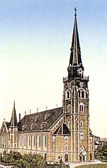
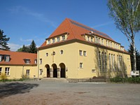
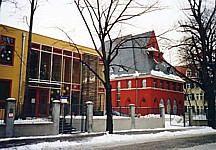

## Friedenskirche

Löbtau gehörte kirchlich ursprünglich zur Kreuzkirche bzw. zur Briesnitzer Kirche. Erst mit dem Zuzug zahlreicher Arbeiterfamilien und dem starken Anstieg der Einwohnerzahl fanden
auch im Ort selbst Gottesdienste statt. Diese wurden ab 1879 im Obergeschoss der für diesen Zweck eigens aufgestockten Schulturnhalle abgehalten, nachdem Löbtau zum
Landdiakonat der Kreuzkirche erklärt worden war. 1891 wurde eine eigene Parochie gebildet, für die 1889/91 die Friedenskirche an der Wernerstraße entstand (Foto). Architekt
des neogotischen Baus war Christian Friedrich Arnold. Am 6. 10. 1891 wurde sie geweiht. Die Kirche besaß einen 62 Meter hohen Turm und bot Platz für über 1000 Gläubige.
Nachdem auch diese Kirche zu klein geworden war, erfolgte 1915 die Ausgliederung des südlichen Teils der Vorstadt als eigenständige Hoffnungsgemeinde.

Die Friedenskirche wurde bereits beim Luftangriff am 16. Januar 1945 schwer beschädigt und brannte am 14.
Februar schließlich völlig aus. Da in der Nachkriegszeit die Mittel für einen Wiederaufbau fehlten, wurde 1949 in den früheren Kirchenraum eine Notkirche
nach einem Entwurf von Otto Bartning eingebaut und am 4. Advent 1949 eingeweiht. Das vom Weltkirchenbund finanzierte Provisorium ist bis heute erhalten und wird von der Löbtauer
Kirchgemeinde genutzt. Im Inneren befindet sich ein im 17. Jh. von Sebastian Walther geschaffener Epitaph aus der
Sophienkirche. Weitere Ausstattungsstücke, darunter ein geschnitzer Taufstein, ein Lesepult und drei Stahlglocken, konnten aus der alten Friedenskirche gerettet werden. Die Orgel entstand 1901 in der Werkstatt Richard
Kreutzbachs und stammt aus einem kirchlichen Seminar in Frankenberg.

[Mehr zur Friedenskirche](friedenskirche/)

---

## Hoffnungskirche

Die Hoffnungsgemeinde Löbtau entstand 1915 durch Ausgliederung des südlichen
Teils der Löbtauer Friedensgemeinde als zweite evangelische Kirchgemeinde des Stadtteils. Grund der Aufteilung war die stark angewachsene Bevölkerung in der
dichtbesiedelten Vorstadt. Bereits 1899 hatte man ein Grundstück an der damaligen Wallwitzstraße erworben, konnte jedoch erst 1935 mit dem Bau eines eigenen
Gotteshauses beginnen. Am 31. Mai 1936 bezog die Gemeinde ihr neues Haus, welches von Rudolf Kolbe entworfen wurde. Der schlichte Bau besitzt neben dem
500 Personen fassenden Kirchsaal verschiedene Räume für die kirchliche Arbeit. Ursprünglich war auf dem Nachbargrundstück noch ein richtiger Kirchbau geplant, der in Folge des Zweiten
Weltkrieges jedoch nicht zustande kam. Aus diesem Grund mussten auch drei 1937 erworbene Glocken in einem hölzernen Glockenstuhl im Garten aufgehängt werden.

Die Hoffnungskirche überstand den Zweiten Weltkrieg ohne größere Schäden und war zeitweise Auftrittsort für Kirchenmusiker und den Kreuzchor. In den 50er Jahren erhielt sie an Stelle des 1941 konfiszierten Geläuts die
geretteten Glocken der zerstörten Johanneskirche in der Pirnaischen Vorstadt. Erst seit 1961 wird sie offiziell als
Hoffnungskirche bezeichnet. Im Inneren befinden sich Glasmalereien von Helmar Helas und ein farbig gestaltetes Kreuz der Künstlerin Elly-Viola Nahmmacher. Außerdem besitzt die Hoffnungskirche zwei Jehmlich-Orgeln von
1936 und 1986. Im Zuge innerkirchlicher Umstrukturierungen schlossen sich Hoffnungs- und Friedenskirchgemeinde 1999 wieder zu einer einheitlichen Gemeinde zusammen.

[Mehr zur Hoffnungskirche](hoffnungskirche/)

---

## Katholische Kirche St. Antonius

Die ersten katholischen Gottesdienste fanden in Löbtau bereits Ende des 19. Jh. statt, nachdem sich hier auch zahlreiche katholische Familien niedergelassen hatten.
Zunächst nutzte die Gemeinde den Saal der “Musenhalle” an der Kesselsdorfer Straße, später die Turnhalle der örtlichen Volksschule. Am 1. April 1904 wurde Löbtau selbstständige Pfarrei.

1910 erwarb die junge katholische Gemeinde ein Grundstück an der Bünaustraße, auf dem 1912 zunächst eine Schule entstand. 1922/23 wurde in unmittelbarer
Nachbarschaft nach Plänen des Architekten Rudolf Zacek eine katholische Pfarrkirche errichtet, die am 18. März 1923 als St. Antonius-Kirche geweiht wurde. Das Gebäude überstand die Luftangriffe 1945 ohne größere Schäden
und wird bis heute von der Gemeinde genutzt. 1969 erfolgte nach Plänen E. Körners eine Neugestaltung des Innenraumes. Hängekreuz, Leuchter und Tabernakel stammen aus der Werkstatt des Künstlerehepaares Kleemann,
die Orgel wurde 1978 von der Firma Jehmlich gebaut. 2003 erhielt die St. Antonius-Kirche eine Solaranlage zur Stromerzeugung.

[Mehr zur Kirche St. Antonius](st__antonius-kirche/)

---

 \[ [Nord](../../../nord/)\] \[ [Nordwest](../../../nordwest/)\] \[ [Neustadt](../../../neustadt/)\] \[ [Nordost](../../../nordost/)\]
 \[ [West](../../../West/west.html)\] \[ [Zentrum](../../../Zentrum/zentrum.html)\] \[ [Südwest](../../../Sudwest/sudwest.html)\] \[ [Süd](../../../Sud/sud.html)\] \[ [Südost](../../../Sudost/sudost.html)\] \[ [Ost](../../../Ost/ost.html)\] \[ [Register](../../../Register/register.html)\] \[ [Kontakt](../../../Kontakt/kontakt.html)\] \[ [Impressum](../../../Impressum/impressum.html)\]
