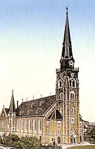
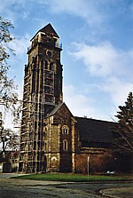
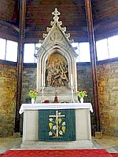

Da Löbtau bis 1839 zwei verschiedenen Ämtern unterstand, gehörte der Ort kirchlich mit
seinem nördlichen Teil zur Briesnitzer Kirche und mit dem südlichen Teil zur Dresdner Kreuzkirche. Erst mit dem Zuzug zahlreicher Arbeiterfamilien und dem starken Anstieg der
Einwohnerzahl fanden auch im Ort selbst Gottesdienste statt. Diese wurden ab 30. März 1879 im Obergeschoss der für diesen Zweck eigens aufgestockten Schulturnhalle auf der
Schulstraße 8 abgehalten, nachdem Löbtau zum 1. Landdiakonat der Kreuzkirche erklärt worden war. Bereits 1882 war an der Wernerstraße 22 ein Pfarrhaus entstanden.

1891 gründete man gemeinsam mit dem Nachbarort Naußlitz eine eigene Parochie, für welche 1889/91 die Friedenskirche an der Wernerstraße entstand _(Foto)_. Die Finanzierung
übernahmen der Kirchenvorstand der Kreuzkirche sowie der Rat der Stadt Dresden, während die Gemeinde Löbtau den zuvor für 50.000 Mark erworbenen Bauplatz zur Verfügung stellte. Am 14. Oktober 1889 wurde der Grundstein für die neue Kirche gelegt. Architekt des
neogotischen Baus war Christian Friedrich Arnold, ein Schüler Sempers. Die Bauausführung übernahmen die Löbtauer Baumeister Schreiber und Pohle. Am 6. Oktober 1891 wurde sie als Friedenskirche geweiht. Im Folgejahr
konnte nach längeren Verhandlungen und Zahlung einer Abfindungssumme auch der Briesnitzer Teil Löbtaus in die neue Gemeinde eingegliedert werden.

Die Kirche besaß einen 62 Meter hohen Turm und bot Platz für ca. 1100 Gläubige. Zur Ausstattung gehörten u.a. drei Altarbilder des Historienmalers Tröbs, mehrere von Professor Schönherr entworfene Glasfenster aus der
Werkstatt des renommierten Dresdner Glasmalers Urban sowie eine von den Gemeinden Löbtau und Naußlitz gestiftete Jehmlich-Orgel. Zwei weitere Bilder mit Darstellungen Luthers und Melanchtons waren Geschenke des
Kunstmalers Prof. Walther aus Dresden.

Neben den Gottesdiensten trafen sich in der Kirche und im Gemeindehaus auf der
Herbertstraße auch verschiedene kirchliche Vereine, wie der bereits 1878 gegründete Marienverein zur Unterhaltung einer Kinderbewahranstalt, der Frauenverein, der
evangelische Jünglingsverein sowie der 1898 entstandene Kirchenchor. Nachdem die Kirche zu klein geworden war, erfolgte zum Jahresanfang 1915 die Ausgliederung des südlichen Teils der Vorstadt als eigenständige [Hoffnungsgemeinde](../hoffnungskirche/).

Die Friedenskirche wurde bereits beim Luftangriff am 16. Januar 1945 schwer beschädigt
und brannte am 14. Februar schließlich völlig aus. Da in der Nachkriegszeit die Mittel für einen Wiederaufbau fehlten, wurde 1949 in den früheren Kirchenraum eine Notkirche
nach einem Entwurf von Otto Bartning eingebaut und am 4. Advent (18. Dezember) 1949 eingeweiht. Das vom Weltkirchenbund und vielen in- und ausländischen Spendern
finanzierte Provisorium ist bis heute erhalten und wird von der seit 1999 wieder vereinigten Löbtauer Kirchgemeinde
genutzt. Bartning hatte 1947 zur Behebung von Kriegsschäden ein Konzept für den vereinfachten Bau von Notkirchen
entwickelt, welches in 48 Orten Deutschlands zum Einsatz kam. Der erhalten gebliebene Turm erhielt an Stelle seiner zerstörten Spitze einen Aufbau mit Zeltdach _(Foto)_.

Im Inneren befindet sich ein im 17. Jahrhundert von Sebastian Walther geschaffener
Epitaph aus der Sophienkirche, der heute Teil des Altars ist **_(Foto:_** _Wikipedia)_. Der Stein mit kunstvollem Alabasterrrelief zeigt die Kreuztragung Jesu und diente ursprünglich als
Grabstein. 1886 wurde er in den Altar der Sakristei der Sophienkirche eingebaut und bei deren Abriss 1962 geborgen. Weitere Ausstattungsstücke, darunter ein geschnitzer
Taufstein aus Eichenholz, ein Lesepult und drei Stahlglocken aus dem Jahr 1920 konnten aus der alten Friedenskirche gerettet werden. Ursprünglich besaß die Kirche drei
Bronzeglocken der Dresdner Glockengießerei Bierling, welche jedoch im Ersten Weltkrieg zu Rüstungszwecken abgegeben werden mussten. Ein einst vorhandene Altarbild des
Historienmalers Tröbs wurde 1992 bei einem Einbruch gestohlen und ist seitdem verschollen. Die Orgel der Friedenskirche entstand 1901 in der Werkstatt Richard
Kreutzbachs und stammt aus einem kirchlichen Seminar in Frankenberg. Sie ersetzt die 1945 verbrannte Vorgängerin der Gebrüder Jehmlich aus dem Jahr 1892. In den letzten Jahren fanden verschiedene Sanierungs- und
Sicherheitsarbeiten, vor allem an der Turmruine, statt.

Seit 1999 bilden Friedens- und Hoffnungskirche wieder eine gemeinsame Kirchgemeinde. Bekannt ist die Kirche
durch ihr reiches musikalisches Leben, welches auch Gospel- und Jazzkonzerte beinhaltet. Vom Stadtjugendpfarramt
wurde die Friedenskirche als “Jugendkirche” ausgewählt und widmet sich verstärkt der Betreuung junger Menschen.

* * *

 \[ [Home](../../../index.html)\] \[ [Nord](../../../nord/)\] \[ [Nordwest](../../../nordwest/)\] \[ [Neustadt](../../../neustadt/)\] \[ [Nordost](../../../nordost/)\] \[ [West](../../../west/)\] \[ [Zentrum](../../../zentrum/)\] \[ [Südwest](../../../sudwest/)\] \[ [Süd](../../../Sud/sud.html)\] \[ [Südost](../../../Sudost/sudost.html)\] \[ [Ost](../../../Ost/ost.html)\] \[ [Register](../../../Register/register.html)\] \[ [Kontakt](../../../Kontakt/kontakt.html)\] \[ [Impressum](../../../Impressum/impressum.html)\]
