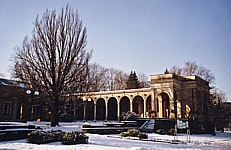
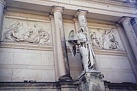
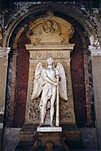
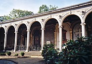
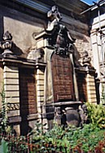
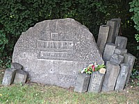

Der Neue Annenfriedhof wurde als vierter Friedhof dieses Namens auf
freiem Feld an der Kesselsdorfer Straße angelegt. Ziel war die Entlastung des 1848 eröffneten [Alten Annenfriedhofs](../../../../Sud/Plauen/Strassen_Plauen/Chemnitzer_Strasse/Alter_Annenfriedhof/alter_annenfriedhof.html) an der Chemnitzer Straße, der an
seine Kapazitätsgrenze gekommen war. Für den neuen Begräbnisplatz erwarb man für 130.000 Mark einige Ackerflächen von Löbtauer Bauern. Die nach Plänen des Gartenarchitekten Max Bertram regelmäßig gestaltete
Anlage war bei ihrer Einweihung am  23. Juni 1875 mit 14,3 Hektar und 37.000 möglichen Grabstellen größter einheitlich gestalteter Friedhof in
Deutschland. 1897 entstand in unmittelbarer Nachbarschaft, nur durch eine Hecke getrennt, der Friedhof “Friede und Hoffnung” für die Löbtauer Kirchgemeinde. Ursprünglich nur als Löbtauer
Friedhof bezeichnet erfolgte mit der Bildung der neuen Hoffnungskirchgemeinde 1915 die heute übliche Namensgebung. Feier- und Leichenhalle wurden von Beginn an mit dem Neuen Annenfriedhof gemeinsam genutzt.

Zentrum der Anlage des Neuen
Annenfriedhofs ist die zwischen 1875 und 1878 angelegte Friedhofshalle, die ursprünglich aus einem zentralen Kuppelbau mit Seitenflügeln und anschließenden Wandelgängen _(Foto oben)_
bestand. Im Mittelteil befand sich die Trauerhalle mit Nebenräumen, die Seitengebäude wurden zur Aufbahrung der Verstorbenen, für gerichtsmedizinische Untersuchungen und als Lagerräume genutzt. Architekt
des Neorenaissance-Baus war der Semper-Schüler Robert Wimmer; der plastische Schmuck _(Foto links)_ stammt von Martin Engelke.

In den Wandelgängen wurden Grüfte für wohlhabende Dresdner Familien angelegt, u. a. für den bekannten Glaswerksbesitzer Friedrich August Siemens (+ 1904), die Schokoladenfabrikanten August und Paul Ferdinand
Lobeck und den Fabrikbesitzer Alfred Klinge (+ 1910). Zu den bekannten Persönlichkeiten, die auf dem Friedhof
ihre letzte Ruhestätte fanden, gehören auch einige Angehörige der Kunstgießerfamilie Bierling, der Flugpionier Hermann Reichelt (+ 1914) und Paul Büttner, früherer Direktor des Dresdner Konservatoriums (+ 1943).

Ende 1944 wurde der Neue Annenfriedhof von der nationalsozialistischen Stadtverwaltung zum “Festungsfriedhof”
erklärt und durfte nicht mehr für zivile Bestattungen genutzt werden. Geplant war eine Anlage für die zu erwartenden
Gefallenen bei einer Verteidigung Dresdens gegen die vorrückende sowjetische Armee. Entgegen dieser Festlegung
wurden hier noch kurz vor Kriegsende 325 Opfer des Luftangriffs vom 17. April 1945, der vor allem die Vorstadt
Löbtau traf, in einem Gemeinschaftsgrab beigesetzt. Bereits am 16. Januar 1945 war die zentrale Kuppelhalle des Friedhofs durch einen Bombentreffer zerstört worden, wobei acht Menschen ums Leben kamen.. An der Südseite
ruhen in ca. 600 Kriegsgräbern deutsche, italienische, polnische und tschechische Soldaten.

In der Nachkriegszeit erfolgte die Vereinigung der beiden benachbarten Friedhöfe. Trennende Hecken und
Gitterzäune wurden daraufhin entfernt. Ursprünglich bot die Gesamtanlage Platz für ca. 44.000 Grabstellen, von
denen heute jedoch nur ungefähr 6.000 belegt sind. Um die unter Denkmalschutz stehende Gesamtanlage erhalten zu können, ist künftig eine parkartige Gestaltung des Areals geplant.

**_Fotos:_** _Impressionen vom Neuen Annenfriedhof:_

_links die Grabstelle der Familie Siemens,__rechts das Familiengrab der Kunstgießerfamilie Bierling_

## Werner-Gedenkstein

Westlich des Haupteingangs des Friedhofes erinnert ein schlichter Gedenkstein an den Mineralogen und Geologen Abraham Gottlob Werner, der während seiner häufigen Reisen zwischen Dresden und Freiberg gern an dieser Stelle rastete. Nach seinem Tod am 30. Juni 1817 wurde er hier aufgebahrt, damit seine Schüler und Freunde von ihm Abschied nehmen konnten. Der Leichnam wurde anschließend an den Trauerzug übergeben und nach Freiberg überführt. In Verehrung ihres Lehrmeisters stifteten Freiberger Studenten im Jahr 1818 das kleine Denkmal mit der Inschrift “Zu Werners Andenken”. Der Gedenkstein besteht aus Granit, zu beiden Seiten befinden sich Syenitsäulen und erinnern an Werners Betätigungsfeld. Zwei zeitgleich gepflanzte Lindenbäume sind heute nicht mehr vorhanden. Am 1. Juli 2017 wurde in Ergänzung des Denkmals eine Infostele mit biografischen Daten aufgestellt. Gestiftet wurde diese vom Förderverein der Bergakademie Freiberg.

* * *

 \[ [Nord](../../../../nord/)\] \[ [Nordwest](../../../../Nordwest/nordwest.html)\] \[ [Neustadt](../../../../neustadt/)\] \[ [Nordost](../../../../nordost/)\] \[ [West](../../../../west/)\] \[ [Zentrum](../../../../zentrum/)\] \[ [Südwest](../../../../Sudwest/sudwest.html)\]
 \[ [Süd](../../../../Sud/sud.html)\] \[ [Südost](../../../../Sudost/sudost.html)\] \[ [Ost](../../../../Ost/ost.html)\] \[ [Register](../../../../Register/register.html)\] \[ [Kontakt](../../../../Kontakt/kontakt.html)\] \[ [Impressum](../../../../Impressum/impressum.html)\]
