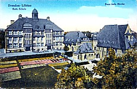
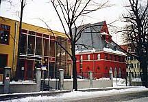

Die ersten katholischen Gottesdienste fanden in Löbtau bereits Ende des 19. Jahrhunderts statt, nachdem sich hier auch zahlreiche katholische Familien niedergelassen hatten. Zunächst nutzte die Gemeinde den
Saal der [“Musenhalle”](../../strassen_lobtau/kesselsdorfer_strasse/musenhalle/) an der Kesselsdorfer Straße, ab 1892 den früheren Betsaal der evangelischen Kirchgemeinde im 1. Obergeschoss der Turnhalle an der Gröbelstraße. Am 1. April 1904 wurde Löbtau selbstständige Pfarrei.

1910 erwarb die junge katholische Gemeinde ein Grundstück an der
Bünaustraße, auf dem 1912 zunächst eine Schule entstand _(Foto)_. Dieser Schulbau ist noch heute im Hinterhof des Kirchengrundstücks zu sehen. Gleichzeitig plante man den Bau einer größeren Kirche und eines
Gemeindehauses. Bedingt durch den Ersten Weltkrieg kam dieses Vorhaben nicht zustande. Erst am 3. Juli 1922 konnte der ersten Spatenstich für das
deutlich reduzierte Projekt erfolgen. Nach Plänen des Architekten Rudolf Zacek entstand eine katholische Pfarrkirche, welche am 18. März 1923 als St.
Antonius-Kirche geweiht wurde. Ursprünglich sollte die Kirche noch einen freistehenden Glockenturm erhalten, welcher jedoch aus finanziellen Gründen nie realisiert wurde. Als Pfarrhaus diente
bis 1950 ein Gebäude an der Tharandter Straße. Heute ist dieses am Schillingplatz 17 untergebracht.

Die St. Antonius-Kirche überstand die Luftangriffe 1945 ohne größere Schäden
und wird bis heute von der Gemeinde genutzt. 1964 erfolgte nach Plänen E. Körners eine Neugestaltung des Innenraumes. Dabei entfernte man alle Malereien
im Innenraum sowie den früheren Hochaltar und die Kanzel zugunsten einer schlichten modernen Gestaltung. Hängekreuz, Leuchter und Tabernakel stammen
aus der Werkstatt des Künstlerehepaares Kleemann, die Orgel wurde 1978 von der Firma Jehmlich gebaut. 2003 erhielt die St. Antonius-Kirche eine Solaranlage zur Stromerzeugung.

---

 \[ [Home](../../../../index.html)\] \[ [Nord](../../../../nord/)\] \[ [Nordwest](../../../../Nordwest/nordwest.html)\] \[ [Neustadt](../../../../neustadt/)\] \[ [Nordost](../../../../nordost/)\] \[ [West](../../../../west/)\] \[ [Zentrum](../../../../zentrum/)\] \[ [Südwest](../../../../Sudwest/sudwest.html)\] \[ [Süd](../../../../Sud/sud.html)\] \[ [Südost](../../../../Sudost/sudost.html)\] \[ [Ost](../../../../Ost/ost.html)\] \[ [Register](../../../../Register/register.html)\] \[ [Kontakt](../../../../Kontakt/kontakt.html)\] \[ [Impressum](../../../../Impressum/impressum.html)\]
