### Altfrankener Straße

Die Altfrankener Straße wurde 1897 angelegt und nach dem Ort [Altfranken](../../../sudwest/altfranken/), seit 1997 ein Stadtteil von Dresden, benannt.
Von den Mietshäusern der Straße stehen die Gebäude Altfrankener Straße 2 und 5 sowie die Villa Nr. 11  unter Denkmalschutz.

#### Café Kirschberg
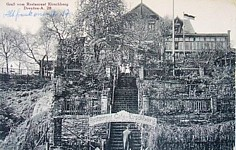 Das kleine Gartenlokal befand sich auf dem Grundstück
Altfrankener Straße 17 und wurde auch als “Gaststätte Kirschberg” bzw. “Zum Kirschberg” bezeichnet. Der Zugang erfolgte über eine Treppenanlage von der heutigen Fritz-Schulze-Straße aus. Zum Restaurant gehörte auch eine Veranda sowie eine terrassenartige Gartenanlage in Richtung Weißeritztal. Besitzer war um 1920 Paul Lange. Vermutlich schloss das Lokal Ende der 1920er Jahre. Das erhaltene Gebäude dient heute als Wohnhaus.

### Am Lerchenberg

Das Areal zwischen Dorfplatz und der nördlichen Ortsgrenze zu Cotta trug einst die Bezeichnung Lerchenberg. In Erinnerung
an diesen alten Flurnamen wurde der hier befindliche Platz um 1900 Am Lerchenberg benannt. In der Nähe dieser Erhebung
entstanden 1663 einige kleine Gutsarbeiterhäuser für die Tagelöhner des nahegelegenen Kammergutes Ostra. Während des
Preußisch-Österreichischen Krieges ließen die Preußen am Lerchenberg eine Schanze anlegen, die der Verteidigung der Stadt Dresden dienen sollte. Der Name des “Schanzenviertels” in Cotta sowie die Gaststätte “Zur Schanze” an der
Rudolf-Renner-Straße erinnern noch an diese Zeit. Die Reste der Schanze wurden mit Bebauung des Areals nach 1871 beseitigt.

### Anton-Weck-Straße

Die frühere Oststraße wurde 1926 in Anton-Weck-Straße umbenannt. Anton Weck (1623-1680) war kurfürstlicher Sekretär und Archivar und schuf eine der ersten historischen Chroniken Dresdens.

### Klingestraße

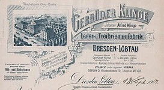Firma Gebrüder Klinge (Nr. 4/6): Das Unternehmen wurde Ende des 19. Jahrhunderts als Treibriemenfabrik Gebrüder Klinge Dresden-Löbtau gegründet. Inhaber war Alfred Klinge (1846-1910), der zuvor bereits mit
seinem Bruder Eugen ein gemeinsames Unternehmen auf dem Jagdweg geführt hatte. Zum Produktionsprogramm gehörten vorrangig Treibriemen für Maschinen und Lederriemen für den militärischen Bedarf. Innerhalb weniger
Jahre gelang es Alfred Klinge, den Betrieb zu einem der bedeutendsten der Branche in Europa zu machen. Teile seines Gewinnes stellte er für soziale und gemeinnützige Stiftungen zur Verfügung. An Alfred Klinge erinnert die Klingestraße in Löbtau sowie sein noch erhaltenes Grab in der Wandelhalle des [Neuen Annenfriedhofes](../../../sudwest/Lobtau/friedenskirche/neuer_annenfriedhof/). Nach 1945 nutzte der VEB Leder- und Plastverarbeitungswerke die Gebäude und fertigte hier u.a. Kamerataschen und Lederhüllen. Die Gebäude stehen unter Denkmalschutz.

### Badweg

Der Badweg wurde 1901 zur Straße ausgebaut und verdankt seinen Namen der kurz danach eröffneten “Oeffentlichen
Brauseanstalt” Löbtau. Als Städtisches Volksbad war diese Einrichtung ein wichtiger Beitrag zur Verbesserung der hygienischen Verhältnisse, da die meisten Arbeiterfamilien keine Bäder in ihren Wohnungen besaßen. Ursprünglich wurde dieser Weg als Verbindung zum Nachbarort Naußlitz angelegt und deshalb auch Naußlitzer Weg genannt.

#### Volksbad Löbtau
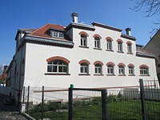Das Volksbad entstand 1902 auf dem Grundstück neben der 35. Bürgerschule (Badweg 1) und diente als Wannen- und Reinigungsbad für die Bevölkerung der Dresdner Vorstadt. Insgesamt standen 16 Brausen und 12 Badewannen für die Bevölkerung zur Verfügung, von denen damals die meisten in ihren Häusern noch keine eigenen Bäder besaßen. Im Obergeschoss befand sich die Wohnung des Badleiters sowie ein Regenwasserbehälter, der gleichzeitig zur Erwärmung des Wassers diente. Das unter Denkmalschutz stehende Gebäude wurde noch bis 1994 genutzt und dann als letzte Dresdner Einrichtung ihrer Art geschlossen. Nach jahrelanger Diskussion um die künftige Nutzung des seit 2003 unter Denkmalschutz stehenden Gebäudes entschied man sich für die Einrichtung eines Kindergartens.
Mit den Umbauarbeiten wurde im Frühjahr 2009 begonnen. Unter Erhalt der historischen Bausubstanz wurde das Bad zum “Theaterkindergarten” mit künstlerischem Profil umgebaut und um einen modernen Anbau ergänzt.

### Baluschekstraße

Die Straße wurde 1897 als Germaniastraße angelegt. Ihren heutigen Namen Baluschekstraße erhielt sie 1950 nach dem Maler
und Graphiker Hans Baluschek (1870-1935), der zu den Mitbegründern der Berliner Sezession gehörte und bis 1933 die
“Große Berliner Kunstausstellung” leitete. Von den Wohnhäusern der Straße steht das Mietshaus Nr. 8 unter Denkmalschutz.

### Bonhoefferplatz

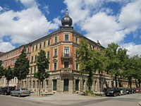 Der heutige Bonhoefferplatz wurde 1891 auf zuvor landwirtschaftlich genutztem Gelände angelegt und am 25. Februar 1891 nach dem sächsischen Staatsminister des Inneren Nostitz-Wallwitz-Platz benannt. Zuvor gab es hier ein als “Rotzsche” bzw. “auf dem Knochen” bezeichnetes Flurstück. Funde von 1893 belegen die frühgeschichtliche Besiedlung des Ortes. So entdeckte man an der Südseite des Platzes Spuren aus der jüngeren Steinzeit, während im nördlichen Teil Überreste eines bronzezeitlichen Begräbnitzplatzes mit zahlreichen Urnengräbern freigelegt wurden.

Der frühere Namensgeber Hermann von Nostitz-Wallwitz (1826-1906) war als Mitglied des Reichstags u. a. an der Erarbeitung der neuen Städteordnung beteiligt und erhielt 1882 die Dresdner Ehrenbürgerwürde.
Zwei angrenzende Straßen bekamen die Bezeichnung Nostitzstraße (heute Clara-Viebig-Straße) bzw. Wallwitzstraße (heute [Clara-Zetkin-Straße](../../../sudwest/lobtau/strassen_lobtau/clara-Zetkin-Strasse/)). Die ca. 2,4 Hektar große Platzanlage, die von mehrgeschossigen Wohn- und Geschäftshäusern umgeben ist, erhielt eine symmetrische parkähnliche Gestaltung und war Zentrum des neuen Stadtviertels südlich der
Kesselsdorfer Straße. 1937 ging die ursprüngliche Wegeführung bei einer Erneuerung der Grünanlagen teilweise verloren.

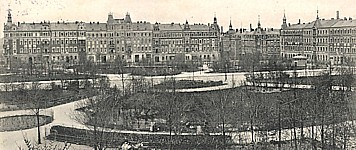

_Foto: Blick über den Nostitz-Wallwitz-Platz um 1910_

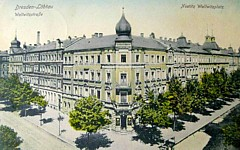Mit der Entstehung des Platzes siedelten sich in den umgebenden Wohnbauten auch zahlreiche Geschäfte und Gaststätten an. So gab es im Eckhaus zur Nostitzstraße (heute Clara-Viebig-Straße 12) vor dem Ersten Weltkrieg den “Sachsenhof”, später “Sachsenburg” genannt. An der Ecke zur Wallwitzstraße existierte im Haus Nr. 16 die Gastwirtschaft “Zum Ritter Frundsberg” _(Foto rechts)_
. Zuletzt hatte hier bis ca. 2010 das Lokal “Saustall” sein Domizil. Eine weitere Gaststätte befand sich am Nostitz-Wallwitz-Platz 1 (“Zum Hirsch”). Hinzu kamen mehrere Läden für den Lebensmittelverkauf sowie die Flora-Apotheke (Nr. 13).

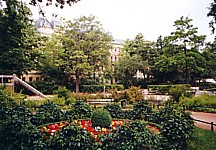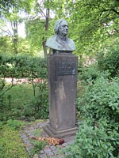1956 wurde der Nostitz-Wallwitz-Platz in Clara-Zetkin-Platz
umbenannt. An die bekannte sozialistische Politikerin und Reichstagsabgeordnete der KPD erinnert ein Denkmal, welches 1994 an die Südseite des Platzes versetzt wurde. Zwei Jahre zuvor hatte die Dresdner Künstlerin Heidemarie Dreßel einen “Wasserspielplatz” geschaffen, bei dem verschiedene bewegliche Keramikelemente als Wasserspeier dienten. Leider wurde die Anlage bereits wenig später durch Vandalismus zerstört und 2000 wieder beseitigt. 1993 erfolgte eine erneute Namensänderung in Bonhoefferplatz. Dietrich Bonhoeffer (1906-1945) war als engagiertes Mitglied der Bekennenden Kirche im Widerstandskampf gegen die Nazis aktiv und wurde 1945 im KZ Flossenbürg hingerichtet.

1994 begannen am Bonhoefferplatz Sanierungsarbeiten, die eine Wiederherstellung des historischen Bildes zum Ziel haben.
Neben Wohnungen und Geschäften besteht seit 1993 auch ein kleines Hotel “Am Bonhoefferplatz”, welches zum Verband
Christlicher Hospize in Deutschland gehört. Unweit davon gibt es im Eckhaus zur Reisewitzer Straße (Nr. 49) das bekannte
italienische Restaurant “La Contadina” sowie an der gegenüberliegenden Ecke Bonhoefferplatz / Reisewitzer Straße / Clara-
Viebig-Straße die Cocktailbar “West Side” (Nr. 12). Historische Treppenhausgestaltungen der Gründerzeit finden sich u.a. in den Wohnhäusern Nr. 5 und 24.

### Bramschstraße

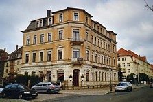
Die Bramschstraße verdankt ihren Namen dem Löbtauer Gutsbesitzer und Fabrikanten Johann Ludwig Bramsch (1811-1877). Bramsch war Inhaber einer Preßhefen- und Spirituosenfabrik in der Friedrichstadt und erwarb 1857 das Stadtgut Löbtau an der Lübecker Straße. Er trat auch als Stifter und Wohltäter des Ortes auf und unterstützte u.a. die örtliche Armenfürsorge. Ihren Namen erhielt die Straße 1898. Einige Wohnhäuser, u.a. das Eckhaus zur Gohliser Straße mit der Gastwirtschaft „Zur Myrte“ (Nr. 2 - _Foto_)) sowie die Gebäude Bramschstraße 11 und 16/18 stehen unter Denkmalschutz.

#### Bramschtunnel

Am 16. September 1999 wurde an der Bramschstraße mit dem Bau eines Straßentunnels begonnen, der als Teil der Gorbitzer Nordtangente zu einer Verkehrsentlastung der Kesselsdorfer Straße beitragen soll. Nach dem Tunnel im [Plauenschen Grund](../../../sud/plauen/plauenscher_grund/) war dieser zweiter bergmännisch erbauter Straßentunnel in Dresden. Als Tunnelpatin fungierte während
der Bauzeit die Ehefrau des damaligen Oberbürgermeisters Pia Wagner. Der Tunnel besteht aus zwei separaten Röhren von
660 Meter (Nordröhre) bzw. 667,5 Metern (Südröhre), wovon ca. 475 Meter unterirdisch verlaufen. Die Einweihung des
Bauwerks erfolgte am 30. November 2002. Der Tunnel beginnt als Verlängerung der Fröbelstraße und mündet in Höhe Klopstockstraße in die Coventrystraße.

### Braunsdorfer Straße

Die von Löbtau nach Gorbitz führende Braunsdorfer Straße wurde 1898 als Prinzeß-Luisen-Straße angelegt. Namenspatronin war die sächsische Kronprinzessin Luise von Toscana (1870-1947), welche 1891 Thronfolger Friedrich August III. geheiratet hatte. Für einen gesellschaftlichen Skandal sorgte ihre Scheidung 1903 und die folgende Flucht vom Hof mit dem Sprachlehrer ihrer Kinder. 1921 wurde die Straße nach dem kleinen Ort Braunsdorf bei Freital in Braunsdorfer Straße umbenannt.

Luisenhaus (Nr. 13): Zeitgleich mit Einweihung der Prinzeß-Luisen-Straße wurde hier das ebenfalls nach der Kronprinzessin benannte Luisenhaus eingeweiht. Die 1898 als gemeindeeigenes Kranken- und Versorgungshaus des damals noch selbständigen Ortes Löbtau gegründete Einrichtung diente zugleich als Altersheim und Damenstift.

1945 wohnten hier zunächst sowjetische Militärs, ab 1947 Krankenschwestern des Friedrichstädter Krankenhauses. Zeitweise nutzte auch die Stadtbezirksverwaltung für Dresden-West einige Räume im Hinterhaus. Am 15. August 1949 bezog die Poliklinik Dresden-Löbtau mit verschiedenen Fachabteilungen beide Gebäude. Nach den Polikliniken in Friedrichstadt, Blasewitz und Trachau war sie vierte Einrichtung dieser Art in Dresden. Wegen der beengten Raumverhältnisse und dem Mangel an Fachärzten wurde sie am 1. Juli 1952 an das Krankenhaus Dresden-Friedrichstadt angegliedert. Hinzu kamen mehrere Außenstellen, u.a. an der Malterstraße 45, der Alfred-Thiele-Straße 8 und im Kurbad Deubener Straße 25. 1969 erhielt die Poliklinik Löbtau ihre Eigenständigkeit zurück.

Nach einer umfassenden Sanierung 1990 dient das frühere Luisenstift heute als Gesundheitszentrum mit zahlreichen Arztpraxen, einer Rettungsstelle und dem Sitz des Ortsverbandes des Arbeiter-Samariter-Bundes. An der Westseite des Hintergebäudes erinnert eine Reliefdarstellung eines Pelikans mit seinen Jungen an die Geschichte des Hauses. Der Pelikan gilt als Symbol aufopfernder Mutterliebe und wird im Christentum mit Nächstenliebe, Opferbereitschaft und Familiensinn verbunden.

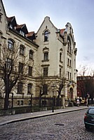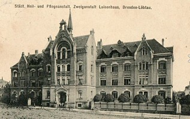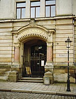

**_Fotos:_** _Das Luisenhaus an der Braunsdorfer Straße 13_

### Bünauplatz

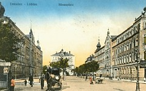
Der Platz entstand 1894 als Lindenplatz und erhielt 1904 den Namen Bünauplatz. Ebenso wie die benachbarte Bünaustraße (bis 1904 Lindenstraße) erinnert dieser an den sächsischen Historiker und Politiker Heinrich Graf von Bünau (1697-1762), der vor allem als Büchersammler bekannt wurde. Bünaus berühmte Bibliothek bildete später den Grundstock für die Sächsische Landesbibliothek.
1962 wurden Bünauplatz und Bünaustraße nach einem sächsischen KPD-Funktionär in Otto-Franke-Platz und -Straße umbenannt. Otto Franke (1877-1953) war Mitbegründer des Spartakusbundes und 1921-24 politischer Leiter der KPD-Bezirksleitung Ostsachsen. Ab 1946 gehörte er dem Parteivorstand und dem Zentralkomitees der SED an. Auf Beschluss des Stadtrates wurde diese Namensgebung Anfang 1993 wieder aufgehoben.

### Bünaustraße

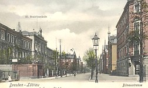Die Bünaustraße wurde 1894 im südlichen Teil von Löbtau angelegt und verbindet
Kesselsdorfer Straße und Frankenbergstraße. Ursprünglich wurde sie Lindenstraße genannt und erhielt nach der Eingemeindung Löbtaus 1904 den Namen Bünaustraße. Namensgeber war der sächsischen Historiker und Politiker Heinrich Graf von Bünau (1697-1762). Da diese Namensgebung zu DDR-Zeiten als “unzeitgemäߔ betrachtet wurde, erfolgte 1962 nach einem sächsischen KPD-Funktionär die Umbenennung in Otto-Franke-Straße. Auf Beschluss des
Stadtrates wurde diese Namensgebung Anfang 1993 wieder rückgängig gemacht.

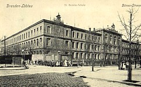
An der Bünaustraße befinden sich einige architektonisch und stadtgeschichtlich wichtige Gebäude Löbtaus. Zu diesen gehörten die 1888 erbaute und 1945 zerstörte [35\. Volksschule](../../../sudwest/lobtau/) am Badweg
_(Foto)_ sowie die 1923 geweihte katholische [St. Antonius-Kirche](../../../sudwest/lobtau/st__antonius-kirche/). In unmittelbarer Nachbarschaft entstand 1912 mit der Katholischen Volksschule ein weiteres Schulgebäude. Weitere Grundstücke wurden von Wohnhäusern und kleinen Gewerbebetrieben eingenommen. So gab es im Hintergebäude der Bünaustraße 3 die Sächsische Motoren- und Maschinenfabrik von Otto Böttger. Die Erdgeschossräume der Häuser Nr. 23 (“Lindenhof”) und 35 (“Restaurant zum Volksbad”) beherbergten Gaststätten.

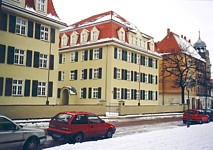1912 errichtete Stadtbaurat Hans Erlwein eine kleine Wohnanlage für Beamte der
Städtischen Straßenbahn (Bünaustraße 4b - 8b), die 1999/2000 denkmalgerecht saniert wurde _(Foto)_. Zuvor befand sich auf dem Areal einer der ersten Dresdner Straßenbahnhöfe. Eine Stele am Eingang trägt die Inschrift: _“Ehre das Überlieferte, Alte und schaffe Neues aus Ihm. Hans Jakob Erlwein. Stadtbaurat in Dresden 1905-1914.”_ Innerhalb der Anlage befinden sich ein zentraler Platz mit Brunnen und Bänken, Wäschetrocken- und Kinderspielplätze.

#### Maschinenfabrik Simon
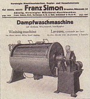
Das Unternehmen entstand um 1880 auf dem Grundstück Bünaustraße 34 und gehörte zu den zahlreichen Gewerbebetrieben der emporstrebenden Vorstadt Löbtau.
Hergestellt wurden hier Schiffsarmaturen, später vor allem Großgeräte wie Spülmaschinen und Waschmaschinen für den gewerblichen Einsatz. Nach Einstellung der Produktion 1990 standen die
Gebäude leer und wurden 2007 abgerissen. Einige geborgene Maschinen sind heute in einem kleinen Park auf dem ehemaligen Firmengrundstück zu sehen.

**_Bild:_** _Werbeprospekt der Maschinenfabrik Simon um 1925_

### Burgkstraße

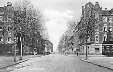
Die Burgkstraße wurde 1883 zu Ehren des Bergwerks- und Rittergutsbesitzers Carl Christian Arthur Freiherr von Burgk auf Roßthal (1823-1897) benannt. Die ehemals bürgerliche Familie Krebs erhielt als Eigentümer der Burgker Steinkohlewerke den Freiherrentitel und gehörte zu den reichsten Familien Sachsens. Sohn Carl Christian Arthur übernahm 1849 die Betriebsführung des väterlichen Unternehmens und lebte auf dem nahe Löbtau gelegenen [Schloss Roßthal](../../../sudwest/rossthal/schloss_rossthal/). Zu seinen sozialen Verdiensten gehören die Stiftung des Burgker Knappschaftshospitals sowie die Finanzierung einer Kleinkinderbewahranstalt in Löbtau. Sein Grab befindet sich auf dem Friedhof in Pesterwitz.

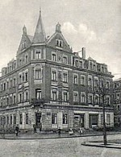
Zahlreiche Gebäude der Burgkstraße stehen wegen ihrer architektonischen Bedeutung unter Denkmalschutz. Einige von ihnen zeigen künstlerischen Bauschmuck im Jugendstil. Sie entstanden meist zwischen 1900 und 1910 als Wohnhäuser für Arbeiterfamilien der aufstrebenden Vorstadt. Auch zwei Gaststätten gab es hier: die Schankwirtschaft „Zur Burg“ (Nr. 15) und das Restaurant „Zum Lerchenberg“ (Nr. 34).

####  Hotel Burgk

Hotel Burgk (Nr. 15): Das Lokal wurde Ende des 19. Jahrhunderts am Rand des Löbtauer Dorfplatzes als Restaurant “Zur Burg” gegründet, wobei man mit diesem Namen wohl Bezug auf den Straßennamen nahm. Inhaber war bis 1913 Kurt Kreher, danach Karl Krutzsch. Das Eckhaus an der Einmündung der Hermsdorfer Straße _(Foto um 1910)_ dient bis heute gastronomischen Zwecken. Seit 1991 wird es als familiengeführtes Drei-Sterne-Hotel genutzt.

### Chauseehausstraße

Die Straße erhielt 1900 zunächst den Namen Dr. Schmidt-Straße, der an den früheren Amtshauptmann von Dresden-Altstadt,
Dr. jur. Emil Richard Schmidt (1833-1903) erinnerte. Die Gemeinde Löbtau hatte zu diesem Zeitpunkt die Dr.-Emil-Richard- Schmidt-Stiftung ins Leben gerufen, die sich vor allem der Behinderten- und Krankenfürsorge widmete. 1962 wurde die Dr.-Schmidt-Straße nach einem KPD- und SED-Funktionär in Bruno-Schramm-Straße umbenannt. Bruno Schramm war in den Zwanziger Jahren als Betriebsrat des Reichsbahn-Ausbesserungswerkes Dresden-Friedrichstadt tätig und floh 1933 in die Sowjetunion. Nach 1945 war er u. a. Präsident der Reichsbahndirektion Schwerin.

Im Zusammenhang mit der großen Straßenumbenennungsaktion Anfang der 1990er Jahre wurde auch diese Straße erneut umbenannt. Die heutige Bezeichnung Chausseehausstraße weist auf das frühere Löbtauer [Chausseehaus](../../../sudwest/lobtau/strassen_lobtau/kesselsdorfer_strasse/) an der Ecke Tharandter/Kesselsdorfer Straße hin, welches Ende des 19. Jahrhunderts
abgebrochen wurde.

### Clara-Viebig-Straße

Die frühere Nostitzstraße, am 25. Februar 1891 benannt nach dem Politiker und Dresdner Ehrenbürger Hermann von
Nostitz-Wallwitz (1826-1906), erhielt 1956 den Namen Clara-Viebig-Straße. Clara Viebig (1860-1952) gehört zu den bedeutendsten
deutschen Erzählerinnen und schuf mehrere Romane und Novellen, darunter ihr bekanntestes Werk “Das Kreuz im Venn”. Das Dstraßenbild prägen überwiegend mehrgeschossige Wohnhäuser der Gründerzeit. Im Eckhaus zum Bonhoefferplatz (Nr. 12) befand sich vor dem Ersten Weltkrieg das Restaurant “Sachsenhof”.

Die Straße, welche parallel zum Weißeritzufer führt, wurde am 19. November 1892 nach dem Seefahrer und Entdecker
Amerikas Christoph Kolumbus (1446-1506) benannt. Das Straßenbild prägen vorrangig Mehrfamilienhäuser, von denen jedoch einige den Luftangriffen 1945 zum Opfer fielen. Unter Denkmalschutz stehen die Gebäude Nr. 8, 9 und 11.

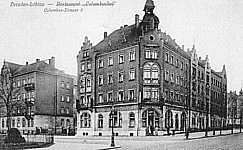Columbushof:
Bis Mitte der Zwanziger Jahre gab es im Eckhaus Wernerstraße / Columbusstraße (Nr. 9) das Restaurant “Columbushof” _(Foto)_. Nach der Schließung übernahm im Frühjahr 1926 die KPD Ostsachsen die Räume und
richtete hier ihre Bezirksleitung ein. Ab 1931 befand sich im Haus das Büro der Unterbezirksleitung Dresden, der u.a. der spätere Bundestagsabgeordnete Herbert
Wehner angehörte. Mit Machtantritt der Nationalsozialisten bezog die NSDAP- Ortsgruppe Löbtau das ehemalige Lokal. Zu DDR-Zeiten befand sich in den Räumen zeitweise eine Arztpraxis. 1963 wurde am Haus eine Gedenktafel in
Erinnerung an das frühere KPD-Büro angebracht. Nach 1990 gelangte das Haus mehrfach in die Schlagzeilen, als es zu gewaltsamen Auseinandersetzungen zwischen dem hier befindlichen linksalternativen
Wohnprojekt “Praxis” und Neonazis kam. Heute dient das Haus Wohnzwecken.

Der um 1895 angelegte Platz erhielt zunächst zu Ehren des sächsischen Kronprinzen Friedrich August (1865-1932) den Namen Friedrich-August-Platz. Um Verwechslungen zu vermeiden,
benannte man ihn 1907 in Kronprinzenplatz um. Die Platzanlage wurde gärtnerisch gestaltet und erhielt eine kleine Brunnenanlage in Form eines stilisierten Blattes. Als
Wasserspeier fungierten vier Frösche am Beckenrand. 1920 wurde dieser Brunnen um eine Bärenplastik ergänzt. Schöpfer
des Bären war der Bildhauer Otto Pilz. Die Froschfiguren des Bärenbrunnens gingen später leider verloren und wurden
vermutlich während des Zweiten Weltkrieges eingeschmolzen. Erhalten blieb lediglich der kleine Bär, der noch 1947 an seinem
Platz stand, später jedoch unter ungeklärten Umständen verschwand. 1950 erfolgte der Abriss der verbliebenen Brunnenanlage.

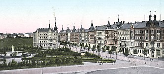

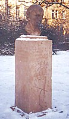Am 31. Mai 1945 wurde der Kronprinzenplatz in Rudolf-Renner-Platz umbenannt. An diesen Löbtauer
Antifaschisten erinnert auch ein Denkmal in der Parkanlage _(Foto)_. Rudolf Renner (1894-1940) gehörte ab 1918 der Spartakusgruppe, später der KPD an und war ab 1921 jüngster Abgeordneter des
sächsischen Landtags. Wegen seines politischen Engaments, u.a. als Redakteur der Sächsischen Arbeiter-Zeitung, kam er 1933 ins KZ Buchenwald, wo er 1940 an den Haftbedingungen verstarb.

1993 erfolgte die Umbenennung des Rudolf-Renner-Platzes  in Conertplatz. Dr. Herbert Conert (1886-1946), der bereits in den Zwanziger Jahren als Stadtbaudirektor in Dresden wirkte,  war als Mitbegründer der CDU nach 1945
am demokratischen Neuaufbau in Dresden beteiligt und leitete die städtische Bauverwaltung. Unter seiner Regie entstand 1946 der erste Dresdner Wiederaufbauplan.

Die Anlagen des Conertplatzes wurden 1993/94 nach historischem Vorbild teilweise rekonstruiert. Künftig wird auch eine
Wiederherstellung des Bärenbrunnens in Betracht gezogen. 2009/10 entstanden auf dem Gelände ehemaliger Tennisplätze nördlich des Platzes durch eine Bauherrengemeinschaft die Reihenhäuser des sogenannten “Court Conert”.

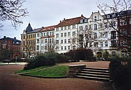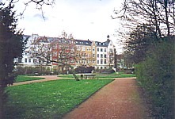

**_Fotos:_** _Der Conertplatz im Jahr 2010_

Die Delbrückstraße entstand um 1890 im Zusammenhang mit der Anlage des Crispiplatzes und wurde am 25. Februar 1891 nach dem deutschen Reichskanzler Otto von Bismarck zunächst Bismarckstraße benannt. 1904
erfolgte die Umbenennung nach Rudolf von Delbrück (1817-1903), einem Bismarck-Mitarbeiter und Leiter des Reichskanzleramtes. 1962 hieß die
Straße noch kurzzeitig Willi-Ermer-Straße, bevor die Benennung ganz aufgehoben wurde. Grund war die vollständige
Zerstörung der vorhandenen Bebauung zwischen Ebertplatz und Oederaner Straße 1945. Später befand sich hier viele Jahre die Endhaltestelle des O-Busses Linie 61.

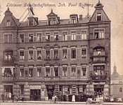Von den ehemaligen Gebäuden der Delbrückstraße hat keines die Zerstörungen des Jahres
1945 überstanden. Der ältere Teil der Bebauung befand sich in Richtung Weißeritzufer und bestand aus mehrgeschossigen Mietshäusern in geschlossener Bebauung. Im Haus Delbrückstraße 2 _(Foto)_
war das “Löbtauer Gesellschaftshaus” von Paul Rossberg untergebracht. Später betrieb der Besitzer hier eine Likörfabrik. Eine weitere Gaststätte befand
sich mit dem “Restaurant zur alten Pulvermühle” im Eckhaus zur Hohenzollernstraße direkt an der Weißeritzbrücke. Zwischen 1903 und 1905 ließ der Dresdner Spar- und Bauverein die
gegenüberliegende Freifläche zwischen Delbrückstraße, Hohenzollernstraße und Crispiplatz (Ebertplatz) mit einer Wohnanlage bebauen. Die Entwürfe stammten vom Architektenbüro
Schilling & Gräbner. Heute befindet sich hier eine Grünfläche.

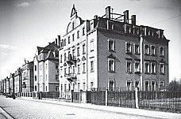
Die Deubener Straße wurde 1892 am Rand des Löbtauer Friedhofs angelegt und am 16. November nach der Gemeinde Deuben, seit 1921 Stadtteil von Freital, benannt. Das Straßenbild prägen vor allem Wohnhäuser der Gründerzeit _(Foto um 1910)_. In einem dieser Gebäude (Nr. 5) befand sich früher die Gaststätte „Deubener Hof“. Im Haus Nr. 25 gab es einst das „Kurbad Löbtau“, seit 1958 als Außenstelle der
Poliklinik Löbtau. Auch das heute nicht mehr vorhandene Eckhaus zur Grillenburger Straße (Nr. 14) beherbergte einst ein Lokal - das Restaurant & Café Thüringer Hof _(Foto rechts)_. Nach 1990 entstand auf dem Grundstück ein Neubau.

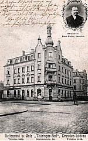Architektonisch interessant ist die 1927 von Curt Herfurth errichtete Wohnanlage der
Eisenbahner-Baugenossenschaft (Nr. 16-32) zwischen Grillenburger und Essener Straße, die heute unter Denkmalschutz steht. Von Herfurth stammen auch die Planungen des Einzelhauses Nr. 10 von
1926\. Zwischen 1927 und 1930 wurden weitere Wohngebäude errichtet (Nr. 36-40).

Zeh-Camera-Fabrik: Das Unternehmen wurde 1902 vom Mechanikermeister Paul Zeh auf der
Freiberger Straße 6 gegründet, jedoch bereits 1903 zur Deubener Straße 33 (ab 1908 Nr. 29) verlegt. Hergestellt wurden zunächst Bedarfsartikel für die photographische Industrie, ab 1913 auch
eigene Kameras. Der Familienbetrieb beschäftigte nur ca. 20 Mitarbeiter und brachte bis zur Einstellung der zivilen Produktion 1940 unter dem Markennamen “Zeca” mehrere Kameramodelle
auf den Markt. Während des Zweiten Weltkriegs wurden auch hier Rüstungsgüter produziert. Die Firmengeschichte endete 1948 mit der Schließung des Werkes.

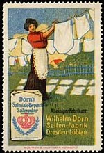
Die Döhlener Straße wurde Ende des 19. Jahrhunderts bei der Projektierung der neuen Wohnviertel südlich der Kesselsdorfer Straße projektiert und sollte ursprünglich von dieser
abgehend bis zum heutigen Bonhoefferplatz führen. 1894 erhielt sie ihren Namen nach der Gemeinde Döhlen, seit 1921 Stadtteil von Freital.

Zu dieser Zeit entstanden hier Wohnhäuser, von denen die Gebäude Nr. 25 und 27 als Baudenkmale unter Schutz stehen. Außerdem siedelten sich einige Gewerbebetriebe an,  so die
Seifenfabrik Wilhelm Dorn im Hintergebäude von Nr. 31. Hergestellt wurden hier Seifen und Reinigungsmittel, u.a. “Dorns Salmiak-Terpentin-Seifenpulver. Die gewerbliche Nutzung eines
Grundstücks führte auch dazu, dass eine durchgehende Straßenführung nicht mehr möglich war. Der nördliche Abschnitt wurde deshalb der Gröbelstraße zugeschlagen, das südliche Reststück besteht bis heute als Sackgasse.

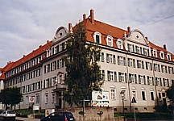Die Ende des 19. Jahrhunderts angelegte Dölzschener Straße erhielt ihren Namen am 9.
Februar 1887 nach dem nahegelegenen Ort Dölzschen, welcher erst seit 1945 zu Dresden gehört. Zuvor war sie Teil eines alten Verbindungsweges zwischen Dölzschen,
Löbtau und dem Weißeritztal. Nach 1900 entstanden hier Mietshäuser. Die zwischen Dölzschener Straße (Nr. 10-12), Frankenbergstraße und Zauckeroder Straße gelegene Wohnanlage _(Foto)_
wurde 1912-14 durch die Eisenbahner - Baugenossenschaft errichtet und stellt ein typisches Beispiel des genossenschaftlichen Siedlungsbaus dieser Zeit dar.

Unweit davon befinden sich die “Johann-Meyer-Häuser” (Nr. 17-23), welche 1911 von Hans Erlwein entworfen wurden und in den Anfangsjahren kinderreichen Familien vorbehalten waren. Beide Wohnkomplexe wurden nach 1990 denkmalgerecht
saniert. Im Haus Nr. 49 wohnte während seiner Dresdner Zeit der Maler und Zeichner Walter Eberhard Loch (1885-1979), der u.a. im Tanzstudio von Mary Wigman tätig war.

Die durch ehemaliges Gärtnereigelände führende Straße trug ab 1876 den Namen Gartenstraße. Später entstanden auch hier
Wohngebäude und kleine Gewerbebetriebe. 1903 erfolgte die Umbenennung nach dem Dichter Joseph von Eichendorff (1788-1857) in Eichendorffstraße. Im Eckhaus zur Columbusstraße (Nr. 1) befand sich früher das Restaurant “
Wartburg”.

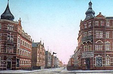
Der Name Emil-Ueberall-Straße erinnert seit 1993 an den Vermesser Emil Ueberall (1848-1936), der in Dresden als selbstständiger Landmesser tätig war und 1921
Vorsitzender des Landesvereins Sachsen der praktischen Geometer wurde. Ueberall entwarf 1875 den Bebauungsplan für die neuen Wohnviertel in Löbtau. Auf weitgehend rechteckigem Straßennetz entstanden bis zur Jahrhundertwende die für
diesen Stadtteil typischen freistehenden Mietshäuser, die wegen ihrer Form auch spöttisch “Kaffeemühlen” genannt werden _(Foto um 1900)_. Zu den markanten Bauten
der Straße gehören auch das frühere “Schwerter-Heim” (Nr. 29/31) und die frühere [37\. Volksschule](../../../sudwest/lobtau/).

Ursprünglich trug die Emil-Ueberall-Straße ab 1881 den Namen Herbertstraße nach dem ältesten Sohn Bismarcks (1849-1904), der zeitweise preußischer Gesandter in Dresden war. Um 1890 waren hier die Gebäude der 36. Volksschule
errichtet worden. 1962 erfolgte die Umbenennung in Ernst-Kießlich-Straße. Ernst Kießlich (1883-1958) war Vorsitzender des Betriebsrates im [Eisenwerk Meurer](../../../west/cossebaude/eisenwerke_meurer/) in Cossebaude und nach 1933 im Widerstandskampf gegen die NS-Diktatur aktiv. In
der Nachkriegszeit wirkte er u. a. als Stadtbezirksabgeordneter der SED und Schöffe.

Nr. 6:
Das Gebäude wurde 1875 vom evangelischen Marienverein als Kinderbewahranstalt errichtet. An diese Nutzung erinnern noch die Initialen “MV” am Eingangstor. Nach Zerstörung des alten Pfarrhauses an der Wernerstraße bezog in der
Nachkriegszeit die [Friedenskirchgemeinde](../../../sudwest/lobtau/friedenskirche/) das Gebäude. Seit 1976 befindet sich im Hinterhaus eine von der Diakonie
betriebene Werkstatt für Behinderte. Außerdem hat hier das Evangelisch-lutherische Stadtjugendpfarramt seinen Sitz.

Nr. 14: Im Hintergebäude dieses Hauses befand sich ab 1900 das Alexander-Bad, benannt nach seinem Besitzer Reinhold
Alexander Leuschner. Leuschner betrieb das private Wannenbad im Erdgeschoss und wohnte selbst im ersten Stock des Hauses. Da es in den meisten Arbeiterwohnungen noch keine Bäder gab, waren solche Reinigungsbäder für die persönliche
Hygiene unentbehrlich. Als eine der letzten Einrichtungen dieser Art existierte noch bis 1994 am Badweg das Volksbad
Löbtau. Das Alexanderbad wurde hingegen vermutlich bereits in den 1920er Jahren geschlossen. Danach nutzte die  Allgemeine Ortskrankenkasse die Räumlichkeiten.

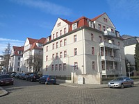 Die heutige Essener Straße wurde 1901 im Süden von Löbtau angelegt und hieß zunächst Gorbitzer Straße. Da es nach der Eingemeindung Löbtaus jedoch bereits eine Gorbitzer Straße in Dresden gab, erfolgte 1904 die Umbenennung in Essener Straße, benannt nach der Industriestadt Essen im Ruhrgebiet. Das Straßenbild prägen vor allem freistehende Würfelhäuser, welche zum Teil unter Denkmalschutz stehen (Nr. 10 und 12). Nach dem Ersten Weltkrieg entstanden zwischen Malter- und Deubener Straße drei- und viergeschossige Wohnblocks für die Eisenbahner-Baugenossenschaft Dresden e.G.m.b.H. sowie an der Einmündung zur Langen Straße für die Wohnungsbaugenossenschaft des Dresdner Handwerks e.G.m.b.H. Architekt dieser Häuser (Nr. 11-19 und 14-22) war Curt Herfurth.

Die im südlichen Teil von Löbtau gelegene Frankenbergstraße wurde am 28. Dezember 1892 nach einem von ihr durchschnittenen Flurstück bezeichnet. Wenig später entstanden
im unteren Bereich die ersten Mehrfamilienhäuser. Neben Wohnhäusern und kleinen Gewerbebetrieben gab es im Eckhaus zur Reisewitzer Straße (Nr. 14) bereits vor dem Ersten
Weltkrieg eine Schankwirtschaft. Heute werden die Räume von einem Pizzaservice genutzt.

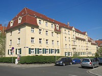Nach Ende des Ersten Weltkriegs setzte sich die Bautätigkeit im oberen Abschnitt der Straße fort. Bauherr war die Eisenbahner-Baugenossenschaft, die für die Planung den
Architekten Curt Herfurth verpflichtete. Herfurth entwarf  1919-1921 zunächst die Wohnhausgruppe zwischen Mohorner und Frankenbergstraße, 1922 den Wohnblock Frankenbergstraße 34-36 _(Foto)_
. 1926 folgten die Gebäude Frankenberger Straße 52-58. Im gleichen Jahr entstand als Abschluss des Wohnviertels am Ende der Straße ein Genossenschaftsheim (Nr. 60). Später befand sich hier die Gaststätte “Am Frankenberg”.
Heute wird das Gebäude gewerblich genutzt. Das anschließende Gelände gehört zur Kleingartensparte “Frankenberg e. V.”.

Die heutige Frankfurter Straße wurde im Jahr 1896 angelegt und hieß zunächst Potschappler Straße. Grund für diese
Namensgebung war ihre Ausrichtung nach dem nahegelegenen Ort Potschappel, der sich 1921 mit weiteren Gemeinden zur Stadt Freital vereinigte. Wenig später entstanden hier Mehrfamilienhäuser in offener Bauweise. 1938 erfolgte die
Umbenennung in Holzweberstraße. Ebenso wie bei der benachbarten Planettastraße (heute Fritz-Schulze-Straße) solllte mit
dieser Benennung an einen nach dem  Putschversuch in Östereich 1934 hingerichteten Kämpfer der nationalsozialistischen
Bewegung erinnert werden. Franz Holzweber war SS-Standartenführer und war am Attentat auf Bundeskanzler Engelbert Dollfuß beteiligt. 1945 erhielt die Straße ihren heutigen Namen nach der hessischen Großstadt Frankfurt am Main.

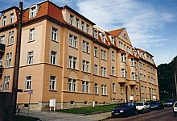Die heutige Fritz-Schulze-Straße wurde 1896 angelegt und bis 1938 nach der österreichischen Regentenfamilie Habsburgerstraße genannt. 1878 hatte der Plauener Mühlenbesitzer Bienert hier ein kleines [Gaswerk](../../../sud/plauen/) errichtet, welches bis 1920 produzierte und anschließend abgerissen wurde. 1938 erhielt die Straße nach dem von den Nazis als “Märtyrer” verehrten Otto Planetta (1899-1934) den Namen Planettastraße. Planetta hatte als Angehöriger der SS bei einem Putschversuch 1934 den österreichischen Bundeskanzer Dollfuß erschossen und wurde wegen seines Attentats hingerichtet.

Bereits 1945 wurde diese Namensgebung aufgehoben und durch den Namen Fritz-Schulze-Straße ersetzt. Fritz Schulze (1903-1942) gehörte zu den Mitbegründern der revolutionären Künstlergruppe ASSO und war ab 1930 Mitglied der KPD. Gemeinsam mit seiner Frau, der Malerin Eva Schulze-Knabe, war er im Widerstandskampf gegen die Nazis tätig. 1941 wurde Fritz Schulze mit einigen Mitstreitern verhaftet und 1942 in Berlin-Plötzensee hingerichtet. Das Straßenbild dominieren mehrstöckige Wohnhäuser, darunter die im Bild zu sehende denkmalgeschützte Wohnanlage Fritz-Schulze-Straße 11-15.

Die Grillenburger Straße entstand Ende des 19. Jahrhunderts im Zuge der Bebauung der Flächen südlich der Landstraße nach Freiberg. Ursprünglich wurde sie ab 1898 Kesselsdorfer Straße genannt (die heutige Kesselsdorfer Straße hieß damals Wilsdruffer Straße). Der auf Naußlitzer Flur gelegene Abschnitt trug ab 1897 den Namen Schulstraße, da sich hier das alte Naußlitzer Schulhaus befand. Nach der Eingemeindung der Vorstädte wurden 1904 beide Straßenabschnitte vereinigt und in Grillenburger Straße umbenannt. Namensgeber war die kleine Siedlung Grillenburg bei Tharandt.

Um 1900 entstanden an der Grillenburger Straße die ersten Gebäude, zu denen u.a. das Eckhaus zur Rabenauer Straße gehört (Nr. 11). Hier befand sich vor dem Ersten Weltkrieg die Schankwirtschaft “Zur Grillenburg”. Später nutzte viele Jahre ein Friseurgeschäft die Räume, bevor diese zu Wohnzwecken umgebaut wurden. Jüngeren Datums sind die unter Denkmalschutz stehenden Häuser Nr. 1-3, die 1927 als Teil einer Wohnanlage der Eisenbahner-Baugenossenschaft durch Curt Herfurth errichtet wurden.

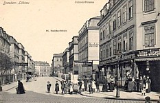Die Gröbelstraße wurde 1904 nach Christian Ernst August Gröbel (1783-1854) benannt, der 32 Jahre lang das Amt des Rektors der Dresdner Kreuzschule innehatte. Bis zur Zerstörung 1945 stand hier in der Nähe der Friedenskirche das Gebäude der [38\. Volksschule](../../../sudwest/lobtau/). Aus diesem Grund wurde die Gröbelstraße ab 1878 bis zur Eingemeindung Schulstraße genannt. Zuvor gab es in diesem Gebiet einige Tümpel und Teiche, weshalb das Flurstück umgangssprachlich den Namen “Am Teiche” trug. Im Erdgeschoss des heute nicht mehr vorhandenen Wohnhauses Nr. 9 existierte vor dem Zweiten Weltkrieg die Gaststätte "Reichskeller".

Lampenfabrik Seifert:

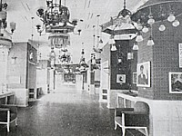Kulturhistorisch bedeutsam ist der 1905/06 errichtete Mustersaal der früheren Lampen- und Leuchtenfabrik Seifert. Nach Plänen von Wilhelm Kreis ließ Firmeninhaber Karl Max Seifert auf dem Grundstück Gröbelstraße 17 einen Mustersaal für seine Produkte bauen, in dem am 26. September 1906 die erste Exposition der Künstlergruppe “Brücke” stattfand. Seifert hatte den zu diesem Zeitpunkt als Assistent und Zeichner für Kreis tätigen Maler Erich Heckel während der Planungsphase für den Neubau kennengelernt und ihm und seinen Künstlerfreunden die Ausstellung ihrer Bilder in den Räumen ermöglicht. Eine zweite Ausstellung gab es im Dezember 1906 / Januar 1907, an der sich auch Wassily Kandinsky beteiligte. Max Pechstein, ebenfalls Mitglied der “Brücke”, gestaltete für den Firmeninhaber eine Werbepostkarte.

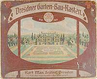Die offiziell als “Dresdner Kunstwerkstätten Karl Max Seifert” bezeichnete Firma befasste sich hauptsächlich mit dem Entwurf und der Herstellung von Lampen und ähnlichen Beleuchtungskörpern. Populär war auch ein von Seifert entwickelter “Dresdner Garten-Bau-Kasten”, bei dem die Spieler mit gipsartigen Spielsteinen komplette Gartenanlagen mit Wegen, Rasen- und Blumenrabatten und Wasserspielen gestalten konnten. Diese Bausteinkästen wurden von Seifert in großer Vielfalt hergestellt und waren seinerzeit sehr beliebt.

1908 musste Seifert sein Unternehmen aufgeben und überließ die Räumlichkeiten der Firma Kretschmar, Bösenberg & Co., die als Dresdner Werkstätten für Beleuchtungswesen m.b.H. ebenfalls auf dem Gebiet der Lampenherstellung tätig war. Später wurden die Produktionshallen und der Mustersaal an verschiedene Unternehmen vermietet. So ist ab 1915 das ursprünglich in der Johannstadt (Blumenstraße 4) ansässige Metallwerk Kratos von Otto Bostelmann an der Gröbelstraße nachweisbar. Zuvor hatte bereits die durch einige Patentanmeldungen erfolgreiche Lyma-Vergaserfabrik Dietz & Co. ihren Sitz auf dem Grundstück.

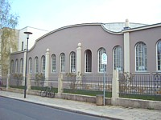Um 1925 übernahm die Dresdner Präzisionswerkzeugfabrik G.m.b.H das Gelände. Weitere Mieter waren die Werka Werkzeug- und Apparate-Bau A.-G. und eine Spezialfirme für Hochspannungsapparate. Bis zum Kriegsende gab es in den 1940er Jahren eine Kokillengießerei und eine Autolackierei. Zwischen 1954 und 1991 wurde das Gelände von der Kältetechnikfirma ILKA genutzt. 2004/96 erfolgte schließlich der Abbruch der stark verfallenen Fabrikhallen. Lediglich der unter Denkmalschutz stehende Kopfbau mit dem Mustersaal blieb erhalten und wurde 2008 in den Neubau der [“Löbtau-Passage”](../../../sudwest/lobtau/strassen_lobtau/kesselsdorfer_strasse/) einbezogen _(Foto)_. Heute befindet sich hier eine Arztpraxis.

Die nach 1890 in der Nähe des heutigen Conertplatzes angelegte Straße wurde ab 1894 zunächst Parkstraße genannt, womit dem parkartig gestalteten Gelände des damaligen Kronprinzenplatzes Reverenz erwiesen werden sollte. Um Verwechslungen mit der Parkstraße in der Innenstadt zu vermeiden, erfolgte nach der Eingemeindung 1904 die Umbenennung in Grumbacher Straße. Der Ort Grumbach gehört heute als Ortsteil zu Wilsdruff.

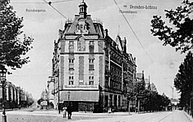Die vom Bonhoefferplatz zur Tharandter Straße führende Hainsberger Straße wurde 1897 angelegt und nach dem Dorf Hainsberg, seit 1964 ein Stadtteil von Freital, benannt. Neben Wohnhäusern gab es hier auch einige meist in den Hintergebäuden untergebrachte Kleinunternehmen, wie die Sächsische Konservenfabrik Bernhard Richter (Nr. 3), die Biox AG (Nr. 5) und die erste Produktionsstätte der bekannten Schokoladenfabrik Hartwig & Vogel (Nr. 9, bis 1914). In der Nr. 22 befand sich von 1929 bis 1945 die Adventgemeinde.

Markantestes Gebäude ist das spitzwinklige Eckhaus Nr. 17 an der Einmündung in die Tharandter Straße _(Foto)_. Eigentümer des Wohn- und Geschäftshauses war zunächst die Actienbrauerei zu Reisewitz, die hier ab ca. 1905 die Schankwirtschaft "Zur Hopfenblüte" betrieb. Später wechselte der Name des Lokals in "Zur Hopfenranke". Zu DDR-Zeiten befand sich in den Räumen eine Konsum-Fleischerei, nach 1990 ein Imbiss. Seit 2011 werden die Räume als Matratzengeschäft genutzt.

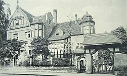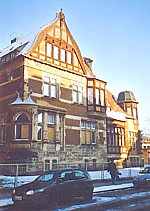Die Hermsdorfer Straße geht auf einen alten Fußweg zwischen dem Löbtauer Dorfplatz und dem benachbarten Wölfnitz zurück, welcher 1896 ausgebaut und Dorfstraße genannt wurde. Nach der Eingemeindung erfolgte 1904 die Umbenennung in Hermsdorfer Straße, wobei die Dörfer Nieder- und Oberhermsdorf (bei Kesselsdorf) Pate standen.

Die Hermsdorfer Straße wurde kurz darauf mit Wohnhäusern bebaut, von denen die Häuser Nr. 5, 16 und 18 unter Denkmalschutz stehen. Hinzu kamen einige gewerbliche Unternehmen wie die von Paul Scholz gegründete Walzenmassefabrik und -gussanstalt auf der Hermsdorfer Straße 13. Nach 1945 befand sich hier bis zur Wende ein Zweigbetrieb des VEB Steppdeckenfabrik Waldenburg. Bemerkenswert ist die vom Architektenbüro Schilling & Gräbner entworfene Villa Nr. 16 im Jugendstil _(Foto)_. Das Landhaus gehörte einst dem Löbtauer Gemeindeältesten Gustav Rudolf Friedrich. Später nutzte es die Stadt Dresden als Betreuungsstelle des Vereins für Mütter- und Säuglingsfürsorge und als Stadtwohlfahrtsamt. Nach 1945 befand sich hier bis 1991 ein Kindergarten mit Schulhort.

Die Klingestraße erhielt ihren Namen 1899 nach dem Löbtauer Unternehmer Alfred Klinge (1846-1910), der eine
Ledertreibriemenfabrik besaß und sich durch einige Stiftungen für das Gemeinwohl verdient machte. Hier befand sich bis zum Ersten Weltkrieg die Gemeindegärtnerei Löbtau, welche später der zunehmenden Bebauung weichen musste.

1911 wurden an der Klingestraße 14-22 und der Dölzschener Straße 17-23 einige Wohnhäuser der Krenkel- und der Johann-Meyer-Stiftung erbaut. Die Entwürfe für die denkmalgeschütze Wohnanlage stammen von Hans Erlwein, die
Fassadengestaltung übernahm Prof. Paul Rößler, ein Mitglied der renommierten Künstlervereinigung “Zunft”. Mit dem Bau der
durch die beiden Stiftungen finanzierten Arbeiterwohnhäuser setzte Erlwein erstmals in seiner Funktion als Dresdner Stadtbaurat moderne Auffassungen des Wohnungsbaus um. In Anlehnung an die kurz zuvor fertig gebaute Gartenstadt
Hellerau erhielten auch die Löbtauer Wohnhäuser Grün- und Erholungsflächen sowie gemeinsame Spiel- und Wäscheplätze. Außerdem wurden viele Wohnungen mit Balkons ausgestattet. 1913 waren diese Gebäude Exponat der Großen Berliner
Kunstausstellung. 1996 wurde die Siedlung unter Beachtung denkmalpflegerischer Aspekte umfassend saniert.

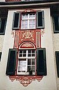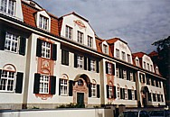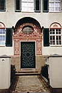

**_Fotos:_** _Erlwein-Häuser an der Klingestraße mit liebevoll gestalteten Details_

Die Lange Straße entstand Ende des 19. Jahrhunderts zunächst als Verbindung zwischen Stollestraße, Kesselsdorfer und
Saalhausener Straße und wurde 1898 wegen ihrer Länge so benannt. Im Zuge der Entstehung weiterer Wohnviertel erfolgten
1912 und 1929 in Richtung Süden Verlängerungen der Straße, die seitdem auch Naußlitzer Flur berührt. Ab 1929 wohnte bis
zu seinem Tod 1977 der Maler und Zeichner Richard Bernhardt (1900-1977) auf der Langen Straße 29. Bernhardt, der
beruflich bei der Stadtverwaltung tätig war, schuf in seiner Freizeit zahlreiche Aquarelle, Feder und Bleistiftzeichnungen von Dresden und seiner Umgebung.

Die Leumerstraße wurde am 20. Februar 1894 nach dem Gärtnereibesitzer Karl Gottlieb Leumer (1813-1877) benannt, welcher so für seine Zuwendungen an die örtliche Schule und Kirchgemeinde geehrt werden sollte. Gemeinsam mit seiner Frau begründete er die Leumer-Stiftung, die alljährlich Weihnachtsgeschenke für bedürftige Kinder des Ortes finanzierte. Die meisten Wohnhäuser entstanden um 1900, einige Baulücken wurden nach 1990 geschlossen.

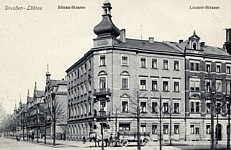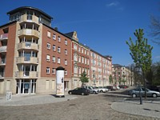

**_Fotos:_** _Blick in die Leumerstraße / Ecke Bünaustraße um 1900 und 2015_

Der heute nicht mehr vorhandene Löbtauer Weg gehörte einst zu den wichtigsten örtlichen Verkehrsverbindungen und führte
von der Freiberger Straße zur Weißeritz, die auf einem schmalen Holzsteg, dem sogenannten “Schindersteg”  überquert
wurde. Von hier aus verlief er durch den alten Dorfkern bis zur Freiberger Chaussee (Kesselsdorfer Straße). 1478 wurde er
erstmals als Lobetawer Weg erwähnt. 1549 ist er als Lobder Weg, später auch als Dresdner Weg in den Karten verzeichnet.
Im Zuge der weitgehenden Bebauung der Löbtauer Fluren verschwand dieser alte Weg, dessen Verlauf heute kaum noch
erkennbar ist. Bis 1879 befand sich an der Freiberger Straße die kurfürstliche, später königliche Ziegelei, weshalb dieser Wegabschnitt um 1845 auch als Ziegelsteig bezeichnet wurde.

Die heutige Lübecker Straße bestand bereits im 16. Jahrhundert als Verbindungsweg von Löbtau über Cotta nach Briesnitz.
Die von den Bewohnern als Weg zur Kirche genutzte Straße trug deshalb auch den Namen Löbtauer Kirchweg. Später wurde
sie auf Cottaer Flur zeitweise Kohlenstraße genannt, da über diesen Weg die Kohle des Döhlener Reviers transportiert wurde.
1904 erhielt sie zusammen mit der Cottaer Straße in Löbtau den Namen Lübecker Straße. Markantestes Gebäude ist das [Cottaer Rathaus](../../../west/cotta/).

Stadtgut Löbtau (“Sauerbratenschänke”): Das im Besitz der Stadt Dresden befindliche Gut wurde 1568 auf Löbtauer Flur
gegründet und besaß die Konzession zum Wein- und Bierschank, Branntweinbrennen, Backen und Schlachten. 1756 richtete
der Fleischer Jeremias Naumann in den Räumen seine Fleischerei ein, die er zugleich auch als Gastwirtschaft betrieb und
etappenweise ausbaute. Dieses alte Gasthaus war Mitte des 19. Jahrhunderts unter dem Namen “Sauerbratenschänke” ein
beliebtes Ausflugsziel. Die als “Original” geltende Gastwirtin Braune bot hier preiswerten Sauerbraten an, der weit über
Löbtau hinaus einen hervorragenden Ruf besaß. Später wurde die Gaststätte offiziell “Bürgergarten” genannt. Besitzer des
Stadtgutes war ab 1857 der Unternehmer Ludwig Bramsch, der wesentlich zu Löbtaus Entwicklung zum Industrievorort beitrug.

1945 wurde das Gebäude Lübecker Straße 19 schwer beschädigt und später nur teilweise wiederaufgebaut. Von den ehemals landwirtschaftlich genutzten Nebengebäuden sind heute noch ein Wirtschaftshof (Nr. 20) und das frühere Wohnhaus
(Nr. 18) erhalten. Beide entstanden um 1850 und weisen noch Merkmale der früheren Nutzung wie Ladeluken und Einfahrtstore auf. Der Gebäudekomplex wird heute gewerblich genutzt.

Nr. 47:
Auf diesem Grundstück befand sich einst die Städtische Abdeckerei, deren Wohn- und Verwaltungsgebäude bis heute erhalten blieb. Diese wurde Anfang des 20. Jahrhunderts an der Stadtgrenze zu Cotta errichtet.

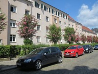
Die bis 1926 Südstraße genannte heutige Malterstraße erhielt ihren Namen nach dem kleinen Ort Malter bei Dippoldiswalde, welcher wegen seiner Talsperre bis heute ein
beliebtes Ausflugsziel ist. Bereits 1923 hatte der Löbtauer Sportverein “Spielvereinigung Löbtau 1893 e. V.” hier einen Sportplatz angelegt. Auch der 1905 entstandene Verein
“Löbtauer Victoria” nutzte zeitweise das Gelände. Die Anlage war bereits kurz nach Kriegsende 1945 Schauplatz einiger sportlicher Großveranstaltungen, darunter des ersten
Nachkriegs-Fußballspiels in Dresden zwischen einer Auswahl von Dresden-Altstadt und Neustadt am 17. Juni 1945. 2005 wurde der Platz umfassend saniert.

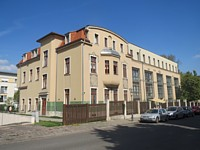
Die Ende des 19. Jahrhunderts im Süden von Löbtau angelegte Straße erhielt am 27. Juni 1893 nach dem preußischen Generalfeldmarschall Helmuth Graf von Moltke (1800-1891)
zunächst den Namen Moltkestraße. Um Verwechslungen mit gleichnamigen Straßen in anderen Stadtteilen zu vermeiden, wurde sie 1904 in Zietenstraße umbenannt. Hans
Joachim von Zieten (1699-1786) diente als Reitergeneral in der Armee Friedrich II. von Preußen.

1946 entschied man sich wegen der “militaristischen” Namensgebung für eine erneute
Umbenennung in Mohorner Straße. Die Gemeinde Mohorn befindet sich in der Nähe von Wilsdruff im heutigen Landkreis Sächsische Schweiz - Osterzgebirge. Neben Wohnhäusern aus der Zeit vor dem Ersten Weltkrieg blieb an der Mohorner
Straße 12 auch das Gebäude einer ehemaligen Glockengießerei erhalten. Hier ist seit 2009 ein Pflegeheim für Demenzkranke untergebracht _(Foto)_.

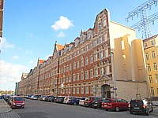Die parallel zur Bahnstrecke Dresden - Chemnitz verlaufende Straße wurde um 1884 nach dem Kauf einiger Grundstücke durch die Gemeinde Löbtau angelegt und trug ab 1889 den Namen Hohenzollernstraße. Mit der Namensgebung sollte das Fürstengeschlecht der Hohenzollern geehrt werden, aus welchem auch der regierende Kaiser Wilhelm II. entstammte. Ursprünglich gehörte dieses Areal zum kurfürstlichen Holzhof bzw. zum Grundstück der 1875 stillgelegten und 1945 zerstörten [Pulvermühle](../../../sudwest/lobtau/weisseritzmuhlgraben/). Ab 1890 wurde die Straße mit Mietshäusern bebaut. Hier befand sich in den Zwanziger Jahren auch die
Städtische Desinfektionsanstalt. Die bereits 1945 nach der Kleinstadt Oederan bei Chemnitz in Oederaner Straße umbenannte Straße wurde 1960 durch die Anlage der Brücke der Jugend geteilt. Neben Wohnhäusern der Gründerzeit prägen heute auch die Bauten des [Kraftwerks Nossener Brücke](../../../sudwest/lobtau/kraftwerk_nossener_brücke/kraftwerk/) und dessen markanter Kühlturm das Straßenbild.

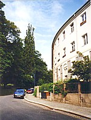
Die Paschkystraße an der Ortsgrenze zwischen Löbtau und Plauen erhielt ihren Namen 1926 nach dem Dresdner Fischhändler August Paschky (1850-1891). Der auch politisch engagierte Paschky genoss bei der Dresdner Bevölkerung durch seine preiswerten Angebote, die er in 15 Filialen in der ganzen Stadt an die Kundschaft brachte, hohes Ansehen. August Paschky war Mitglied im Arbeiterbildungsverein und im Sozialdemokratischen Arbeiterverein und wurde während der Zeit des Sozialistengesetzes zu einem Jahr Haft verurteilt. 1891 verstarb er mit nur 41 Jahren an den Folgen seiner Inhaftierung. Das Unternehmen wurde daraufhin von seiner Frau mit einigen Geschäftspartnern fortgesetzt und bestand noch bis 1945.

1933 wurde die Paschkystraße in Pfordtenstraße umbenannt. Mit dieser Namensgebung sollte an den 1923 vor der Feldherrnhalle in München bei einem Putschversuch gefallenen Theodor von der Pfordten erinnert werden. Die Benennung wurde nach Ende der nationalsozialistischen Herrschaft wieder rückgängig gemacht. Bereits vor 1945 führte die Straße halbkreisförmig von der Tharandter bis zur Habsburgerstraße (heute Fritz-Schulze-Straße), wurde später jedoch unterbrochen. Im Zuge einer Bebauung der noch vorhandenen Freiflächen 2015 stellte man den ursprünglichen Verlauf wieder her.

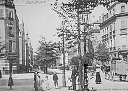
Die Poststraße wurde am 1. Dezember 1880 nach dem deutschen Dichter Heinrich Heine (1799-1856) benannt und erhielt ihren heutigen Namen erst 1893 nach dem hier an der Ecke zum Schillingplatz gelegenen
Postamt Dresden A 28. Um 1900 richtete die Königin- Carola-Stiftung an dieser Straße die erste Volksküche Löbtaus ein.

Bis zur Zerstörung 1945 existierte im Eckhaus zur Kesselsdorfer Straße die [“Musenhalle”](../../../sudwest/lobtau/strassen_lobtau/kesselsdorfer_strasse/musenhalle/) mit dem Kino “Li-Mu”. Nach dem Krieg entstand auf dem Nachbargrundstück ein
eingeschossiges Gebäude mit der beliebten Wohngebietsgaststätte “Berolina”. Seit 2006 befindet sich in diesen Räumlichkeiten das Restaurant ”Mephisto”. Unweit davon öffnete
2006 im Haus Poststraße 12 das inzwischen wieder geschlossene französische Café-Restaurant “Mon Village”.

Die Reisewitzer Straße, die von Plauen bis zum Löbtauer Dorfkern führt, erhielt 1874 ihren Namen nach dem hier gelegenen Vorwerk Reisewitz, welches sich im 18. Jahrhundert im
Besitz des kurfürstlichen Bergdirektors Johann von Reisewitz befand. Aus dem Vorwerk entwickelte sich später der bekannte [Reisewitz\`sche Garten](../../../sudwest/lobtau/strassen_lobtau/tharandter_strasse/reisewitz_scher_garten/) mit Theater und Gastwirtschaft.
Ab 1869 existierte hier bis 1931 die Aktienbrauerei Reisewitz, deren Gebäude noch erhalten sind. Das Gelände der 1861 gegründeten Löbtauer Ziegelei wurde nach 1890 mit Mietshäusern bebaut.

Im Gegensatz zu anderen Löbtauer Straßen war die Reisewitzer Straße ursprünglich als direkte Verbindung zwischen Plauenschem Grund und Elbe konzipiert und wurde deshalb auf 17 Meter Breite ausgebaut.
Später verhinderte der Bau der Friedenskirche die vollständige Umsetzung des von Emil Ueberall entworfenen Konzepts, so dass die Straße heute vor der Kirche endet _(Foto um 1910)_.

Die Saxoniastraße wurde nach 1890 angelegt und zunächst nach dem früher hier befindlichen [Kanonenbohrwerk](../../../sudwest/lobtau/weisseritzmuhlgraben/)
benannt. 1897 erhielt sie den Namen Saxoniastraße, der auf die weibliche Allegoriegestalt “Saxonia” zurückgeht, die als Personifizierung und Schutzpatronin des Landes Sachsen gilt.

Der Schillingplatz und die anschließende Schillingstraße erhielten ihren Namen 1893 nach dem bedeutenden Bildhauer
Johannes Schilling (1828-1910). Schilling wurde u. a. als Schöpfer der Figurengruppe an der Freitreppe zur Brühlschen Terrasse, des Semper- und Rietscheldenkmals in Dresden und des Goethe-Schiller-Denkmals in Weimar bekannt. 1883
erhielt er die Ehrenbürgerwürde von Dresden. Eine Plastik des Bildhauers wurde nach 1945 in den Grünanlagen an Stelle des zerstörten Löbtauer Rathauses aufgestellt. 2012 kehrte sie nach Niedersedlitz zurück.

Die frühere Kirchstraße erhielt 1904 den Namen Stollestraße nach dem Schriftsteller und Verleger Ludwig Ferdinand Stolle
(1806-1872). Stolle gab in Dresden das humoristisch-politische Blatt “Der Dorfbarbier” heraus und verfasste zahlreiche Romane mit meist historischem Inhalt.

**_Fotos:_** _Blick in die Stollestraße um 1910 und die Ecke Stollestraße / Langestraße) im Winter 2006_

Die 1893 angelegte Straße erhielt nach ihrer Fertigstellung zunächst nach dem preußischen Generalfeldmarschall Albrecht Emil
Theodor Graf von Roon (1803-1879) den Namen Roonstraße. Als Kriegsminister und enger Vertrauter Bismarcks leitete er
den Umbau der preußischen Armee und verfasste zahlreiche militärgeografische Werke. Hier befand sich ab 1890 auch das gemeindeeigene [Löbtauer Gaswerk](../../../sudwest/lobtau/). 1946 wurde die Roonstraße nach der sächsischen Kleinstadt Waldheim in Waldheimer
Straße umbenannt.

Die Wernerstraße und der angrenzende Wernerplatz verdanken ihren Namen dem Mineralogen und Geologen Abraham Gottlob Werner (1749-1817). Werner gilt als
“Vater der Geologie” und war regelmäßig zwischen Dresden und seinem Arbeitsort, der Freiberger Bergakademie, unterwegs. Zu seinem Lieblingsrastplatz gehörte eine Stelle am
heutigen Neuen Annenfriedhof. Hier wurden nach seinem Tod 1817 die sterblichen Überreste des Professors aufgebahrt und an seine Freiberger Mitarbeiter übergeben.
Bereits ein Jahr später errichteten Freiberger Studenten an diesem Platz einen [Gedenkstein](../../../sudwest/lobtau/friedenskirche/neuer_annenfriedhof/), der noch heute neben dem Haupteingang des Friedhofs zu finden ist. Ihren
Namen erhielt die Wernerstraße auf Beschluss des Löbtauer Gemeinderates am 16. Oktober 1873.

An der Wernerstraße 1 befand sich einst die 1866 errichtete alte Löbtauer Dorfschule, die ab 1874 als Gemeindeamt diente.
1879 folgte eine katholische Kinderbewahranstalt. Regelmäßig besuchte Königin Carola die von ihr finanzierte Einrichtung.
Später entstanden in unmittelbarer Nachbarschaft das der Armenfürsorge gewidmete Albertstift und eine Volksküche.

Zu den markantesten Gebäuden der Wernerstraße gehört die 1890/91 nach Plänen Christian Friedrich Arnolds errichtete und 1945 schwer beschädigte evangelische [Friedenskirche](../../../sudwest/lobtau/friedenskirche/). Auf dem Nachbargrundstück stand das 1882 erbaute Pfarrhaus der
Kirche (Nr. 22). Dieses Gebäude fiel, ebenso wie einige Wohnhäuser und das Schulhaus an der Ecke zur Gröbelstraße, den Bomben des Zweiten Weltkriegs zum Opfer. Heute prägen vorrangig Wohnhäuser, aber auch noch einige Baulücken das
Straßenbild. Die Wohnanlage Wernerstraße 12-18, zu der auch das Haus Columbusstraße 11 gehört, entstand nach dem
Ersten Weltkrieg für den Gemeinnützigen Bauverein Dresden. Auf einer Freifläche zwischen Kesselsdorfer und Wernerstraße wurde 2011/12 ein modernes Seniorenzentrum für Demenzkranke mit 116 Plätzen gebaut.

**_Fotos:_** _Häuser an der Einmündung Kesselsdorfer/Wernerstraße um 1900 (links) und kurz vor dem Abriss im_
_September 2006. In dem Flachbau ganz links befand sich einst das beliebte Löbtauer Café “Zum Frieden”_.

Die Ende des 19. Jahrhunderts im Süden der Löbtauer Flur angelegte Straße wurde ab 1898 zunächst Coschützer Straße
genannt. 1904 erfolgte die Umbenennung in Zauckeroder Straße. Zauckerode ist heute ein Ortsteil von Freital. Als erste
Wohnhäuser entstanden um 1900 die Gebäude Zauckeroder Straße 1 bis 7. Bauherr war der Löbtauer Unternehmer Richard
Riedrich, der seinen Firmen- und Wohnsitz auf der Zauckeroder Straße 1 hatte. 1926 folgte nach Entwürfen des Architekten Curt Herfurth die Wohnsiedlung Nr. 4-10.

Der heute nicht mehr vorhandene Ziegelweg führte einst von der Tharandter Straße zur Ziegelei Reisewitz. Im Zuge des
Ausbaus des Stadtviertels und der Anlage der Reisewitzer Straße und der Frankenbergstraße wurde die Bezeichnung 1898 aufgehoben und der Feldweg wenig später überbaut.

---

 \[ [Home](../../../index.html)\] \[ [Nord](../../../nord/)\] \[ [Nordwest](../../../nordwest/)\] \[ [Neustadt](../../../neustadt/)\] \[ [Nordost](../../../nordost/)\] \[ [West](../../../west/)\] \[ [Zentrum](../../../zentrum/)\] \[ [Südwest](../../../sudwest/)\] \[ [Süd](../../../sud/)\] \[ [Südost](../../../sudost/)\] \[ [Ost](../../../ost/)\] \[ [Register](../../../register/)\] \[ [Kontakt](../../../kontakt/)\] \[ [Impressum](../../../impressum/)\]
