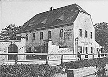
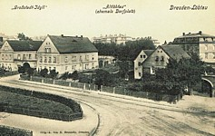
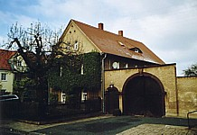

* * *

* * *

Altlöbtau bildet den Kern des 1068 erstmals erwähnten Dorfes, welches Mitte
des 15. Jahrhunderts aus zwölf Bauernstellen bestand. Bis 1830 blieb diese Größe des Dorfes fast unverändert bestehen. Als Mittelpunkt des Ortes wurde
der Dorfplatz von mehreren alten Verbindungswegen durchschnitten, welche später der fortschreitenden Bebauung weichen mussten. So führte eine einst als “Dresdner Weg” bezeichnete Verbindung von der [Weißeritzbrücke](../../../../sudwest/Lobtau/Strassen_Lobtau/Lobtauer_Brucken/lobtauer_brucken.html) kommend direkt auf den Anger und von dort weiter in Richtung Wölfnitz. Bis zu seiner
Einziehung 1892 trug der Abschnitt zwischen Dorfplatz und der heutigen Löbtauer Straße den Namen Pflaumenallee, der westlich an den Platz anschließende Teil den Namen Feld- bzw. Wiesenweg.

Südlich des alten Dorfkerns befand sich im 18. Jahrhundert ein künstlich
angelegter Teich, welcher als “Brühlsches Wasserreservoir” der Wasserversorgung des Neptunbrunnens auf dem Areal des [Brühlschen Palais](../../../../Zentrum/Friedrichstadt/Strassen_Friedrichstadt/Friedrichstrasse/Marcolinipalais/marcolinipalais.html) in der Friedrichstadt diente. Für diesen Zweck hatte der sächsische
Premierminister Heinrich von Brühl am 25. Juni 1743 mehrere Flurstücke von Löbtauer Bauern erworben und von hier eine Röhrfahrt in die Friedrichstadt
anlegen lassen. Die Versorgung des Teiches erfolgte von Plauen aus mit Hilfe eines Wasserkunsthauses, welches bei Bedarf über ein Schöpfrad das Wasser der Weißeritz nach Löbtau leitete. Nach Zerstörung der Anlage im
Siebenjährigen Krieg verlandete der Teich und ist bereits 1782 als “gänzlich verfallen” erwähnt. Auf dem später als “Am Teiche” bezeichneten Grundstück entstanden Ende des 19. Jahrhunderts Wohnhäuser.

Im Zuge der Industrialisierung verlor die landwirtschaftliche Nutzung der Ortsflur
an Bedeutung. Bereits 1874 existierten nur noch vier Bauerngüter. Zu dieser Zeit verschwand auch der letzte von einst vier Teichen am Dorfplatz. Zuvor war das
gemeindeeigene Grundstück als Wasserreservoir und zeitweise auch als Obstgarten genutzt worden. Auch vom einstigen Löbtauer Dorfbach ist heute nichts mehr zu sehen. Heute haben sich um den früheren Dorfplatz nur wenige
Reste der dörflichen Vergangenheit des Ortes erhalten, so die Gehöfte Nr. 4 mit einem Torbogen von 1834 _(Foto)_ und Nr. 18. Das erstgenannte Gut entstand in
heutiger Form 1868 (Schlussstein am Wohnhaus) und beherbergte noch bis in die 1950er Jahre ein Stellmacherwerkstatt. Einige Lücken wurden in den letzten Jahren mit an die vorhandene Bebauung
angepassten Wohnhäusern geschlossen. Der Dorfanger selbst ist heute mit einem Kinderspielplatz parkartig gestaltet.

Einzelne Gebäude

Dorfgasthof:
Die Geschichte des Löbtauer Dorfgasthofs begann im Jahr 1717, als der Ortsrichter George Barth den bislang üblichen Reiheschank und damit Schankgerechtigkeit für sein Gut Altlöbtau 9 erwarb. In der Folge baute er
dieses Anwesen zum Gasthof aus und richtete im Oberschoss sogar einen Tanzsaal ein. 1754 erwarb der Fleischhauer
Jeremias Naumann ein Grundstück an der heutigen Lübecker Straße 19 und betrieb dort eine Fleischerei. Obwohl das Recht auf den Ausschank von Bier und Branntwein zunächst verboten war, scheint Naumann in seinem Gebäude
ebenfalls Gäste bewirtet zu haben, was zu Differenzen mit der bestehenden Schankwirtschaft führte. Erst eine
Entscheidung des Kurfürsten legte diesen Streit 1780 bei. Im 19. Jahrhundert entwickelte sich Naumanns Haus zum Löbtauer Dorfgasthof und wurde später bis zur Zerstörung 1945 als “Bürgergarten” bezeichnet.

Gemeindearmenhaus: Bereits Ende des 18. Jahrhunderts besaß Löbtau ein sogenanntes “Gemeindehaus” (Dorfplatz 8),
in welchem mittellose und hilfsbedürftige Einwohner Obdach fanden. Ab 1770 befand sich hier die Wohnung des Schullehrers und dessen Unterrichtsraum. Nach Verlegung der Dorfschule übernahm der Nachtwächter des Ortes die
Räume. Das Gebäude wurde 1889 wegen Baufälligkeit abgerissen. Danach nutzte man bis zur Eingemeindung einige Gebäude des Kochschen Gutes (Nr. 4) als Ortsarmen- und -krankenhaus. Zugleich diente dieses Haus als
“Besserungsanstalt” für Jugendliche und besaß deshalb eine Arrestzelle für kleinere Vergehen. Auch dieses Gebäude ist heute nicht mehr erhalten.

Windmühlen:
Etwas abseits des Dorfkerns am Lerchenberg gab es wahrscheinlich schon im Mittelalter eine Windmühle.
Eine weitere wurde im 16. Jahrhundert in unmittelbarer Nachbarschaft errichtet. Beide Mühlen gehörten der Familie
Moses (Moyses), welche zugleich Inhaber eines Mühlenhofes an der Weißeritz war. Mit Erlass des Mahlzwanges zur Plauener Hofmühle durch Kurfürst August 1569 entzog dieser der Familie Moses die Mahlgerechtigkeit, was zur
Stillegung der Mühlen führte. Auf dem Grundstück des Mühlenhofes entstand später der [Reisewitzsche Garten](../../../../sudwest/Lobtau/Strassen_Lobtau/Tharandter_Strasse/Reisewitz_scher_Garten/reisewitz_scher_garten.html).

1626 sind in Löbtau erneut zwei Bockwindmühlen verzeichnet. Beide standen in der Nähe der Weißeritz neben der
Pulvermühle und wurde 1642 wahrscheinlich bei Kampfhandlungen des Dreißigjährigen Krieges zerstört. 1794 finden sich erneut vier Windmühlen am sogenannten Löbtauer Schlag”. Diese wurden noch bis ins 19. Jahrhundert von
Pächtern betrieben. Erst die Einführung moderner Mühlen führten um 1850 zum Abriss der Löbtauer Windmühlen

* * *

 \[ [Home](../../../../index.html)\] \[ [Nord](../../../../nord/)\] \[ [Nordwest](../../../../Nordwest/nordwest.html)\] \[ [Neustadt](../../../../neustadt/)\] \[ [Nordost](../../../../nordost/)\] \[ [West](../../../../west/)\] \[ [Zentrum](../../../../zentrum/)\] \[ [Südwest](../../../../sudwest/)\] \[ [Süd](../../../../Sud/sud.html)\] \[ [Südost](../../../../Sudost/sudost.html)\] \[ [Ost](../../../../Ost/ost.html)\] \[ [Register](../../../../Register/register.html)\] \[ [Kontakt](../../../../Kontakt/kontakt.html)\] \[ [Impressum](../../../../Impressum/impressum.html)\]
