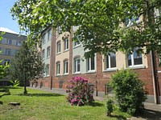
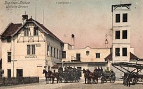

* * *

* * *

Die Clara-Zetkin-Straße, früher nach dem Politiker und Dresdner Ehrenbürger
Hermann von Nostitz-Wallwitz (1826-1906) Wallwitzstraße genannt, erhielt 1956 den Namen der sozialistischen Politikerin Clara Zetkin (1857-1933), die bis 1933
Alterspräsidentin des Deutschen Reichstags war und zahlreiche sozialkritische Schriften veröffentlichte. Auf ihre Initiative wurde 1910 der Internationale Frauentag
eingeführt. Während der benachbarte Clara-Zetkin-Platz 1993 in Bonhoefferplatz umbenannt wurde, behielt die Straße bis heute ihren Namen. An dieser wurde 1877 die [Bürgerschule Löbtau](../../../../sudwest/Lobtau/lobtau.html) (heute 35. Oberschule) und 1936 die [Hoffnungskirche](../../../../sudwest/Lobtau/Friedenskirche/Hoffnungskirche/hoffnungskirche.html) errichtet.

Während die Gebäude im unteren Teil bereits in den Jahren nach 1900 entstanden, blieb der obere Straßenabschnitt zunächst unbebaut _(Foto um 1910)_
. Nach dem Ersten Weltkrieg errichteten verschiedene Baugesellschaften Wohnblocks. Außerdem existierte hier noch bis 1992 eine Gärtnerei. 2003 wurde auf deren Areal mit dem Bau der
Wohnsiedlung “Am Roßthaler Bach” mit Einfamilien- und Doppelhäusern begonnen.

Einzelne Gebäude:

Restaurant “Bacchus” (Nr. 15): Das um 1890 errichtete Eckhaus zur Klingestraße
beherbergte ursprünglich die Gaststätte “Zur Tulpe”. Nach dem Ersten Weltkrieg wurde diese in “Pilsner- Bierstuben - Löbtauer Casino” umbenannt und existierte unter
diesem Namen bis Ende 1978. Danach übernahm das Gastronomenpaar Zepp die Räume und eröffnete hier am 29. November 1979 das Weinlokal “Bacchus” mit 65
Plätzen im Gastraum und im angrenzenden “Bacchuszimmer”. Wegen seiner eleganten Ausstattung, der guten Küche und seiner großen Weinauswahl erwarb sich die
Gaststätte einen guten Ruf weit über Löbtau hinaus. Nach mehrfachem Betreiberwechsels befindet sich hier seit 2008 das Restaurant & Weingarten Art
Culinare Bacchus. Das äußerlich weitgehend unveränderte Gebäude steht als Baudenkmal unter Schutz.

Wallwitzburg (Nr. 21): Auch in diesem Eckhaus an der Einmündung der Dölzschener Straße
befand sich in den Erdgeschossräumen früher eine Gaststätte, welche in Anlehnung an den Straßennamen “Wallwitzburg” genannt wurde _(Foto)_. Am 5. September 1905 gründeten
Löbtauer Fußballer hier den Sportverein “Löbtauer Viktoria” (seit 1908 Dresdner Spielvereinigung 05). Das nach 1945 geschlossene Lokal wird heute als Büro einer Versicherungsagentur genutzt.

Nr. 23 und 25: Die beiden um ca. 1900 erbauten Mietshäuser gehören zu einer Wohnhausgruppe an der Ecke Clara-Zetkin-Straße / Zauckeroder Straße. Sie wurden, ebenso
wie die ehemalige “Wallwitzburg” und die Mietshäuser Zauckeroder Straße 1 bis 7, durch den Löbtauer Unternehmer Richard Riedrich errichtet und weisen ähnliche architektonische
Gestaltungsformen auf. Riedrich war Inhaber eines Baugewerkes und hatte seinen Firmensitz auf der Zauckeroder Straße 1.

Nr. 27/29:
Das Doppelhaus an der Einmündung zur Zauckeroder Straße wurde 1926 gebaut. Architekt war Curt Herfurth.

Zigarettenfabrik Casanova (später Aurelia) (Nr. 33): Das Unternehmen wurde kurz nach der Jahrhundertwende im Hintergebäude der Wallwitzstraße 33
gegründet und ist 1907 erstmals im Adressbuch genannt. Besitzer der “Casanova Cigarettenfabrik” war der Unternehmer Caspar August. Neuhaus, dessen Initialien
“C A N” auch das Markenzeichen des Unternehmens bildeten, stammte aus Nordrhein-Westfalen und war Inhaber einer Zigarrenfabrik in Schwetzingen. Ab
1913 war er Abgeordneter der Deutschen Zentrumspartei im Reichstag. In der Dresdner Niederlassung wurden überwiegend Zigaretten der Marken “Kranz”, “Mirko” und “Rubens” hergestellt. 1912 erfolgte eine Erweiterung der
Betriebsgebäude.

Nach dem Tod von Neuhaus 1926 ging das Unternehmen in den Besitz der Berliner
Zigarettenfabrikanten Garbáty über. Die jüdische Familie gehörte bis 1929 zu den bedeutendsten Herstellern der Branche und besaß neben dem Stammwerk in Berlin
zahlreiche Niederlassungen im In- und Ausland. 1929/30 wurde die Firma an den Reemtsma-Konzern verkauft. Ab 1933 war der Dresdner Unternehmer Ernst Karl
Müller Inhaber der Zigarettenfabrik auf der Wallwitzstraße 33. Diese firmierte nun bis 1945 unter dem Namen “Aurelia” und stellte Zigaretten der Marken “Araber” und
Sultan” her. Nach 1945 siedelte sich auf dem Grundstück Nr. 31/33 eine Niederlassung des VEB Prüfgerätewerks Medingen an. Heute werden die Räume vom
Nachfolgeunternehmen P-D Industriegesellschaft mbH Prüfgerätewerk Dresden und weiteren Gewerbetreibenden genutzt.

Feuerwache Löbtau:
Bereits um 1870 hatte die damals noch selbstständige Gemeinde Löbtau am südlichen Rand der bebauten Gemeindeflur ein größeres Areal erworben, um hier gemeindeeigene Gebäude errichten zu können. U.a
war der Bau eines Schlachthofes geplant, was jedoch nicht zustande kam. Stattdessen wurde 1877 die Löbtauer Bürgerschule gebaut (heute 35. Oberschule). 1898 entstand auf dem Nachbargrundstück ein Feuerwehrdepot
mit Verwaltungsgebäude, Steigerturm und Marstall _(Foto rechts)_. Die Gebäude dienten der Unterbringung der Pferde und des Löschgerätes. Mit der
Eingemeindung des Ortes übernahm die Stadt Dresden die Einrichtung und gliederte sie als “Feuerwache 7” in das städtische Rettungswesen ein.

Auch nach 1945 blieb die Feuerwache in Betrieb und wurde ab 2007 grundlegend
rekonstruktiert. Dabei entstand ein modernes Sozialgebäude mit Unterkunfts- und Sozialräumen _(Foto links)_. Im Frühjahr 2009 konnte die Wache eingeweiht
werden. Sie besitzt acht Stellplätze für Feuerwehr- und Rettungsdienstfahrzeuge sowie Unterstellmöglichkeiten für Löschtechnik. Die Feuerwache ist zuständig für
die westlichen Dresdner Stadtteile Altfranken, Gompitz; Gorbitz, Naußlitz, Löbtau, Plauen, Coschütz und Gittersee. Außerdem dient sie als Stützpunkt des Höhenrettungsdienstes.

Theater 50: Die kleine Bühne wurde 1986 von der Künstlergruppe “salto vitale” gegründet und hatte ihr Domizil im
Erdgeschoss des Hauses Clara-Zetkin-Straße 44. Initiatoren des Kleinkunsttheaters waren die Dresdner Schauspieler
Rainer König, Alf Mahlo, Ralf Herzog und Olaf Böhme. Nach 1990 wuchs das Interesse an den Veranstaltungen stark
an, so dass das Theater 1994 in größere Räumlichkeiten an der Maternistraße verzog. In den früheren Räumen trat später
noch mehrfach Olaf Böhme auf, bevor das nun “bebe” (Böhmes Bühne) genannte Kleintheater seine Pforten für immer schloss.

* * *

 \[ [Home](../../../../index.html)\] \[ [Nord](../../../../nord/)\] \[ [Nordwest](../../../../Nordwest/nordwest.html)\] \[ [Neustadt](../../../../neustadt/)\] \[ [Nordost](../../../../nordost/)\] \[ [West](../../../../west/)\] \[ [Zentrum](../../../../zentrum/)\] \[ [Südwest](../../../../sudwest/)\] \[ [Süd](../../../../Sud/sud.html)\] \[ [Südost](../../../../Sudost/sudost.html)\] \[ [Ost](../../../../Ost/ost.html)\] \[ [Register](../../../../Register/register.html)\] \[ [Kontakt](../../../../Kontakt/kontakt.html)\] \[ [Impressum](../../../../Impressum/impressum.html)\]
