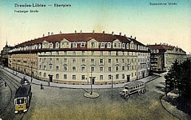
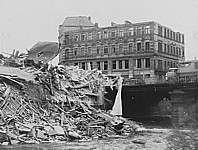
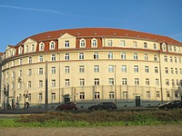
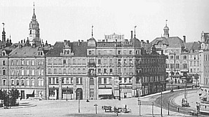
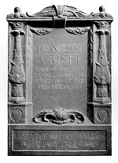
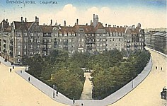

* * *

* * *

Der heutige Ebertplatz wurde 1890 auf einer Freifläche in der Nähe der
Weißeritz angelegt. Ursprünglich stand hier der Zirkusbau von August Schumann, der 1899 den Zirkus Renz in Berlin übernahm. Der neue Platz erhielt
am 25. Februar 1891 den Namen Crispiplatz, benannt nach dem italienischen Staatsmann Francesco Crispi. Crispi (1819-1901) war ab 1887 Ministerpräsident des Königreiches Italien und enger Vertrauter Bismarcks.
Löbtau unterhielt um 1900 freundschaftliche Kontakte mit Crispis Heimatstadt Palermo, die der Gemeinde 1901 eine Statue des Politikers schenkte. Um den
Platz entstanden mehrgeschossige Wohn- und Geschäftshäuser sowie nach der Jahrhundertwende die Wohnanlage des Dresdner Spar- und Bauvereins.

1926 wurde der Crispiplatz in Ebertplatz umbenannt. Diese Namensgebung sollte an
den kurz zuvor verstorbenen ersten Reichspräsidenten der Weimarer Republik, Friedrich Ebert (1871-1925), erinnern. Da Ebert als ehemaliger SPD-Vorsitzender
von den Nazis als “unwürdig” betrachtet wurde, ließen diese 1933 die Benennung wieder rückgängig machen. 1945 zerstörten Bomben Teile der vorhandenen
Bebauung, woraufhin der Platz in eine große Grünanlage mit Kinderspielplatz umgestaltet wurde. Die vorhandenen repräsentativen Wohngebäude an der Weißeritzbrücke wurden im Frühjahr 1988 zugusten der neuen [Hochstraße](../../../../sudwest/lobtau/strassen_lobtau/lobtauer_brucken/) gesprengt _(Foto)_, die seit 1993 die Platzanlage überspannt. An ihrer Stelle
entstand 2008 eine kleine, zur Weißeritz geöffnete Parkanlage.

1962 wechselte der Crispiplatz erneut seinen Namen und hieß nun bis 1993 Willi-Ermer-Platz. Willi Ermer (1903-1949) war ab 1925 Mitglied der KPD und
leitete die Abteilung Dresden-Löbtau des Roten Frontkämpferbundes. Nach seiner Entlassung aus dem berüchtigten Strafbataillon 999 war er in der Nachkriegszeit in
verschiedenen Funktionen der SED tätig. 1993 beschloss der Dresdner Stadtrat, dem Platz seinen früheren Namen Ebertplatz zurückzugeben. Zwischen 1964 und 1974 befand sich hier die Wendeschleife der einzigen Dresdner [O-Bus-Linie](../../../../sudwest/lobtau/strassen_lobtau/ebertplatz/o-bus/) von Löbtau nach Weißig.

**_Foto:_** _Blick vom Crispiplatz zum Drei-Kaiser-Hof um 1910_

Einzelne Gebäude:

Crispidenkmal:
Das vom italienischen Bildhauer Mario Rutelli (1859-1941) geschaffene Standbild des Politikers Francesco Crispi wurde als Geschenk der Stadt Palermo an Löbtau
übergeben und am 26. Oktober 1906 feierlich eingeweiht. Nach Umbenennung des Crispiplatzes in Ebertplatz forderten vor allem linke SPD-Mitglieder die Entfernung des
Denkmals. An seiner Stelle sollte stattdessen ein Gedenkstein für den verstorbenen Reichspräsidenten Ebert aufgestellt werden. Lediglich die Erhaltung des von Hans Erlwein
gestalteten Denkmalsockels war geplant. Dieser Vorschlag wurde von der Stadt Dresden jedoch abgelehnt. Das Crispidenkmal wurde 1945 bei der Zerstörung der umliegenden
Wohngebäude nur leicht beschädigt, fiel jedoch 1946 der politisch motivierten “Bilderstürmerei” zum Opfer. 1948 verschwand auch der Sockel, so dass heute keine Reste mehr auffindbar sind.

Dr.-Höhne-Häuser: Die Wohnanlage zwischen Ebertplatz, Freiberger und Oederaner Straße entstand im Auftrag des Dresdner Spar- und Bauvereins. Sie umfasst die Gebäude Ebertplatz 1-3b, Freiberger Straße 113-121 und
Saxoniastraße 2-10. Die fünfgeschossige Häusergruppe mit ca. 400 Wohnungen wurde zwischen 1920 und 1921 nach Plänen des Architekten Paul Beck erbaut, welcher auch Schöpfer der Grunaer [Gartenheimsiedlung](../../../../ost/gruna/) war. Die Gebäude blieben bis heute erhalten und wurden nach 1990 saniert.

Graf-von-Posadowsky-Wehner-Häuser: Zwischen 1903 und 1905 entstanden
am damaligen Crispiplatz (Nr. 4-9) durch den Dresdner Spar- und Bauverein die “Graf- von-Posadowsky-Wehner-Häuser”. Das Areal des ehemaligen Floßhofs war zuvor vom Reichsamt des Inneren erworben und dem Verein per
Erbbauvertrag überlassen worden. Die architektonische Gestaltung oblag dem renommierten Architekturbüro Schilling & Gräbner. Die 1945 zerstörte Häusergruppe mit 300 Kleinwohnungen verfügte über Gemeinschaftsbäder,
Innenhöfe mit Kinderspielplätzen und eine Bibliothek und stand vorrangig unbegüterten Mietern offen. Hinzu kamen soziale Einrichtungen wie eine
Kinderbewahranstalt und eine Haushaltschule für ältere Mädchen. Die Finanzierung erfolgte durch den Evangelischen
Arbeiterverein und den erwähnten Erbbauvertrag des Grafen Dr. Posadowsky-Wehner, welcher Staatssekretär im
Reichsinnenministerium war und dessen Namen der Komplex erhielt. Für die damals beispielhafte Wohnanlage erhielt der Verein 1906 eine Goldmedaille der 3. Deutschen Kunstgewerbeausstellung.

Nr. 10: Das Wohnhaus an der früheren Delbrückstraße entstand 1926 im Stil der neuen Sachlichkeit und weist an der
Fassade und im Treppenhaus auch einige expressionistische Elemente auf. Architekt war der Dresdner Stadtbaurat Paul
Wolf. Das durch verschiedene Gesimse horizontal gegliederte fünfgeschossige Gebäude weist in der Mitte einen tiefen
Rücksprung auf, wobei die beiden Seitenflügel abgeschrägt sind. Hier befindet sich auch die Durchfahrt zum Hof des Hauses. Das nach 1990 sanierte Gebäude dient bis heute als Wohnhaus und steht unter Denkmalschutz.

* * *

 \[ [Home](../../../../index.html)\] \[ [Nord](../../../../nord/)\] \[ [Nordwest](../../../../nordwest/)\] \[ [Neustadt](../../../../neustadt/)\] \[ [Nordost](../../../../nordost/)\] \[ [West](../../../../west/)\] \[ [Zentrum](../../../../zentrum/)\] \[ [Südwest](../../../../sudwest/)\] \[ [Süd](../../../../sud/)\] \[ [Südost](../../../../sudost/)\] \[ [Ost](../../../../ost/)\] \[ [Register](../../../../Register/register.html)\] \[ [Kontakt](../../../../Kontakt/kontakt.html)\] \[ [Impressum](../../../../impressum/)\]
