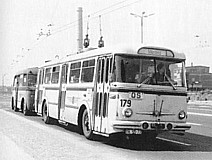

* * *

* * *

Dresdens erste O-Bus-Linie wurde 1903 unter dem Namen [“Dresdner Haidebahn”](../../../../../Nord/Klotzsche/Haidebahn/haidebahn.html) eingeweiht und verband die Endstelle der Straßenbahn am Arsenal (heute Olbrichtplatz) mit dem Villenvorort Klotzsche-Königswald. Die Fahrzeuge stammten aus der Werkstatt der Dresdner Unternehmers Carl Stoll, der die Strecke als Privatunternehmen betrieb. Zum Einsatz kamen sechs Wagen, die mit Elektromotoren und Stromabnehmer ausgestattet waren. Wegen häufiger Ausfälle und der Lärm- und Staubbelastung durch die Motorwagen geriet das Unternehmen jedoch schon bald in wirtschaftliche Schwierigkeiten und musste bereits im Juli 1904 den Betrieb wieder einstellen. Als wichtigstes Nahverkehrsmittel setzte sich stattdessen die Straßenbahn durch.

Erst in der Zeit nach dem Zweiten Weltkrieg zwangen Materialmangel und Schäden am Gleisnetz zu neuen Überlegungen. Als vorteilhaft erwies sich, dass in einer Werdauer Fahrzeugfabrik mehrere Fahrgestelle und die
benötigte elektrische Ausrüstung erworben werden konnten. Erstmals wurde auf der großen Dresdner Ausstellung “Dresden baut auf” 1946 die Idee für eine neue O-Bus-Linie vorgestellt. Bereits wenig später begannen
die Vorbereitungen mit dem Aufstellen von Oberleitungsmasten und dem Anbringen der Fahrdrähte. Ausgehend vom Busbahnhof Blasewitz an der Tolkewitzer Straße entstand eine Versuchsstrecke zwischen Körnerplatz und dem
Münchner Platz in der Südvorstadt. Die offizielle Eröffnung der ca. neun Kilometer langen Strecke erfolgte am 8. November 1947.

Für den im 20-Minuten-Takt geplanten Betrieb standen zunächst nur fünf Fahrzeuge
zur Verfügung. 1948 schaffte man drei Beiwagen an, so dass die O-Busse nun auch  im Anhängerbetrieb verkehren konnten. Trotz einiger Probleme mit den
Stromabnehmern erwarben die Verkehrsbetriebe 1949 fünf weitere Wagenzüge, wodurch die Strecke am 1. November 1949 bis nach Weißig verlängert werden
konnte und dort die Straßenbahnstrecke zwischen Bühlau und Weißig ersetzte. Weitere Verbesserungen erfolgten ab 1953 mit dem Einsatz modernerer O-Busse
vom Typ W 602a aus Hennigsdorfer, ab 1957 mit Skoda-Bussen aus tschechischer Produktion. Der Streckenabschnitt vom Fritz-Foerster-Platz durch die George-
Bähr-Straße zum Münchner Platz wurde 1958 zugunsten einer Neubaustrecke über die Nürnberger Straße aufgegeben, welche im Juni 1964 bis zum Willi-Ermer-Platz (heute Ebertplatz) in Löbtau verlängert wurde. Mit 16,8 km
Streckenlänge erreichte das O-Bus-Netz damit seine größte Ausdehnung. Die Linie wurde zunächst als Linie C, später als Linie 61 bezeichnet.

Hoher Verschleiß an den Fahrzeugen und Oberleitungen sowie Schwierigkeiten bei der Ersatzteilbeschaffung für die
wenigen Busse führten nach 1970 zur schrittweisen Einstellung des Betriebes. Nach Stilllegung der Abschnitte von Bühlau
nach Weißig (4. September 1971) und von Löbtau nach Gruna (15. August 1974) rückte am 28. November 1975 der letzte Dresdner O-Bus ins Depot ein. Die noch betriebsbereiten Fahrzeuge wurden daraufhin an andere DDR-
Verkehrsunternehmen verkauft. Heute existiert noch ein kompletter Wagenzug als Museumsfahrzeug in Berlin.

* * *

 \[ [Nord](../../../../../nord/)\] \[ [Nordwest](../../../../../Nordwest/nordwest.html)\] \[ [Neustadt](../../../../../neustadt/)\] \[ [Nordost](../../../../../nordost/)\] \[ [West](../../../../../west/)\] \[ [Zentrum](../../../../../zentrum/)\] \[ [Südwest](../../../../../sudwest/)\]
 \[ [Süd](../../../../../Sud/sud.html)\] \[ [Südost](../../../../../Sudost/sudost.html)\] \[ [Ost](../../../../../Ost/ost.html)\] \[ [Register](../../../../../Register/register.html)\]
 \[ [Kontakt](../../../../../Kontakt/kontakt.html)\] \[ [Impressum](../../../../../Impressum/impressum.html)\]
