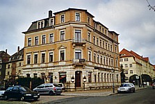
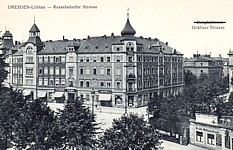

Die über Löbtauer und Cottaer Flur verlaufende Gohliser Straße entstand im Zuge des 1875 erarbeiteten Bebauungsplanes Emil Ueberalls und wurde zunächst als Planstraße P bezeichnet. Da sich an ihrem Löbtauer Ende des bekannte “Café Frieden” befand, nannte man sie im Volksmund zunächst Friedensstraße. Am 14. Dezember 1892 erhielt sie offiziell den Namen Ahlwardtstraße. Namensgeber war der Reichstagsabgeordnete Hermann
Ahlwardt (1846–1914), der durch seine antisemitischen Schriften und Flugblätter bereits zu Lebzeiten heftig umstritten war und zu einer mehrmonatigen Haftstrafe verurteilt wurde.

Bereits wenige Monate nach der Erstbenennung wurde die Ahlwardtstraße am 19. April 1893 nach den Dörfern Ober- und Niedergohlis umbenannt. Das Straßenbild prägen bis heute mehrgeschossige Mietshäuser in offener Bauweise. Die Häuserzeile Nr. 35-43 entstand zwischen 1919 und 1925 nach Entwürfen von Otto Schubert für den Kleinwohnungsbauverein Dresden, die Häuser der Nr. 38 bis 50 durch Stadtbaurat Paul Wolf. Neben Arbeiterwohnungen gab es hier auch einige kleine Läden und Gaststätten. Neben dem “Café Frieden” und der gegenüberliegenden Konditorei Müller existiert im Eckhaus zur Bramschstraße mit dem Restaurant “Zur Myrte” eine weitere traditionsreiche Gaststätte _(Foto)_. Ein weiteres Lokal gab es früher an der Ecke zur Hermsdorfer Straße (Nr. 17), wo um 1914 die “Wettinburg” des Schankwirts Otto Kloß zum Besuch einlud. An Stelle des heute nicht mehr vorhandenen Gebäudes entstand nach 1990 das Hotel & Apartmenthaus “Altstadtperle” (Nr. 17-19).

Café & Konditorei Müller (Nr. 1): Die zu den traditionsreichsten Läden im Dresdner Westen gehörende Konditorei wurde im Jahr 1908 von Konditormeister Paul Müller gegründet. Sie befindet sich Erdgeschoss des
Eckhauses zur Kesselsdorfer Straße. 1935 übernahm mit Rudi Müller der Sohn des Firmengründers den Familienbetrieb und führte ihn bis 1961. Danach oblag die Geschäftsleitung Müllers Schwiegersohn Christian Mütze, der nach der Wende in der DDR 1991 ein weiteres Café am Nürnberger Ei eröffnete. Bis heute befindet sich das Unternehmen in Familienbesitz.

* * *

 \[ [Home](../../../../index.html)\] \[ [Nord](../../../../nord/)\] \[ [Nordwest](../../../../nordwest/)\] \[ [Neustadt](../../../../neustadt/)\] \[ [Nordost](../../../../nordost/)\] \[ [West](../../../../west/)\] \[ [Zentrum](../../../../zentrum/)\] \[ [Südwest](../../../../sudwest/)\] \[ [Süd](../../../../sud/)\] \[ [Südost](../../../../sudost/)\] \[ [Ost](../../../../ost/)\] \[ [Register](../../../../Register/register.html)\] \[ [Kontakt](../../../../Kontakt/kontakt.html)\] \[ [Impressum](../../../../impressum/)\]
