

[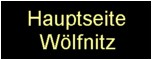](../../../../sudwest/wolfnitz/)

* * *

[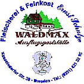](http://www.fleischereischulze.de)

**Fleischerei Schulze**

[**zur HOMEPAGE**](http://www.fleischereischulze.de)

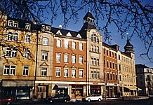Die Kesselsdorfer Straße bestand schon gegen Ende des 12. Jahrhunderts als Teil
einer alten Verbindungsstraße zwischen dem Kloster Nossen und dem [Klosterhof](../../../../sudost/leubnitz-neuostra/klosterhof/) in
Leubnitz. Zugleich verband sie die Stadt Dresden mit dem bedeutenden Bergbauzentrum um Freiberg. Ursprünglich wurde sie als “Freybergische Straße”
bezeichnet und gehört zu den wichtigsten alten Fernstraßen im Dresdner Raum. August der Starke ließ sie um 1720 zur Poststraße ausbauen und mit Postmeilensäulen
versehen, von denen jedoch keine erhalten blieb. 1704 entstand in diesem Zusammenhang an Stelle einer hölzernen Vorgängerin eine steinerne [Brücke](../../../../sudwest/lobtau/strassen_lobtau/lobtauer_brucken/) über die Weißeritz. Als Hauptverkehrsverbindung ins Erzgebirge wurde sie 1767 “Gebürgische
Hauptstraße” genannt. Noch bis zum Ende des 19. Jahrhunderts erinnerte eine Wegsäule in der Nähe der Kreuzung mit der Tharandter und Löbtauer Straße an die Bedeutung dieses Verkehrsweges.

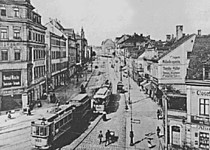Zwischen 1810 und 1812 wurde die Straße im Auftrag Napoleons zur Chaussee
ausgebaut und erhielt dabei im Wesentlichen ihren heutigen Verlauf. Ab 1871 trug sie zunächst den Namen Wilsdruffer Straße, ab 1904 Kesselsdorfer Straße. Dieser Name
wurde nach der Eingemeindung auch auf die Straßenabschnitte in Gorbitz (1926) und in Gompitz (1999) übertragen. Ab 1881 verkehrte eine Pferdebahn bis zum 1875 entstandenen [Neuen Annenfriedhof](../../../../sudwest/Lobtau/Friedenskirche/Neuer_Annenfriedhof/neuer_annenfriedhof.html). 1893/96 wurde diese Strecke elektrifiziert und bis
zum Straßenbahnhof Naußlitz verlängert. Bereits vor dem Zweiten Weltkrieg entwickelte sich die Kesselsdorfer Straße zum Stadtteilzentrum der westlichen
Dresdner Vororte mit zahlreichen Geschäften und Gaststätten. Im unteren Teil _(Foto)_ fielen einige dieser Gebäude 1945 den Bombenangriffen zum Opfer, darunter der bekannte [“Drei-Kaiser-Hof”](../../../../sudwest/lobtau/strassen_lobtau/kesselsdorfer_strasse/drei-kaiser-hof/) und die [“Musenhalle”](../../../../sudwest/lobtau/strassen_lobtau/kesselsdorfer_strasse/musenhalle/) an der Poststraße. Erst nach 1990 wurde mit der schrittweisen Schließung der Baulücken begonnen.

Löbtau:

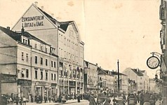Vor allem der untere Teil der Kesselsdorfer Straße ist bis zur Gegenwart als Einkaufszentrum von Bedeutung. In der zweiten Hälfte des 19. Jahrhunderts entstanden hier zahlreiche Wohn- und Geschäftshäuser. Erwähnenswert sind u.a. das Kaufhaus des Konsumvereins “Vorwärts” (später Modehaus Schacht & Hödel - Nr. 22), das Schuhhaus Schleinitz (Nr. 14) sowie das Kaufhaus Möbius (Nr. 20), eine Filiale des bekannten Dresdner Großkaufhauses auf der Wilsdruffer Straße. Im Hintergebäude des letztgenannten Grundstücks gab es vor 1945 das Kino “Westend-Lichtspiele”. Zahlreiche Gebäude fielen 1945 den Bomben zum Opfer. Die entstandenen Baulücken konnten erst nach 1990 geschlossen werden.

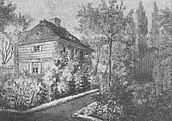Chausseehaus: Das Gebäude entstand 1811 an der Ecke Kesselsdorfer/Tharandter Straße und diente der Erhebung des Chausseegeldes für die Benutzer dieser Straße. Anlass war der kurz zuvor erfolgte Ausbau der Straße, welcher über 17.800 Taler gekostet hatte. Das Haus wurde von G. F. Thormeyer entworfen und war mit über 20.000 Mark jährlicher Einnahme ergiebigstes Einnehmerhaus in Sachsen _(Bild)_. Neben den Expeditionsräumen gab es auch zwei Wohnungen und einen großen Garten, dessen Ertrag dem Chausseegeldeinnehmer ein zusätzliches Einkommen verschaffte. Mit Hilfe hölzerner Schlagbäume konnte die Straße abgesperrt und die Fuhrleute zur Zahlung der fälligen Gebühr veranlasst werden. Nach Aufhebung des Chausseegeldes am 31. Dezember 1885 verlor es seine Funktion und wurde wenige Jahre später abgebrochen.

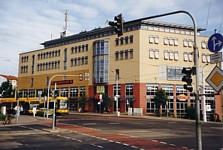Kesselsdorfer Passagen: Der moderne Gebäudekomplex _(Foto)_ wurde 1997/98 auf dem Grundstück Nr. 2-6 errichte und beherbergt mehrere Läden und Restaurants sowie Büros in den Obergeschossen. Zuvor standen hier noch einige Anfang des 19. Jahrhunderts errichtete Wohnhäuser, darunter das 1945 teilzerstörte Gebäude der Likörfabrik Max Herzog. In Anlehnung an die frühere Gaststätte auf der gegenüber liegenden Straßenseite wurden die “Kesselsdorfer Passagen” 2000 in “Drei-Kaiser- Hof” umbenannt.

Nr. 8: In diesem heute nicht mehr vorhandenem Gebäude (ehem. Wilsdruffer Straße 50) wohnte Ende des 19. Jahrhunderts der Glasmacher Georg Horn (1841-1919), der im [Löbtauer Glaswerk](../../../../zentrum/wilsdruffer_vorstadt/freiberger_strasse/glaswerk_lobtau/) beschäftigt war und Mitbegründer des Bundes der Glasarbeiter Deutschlands war. Nach seiner Entlassung in Folge des Sozialistengesetzes betrieb er im Haus zeitweise eine Produktenhandlung. Horn verzog später nach Radebeul-Lindenau. Politisch betätigte er sich als Redakteur, Schriftsteller und Gewerkschaftsfunktionär. Er war Mitglied des Löbtauer Gemeinderates, Landtagsabgeordneter und von 1895 bis 1918 Mitglied des Deutschen Reichstags. Das Haus fiel 1945 dem Luftangriff zum Opfer. 2013/15 erfolgte auf dem Grundstück an der Ecke zur Gröbelstraße der Bau eines neuen Wohn- und Geschäftshauses (Nr. 8-10).

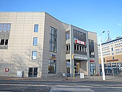Löbtau-Passage: Das moderne Einkaufszentrum entstand 2008/09 auf dem Grundstück des früheren “Dreikaiserhofes” und einiger Nebengebäude. Im Erdgeschoss befindet sich eine Ladenpassage, im Obergeschoss ein zweigeschossiges Parkdeck. Zuvor war das Grundstück des 1945 zerstörten Hotels zeitweise Standort des HO-Möbelhauses “Das schöne Heim” (Möbelhaus West), später einiger Verkaufspavillons, bevor diese am 28. Juni 1996 durch einen Großbrand zerstört wurden. In den Neubau der Löbtau-Passage wurde auch der Mustersaal der ehemaligen [Lampenfabrik Seifert](../../../../sudwest/lobtau/strassen_lobtau/) auf der Gröbelstraße integriert. Hier hatte 1906 die erste öffentliche Ausstellung der “Brücke”-Künstler stattgefunden.

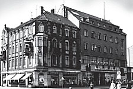Kaufhaus “Magnet” (Nr. 11): Das in den Zwanziger Jahren errichtete Kaufhaus blieb bis zur Schließung 1990 eine beliebte Einkaufsstätte weit über die Löbtauer Ortsgrenzen hinaus _(im Bild rechtes Gebäude)_. Vor 1945 wurde es als “Rheinische Kaufhalle” bezeichnet. Im Obergeschoss besaß der Maler Otto Dix ab 1933 seine Atelierräume und nutzte diese bis zu seinem Tod 1969. Nach 1945 gab es im Haus für einige Jahre eine Tauschzentrale (“Tauze”), in der man im Tausch gegen Wertgegenstände Lebens- und Genussmittel erhielt. Zu den Geschäftsführern des Unternehmens gehörte der spätere Vorsitzende des Zentralrates der Juden in Deutschland Ignatz Bubis.

Am 25. November 1948 eröffnete in den Räumen das erste “freie” HO-Fachgeschäft Dresdens, in welchem man Textilien, Schuhe und Industriewaren ohne Bezugsscheine erwerben konnte. Später wurde diese Einrichtung in “Textilhaus West”, 1960 im Kaufhaus “Magnet” umbenannt. Ab 1975 standen den Kunden vier “Komplexverkaufsbereiche” zur Verfügung, wodurch sich die Verkaufsfläche deutlich vergrößerte. Das nach der Wende viele Jahre leer stehende Kaufhaus wurde 2010 saniert und dabei äußerlich stark verändert.

Nr. 13:
Auf dem Grundstück eines 1945 zerstörten Wohn- und Geschäftshauses entstand in der Nachkriegszeit ein einstöckiges Gebäude. Hier war bis 1990 die stadtweit bekannte Schokoladen-Werksverkaufsstelle der Firma “Elbflorenz”
untergebracht. Nach 1990 wurde das Gebäude durch ein modernes Geschäftshaus ersetzt.

Bekleidungshaus Stohn:
Das traditionsreiche Dresdner Modehaus Stohn entstand 1938 im Eckhaus Kesselsdorfer Straße/ Bünaustraße 1 und befand sich im Besitz von Walter Stohn, einem 1906 in Meißen geborenen Textilkaufmann. Zuvor gab
es hier das Lokal “Gute Quelle”. Während des Zweiten Weltkrieges wurde der Laden, zu dem auch eine Änderungsschneiderei gehörte, von Stohns Ehefrau Elsa geführt. Den Luftangriff überstand das Gebäude im Gegensatz zu
der umgebenden Bebauung ohne größere Schäden. Auch zu DDR-Zeiten blieb das Damen- und Herrenmodegeschäft in privatem Besitz und war weit über die Dresdner Stadtgrenze hinaus bekannt. 1997 gab die Familie den Laden aus
Altersgründen auf. Dieser wurde noch kurzzeitig von einem Nachfolger weitergeführt. Heute befindet sich in den Räumen ein Sonnenstudio.

Westend-Lichtspiele
: Das Filmtheater mit ca. 450 Plätzen wurde 1912 als Westend-Theater gegeründet und befand sich auf der Kesselsdorfer Straße 20. 1917 befand es sich im Besitz von F. A. Wache, ab 1920 der Firma Riegel & Goldhammer.
1934 übernahm Willy Schulze, der auch Inhaber der gegenüber liegenden [“Musenhalle”](../../../../sudwest/lobtau/strassen_lobtau/kesselsdorfer_strasse/musenhalle/) und des Kinos im Dreikaiserhof
war, den Betrieb. 1945 fiel das Gebäude den Bomben zum Opfer.

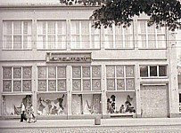Konsument-Warenhaus (Nr. 22): Das Warenhaus entstand in den Zwanziger Jahren als Verkaufsstelle des Konsumvereins “Vorwärts” für Dresden und Umgebung. Nachdem
die der SPD nahestehenden Konsumvereine nach 1933 zwangsweise aufgelöst wurden, übernahm die Firma Schacht & Hödel die Räume und betrieb hier bis 1945 ein
Modehaus für Kleidung, Schuhe und Textilien. 1945 wurde das Gebäude schwer beschädigt, jedoch bald als erstes Dresdner Kaufhaus der Nachkriegszeit wieder aufgebaut _(Foto)_
. Auch nach Normalisierung der wirtschaftlichen Lage blieb die seit den 1960er Jahren als Konsument-Warenhaus bezeichnete Einrichtung ein Anziehungspunkt der Bevölkerung. Zur Vergrößerung der Verkaufsfläche kamen nach
1950 noch zwei flache Anbauten hinzu. 1990 schloss das Warenhaus seine Pforten und wurde 1996 zugunsten eines Geschäftshauses abgerissen.

City-Forum (Nr. 24):
Der moderne Gebäudekomplex nimmt das Grundstück des früheren Konsument-Warenhauses und seiner Nachbarflächen ein und wurde 1997 fertiggestellt. Im Erdgeschoss befindet sich eine kleine Ladenpassage, ergänzt
um weitere Geschäfte. Die Obergeschosse dienen als Wohnungen bzw. Büroräume.

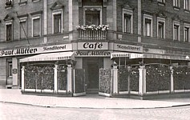Café Müller: Die Konditorei mit angehörigem Café wurde 1908 im Eckhaus Kesselsdorfer Straße / Gohliser Straße 1 gegründet und gehört zu den
traditionsreichsten Unternehmen in Löbtau. Gegenüber befand sich noch bis nach 1990 das ebenfalls weithin bekannte Café “Frieden”. 2008 musste dieses Gebäude dem Neubau eines Geschäftshauses weichen, in welchem eine
Bäckereifiliale mit Cafébetrieb die gastronomische Tradition fortsetzt.

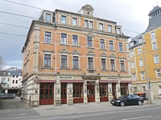Kandler´s Hotel & Restaurant: Die Gaststätte wurde 1995 in dem Ende des 19. Jahrhunderts errichteten Wohnhaus Kesselsdorfer Straße 40 eingerichtet. Neben
Übernachtungsmöglichkeiten besitzt das Haus auch ein im Stil der Gründerzeit eingerichtetes Restaurant, welches vor allem Gerichte der regionalen Küche anbietet. Zu
den Gästen des Hotels gehörten u.a. Johannes Heesters, Lotte Huber und Wolfgang Stumpf.

Straßenbahnhof Löbtau:
Der Straßenbahnhof Löbtau wurde im Frühjahr 1883 eröffnet und diente als Depot der zwei Jahre zuvor eröffneten Pferdebahn. Diese verkehrte zunächst nur bis zum Glaswerk an der Freiberger Straße, wurde jedoch
wenige Monate später, am 8. November 1881, bis zum Neuen Annenfriedhof verlängert. Das Depot wurde nach seiner
Fertigstellung zur Unterstellung der Pferde und Pferdebahnwagen genutzt und bestand bis zur Elektrifizierung der Strecke 1895. 1912 entstand auf dem Grundstück nach Plänen Hans Erlweins die Wohnanlage an der [Bünaustraße](../../../../sudwest/lobtau/strassen_lobtau/) für Angestellte der Städtischen Straßenbahn. An die Pferdebahnzeit erinnert heute noch ein Schuppen auf dem Gelände.

Kaiser-Wilhelm-Denkmal: Das heute nicht mehr vorhandene Denkmal wurde aus Anlass des 90. Geburtstages Kaiser
Wilhelm I. am 22. März 1887 am Löbtauer Straßenbahnhof aufgestellt. Das Denkmal bestand aus einer Granitplatte mit
Inschrift und wurde vom Personal der Straßenbahngesellschaft und Löbtauer Einwohnern finanziert. Mit Elektrifizierung der
Straßenbahnstrecke wurde der Pferdebahnhof nicht mehr benötigt und dessen Grundstück 1912 mit der Wohnanlage Bünaustraße bebaut. Vermutlich verschwand in diesem Zusammenhang auch der Gedenkstein.

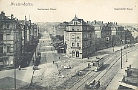Nr. 43:
Das markante Wohn- und Geschäftshaus an der Einmündung zur Saalhausener Straße entstand Ende des 19. Jahrhunderts und wird im Volksmund als “Scharfe Ecke” bezeichnet. Um 1900 gab es im Erdgeschoss ein gleichnamiges
Lokal. Nach 1990 bezog eine Bankfiliale diese Räume. Heute hat hier das traditionsreiche Dresdner Fotogeschäft Hahn seinen Sitz.

Nr. 50:
Das Eckhaus zur Rudolf-Renner-Straße entstand Ende des 19. Jahrhunderts. Am 15. Mai 1911 eröffnete hier der Apotheker Richard Bieber die Kronprinzenapotheke. 1945 übernahm Carl Ritter das Geschäft, welches in der
Nachkriegszeit den Namen Robert-Koch-Apotheke erhielt und bis heute existiert.

Naußlitz:

Die Bebauung der Kesselsdorfer Straße auf Naußlitzer Flur begann ab 1870, als hier erste Mietshäuser entstanden. Der
abseits des Dorfkerns gelegene Ortsteil an der Kesselsdorfer und der Pietzschstraße wurde inoffiziell auch als Neu-Naußlitz bezeichnet. Auch hier gibt es bis heute verschiedene Geschäfte.

Apollo-Lichtspiele (Nr. 80): In diesem Haus befand sich ab 1912 bis Mitte der 1920er Jahre ein Kino. Zunächst   “Apollo-
Lichtspiele”, ab 1921 “Reform-Lichtspiele” genannt, besaß das kleine Filmtheater ca. 150 Plätze.

Nr. 82:
Das um 1910 errichtete Doppelhaus an der Kesselsdorfer Straße 82 / Langestraße gehört zu den architektonisch
beindruckendsten Gebäuden in diesem Abschnitt. Mit zahlreichen Loggien und Balkonen und modernen Schmuckelementen
orientierte sich dieses Mietshaus an den gewandelten Architekturauffassungen seiner Zeit. Nach 1990 wurde das Gebäude denkmalgerecht saniert.

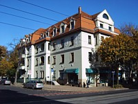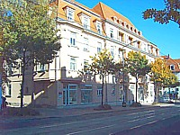

**_Fotos:_** _Wohnhäuser an der Kesselsdorfer Straße (links Nr. 82, rechts Nr. 86-88)_

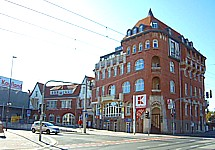Straßenbahnhof Naußlitz:
An der Einmündung Koblenzer Straße / Wendel-Hipler- Straße befindet sich der 1902 eröffnete Straßenbahnhof Naußlitz, einer der wenigen Industriebauten im Jugendstil in Dresden. Das Gebäude entstand ab 1899 nach
Plänen des Architekten Edmund Körner und besteht aus einem Verwaltungsgebäude sowie der Wagenhalle an der Koblenzer Straße. 1938/39 diese nochmals erweitert.
1945 erlitt der Bau schwere Beschädigungen, konnte jedoch nach seiner Wiederherstellung bereits im Folgejahr wieder  genutzt werden. Zuletzt diente der
frühere Straßenbahnhof bis zur Schließung 1996 als Busdepot. Nach dem Verkauf an eine private Investorengruppe entstand hier ein modernes Einkaufszentrum. Die
frühere Wagenhalle wurde dabei mit Ausnahme der Außenwände abgerissen. Auf dem Dach befindet sich heute ein Parkdeck. Im denkmalgerecht sanierten Hauptgebäude sind seit 2005 Büros, Arztpraxen und Wohnungen untergebracht.

Wölfnitz:

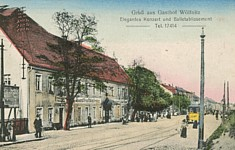Gasthof Wölfnitz: Der Gasthof entstand um 1810 im Zusammenhang mit dem Ausbau der Kesselsdorfer Straße zur Chaussee und wurde 1816 erstmals erwähnt.
Zu den Gästen gehörten vor allem Fuhrleute auf ihrem Weg nach Freiberg. 1879 ließ der Gastwirt Friedrich August Köhler einen großen Saal für verschiedene
Veranstaltungen anbauen. Für einen zusätzlichen Gästezuwachs sorgte die ab 1. August 1900 bis hier verkehrende Straßenbahn. 1945 wurde im Saal ein als
“Filmbühne Wölfnitz” bezeichnetes Kino eingerichtet, wobei Teile der aus der zerstörten Musenhalle geretten Kinotechnik zum Einsatz kamen. Gelegentlich
fanden außerdem Konzerte statt. Am 20. Februar 1985 zerstörte ein Brand den Kinosaal, woraufhin der Gasthof drei Jahre später dem Abbruch verfiel. An seiner Stelle befindet sich heute ein Supermarkt.

Gorbitz:

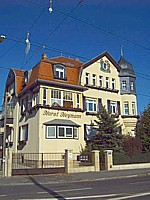Während im unteren Teil der Kesselsdorfer Straße ab 1880 zu beiden Seiten mehrgeschossige
Wohn- und Geschäftshäuser entstanden, blieb die Gorbitzer Flur bis 1980 weitgehend unbebaut. Lediglich am Rande des Dorfkerns Niedergorbitz standen einige Bauerngüter und Mietshäuser.
Pläne zur Errichtung eines großen Wohnviertels zwischen Löbtau und der heutigen Julius-Vahlteich-Straße scheiterten am Beginn des Ersten Weltkrieges. Auch nach 1945 blieben
die Flächen des früheren Kammergutes unbebaut und wurden bis in die 1970er Jahre landwirtschaftlich genutzt. Erst der Beschluss zum Aufbau eines großen [Neubaugebietes](../../../../sudwest/gorbitz/) am
Gorbitzer Hang veränderte das Bild. Bis 1990 war das Areal bis zur Stadtgrenze in Gompitz fast komplett mit Wohnblocks bebaut. Moderne Einkaufsmärkte und Gewerbebetriebe folgten in den
letzten Jahren. Auf der linken Straßenseite sind noch einige historische Bauerngüter von Nieder- und Obergorbitz erhalten, die teilweise saniert wurden. Zu den wenigen Villenbauten an der
Kesselsdorfer Straße gehört das Haus Nr. 116. Es wurde 1912 für einen Dresdner Fabrikanten errichtet _(Foto)_.

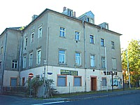Gasthof “Zum alten Dessauer”:
Die frühere Gaststätte auf der Kesselsdorfer Straße 135 verdankt ihren Namen dem Aufenthalt des Fürsten Leopold von Anhalt-Dessau, der im Zusammenhang mit der Schlacht von Kesselsdorf am 15. Dezember 1745 hier weilte.
Fürst Leopold, wegen seiner militärischen Fähigkeiten auch “der alte Dessauer” genannt, führte als Feldmarschall die preußischen Truppen während der Schlacht und brachte der
sächsischen Armee eine vernichtende Niederlage bei. 1875 entstand ein neuer Gasthof, dessen Räume zuletzt von einer Pizzeria genutzt wurden. Nach 1945 hatte hier zeitweise
der Dorfklub Gorbitz sein Domizil. Derzeit steht das Haus leer.

Nr. 139: Das Gorbitzer Wohnhaus des Kreishauptmannes Sahrer von Sahr war am 9./10. November 1813
Verhandlungsort zwischen Vertretern der französischen Besatzer und den Verbündeten. Im Ergebnis der Gespräche
kapitulierten die französischen Einheiten und zogen kampflos aus Dresden ab, wodurch der Stadt eine lang andauernde
Belagerung erspart blieb. An das Ereignis erinnerten später einige in die Fassade eingemauerte Kanonenkugeln, die nach 1990 bei der Sanierung des Gebäudes jedoch beseitigt wurden.

Nr. 143:
Auch in diesem Gebäude befand sich ursprünglich ein Gasthof, welcher sich um 1900 im Besitz von Ernst Schumann befand. Der Gasthof Niedergorbitz wurde nach 1945 geschlossen und diente später gewerblichen Zwecke. 2004
entstand an seiner Stelle das modernes Kurzzeit-Pflegeheim “Am Gorbitzbach”.

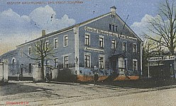

**_Foto:_** _Gasthof Niedergorbitz auf einer historischen Postkarte_

Nr. 153:
Der nach historischem Vorbild gestaltete Dreiseithof wurde zwischen 2007 und 2011 errichtet, wobei für den Bau
vorrangig Materialien aus Abbruchhäusern genutzt wurde. Kernstück ist die Scheune des früheren Pfarrgutes von
Dorfchemnitz im Erzgebirge, welche 2006 demontiert und in Gorbitz wieder aufgebaut wurde. Heute dient das Anwesen als Wellnesshotel.

Nr. 179 / 179a:
Der aus Wohnstallhaus, Scheune, Seitengebäude und Resten einer Toranlage bestehende Dreiseitenhof gehört zu den letzten erhaltenen Bauerngütern von Gorbitz und steht unter Denkmalschutz. Heute dient das Areal Wohn-
und Gewerbezwecken.

Hotel Sächsischer Reiterhof (Nr. 185):
Der frühere Dreiseithof Kesselsdorfer Straße 185 steht heute unter Denkmalschutz und wird seit einigen Jahren als Hotel genutzt. Erhalten blieben zwei Torhäuser, dasWohnstallhaus und die frühere Scheune.
Auch die benachbarten Grundstücke Nr. 187 und 189 sind frühere Bauernhöfe und als Baudenkmale registriert.

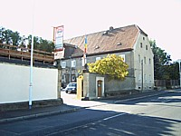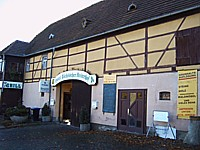

**_Fotos:_** _ehemalige Gehöfte an der Kesselsdorfer Straße: Nr. 179 (links) und Nr. 185 (rechts)_

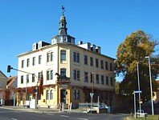Landeskrone:
Die Gaststätte (Kesselsdorfer Straße 200) entstand Ende des 19. Jahrhunderts an der Ecke zur Hirtenstraße. Auch nach 1945 blieb das Gasthaus in
Betrieb und schloss erst um 1970 seine Pforten. Das Gebäude wird seitdem gewerblich genutzt und nach 1990 umfassend saniert. Heute befindet sich hier ein Fachgeschäft für
den Reitsportbedarf. Unweit der “Landeskrone” gab es mit dem [“Reichsschmied”](../../../../sudwest/lobtau/strassen_lobtau/kesselsdorfer_strasse/reichsschmied/) ein
weiteres bekanntes Gorbitzer Lokal, welches nach 1945 als DEFA-Studio für Trickfilme bekannt wurde.

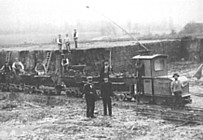Ziegelei Kunath (Nr. 242):
Die Ziegelei auf Obergorbitzer Flur wurde 1873 gegründet und befand sich ursprünglich im Besitz des Premierleutnants Bertram. Nach dessen Konkurs ersteigerte sie 1879 der Gorbitzer Unternehmer Ernst Friedrich Wilhelm
Kunath und baute sie zu einem der modernsten Ziegeleibetriebe im Dresdner Umland aus. U.a. ließ er einen neuen Ringofen errichten, stationierte eine Dampfmaschine und
mehrere Ziegelpressen. Die Kapazität des Werkes, zu dem auch ausgedehnte Lehmgruben gehörten, betrug zu Spitzenzeiten bis zu 6,5 Millionen Ziegel im Jahr. Zur
Beförderung des Rohmaterials setzte Kunath eine elektrisch betriebene Feldbahn ein _(Foto)_. Auch die Fördermaschinen besaßen bereits elektrischen Antrieb, ein Novum zu dieser Zeit. Eine eigens angeschaffte
dampfmaschine mit Generator sorgte für deren Energieversorgung und lieferten zugleich Strom für die Obergorbitzer Wohngebäude.

Bis zum Zweiten Weltkrieg blieb das Unternehmen in Familienbesitz, musste dann jedoch kriegsbedingt schließen. Erst 1950
wurde die Produktion wieder aufgenommen, nachdem man sich zuvor einige Jahre der Fertigung von Betonfertigteilen, vor allem
Dachziegeln gewidmet hatte. 1972 wurde die Ziegelei zwangsweise verstaatlicht und in den VEB Ziegelwerke
Dresden eingegliedert. Trotz ausreichender Rohstoffvorräte entschloss man sich 1977, bedingt durch den starken Verschleiß
der vorhandenen technischen Anlagen, zur Schließung der Ziegelei. Auf dem Areal entstand wenig später das Neubaugebiet Gorbitz.

Gompitz:

Oberhalb des Gorbitzer Hangs erreicht die Kesselsdorfer Straße die Fluren von Gompitz. Hier befindet sich u.a. der Ende des 19. Jahrhunderts erbaute [Gasthof Gompitz](../../../../sudwest/gompitz/), welcher heute als Schnitzel-Spezialitätenrestaurant “Schnizz” dient. Im
Zusammenhang mit dem Ausbau der Straße zum Autobahnzubringer wurden 2007 die Wohnhäuser Kesselsdorfer Straße 306 bis 310 sowie Nr. 271, 275 und 277 abgerissen. Seit dem 29. November 2008 verkehrt parallel zur Straße die
Straßenbahn bis zur Gleisschleife in Pennrich. Unterhalb der Gleistrasse entstand ein 75 Meter langer Tunnel mit zwei Röhren für den Autoverkehr.

* * *

 \[ [Home](../../../../index.html)\] \[ [Nord](../../../../nord/)\] \[ [Nordwest](../../../../nordwest/)\] \[ [Neustadt](../../../../neustadt/)\] \[ [Nordost](../../../../nordost/)\] \[ [West](../../../../west/)\] \[ [Zentrum](../../../../zentrum/)\] \[ [Südwest](../../../../sudwest/)\] \[ [Süd](../../../../sud/)\] \[ [Südost](../../../../sudost/)\] \[ [Ost](../../../../ost/)\] \[ [Register](../../../../Register/register.html)\] \[ [Kontakt](../../../../Kontakt/kontakt.html)\] \[ [Impressum](../../../../impressum/)\]
