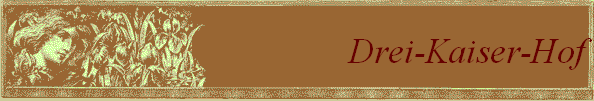
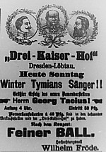
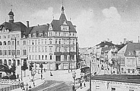
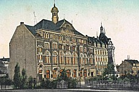
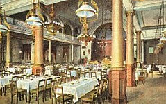

* * *

* * *

* * *

* * *

* * *

* * *

Der Drei-Kaiser-Hof entstand im letzten Drittel des 19. Jahrhunderts an der
Kreuzung [Kesselsdorfer](../../../../../sudwest/lobtau/strassen_lobtau/kesselsdorfer_strasse/) / [Tharandter Straße](../../../../../sudwest/lobtau/strassen_lobtau/tharandter_strasse/) auf dem Grundstück des abgetragenen Löbtauer Chausseehauses. Nach Fertigstellung des
repräsentativen Wohn- und Geschäftshauses eröffnete am 1. April 1888 der Gastwirt Wilhelm Gustav Fröde im Erdgeschoss sein  “Restaurant zum alten
Chausseehaus”. Nachdem Fröde das gesamte Grundstück 1890 gekauft hatte, wurde auf dem Nachbargrundstück 1897 ein Hotelneubau errichtet, der den Namen “Drei-Kaiser-Hof” erhielt _(Foto)._
Mit diesem Namen sollte an das “Dreikaiserjahr” 1888 erinnert werden, in welchem gleich drei deutsche Kaiser
regierten: Wilhelm I., Friedrich III. und Wilhelm II. . Hotel und Restaurant waren bis zum Ersten Weltkrieg eine
renommierte Adresse für Dresden-Besucher. Am 27. Dezember 1902 fanden hier die “Einverleibungs-Festlichkeiten”
aus Anlass der bevorstehenden Eingemeindung Löbtaus nach Dresden statt. 1914 wurde sogar ein hauseigenes Kino eingerichtet.

Nach dem Tod des Besitzers Johannes Zacharias Fröde 1923 und seiner Ehefrau >wurde der Gaststättenbetrieb 1926 von Friedrich Richter als Pächter weitergeführt. Auch das Kino erhielt nach einem Umbau mit Willy Schulze einen neuen Betreiber, der es bis 1945 unter dem Namen “Drei-Kaiser-Hof- Tageslicht-Spiele” betrieb. Der große Ballsaal diente hingegen nur noch gelegentlich für Veranstaltungen. Während des Zweiten Weltkrieges wurde in den früheren Hotelzimmern ein Wehrmachtsquartier für Offiziere eingerichtet. 1945 fiel der Gebäudekomplex den Bomben zum Opfer.

Trotz der schweren Schäden gelang es jedoch, einige Erdgeschossräume wieder nutzbar zu machen. Auch nach Abbruch der Ruine um 1950 blieb in diesem Gebäuderest ein kleiner Bierausschank bestehen, der bis zu seiner Schließung um 1970 von den Löbtauern rege besucht wurde. Außerdem gab es auf dem Areal zeitweise einen Altstoffhandel. Erst nach 1990 verschwanden die letzten Erinnerungen an das einstige Traditionslokal, da an seiner Stelle ein moderner Hotelkomplex geplant war. Allerdings kam dieser Bau nie zur Ausführung, so dass die Freifläche immer mehr verwilderte und später zumindest notdürftig beräumt wurde. 2008 begann auf dem Areal der Bau des Einkaufszentrums “Löbtau-Passage”. Der Name Drei-Kaiser-Hof wird jedoch seit 2000 von einem modernen Einkaufskomplex auf der gegenüberliegenden Straßenseite weitergeführt.

**_Foto:_** _Der große Ballsaal im Drei-Kaiser-Hof_

* * *

 \[ [Home](../../../../../index.html)\] \[ [Nord](../../../../../nord/)\] \[ [Nordwest](../../../../../nordwest/)\] \[ [Neustadt](../../../../../neustadt/)\]
 \[ [Nordost](../../../../../nordost/)\] \[ [West](../../../../../west/)\] \[ [Zentrum](../../../../../zentrum/)\] \[ [Südwest](../../../../../sudwest/)\]
 \[ [Süd](../../../../../sud/)\] \[ [Südost](../../../../../sudost/)\] \[ [Ost](../../../../../ost/)\] \[ [Register](../../../../../Register/register.html)\] \[ [Kontakt](../../../../../Kontakt/kontakt.html)\] \[ [Impressum](../../../../../impressum/)\]
