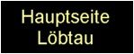
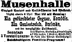
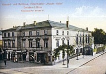
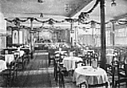

* * *

* * *

* * *

* * *

* * *

* * *

Das Löbtauer Vergnügungslokal “Musenhalle” entstand gegen Ende des 19.
Jahrhunderts an der [Kesselsdorfer Straße](../../../../../sudwest/lobtau/strassen_lobtau/kesselsdorfer_strasse/) 17, Ecke Poststraße. Im Saal des
Gebäudes fanden bis zum Ersten Weltkrieg regelmäßig Tanz- und Varieté- Veranstaltungen sowie Konzerte statt. Zeitweise nutzte auch die Löbtauer
Kirchgemeinde diesen Saal für ihre Gottesdienste. Außerdem besaß das Haus eine Weinstube, eine Stehbierhalle sowie einen großen Gästegarten. Anfang der 1920er
Jahre musste die von der örtlichen Bevölkerung gern besuchte “Musenhalle” aus wirtschaftlichen Gründen schließen.

Die Räume wurden nun vom Kaufhaus Steinhard (ab 1938 Schumann & Co.)
genutzt. Im Herbst 1929 wurde auf dem Grundstück ein Kino eröffnet, welches den Namen “Lichtspiele Musenhalle” erhielt, allgemein aber als “Li-Mu” bekannt
war. Der umgebaute Saal besaß über 1000 Sitzplätze, großzügige Vorräume und Foyers und gehörte zu den modernsten Dresdner Filmtheatern. Bis 1945 wurden
hier Filme gezeigt, bevor das Gebäude beim Luftangriff am 17. April 1945 in Trümmer sank. Durch den mutigen Einsatz des Besitzers Willy Schulze und einiger
Anwohner konnten zumindest Teile des Gestühls und die wertvollen Vorführapparate gerettet werden. Diese kamen dann in der [Filmbühne Wölfnitz](../../../../../sudwest/lobtau/strassen_lobtau/kesselsdorfer_strasse/)
im Saal des dortigen Gasthofes zum Einsatz. Die Ruine der Musenhalle wurde in der Nachkriegszeit abgerissen und auf dem Areal eine Grünfläche angelegt. 1954 entstand hier die zunächst nur in den Sommermonaten betriebene
Gastwirtschaft “Berolina”. Das zeltartige Provisorium wurde zwei Jahre später durch einen Leichtbau für den Dauerbetrieb ersetzt. Dieser dient noch immer, heute als Speiselokal “Mephisto”, seinem Zweck.

* * *

 \[ [Home](../../../../../index.html)\] \[ [Nord](../../../../../nord/)\] \[ [Nordwest](../../../../../nordwest/)\] \[ [Neustadt](../../../../../neustadt/)\]
 \[ [Nordost](../../../../../nordost/)\] \[ [West](../../../../../west/)\] \[ [Zentrum](../../../../../zentrum/)\] \[ [Südwest](../../../../../sudwest/)\]
 \[ [Süd](../../../../../sud/)\] \[ [Südost](../../../../../sudost/)\] \[ [Ost](../../../../../ost/)\] \[ [Register](../../../../../Register/register.html)\] \[ [Kontakt](../../../../../Kontakt/kontakt.html)\] \[ [Impressum](../../../../../impressum/)\]
