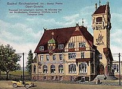
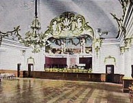
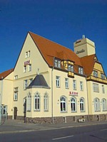

* * *

* * *

Der Gasthof “Zum Reichsschmied”, benannt zu Ehren des Reichsgründers Otto
von Bismarck,  entstand Ende des 19.  Jahrhundert an der Kesselsdorfer Straße 208. Schon 1856 hatte ein Gorbitzer Schmiedemeister das Grundstück erworben
und hier ein Lokal eingerichtet. Das heutige repräsentative Gebäude mit seinem Turm war ab 1900 beliebtes Ausflugs- und Vergnügungslokal am westlichen
Stadtrand und besaß einen der größten Ballsäle der Dresdner Umgebung. Bis zu 900 Personen konnten sich hier vergnügen. Ständig wechselnde Dekorationen
und farbige Illuminierung sorgten für Abwechslung beim Publikum. Noch bis in die Dreißiger Jahre fanden hier Tanzveranstaltungen statt. Gelegentlich gab es
auch Auftritte von Vokalsängern, Artisten und Kabarettisten, Vereinstreffen sowie Theateraufführungen der Gorbitzer Volksschule.

1938 erwarb der Filmproduzent Fritz Boehner den ehemaligen Gasthof und richtete hier ein Filmstudio ein. Boehner gilt als Pionier des Werbefilms und produzierte mit
seiner Boehner-Film bis 1945 zahlreiche Kurz- und Werbefilme für verschiedene Auftraggeber. Unter seiner Regie entstanden in den 1930er Jahren die ersten
Kinospots und das deutschlandweit aktive Dresdner Film-Magazin zum Vertrieb dieser Streifen. Bis 1945 waren die Gorbitzer Studios Wirkungsstätte bekannter
Filmemacher und Schauspieler wie Richard Groschopp, C. A. Engel, Fritz Wollangk und Erich Ponto. In den ersten Nachkriegsmonaten wurden die Räume als Rundfunkstudio des Senders Dresden und
als “Haus der Kleinkunst” für Varietéveranstaltungen genutzt.

1946 wurde das Studio enteignet und diente kurzzeitig als Niederlassung der sowjetischen Filmhandelsgesellschaft Sovexport. Danach übernahm die DEFA den Gebäudekomplex
und richtete hier das DEFA-Studio für populärwissenschaftliche Filme ein. Am 1. April 1955 wurde dieses in DEFA-Studio für Trickfilme umbenannt und war bis 1990
bedeutendster Trickfilmproduzent der DDR. Hier entstanden zahlreiche bekannte Puppen- und Zeichentrickfilme für Kinder, aber auch Auftragsproduktionen für das
DDR-Fernsehen und öffentliche Einrichtungen. Im früheren Ballsaal wurde das für Puppentrickfilme benötigte Puppenatelier eingerichtet, während die frühere Kegelbahn nun
als Vorführraum diente. Anfang der 1960er Jahre folgte ein Tonstudio im früheren Gasthof Gittersee. Zu den bekanntesten Filmreihen des DEFA-Trickfilmstudios gehörten die
populärwissenschaftliche Kinderserie “Jan und Tini auf Reisen”, Kurzfilme mit “Kundi” für das Dresdner Hygienemuseum sowie die Werbefilme der “Tausend Tele-Tips” des DDR-Fernsehens. Zur
Verbesserung der Produktionsbedingungen wurde der frühere ”Reichsschmied” 1966 umfassend erweitert und umgebaut. Bis zur Liquidierung des Studios durch die Treuhandgesellschaft am 30. Juni 1992 entstanden in Gorbitz
über 1.400 Animations- und ca. 100 Spielfilme.

1991 kamen die Gebäude in den Besitz des Mitteldeutschen Rundfunks und seiner Tochterfirma drefa. Weitere
Räume wurden an verschiedene Produktionsfirmen vermietet. Bis 2000 setzten diese die Gorbitzer Filmtradition fort.
Erst mit Verlegung des MDR nach Leipzig endete die Geschichte der Filmateliers. Heute befindet sich im Haus wieder ein Restaurant.

* * *

 \[ [Home](../../../../../index.html)\] \[ [Nord](../../../../../nord/)\] \[ [Nordwest](../../../../../nordwest/)\] \[ [Neustadt](../../../../../neustadt/)\]
 \[ [Nordost](../../../../../nordost/)\] \[ [West](../../../../../west/)\] \[ [Zentrum](../../../../../zentrum/)\] \[ [Südwest](../../../../../sudwest/)\]
 \[ [Süd](../../../../../sud/)\] \[ [Südost](../../../../../sudost/)\] \[ [Ost](../../../../../ost/)\] \[ [Register](../../../../../Register/register.html)\] \[ [Kontakt](../../../../../Kontakt/kontakt.html)\] \[ [Impressum](../../../../../impressum/)\]
