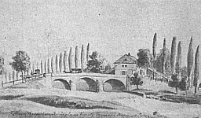
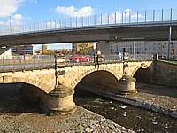
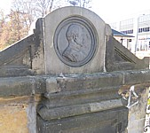
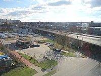
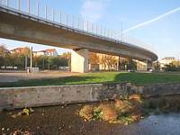

* * *

* * *

* * *

Weißeritzbrücke Kesselsdorfer Straße:

Die erste Weißeritzbrücke in Löbtau entstand bereits im Mittelalter und war ältester Übergang über diesen Fluß in Dresden überhaupt. Die mehrfach erneuerte hölzerne Brücke verband den aus der Innenstadt kommenden Fahrweg (heute [Freiberger Straße](../../../../zentrum/wilsdruffer_vorstadt/freiberger_strasse/)) mit der bedeutenden “Freybergischen Chaussee” (heute [Kesselsdorfer Straße](../../../../sudwest/lobtau/strassen_lobtau/kesselsdorfer_strasse/)). Da sie nur sehr eingeschränkt tragfähig war, mussten schwerere Fuhrwerke eine in der Nähe liegende Furt benutzen. Erst nach einem Umbau in der Mitte des 16. Jahrhunderts, bei dem die Brücke steinerne Pfeiler erhielt, konnte sie als Straßenbrücke genutzt werden. Trotz dieser Maßnahme zerstörten immer wieder Hochwasser und Eisgang dieses Bauwerk. Deshalb entschloss man sich Anfang des 18. Jahrhunderts zu einem kompletten Neubau in Stein, der 1704 vollendet werden konnte. Als Besonderheit wurde im Brückenkörper eine Wasserleitung untergebracht, welche als [“Gorbitzer Röhrfahrt”](../../../../sudwest/gorbitz/gorbitzer_rohrfahrt/) von Gorbitz bis zum Dresdner Schloss führte.

1837 entstand die bis heute erhaltene Brücke, die zunächst Chausseehausbrücke genannt wurde, bevor sie 1902 den Namen Bismarckbrücke erhielt. 1916 wurde an der Brücke eine Büste des “Eisernen Kanzlers” angebracht, welche jedoch nach 1945 verschwand und erst 1998 durch eine Relieftafel aus der Kunstgießerei Lauchhammer ersetzt wurde. 1998 erfolgte die Sanierung der heute offiziell unbenannten Brücke. Dabei wurden auf die vorhandenen Sandsteinbögen drei Stahlbetonbögen aufgesetzt. Das Bauwerk ist 40 Meter lang und 15 Meter breit und dient dem Straßenbahnverkehr.

**_Foto:_** _Blick vom Ebertplatz über die Bismarckbrücke in Richtung Kesselsdorfer Straße um 1930_

Zur Entlastung der alten Brücke entstand 1994/95 unmittelbar neben dem historischen Bauwerk eine moderne Straßenbrücke für den stark angewachsenen Verkehr. Die Stahlbetonbrücke ist 36,7 Meter lang und ca. 12 Meter breit und wird vom Autoverkehr genutzt. Beim Weißeritzhochwasser im August 2002 wurden beide Brücken in Mitleidenschaft gezogen, wenig später jedoch repariert.

_**Fotos:** Die alte Weißeritzbrücke, im Hintergrund die Trasse der Hochstraße_

_und das Bismarckrelief an der Brücke (rechts)_

Weitere Weißeritzbrücken:

Neben der wichtigen steinernen Weißeritzbrücke gab es außerdem etwas flussabwärts den sogenannten “Schindersteg”. Dabei handelte es sich um einen hölzernen Steg, welcher zur Abdeckerei und dem städtischen Richtplatz führte. 1769 ist dieser als “das kleine Brucklein bey der meisterey” erwähnt. Mehrfach musste diese Holzbrücke nach Hochwasser erneuert werden und verschwand im Zusammenhang mit der Verlegung des Weißeritzbettes 1893.

Um den gewachsenen Verkehrsbedürfnissen zu begegnen, entstanden Ende des 19. Jahrhunderts drei weitere Brücken auf Löbtauer Flur. Diese befinden sich noch heute an der Oederaner Straße, an der Löbtauer Straße und der Wernerstraße. Während die Brücken an der Oederaner und der Wernerstraße beim Weißeritzhochwasser 2002 relativ glimpflich davon kamen, wurde die Brücke an der Löbtauer Straße schwer beschädigt und wenig später durch einen Neubau ersetzt.

Nossener Brücke:

Im Zusammenhang mit dem Ausbau der Dresdner Eisenbahnanlagen machte sich ein weiterer Brückenbau erforderlich. Dieser verband den alten Zelleschen Weg mit der Freiberger Straße und erhielt 1889 den Namen Hohenzollernbrücke. Unter der Brücke verliefen die Gleise der 1855 eröffneten Albertbahn und der Anlagen des Bahnbetriebswerks. Um 1900 wurde sie als Nossener Brücke (nach der angrenzenden Nossener Straße) bezeichnet. Die als Stahlträgerbrücke ausgeführte alte Brücke genügte jedoch nach 1945 nicht mehr den Verkehrsanforderungen und wurde Anfang der 1960er
Jahre durch eine neue Stahlbetonbrücke ersetzt. Parallel zu den Arbeiten erfolgte eine komplette Neugestaltung des gesamten Verkehrszuges, zu dem weitere kleinere Überführungen über die Fabrikstraße, die Zwickauer Straße und das Gelände des Kraftwerks gehörten. Die neue Brücke war deshalb bedeutend länger und wurde am 28. Juni 1964 als Brücke der Jugend dem Verkehr übergeben. Gleichzeitig erfolgte eine Verlängerung der [O-Bus-Linie](../../../../sudwest/lobtau/strassen_lobtau/ebertplatz/o-bus/) bis zum Willi-Ermer-Platz (Ebertplatz).

Nach 1990 wurde diese Brücke komplett erneuert und erhielt dabei auch ihren früheren Namen zurück. Bereits 1989 war im Anschluss mit dem Bau einer modernen Hochstraße begonnen worden, die von der Nossener Brücke aus den Ebertplatz und die Weißeritz überquert und schließlich am Emerich-Ambros-Ufer endet. Der fast einen Kilometer lange Verkehrszug ist Teil der Dresdner Südtangente und soll vor allem zur Entlastung der Kesselsdorfer Straße beitragen. 1996 erhielt das Bauwerk offiziell den Namen Löbtauer Brücke, wird jedoch meist Neue Nossener Brücke genannt. Die offizielle Einweihung erfolgte am 29. November 1996 _(Foto)_.

* * *

 \[ [Nord](../../../../nord/)\] \[ [Nordwest](../../../../nordwest/)\] \[ [Neustadt](../../../../neustadt/)\] \[ [Nordost](../../../../nordost/)\] \[ [West](../../../../west/)\] \[ [Zentrum](../../../../zentrum/)\] \[ [Südwest](../../../../sudwest/)\]
 \[ [Süd](../../../../sud/)\] \[ [Südost](../../../../sudost/)\] \[ [Ost](../../../../ost/)\] \[ [Register](../../../../Register/register.html)\] \[ [Kontakt](../../../../Kontakt/kontakt.html)\] \[ [Impressum](../../../../impressum/)\]
