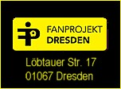
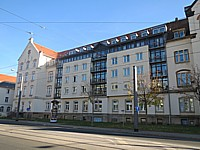
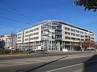
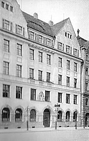
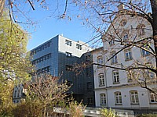
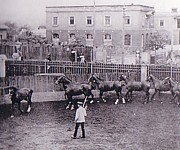
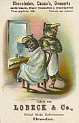

* * *

* * *

Die Löbtauer Straße verbindet die Friedrichstadt mit Löbtau und erhielt ihren Namen
1840 bzw. 1904. Zuvor wurde die parallel zum alten Weißeritzlauf führende Allee auch als Vor dem Löbtauer Schlag bzw. ab 1877 auf Löbtauer Flur als Dresdner Straße
bezeichnet. Hier befand sich an der Stadtgrenze zwischen Dresden und Löbtau der “Löbtauer Schlag”, eine zur Erhebung städtischer Abgaben dienende Einnahmestelle.

Mitte des 19. Jahrhunderts entstanden in diesem Gebiet die ersten Mietshäuser und Industriebetriebe, darunter die [Glasfabrik](../../../../zentrum/wilsdruffer_vorstadt/freiberger_strasse/glaswerk_lobtau/) der Familie Siemens. Weitere bedeutende
Unternehmen in diesem Bereich waren die 1857 gegründete Zementfabrik Michel, die Maschinenfabrik Kühne & Co., die Schuhwarenfabrik Eberle & Treibmann und der [Fiskalische Kohlenbahnhof](../../../../zentrum/wilsdruffer_vorstadt/freiberger_strasse/) auf dem
Gelände zwischen Löbtauer und Freiberger Straße.  Zur Unterbringung der Arbeiter waren bereits zwischen 1859 und
1862 einige Wohnhäuser an der Flußstraße gebaut worden. Diese Siedlung hieß im Volksmund Neu-Löbtau und war Ausgangspunkt der weiteren Besiedlung des Stadtteils.

Neben den genannten Unternehmen existierten hier
um 1900 die bekannten Ausflugslokale “Neu-Hamburg” und “Altona”, an die noch die [Altonaer Straße](../../../../zentrum/friedrichstadt/strassen_friedrichstadt/) erinnert. Im Wohnhaus Löbtauer Straße 9 hatte zeitweise der Maler Karl Schmidt-Rottluff
sein Atelier, der zu den Mitbegründern der “Brücke” gehörte. 1893 wurde auf dem trockengelegten Weißeritzflussbett der Fiskalische Straßenbauhof eingerichtet.

1945 fielen zahlreiche Gebäude an der Löbtauer Straße den Bomben zum Opfer,
weshalb eine endgültige städtebauliche Fassung des Areals bis heute fehlt. 1991/94 entstand an der Ecke Löbtauer/ Berliner Straße ein moderner Neubau für das Dresdner
Amtsgericht. 1999 folgte das Gründer- und Gewerbezentrum unmittelbar an der Weißeritzbrücke. Auch an der Einmündung der Cottaer Straße wurde ein moderner Bürokomplex errichtet _(Foto)._
2013 begann die Umgestaltung der Brachfläche zwischen Löbtauer, Schweriner und Roßthaler Straße zu einem kleinen Freizeitpark für Kinder und Jugendliche. Hier findet man verschiedene Sport-, Spiel- und
Erholungsflächen. Außerdem entstand eine moderne Behindertenwerkstatt des Vereins Lebenshilfe Dresden.

Einzelne Gebäude und Einrichtungen:

Stadthaus Friedrichstadt:
Das Gebäude Löbtauer Straße 2 wurde 1907/08 nach Plänen des Stadtbaurates Hans Erlwein erbaut und beherbergte ursprünglich eine Polizeiwache, die
städtische Meldestelle sowie eine Filiale der Stadtsparkasse. In den oberen Geschossen befanden sich Wohnungen. Die Fassadenreliefs, die u.a. zwei Mütter mit Kindern und das
Dresdner Stadtwappen zeigen, stammen von Georg Wrba. Außerdem ließ Erlwein an der linken Seite der Fassade sein Architektenzeichen, einen Putto mit Weinfass, umgeben von Erlenzweigen,
anbringen. Neben dem Stadthaus gehörte ursprünglich auch ein im ähnlichen Stil errichtetes Hintergebäude mit Ecktürmchen zum Komplex. Hier fanden städtische Einrichtungen wie die
Kanalbetriebsstelle des Tiefbauamtes und eine Laternenwächter-Wache ihr Domizil.

1945 wurde das Friedrichstädter Stadthaus durch Bomben beschädigt, konnte jedoch notdürftig
wiederhergestellt werden. Auf den Wiederaufbau des zerstörten linken Giebels verzichtete man dabei. In die Räume der ehemaligen Sparkassenfiliale zog nun eine Fleischverkaufsstelle des
Konsums ein. Die Obergeschosse beherbergten auch weiterhin Wohnungen sowie die Büros des Städtischen Bestattungsamtes und eine Arztpraxis. Zuletzt wurden einige Räume von der Kommunalen Wohnungsverwaltung und dem
Bezirksvorstand der URANIA genutzt. Das Hintergebäude fiel 1985 der Neubebauung der Schäferstraße zum Opfer. Aus
baupolizeilichen Gründen musste wenig später auch das denkmalgeschützte Vorderhaus geräumt werden und steht seitdem
leer. Der Anfang der 1990er Jahre geplante Abriss konnte durch Bürgerproteste verhindert werden. Nach Verkauf an einen Investor ist eine Sanierung des Stadthauses als Wohnhaus vorgesehen.

Nr. 17:
In diesem Gebäude befindet sich seit Ende 2006 das “Dynamo-Fanhaus”. Die Einrichtung lädt zu verschiedenen
Veranstaltungen für die Fußballfreunde von Dynamo Dresden ein und wird vom Team Fanprojekt e.V. betrieben.

Nr. 29 (Heaven 07):
Dieses frühere Arbeiterwohnheim wurde Mitte der 1980er Jahre auf einem Ruinengrundstück an der Ecke zur Fröbelstraße errichtet und diente zur Unterbringung der Bauleute für den Hotelneubau des “Bellevue”. 1990
entstand hier mit dem “Heaven 07” Dresdens erstes offiziell genehmigtes Bordell. Nach einem Brand wurde das Gelände im
Sommer 1998 zwangsweise geräumt und die Gebäude Ende 2010 abgerissen. 2013 wurde auf dem Grundstück die
temporäre Kunstinstallation “Fahrtwindkino” mit bedruckten Bildtafeln aufgestellt, die an das ehemals hier verlaufende Weißeritzbett erinnern. Gestaltet wurde das Projekt vom Büro Storch.Landschaftsarchitektur.

**_Foto:_** _Kunstinstallation “Fahrtwindkino” an der Löbtauer Straße 29_

Stadtkrankenhaus Löbtauer Straße (Nr. 31/33): Bereits 1861 wurde im
ehemaligen Gemeindehaus Löbtau eine Städtische Pflegeeinrichtung für geistig  und körperlich Behinderte mit 55 Betten eingerichtet. 1888 entstand auf einem
Grundstück an der Löbtauer Straße das spätere Stadtkrankenhaus als “Städtisches Irren- und Siechenhaus”, welches ein Jahr später mit der Abteilung
für Geisteskranke des Friedrichstädter Krankenhauses fusionierte. Infolge des Bevölkerungswachstums der Stadt und der daraus resultierenden Zunahme an
pflegebedürftigen Personen machten sich bereits wenige Jahre später erste Erweiterungen erforderlich. Der ausgedehnte Gebäudekomplex zwischen Fröbel- und Altonaer Straße _(Foto)_
wurde ab 1902 als Städtische Heil- und Pflegeanstalt, ab 1930 als Stadtkrankenhaus Löbtauer Straße bezeichnet. Nach einem einheitlichen Konzept gruppieren sich die viergeschossigen Hauptbauten um einen
parkartigen Innenhof. Versorgt wurden hier bis zum Zweiten Weltkrieg vor allem Personen mit schweren geistigen und körperlichen Behinderungen. Dafür standen insgesamt 132 Betten zur Verfügung.

Beim letzten Luftangriff auf Dresden am 17. April 1945 wurde die Klinik getroffen und
dabei zum Teil zerstört bzw. schwer beschädigt. Einige Flügel konnten bereits in der Nachkriegszeit wiederhergestellt werden. Ab 1953 dienten diese als Städtisches
Pflegeheim mit über 900 Plätzen. Nach 1990 wurden die vorhandenen Gebäude durch baulich angepasste Neubauten, teilweise auf den Fundamenten der 1945 zerstörten
Flügel, ergänzt. Heute diente der Komplex als Pflegeheim und Geriatrische Klinik. Seit 2004 gehört das Heim zur gemeinnützigen Cultus GmbH. Die verbliebenen Gebäude
sollen künftig saniert und als altersgerechte Wohnungen vermietet werden. 2014 begann die Renovierung der Altbauten an der Ecke zur Altonaer Straße (Löbtauer Str. 35) und deren Umbau zu Wohnzwecken.

Nr. 45: Das Grundstück an der Ecke zur Altonaer Straße war von 1909 bis 1923 erster Standort des [Sächsischen Serumwerkes](../../../../Zentrum/Pirnaische_Vorstadt/Strassen_Pirnaische_Vorstadt/Zirkusstra%DFe/Serumwerk/serumwerk.html). Das Unternehmen ging aus dem 1910 von Karl August Lingner gegründeten “Sächsischen Serumwerk und Institut für Bakteriotherapie G.m.b.H.” hervor und nutzte die Stallungen der [Gambrinus-Brauerei](../../../../zentrum/friedrichstadt/strassen_friedrichstadt/) auf der gegenüberliegenden Straßenseite. Hier wurden die für die Impfstoff-Herstellung des Serumwerkes erforderlichen Pferde gehalten. Neben Ställen für ca. 30 Pferde gab es auch einen kleinen Reitplatz _(Foto)_, um den Tieren den erforderlichen Auslauf zu gewähren. Aus Platzgründen zog das Unternehmen 1924 in die Räumlichkeiten der ehemaligen Tierärztlichen Hochschule auf der Zirkusstraße um. 1934 erwarb das Werk schließlich für die Pferdehaltung ein bis 1988 genutztes Gut in Oelzschau bei Borna.

Nach 1945 nutzte das volkseigene Verkehrskombinat Dresden das Grundstück an der Löbtauer Straße 45. U.a. war hier bis 1990 die Fahrschule des VEB Taxi und Fahrschule untergebracht.

Alpenschänke: Das Gebäude Löbtauer Straße 56 entstand im 19. Jahrhundert direkt auf der Stadtgrenze zwischen Dresden und Löbtau und diente als Akzisehaus zur Erhebung kommunaler Abgaben _(Foto)_
. Im Nebenerwerb betrieben die Pächter eine kleine Gastwirtschaft, die ihren ungewöhnlichen Namen vermutlich wegen des langen Anstieges bis zu diesem Punkt erhielt. Im Volksmund war die
Schänke als “Pumphäuschen” bekannt, da sich die Fuhrleute hier oft Geld zur Bezahlung der Einfuhrzölle “pumpen” mussten. Hier befand sich auch eine
Außenstelle des Städtischen Marstalls. Nach der Eingemeindung Löbtaus wurden die Gebäude 1905 abgebrochen.

Zementfabrik Michel:
Die Fabrik zur Herstellung von Portlandzement wurde 1857 von Eduard Michel gegründet und war eine der bedeutendsten dieser Branche in Sachsen. 1874 übernahm die Siemens AG das Werksgelände und nutzte es für
eigene Zwecke.

Schokoladenfabrik Lobeck (Nr. 63-71): Die Schokoladenfabrik Lobeck befand sich ursprünglich in einer Mühle im [Lockwitzgrund](../../../../sudost/lockwitz/strassen_lockwitz/) und wurde 1838 als “Chocoladen- und Kakaofabrik Ferdinand
Lobeck & Co.” gegründet. 1857 besuchte Otto Rüger diese Mühle und erwarb erste Kenntnisse bei der Schokoladenherstellung. Zwei Jahre später, im Oktober 1859, kaufte er schließlich das Anwesen
und richtete dort seine eigene [Schokoladenfabrik](../../../../sudost/lockwitz/strassen_lockwitz/schokoladenfabrik_ruger/) ein. August Ferdinand Lobeck erwarb daraufhin 1862 ein Grundstück an der Löbtauer Straße in Dresden, um hier sein Unternehmen fortzuführen.
Unter den Markennamen “Lobeck” und “Dreiring” wurden Schokoladen- und Kakaoerzeugnisse, Konfitüre und Zuckerwaren hergestellt. Spezialität der Firma war ein ohne chemische Zusätze unter
Dampfdruck gefertigtes Kakaopulver, welches sich leichter als herkömmliche Produkte verrühren ließ. Ab 1876 durfte sich Lobeck als Königlich-Sächsischer Hoflieferant bezeichnen. Zeitweise gehörten
auch Makkaroni und Waffelgebäck zum Herstellungsprogramm. Um 1910 zählte die Firma fast 500 Beschäftigte. Beim Bombenangriff auf Dresden wurde die Schokoladenfabrik zerstört, womit die Geschichte des Unternehmens endete.

Gründer - und Gewerbezentrum:
Das moderne Bürogebäude Löbtauer Straße 67 _(Foto)_ entstand 1999 auf dem Gelände des früheren Motorenwerkes unmittelbar an der [Weißeritzbrücke](../../../../sudwest/lobtau/strassen_lobtau/lobtauer_brucken/). Zuvor war das Grundstück bis 1934 von einer
Schokoladenfabrik, danach bis 1991 von einem Zweigbetrieb des Sachsenwerkes zur Herstellung von Elektromaschinen genutzt worden. Hier haben heute zahlreiche
klein- und mittelständische Unternehmen aus dem Bereich Handwerk und Gewerbe ihren Sitz. Die angrenzende weißeritzbrücke wurde nach dem Hochwasser von 2002 durch einen Neubau ersetzt und die Uferzone neu gestaltet.

Städtische Bestattung (Nr. 70): Die Geschichte des kommunalen Bestattungswesens lässt sich bis ins Mittelalter zurück
verfolgen. Schon 1384 und 1427 werden in Rechnungsdokumenten städtische Marstallknechte erwähnt, welche Leichenfuhren zu den Friedhöfen übernehmen mussten. 1683 trat eine kursächsische Leichenordnung in Kraft, die alle
notwendigen Details der Bestattung regelte und bis ins 19. Jahrhundert galt.

1886 erwarb die Stadt Dresden auf der Löbtauer Straße ein Grundstück, in welchem man den Fuhrpark (Marstall) mit den
Leichenwagen unterbrachte. Die Hauptgeschäftsstelle der Städtischen Bestattung befand sich hingegen in einem heute nicht
mehr vorhandenen Gebäude Am See 2/4 in der Nähe des Postplatzes. 1911 wandelte man das Leichenwageninstitut  zur
Städtischen Beerdigungsanstalt um, die Verwaltung wurde einem eigens geschaffenen Bestattungsamt übertragen. Nach
Auflösung des Marstalls 1939 blieb das Städtische Bestattungsamt alleiniger Nutzer des Grundstücks Löbtauer Straße 70.

Durch Beschluss dees Rates der Stadt erfolgte 1946 eine komplette Kommunalisierung der gesamten Totenbestattung. Die bestehenden vier kommunalen Friedhöfe in [Tolkewitz](../../../../ost/tolkewitz/johannisfriedhof/), [Dölzschen](../../../../sudwest/dolzschen/dolzschener_friedhof/), der Albertstadt [(Nordfriedhof)](../../../../neustadt/albertstadt/nordfriedhof/) und der [Heidefriedhof](../../../../nordost/dresdner_heide/heidefriedhof/)
unterstanden nun ebenfalls dem Städtischen Bestattungswesen. 1951 konnte die Verwaltung in die wiederaufgebauten
Gebäude auf der Löbtauer Straße verlagert werden, wo das Unternehmen - seit 1996 Eigenbetrieb der Stadt Dresden - bis heute sein Domizil hat.

Nr. 80: Das ehemalige Postgebäude auf der Löbtauer Straße 80 wird seit 2011 als “Bandhaus” der Firma Volume 11
eröffnet. Hier können Dresdner Bands und Einzelmusiker Probenräume für ihre Arbeit mieten.

Nr. 81  / 83: Das viergeschossige Doppelwohnhaus entstand Ende des 19. Jahrhunderts und blieb im Gegensatz zu
zahlreichen Wohngebäuden der Umgebung bis Ende der 1980er Jahre erhalten. Im Zuge der Verlängerung der Nossener Brücke und dem Bau der Hochstraße wurde der Bau am 20. September 1992 gesprengt.

Die Flußstraße wurde im Zusammenhang mit dem Ausbau des Industriegebietes zwischen Löbtauer und Freiberger Straße
angelegt. 1871 erhielt sie ihren Namen nach der nahegelegenen Weißeritz, die 1893 ihr neues Bett in Richtung Cotta erhielt.
Die ersten Wohngebäude an der Flußstraße wurden zwischen 1859 und 1862 durch den Cottaer Zimmermann Deckow für
die Arbeiter der Vorstadt errichtet. Die Straße wird heute nicht mehr namentlich benannt, ist in ihrer Anlage jedoch noch erhalten.

Die Straße erhielt 1883 den Namen Siemensstraße, der an den Techniker und Unternehmer Friedrich August Siemens
(1826-1904) erinnerte. Die Familie Siemens war Inhaber des im 19. Jahrhunderts entstandenen [Löbtauer Glaswerk](../../../../zentrum/wilsdruffer_vorstadt/freiberger_strasse/glaswerk_lobtau/) in
unmittelbarer Nähe. Außerdem machte Siemens durch zahlreiche Erfindungen und technische Neuerungen auf sich aufmerksam. 1953 wurde die Siemensstraße nach dem kleinen Ort Hirschfeld im Erzgebirge in Hirschfelder Straße
umbenannt.

* * *

 \[ [Home](../../../../index.html)\] \[ [Nord](../../../../nord/)\] \[ [Nordwest](../../../../nordwest/)\] \[ [Neustadt](../../../../neustadt/)\] \[ [Nordost](../../../../nordost/)\] \[ [West](../../../../west/)\] \[ [Zentrum](../../../../zentrum/)\] \[ [Südwest](../../../../sudwest/)\] \[ [Süd](../../../../sud/)\] \[ [Südost](../../../../sudost/)\] \[ [Ost](../../../../ost/)\] \[ [Register](../../../../Register/register.html)\] \[ [Kontakt](../../../../Kontakt/kontakt.html)\] \[ [Impressum](../../../../impressum/)\]
