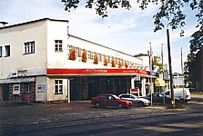
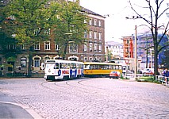
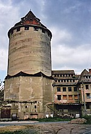

* * *

* * *

Die heutige Tharandter Straße wurde Mitte des 16. Jahrhunderts als Fußweg durch
den Plauenschen Grund angelegt. 1712 regten die Ämter Dippoldiswalde und die Stadt Tharandt an, den bestehenden Fahrweg über die Höhen von Coschütz und
Plauen in das Weißeritztal zu verlegen und zu befestigen. Wegen des hohen Aufwands und der zu geringen Verkehrsbedeutung wurde das Vorhaben jedoch
abgelehnt. Erst nach einer erneuten Eingabe erfolgte 1745 der Ausbau des Talweges zur Fahrstraße, um so eine bessere Verbindung zwischen dem Elbtal und den
Dörfern Potschappel und Döhlen zu schaffen. Zuvor hatte bereits 1729 der sächsische Oberlandfeldmesser Christoph Moritz Dietze den Abschnitt zwischen
dem Reisewitzschen Garten bis zur Plauener Weißeritzbrücke befestigen lassen.

An der Kreuzung Kesselsdorfer/ Tharandter Straße befand sich einst der Löbtauer Weideplatz. Mit Ausnahme einiger
Mühlen an der Weißeritz waren die Flächen links und rechts dieses Weges unbebaut. Am Eingang zum Plauenschen Grund lag seit dem 17. Jahrhundert das Areal des [Reisewitz´schen Gartens](../../../../sudwest/lobtau/strassen_lobtau/tharandter_strasse/reisewitz_scher_garten/), welcher jedoch in der zweiten Hälfte des
19\. Jahrhunderts der zunehmenden Bebauung weichen musste. Zeitweise bestanden in diesem Teil Löbtaus auch einige
Handelsgärtnereien. Erst mit der Industrialisierung wuchs die Verkehrsbedeutung dieser Straße. Nach der verstärkten Erschließung der Steinkohlevorkommen in Döhlen und Burgk erfolgte 1807/09 auf Betreiben der Königlichen
Steinkohlewerke der Ausbau zur Chaussee, die nun den Namen Kohlenstraße erhielt. 1871 wurde sie auf  Löbtauer Flur
in Plauensche Straße umbenannt, 1904 in Tharandter Straße. Dieser Name wurde nach der Eingemeindung Dölzschens auch auf den anschließenden Abschnitt bis zur Freitaler Stadtgrenze übertragen.

Zu den bedeutenden Gebäuden und Einrichtungen
an der Tharandter Straße gehörten das 1897 vollendete Löbtauer [Rathaus](../../../../sudwest/lobtau/) sowie der Hotelkomplex [“Drei-Kaiser-Hof”](../../../../sudwest/lobtau/strassen_lobtau/kesselsdorfer_strasse/drei-kaiser-hof/) an der Tharandter Straße, die beide 1945 den Bomben zum Opfer fielen _(Foto oben)_
. Auch zahlreiche Wohngebäude sowie industrielle Anlagen wurden zerstört bzw. schwer beschädigt. Seit 1870 hatte sich der gesamte Bereich zwischen Tharandter Straße und Weißeritz zum Industriegebiet
entwickelt. Neben metallverarbeitenden Betrieben wie der Firma Hille (Herstellung von Gas- und Benzinmotoren) und der Eisengießerei Buschbeck & Hebenstreit befand sich hier auch die 1843 gegründete [Schokoladenfabrik Petzold & Aulhorn](../../../../sud/plauen/strassen_plauen/petzold___aulhorn/) sowie eine Großwerkstatt für Busse und Lkws _(Foto)_
. In der Nachkriegszeit wurden diese Betriebe in volkseigene Unternehmen umgewandelt, so zum VEB Kupplungs- und Triebwerkbau (Nr. 31/33) und VEB Vereinigte
Metallgusswerke (Nr. 41). Heute nutzen verschiedene gewerbliche Unternehmen die Gebäude, darunter das Sächsische
Druck- und Verlagshaus. Die 1902 entstandene Straßenbahn nach Freital-Hainsberg und Plauen wurde 1974 bzw. 1998 durch eine Buslinie ersetzt.

**_Foto:_** _Abzweig Tharandter Straße/Altplauen kurz vor Einstellung der Straßenbahn 1998_

Firma Schulze & Schultz:
Das Unternehmen wurde 1914 von den Ingenieuren Richard Josef Schulze und Hugo Schultz
als “Schulze & Schultz Apparatebauanstalt” in Niedersedlitz gegründet. Anfangs besaß der Betrieb nur fünf Mitarbeiter.
Hergestellt wurden luft- und wärmetechnische Anlagen für industrielle Zwecke, u.a. Luftbefeuchtungsanlagen für die
Textilindustrie. Der wirtschaftliche Erfolg ermöglichte die Aufstockung des Personals auf bis zu 200 Arbeiter und den
Erwerb eines Firmengrundstücks an der Tharandter Straße 8. 1932 schied Hugo Schultz aus der Firma aus. Während des Zweiten Weltkrieges wurden Panzer- und Bunkerbelüftungsanlagen gebaut. Im Zusammenhang mit dem
Volksentscheid in Sachsen 1946 wurde die Firma Schulz & Schultze enteignet und in Volkseigentum überführt. Fortan firmierte das Unternehmen als VEB Luft- und Wärmetechnik und nutzte auch die Räume der ehemaligen
[Lampenfabrik Seifert](../../../../sudwest/lobtau/strassen_lobtau/)
auf der Gröbelstraße. 1964 erfolgte die Eingliederung als Betriebsteil in den neu gebildeten VEB Lufttechnische
Anlagen mit Sitz in Klotzsche. Nach 1990 wurde die Produktion eingestellt, wenig später folgte der Abriss der Gebäude.

Dresdner Strickmaschinenfabrik: Der Betrieb entstand 1868 auf der Freiberger Straße 11, als
Georg Laue hier seine Werkstatt einrichtete und mit dem Bau der ersten deutschen Strickmaschinen begann. Zunächst erfolgte die Produktion von Maschinen nach
amerikanischem Vorbild, bald jedoch nach eigenen Konstruktionsentwürfen. Der große Erfolg machte wenig später den Neubau einer Fabrik auf Löbtauer Flur erforderlich (Tharandter
Straße 31/33). Am 1. Januar 1879 trat Theodor Eduard Timaeus, ein Verwandter des bekannten Schokoladenfabrikanten, in den Betrieb ein, der nun als “Dresdner
Strickmaschinenfabrik Laue & Timaeus” firmierte. Hergestellt wurden Strickmaschinen mit Motoren für die Großindustrie, wobei zeitweise bis zu 2000 verschiedene Modellvarianten
zum Programm gehörten. Bereits im ersten Jahr gelang der Umbau einer Hand-Strickmaschine zur Musterstrickmaschine, mit der nun auch die Fertigung gemusterter Ware möglich war.

1890 erfolgte ein Besitzerwechsel, so dass das Unternehmen fortan unter dem Name Irmscher & Co (später Irmscher & Witte) tätig war.
1911 wurde der Betrieb in eine Aktiengesellschaft umgewandelt und per 13. März 1912 ins Handelsregister eingetragen. Die Dresdner Strickmaschinenfabrik Irmscher & Witte AG (ab 1937
Irmscher & Witte Maschinenfabrik AG) wurde nach 1945 enteignet und ging 1952 im VEB Kupplungswerk- und Triebwerksbau auf. 1982 wurde durch Zusammenschluss mit dem Kupplungswerk Freital der VEB Kupplungswerk
Dresden gebildet, der bis 1990 existierte.

Kino in der Fabrik (Nr. 33): Das Kino in der Fabrik (KiF) ging aus einer früheren Probebühne des Staatsschauspiels
hervor. Ursprünglich wurden die Gebäude vom VEB Kupplungs- und Triebwerksbau genutzt. Nachdem das “Kleine
Haus” an der Glacisstraße aus baulichen Gründen geschlossen werden musste, entstand hier eine Interimsspielstätte, die
sich als “TiF” (Theater in der Fabrik) vorrangig dem experimentellen Theater widmete und jungen Künstlern eine
Spielstätte bot. Die Einweihung erfolgte am 3. Oktober 1993. Leiter war von 1994 bis 1998 Volker Metzler. Danach übernahm eine freie Schauspielertruppe um Eva Johanna Heldrich den Spielbetrieb und sorgte mit zahlreichen
Uraufführungen für überregionale Aufmerksamkeit. Am 12. Juni 2004 wurde dieses Theater  geschlossen. Seit dem 16.
März 2006 dienen die Räumlichkeiten als privates Programmkino. Die drei von der APO Filmtheater GmbH betriebenen Säle bieten insgesamt Platz für ca. 300 Besucher. Außerdem gibt es ein kleines Restaurant.

Nr. 64: In diesem Haus wurde am 4. Dezember 1899 die Malerin Elfriede Lohse-Wächtler geboren. Nach dem Besuch
der Kunstakademie gehörte sie der Künstlergruppe Dresdner Sezession um Otto Dix und Conrad Felixmüller an und
schuf in den 1920er Jahren zahlreiche expressionistische Gemälde. Nach einem Nervenzusammenbruch 1929 verbrachte
sie längere Zeit in verschiedenen psychiatrischen Kliniken, zuletzt in Arnsdorf. 1940 wurde sie in der Tötungsanstalt Pirna-Sonnenstein ein Opfer des nationalsozialistischen Euthanasieprogramms.

In Plauen verengt sich das Weißeritztal und bildet hier den eigentlichen [Plauenschen Grund](../../../../sud/plauen/plauenscher_grund/), der bis ins 19. Jahrhundert wegen seiner romantischen Landschaftsbilder Anziehungspunkt für
Naturliebhaber und Künstler war. Neben einigen Mühlen entstand hier auch die zu Dölzschen gehörende Siedlung Niederdölzschen. Wichtigstes gewerbliches Unternehmen war die aus
einem Eisenhammer hervorgegangene Friedrich-August-Hütte, später [Eisenhammerwerk Dölzschen](../../../../sud/plauen/plauenscher_grund/eisenhammerwerk/) genannt. Zeitweise bestand auch ein Schlacke-Kurbad. Die früheren Mühlen
entwickelten sich später zum Teil zu Großbetrieben wie den [Bienert-Werken](../../../../sud/plauen/bienertmuhle/) in Plauen und
der König-Friedrich-August-Mühlenwerke AG in Dölzschen mit angeschlossener Brotfabrik _(Foto)_. Durch den Eisenbahnbau und die Industrialisierung verlor der Plauensche Grund an
Bedeutung für den Ausflugsverkehr. Heute ist die hier entlang führende Tharandter Straße eine wichtige Verkehrsverbindung zwischen Dresden und Freital und wurde nach 1990 ausgebaut.
