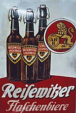
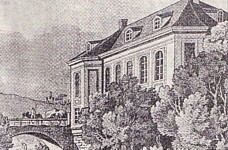
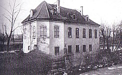
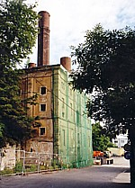

* * *

_Werbedeckel und Tafel der Brauerei Reisewitz_

* * *

Die frühe Geschichte des Grundstücks liegt weitgehend im Dunkeln. Vermutlich gab es an dieser Stelle zum Ausgang des Mittelalters ein Vorwerk, welches später von Mühlenbesitzern erworben und gärtnerisch gestaltet wurde. Zuvor hatte die Familie Moses hier zwei Windmühlen betrieben, welche jedoch mit Einführung des Mahlzwangs der Plauener [Hofmühle](../../../../../sud/plauen/bienertmuhle/) 1571 ihre Bedeutung verloren. Bereits auf einer Karte von 1591 ist zwischen Weißeritz und der heutigen Tharandter Straße eine parkartige Anlage mit Laubengängen und zwei Lusthäusern erkennbar. Hinzu kamen ein Obst- und Weingarten sowie ein Kräutergärtchen. 1659 erwarb der Stadtsyndikus Georg Börner das Grundstück und erweiterte die Fläche durch Zukauf benachbarter Grundstücke. Gemeinsam mit seinem Sohn ließ er seltene Gehölze anpflanzen, Statuen aufstellen und das Areal nach zeitgenössischen Beschreibungen zu einem der schönsten Gärten Dresdens machen.

1692 kaufte Kurfürst Johann Georg IV. das Grundstück an der Weißeritz. Hier ließ er für seine Geliebte Magdalena Sibylla von Neitschütz ein Wasserpalais errichten _(Bild)_ und den vorhandenen Garten neu gestalten. Erstmals in Dresden wurden hier holländische Tulpen angepflanzt, aber auch Zitronen-, Feigen- und Lorbeerbäume. Wenig später erkrankte Sibylla und verstarb 1694 an den Blattern. Ihr Geliebter blieb ihr bis zum Tod treu, steckte sich an und starb nur wenige Tage später, wodurch Johann Georgs Bruder, August der Starke, an die Macht kam. August ließ das Areal daraufhin von der kurfürstlichen Kammer wieder einziehen und verkaufte es wenig später an einen privaten Besitzer.

1702 erwarb der kurfürstliche Bergdirektor Johann Wratislaw von Reisewitz das Areal, besaß es jedoch nur bis 1709. Nach diesem Besitzer erhielt der Garten seinen Namen Reisewitzscher Garten, der sich heute noch in der [Reisewitzer Straße](../../../../../sudwest/lobtau/strassen_lobtau/) erhalten hat. 1719 bis 1724 hatte hier die kurfürstliche Falknerei ihren Sitz. Nach deren Verlegung in die Nähe von Großenhain schenkte August der Starke das Grundstück seinem Akziserat Christian Friedrich Starcke. Starcke ließ die Gartenanlage schrittweise wieder herstellen, legte neue Wege und Alleen an und eröffnete 1729 ein Ballhaus für Vergnügungsveranstaltungen. 1745 übernachtete Preußenkönig Friedrich der Große nach der Schlacht bei Kesselsdorf im Parkgelände. Während des Siebenjährigen Krieges wurden die vorhandenen Gebäude von preußischen Soldaten geplündert und demoliert. Auch in der Napoleonzeit stand der Reisewitzsche Garten im Blickpunkt der Militärs. Zeitweise befand sich hier ein Lazarett. Der französische General Reynier richtete 1813 im Gartenschlösschen sein Stabsquartier ein. Wenig später gingen die Bauwerke bei Kampfhandlungen in Flammen auf.

**_Bild:_** _Das Wasserpalais im Reisewitzschen Garten um 1890_

Trotz der Verwüstungen und Dank des neuen Besitzers des Grundstücks, dem Dresdner Bäckermeister Bunke, blieb die parkartige Anlage wegen ihres Baumbestandes und der romantischen Laubengänge am Flussufer ein beliebtes Ausflugsziel der Dresdner Bevölkerung. Bunke ließ die zerstörten Gebäude und den Park wieder herstellen. Zwischen 1844 und 1856 existierte ein Sommertheater. Außerdem gab es auf dem Grundstück die Gastwirtschaft “Starckes Garten”, die auch als politischer Versammlungsort von Bedeutung war. Am 4. September 1848 fand hier die erste große Massenveranstaltung der Dresdner Demokraten im Vorfeld der Bürgerlich-demokratischen Revolution statt.

Während die Gartenanlagen zum Großteil der Bevölkerung offen standen, bewohnte das Wasserschlößchen ab 1839 die Gräfin Auguste Charlotte von Kielmannsegg (1877-1863). Diese war für ihre fanatische Napoleon-Verehrung bekannt und gestaltete ihr Wohnhaus als private “Gedenkstätte” für den französischen Herrscher mit zahlreichen Kunstwerken. Eine angebliche Liebesbeziehung zu Napoleon ist jedoch ebensowenig verbürgt wie ihre Tätigkeit als Agentin während der Befreiungskriege. Allerdings stand sie bis zu Napoleons Tod mit diesem in Verbindung und besaß zahlreiche persönliche Gegenstände und Erinnerungsstücke aus dessen Besitz. Am 26. April 1863 verstarb die Gräfin in ihrem Haus im Reisewitz\`schen Garten.

Nach 1860 wurden Teile des Areals durch neue Industrieunternehmen in Anspruch genommen. So entstand auf Löbtauer Flur eine Ziegelei, 1868 die Aktienbrauerei Reisewitz und 1897 die [Schokoladenfabrik Petzold & Aulhorn](../../../../../sud/plauen/strassen_plauen/petzold___aulhorn/). Das verbliebene Areal wurde bis zur Jahrhundertwende mit Wohnhäusern bebaut, so dass heute vom Garten keine Spuren mehr auffindbar sind. Das ehemalige Wasserschlößchen und die Falknerei waren bereits 1891 abgebrochen worden. Die Brauerei Reisewitz (Reisewitzer Straße 122) bestand noch bis 1931 und geriet erst durch die Weltwirtschaftskrise in Schwierigkeiten. Nach Einstellung des Braubetriebs dienten die Gebäude als Lager. Teile der historischen Anlage sind bis heute erhalten geblieben _(Foto)_. Im Dezember 2002 wurde der Gebäudekomplex bei einem Brand beschädigt. Heute nutzen u.a. das Straßenbauamt und die Firma Plasticard ZFT das Areal.

* * *

 \[ [Nord](../../../../../nord/)\] \[ [Nordwest](../../../../../nordwest/)\] \[ [Neustadt](../../../../../neustadt/)\] \[ [Nordost](../../../../../nordost/)\] \[ [West](../../../../../west/)\] \[ [Zentrum](../../../../../zentrum/)\] \[ [Südwest](../../../../../sudwest/)\]
 \[ [Süd](../../../../../sud/)\] \[ [Südost](../../../../../sudost/)\] \[ [Ost](../../../../../ost/)\] \[ [Register](../../../../../Register/register.html)\]
 \[ [Kontakt](../../../../../Kontakt/kontakt.html)\] \[ [Impressum](../../../../../impressum/)\]
