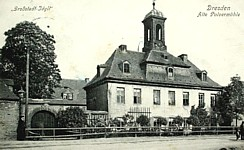
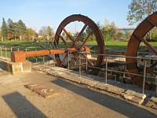
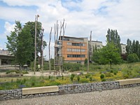
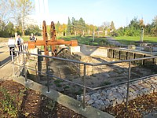
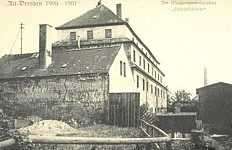
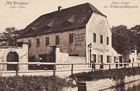
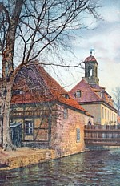
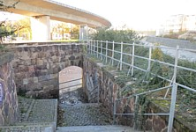
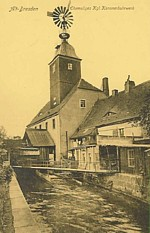

Der Weißeritzmühlgraben wurde bereits im 15. Jahrhundert angelegt und diente
der Wasserversorgung der zahlreichen Mühlen und Manufakturen in Löbtau und der Wilsdruffer Vorstadt. Der auf Löbtauer Flur in der Nähe der heutigen
Biedermannstraße von der Weißeritz abzweigende Mühlgraben durchquerte die Gewerbeviertel Löbtaus und anschließend die Wilsdruffer Vorstadt, bevor er nach ca. 4 km Länge in der Nähe der Kleinen Packhofstraße in die Elbe
mündete. Als eine der ersten Mühlen wurde 1570 die Walkmühle erwähnt, der 1576 eine Pulvermühle und 1697 die “Spiegelschleife” folgten. Im 17. und 18. Jahrhundert entwickelte sich das Gebiet am Weißeritzmühlgraben zu einem ersten frühindustriellen Zentrum in Dresden. Neben der Wasserkraft zum Antrieb der verschiedenen Mühlen nutzte man den Mühlgraben auch zur Holzbeförderung zum Floßhof und als Wasserreservoir für die an der Gerbergasse (heute Theaterstraße) ansässigen Gerbereien.

Mit Durchsetzung der Dampfkraft und später der Elektrizität verlor der
Weißeritzmühlgraben an Bedeutung. Hinzu kamen hygienische Bedenken wegen des zunehmend verunreinigten Wassers und dem von diesem ausgehenden Geruch. Am 9. Oktober 1937 wurde der Graben trockengelegt und zum größten Teil verfüllt. Reste seines unterirdischen Verlaufs finden sich noch unter der Ostraallee und den angrenzenden Gebäuden der Theaterwerkstätten. Im Zuge des Ausbaus des “Grünzuges Weißeritz” wurden Teile des verfüllten Mühlgrabens an der Oederaner Straße in Löbtau freigelegt und unter Einbeziehung einiger baulicher Überreste der Pulvermühle in eine kleine Parkanlage einbezogen _(Foto)_.

**_Fotos:_** _Impressionen vom Weißeritz-Grünzug in Löbtau_

---

## Mühlen und gewerbliche Einrichtungen am Weißeritzmühlgraben

### Spiegelschleife

 Die Geschichte dieser frühen Manufaktur begann 1697, als Ehrenfried Walter von Tzschirnhaus eine Edelsteinschleif- und Poliermühle in der
Ostravorstadt einrichtete. 1710 wurde das Unternehmen an den Löbtauer Weißeritzmühlgraben auf das Grundstück eines früheren Eisenhammers verlegt
und ab 1715 als Spiegelschleiferei betrieben. Hier wurde Glas, welches aus der Hütte Friedrichsthal bei Senftenberg stammte, zu Spiegeln geschliffen. Die 1787
modernisierte Schleiferei fiel 1813 den napoleonischen Truppen zum Opfer. 1820 entstand auf dem Gelände ein neuer Betrieb, der zunächst von einer
Baumwollspinnerei, ab 1887 von der Schokoladenfabrik Lippold genutzt wurde. 1945 wurden die Bauten durch Bomben zerstört.

### Neue Sorge

 Das einstige Gasthaus am Weißeritzmühlgraben entstand vermutlich
im 17. Jahrhundert aus einem früheren Vorwerk und befand sich damals noch weitab der Stadt inmitten von Wiesen und Feldern. Um 1900 entwickelte es sich zu einem beliebten Ausflugslokal. Der Namen ist vermutlich vom “Umsorgen der Gäste” abgeleitet. 1926 schloss die Gastwirtschaft im Zusammenhang mit Baumaßnahmen in der Umgebung ihre Pforten. 1945 wurde das Gebäude
zerstört.

### Pulvermühle

Die Dresdner Pulvermühle wurde bereits 1576 wegen der drohenden Explosionsgefahr aus der Wilsdruffer Vorstadt in die Nähe des Löbtauer Dorfangers verlegt.
Nach Vorschlägen von Festungsbaumeister Paul Buchner und Rochus von Lynar entstand ein Gebäudekomplex, in dem mit Hilfe der Wasserkraft des Mühlgrabens Salpeter, Kohle und Schwefel zu Schießpulver zermahlen wurden. 1622 erfolgte nochmals eine Erweiterung durch den Anbau mehrere Nebengebäude. Mehrfach wurde diese kurfürstliche Pulvermühle durch Explosionsunglücke zerstört, zuletzt am 27. Juni 1796. Zeitweise fanden in der Nähe der Mühle auch militärische Manöver und “Probeschießen” der Artillerie statt.

Das Areal der Pulvermühle bestand aus verschiedenen Wohn- und Verwaltungsgebäuden, darunter ein schlichtes Herrenhaus im Zopfstil, welches mit einem Dachreiter gekrönt war.
Wegen der hohen Expolsionsgefahr galten besondere Verhaltensregeln und Beschränken für den Aufenthalt von Besuchern. Dennoch hatte der jeweilige Besitzer der Mühle das Recht, Bier auszuschänken und Gäste zu bewirten. Nach Verlegung der Pulverfabrikation nach Gnaschwitz bei Bautzen 1875 wurde
die Pulvermühle noch zeitweise als Getreidemühle genutzt. Im April 1945 zerstörten Bomben das historische Bauwerk. Reste der Fundamente werden künftig in einem auf dem Areal geplanten kleinen Park zu sehen sein.

### Holzhof

Der Löbtauer Holzhof wurde 1521 auf Betreiben Herzog Georg des Bärtigen auf einem Teilstück des früheren Gemeindeangers angelegt. Hier wurde
das auf der Weißeritz aus dem Erzgebirge herabgeflößte Holz gelagert und für den Verkauf vorbereitet. Der 1717 und 1741 nochmals erweiterte Löbtauer Floßhof nahm bis zu seiner Auflösung 1879 das gesamte Areal zwischen dem heutigen Ebertplatz, der Hirschfelder Straße und der Freiberger Straße ein. Zum Grundstück gehörten auch das Wohnhaus des Floßmeisters mit der Expeditionsstube, eine Baracke für die Arbeiter sowie Ställe und Lagerräume. Nach Aufgabe des Holzhofes entstanden auf dem Gelände einige Wohnhäuser und kleine Gewerbebetriebe. Die Pläne für die Bebauung lieferte der Dresdner Architekt Karl Adolph Canzler. Heute erinnert am Weißeritzufer noch ein gemauerter früherer Wasserauslass an den Holzhof _(Foto)_.

### Kanonenbohrwerk

Auf dem Gelände des späteren Kanonenbohrwerks an der Saxoniastraße existierte bereits 1574 ein Kupferhammer, der mit Hilfe von Wasserkraft betrieben wurde. Im 17\. Jahrhundert erwarb der sächsische Hof das Areal und ließ hier nach Ende des Siebenjährigen Kriegs 1765 ein Bohrwerk für Geschützrohre errichten. Das Kanonenbohrwerk gehörte zu den ersten modernen Industriebetrieben Sachsens und produzierte einen Großteil des Bedarfs der sächsischen Armee. Im 19. Jahrhundert wurde die Wasserkraftanlage durch eine Dampfmaschine ersetzt.

1870 verpachtete der Staat das Gebäude an einen privaten Unternehmer, der hier die Sächsische Stahl- und Windmotorenfabrik Herzog einrichtete. Wahrzeichen war ein auf dem Dachreiter des Hauses angebrachtes Windrad. 1928 wurde das Gebäude durch einen Brand schwer beschädigt und anschließend ohne Turm wiederhergestellt. Mit der Zerstörung der Fabrik 1945 endete die Geschichte des Kanonenbohrwerks. Heute steht auf dem Grundstück das Heizkraftwerk der DREWAG.

### Zum Türmchen
Das wegen seines charakteristischen Dachreiters “Türmchen” genannte Gasthaus befand sich bis 1895 auf dem Areal, welches heute von den ausgedehnten Gleisanlagen der Deutschen Bahn unterhalb der Nossener Brücke eingenommen wird. Ab 1845 führte hier die Bahnstrecke der [Albertbahn](../../../sud/plauen/plauenscher_grund/albertbahn/) vorbei. Im Zuge des Ausbaus der Bahnstrecke und der Anlage des Hauptbahnhofes wurden die Gebäude angerissen und der Weißeritzmühlgraben in diesem Abschnitt unterirdisch verlegt.

### Würzmühle
Diese seit Ende des 19. Jahrhunderts verschwunde Mühle lag ebenfalls im Bereich der Gleisanlagen und diente sowohl als Schleif- und Poliermühle als auch als Ölmühle, Gewürzmühle, Lederwalke und Lohgerberei. Um 1878 wurde diese Mühle aufgelassen und wenig später abgetragen.

### Kunadsmühle

Die nach ihrer ersten Besitzerfamilie genannte Kunadsmühle wurde erstmals um 1500 erwähnt und gehörte mit vier Mahlgängen und einer Schneidemühle zu den größten Mühlen am Weißeritzmühlgraben. 1569 verkaufte die Witwe des Müllers das Areal an Kurfürst August. Nach mehrfachen Umbauten und Erweiterungen wurde die Kunadsmühle 1894 abgerissen. An ihrer Stelle entstand das Bahnpostamt der Sächsischen Staatsbahn. Heute erinnert noch der Name der Kunadstraße an die frühere Mühle.

### Papiermühle

Die Dresdner Papiermühle entstand Ende des 15. Jahrhunderts im Auftrag von Herzog Albrecht und befand sich einst dort, wo sich heute die Bahngleise zum Neustädter Bahnhof, zum Hauptbahnhof und in Richtung Freital gabeln. 1518 erwarb der Papiermacher Michael Schaffirt die Mühle und stellte hier aus Lumpen (Hadern) das begehrte Material her. Mehrmals wurde die Mühle Opfer von Bränden und wirtschaftlichen Schwierigkeiten, die 1784 sogar zu ihrer Versteigerung führten. Ab 1858 befand sie sich wieder im Besitz der Familie Schaffirt, die die Papiermühle in eine Aktiengesellschaft umwandelte.

Umweltprobleme und die zumehmende Belastung des Grundstücks durch Rauch und Ruß der vorbeifahrenden Eisenbahnen führten 1914 schließlich zu ihrer Stillegung und zum folgenden Abbruch der Gebäude. Heute erinnert noch die Papiermühlengasse an das Unternehmen.

### Tabakmühle

Die Tabakmühle nahm einst den hinteren Teil des Grundstückes Poppitz Nr. 7 in der Nähe des Sternplatzes
ein. Bis 1845 führte hier der Weißeritzmühlgraben entlang, wurde dann verlegt und folgte nun, ab 1867 weitgehend
unterirdisch, ungefähr dem Verlauf der Annenstraße bis zur Annenkirche. Die 1766 erstmals erwähnte Mühle diente der
Herstellung vom Schnupftabak, wurde jedoch bereits wenige Jahrzehnte später stillgelegt. 1865 brannten die Gebäude ab und wurden nicht wieder aufgebaut.

### Bäcker- und Hofmühle

Die Bäckermühle mit dem Mühlhof befand sich in der Nähe der Annenkirche. In unmittelbarer Nähe lag die bereits 1400 erstmals erwähnte Hofmühle, die sich bis 1865 im Besitz des sächsischen Staates befand und
nach ihrer Privatisierung Beisertmühle genannt wurde. Dritte Mahlmühle in diesem Gebiet war die Dammmühle an der Kleinen Zwingerstraße, einer Seitengasse der Freiberger Straße. Zwischen Bäcker- und Hofmühle stürzte der
Weißeritzmühlgraben bis zu seiner Schließung 1937 einen ca. 6 Meter hohen Wasserfall hinunter. Bereits zehn Jahre zuvor
waren beide Mühlen geschlossen und 1935 abgerissen worden. Nach 1945 entstand auf dem Grundstück eine Schule.

### Silberhammer

Das Hammerwerk wurde Anfang des 17. Jahrhunderts im sogenannten “Gerberviertel” am Weißeritzmühlgraben erbaut, um hier eine neue staatliche Münzstätte einzurichten. Zuvor befand sich diese in der Nähe
des Schlosses, später an der heutigen Münzgasse in der Nähe der Frauenkirche. 1802 wurde der Betrieb modernisiert
und bis zur Verlegung der Münze nach Muldenhütten bei Freiberg 1886 genutzt. Die Gebäude des Silberhammers mussten 1912 dem Bau des Schauspielhauses weichen.

### Nudelmühle

Diese Mühle entstand 1773 am unteren Teil des Weißeritzmühlgrabens an der heutigen Ostraallee. Erster
Besitzer war der italienische Hofschauspieler Antonio Bertoldi, der sich nach seinem Bühnenabschied der Herstellung von
Makkaroni und anderen Nudeln widmete. Auf dem Grundstück befand sich zugleich eine Gastwirtschaft, die bis zu ihrem
Abbruch 1913 “Zur alten Nudelmühle” genannt wurde. An ihrer Stelle errichtete man ein 1945 schwer beschädigtes Wohnhaus, dessen Ruine 1972 beseitigt wurden. Heute stehen hier die Gebäude der Theaterwerkstätten.

Marmorschleife: Die gegenüber der Nudelmühle gelegene Marmorschleife war Herstellungsort der für den Bau der
Hofkirche benötigten Steinblöcke. Die Manufaktur ging aus einer früheren Glashütte hervor und war von August dem
Starken zur Edelstein-Schleif- und Poliermühle umgewandelt worden. Neben der Verarbeitung heimischer Mineralien
experimentierte Ehrenfried Walter von Tzschirnhaus in den Räumen mit verschiedenen Hohlspiegeln und legte dabei den Grundstein für die spätere Erfindung des Meißner Porzellans.

### Schmelzmühle

Die bereits 1588 entstandene Schmelzmühle befand sich an der Kleinen Packhofstraße und war letzte Mühle am Weißeritzmühlgraben. Mehrfach wurde sie durch Brände und Kriegszerstörungen vernichtet, jedoch immer
wieder aufgebaut. Erst 1929/30 musste auch diese Mühle der Umgestaltung des Packhofviertels weichen.

**Private Homepage zum Weißeritzmühlgraben:**

* * *

 \[ [Home](../../../index.html)\] \[ [Nord](../../../nord/)\] \[ [Nordwest](../../../nordwest/)\] \[ [Neustadt](../../../neustadt/)\] \[ [Nordost](../../../nordost/)\] \[ [West](../../../west/)\] \[ [Zentrum](../../../zentrum/)\] \[ [Südwest](../../../sudwest/)\] \[ [Süd](../../../Sud/sud.html)\] \[ [Südost](../../../Sudost/sudost.html)\] \[ [Ost](../../../Ost/ost.html)\] \[ [Register](../../../Register/register.html)\] \[ [Kontakt](../../../Kontakt/kontakt.html)\] \[ [Impressum](../../../Impressum/impressum.html)\]
