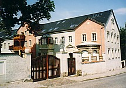
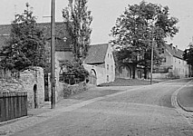
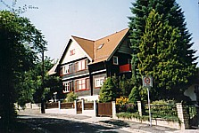
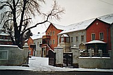
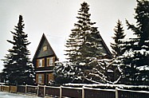
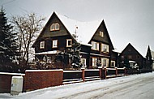
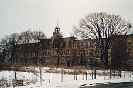
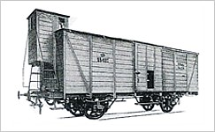

* * *

**Gemeindesiegel von Naußlitz**

Naußlitz entstand im 10. Jahrhundert als Gassendorf am Westhang des Elbtales
und wurde 1144 als Nuendorf, 1311 als Nuzadelitz erwähnt. Beide Namen bedeuten übersetzt Neudorf. Die kleine Siedlung am Roßthaler Bach gehörte
ursprünglich zu den Domherrengütern des Meißner Hochstifts und lebte von der Landwirtschaft sowie vom Obst- und Weinbau. Im 16. Jahrhundert wohnten hier
neun Bauernfamilien, die Güter unterschiedlicher Größe bewirtschafteten. Um eine weitere Zersplitterung zu verhindern, wurde 1672 die Güterteilung in Naußlitz verboten.

Größtes Gehöft war das Gut Altnaußlitz Nr. 10 _(Foto oben)_. Zu dessen
Bewirtschaftung wurden zeitweise auch polnische Saisonarbeiter herangezogen, für die auf dem Nachbargrundstück Nr. 8 eine Schnitterkaserne entstand. Das
auch “polnische Villa” genannte Gebäude ist heute nicht mehr vorhanden. 1745 und 1813 richteten Kriegsereignisse und Truppendurchzüge auf der heutigen
Kesselsdorfer Straße Schäden an den Naußlitzer Bauerngütern an. In der Nacht vom 26. zum 27. August 1813 übernachtete der Feldmarschall Joseph Mesko
Freiherr von Felsö-Kubiny in einem Naußlitzer Gehöft, bevor er an der Schlacht auf der Räcknitzhöhe teilnahm und dort gefangen genommen wurde.

Ihr heutiges Aussehen erhielten die Gebäude des Dorfkerns im 19. Jahrhundert. Zeitweise existierte auch ein Plänersteinbruch, in dem Baumaterial für neue Gebäude und Grundstückseinfassungen für die umliegenden Orte
gewonnen wurde. Zu den berühmten Gästen des Dorfes gehörte Karl May, der zum Jahreswechsel 1864/64 für zwei Monate in Naußlitz untertauchte, um seiner drohenden Verhaftung durch die Chemnitzer Gendarmerie zu entkommen.

Erst nach 1870 entstanden die ersten Wohnhäuser außerhalb des Dorfkerns, vor
allem an der Ortsgrenze zu Löbtau und entlang der Kesselsdorfer Straße. Zeitweise bestanden auf Naußlitzer Flur drei Ziegeleien, die die wachsende
Großstadt mit Ziegeln versorgte. Beschäftigt waren die Bewohner aber auch in den neuen Industriebetrieben Löbtaus und Dresdens. Zwischen 1870 und 1890
stieg die Einwohnerzahl des Ortes deshalb von 243 auf 1.468 Bewohner, meist Arbeiterfamilien, an. Am 1. Januar 1903 wurde Naußlitz nach Dresden eingemeindet.

Zu den wichtigsten gewerblichen Unternehmen gehörte ab 1902 der Straßenbahnhof  Naußlitz, der 1939 um den städtischen Busbahnhof erweitert wurde. Die Mitte der 1990er Jahre aufgegebenen Hallen wurden 2005 zu einem
Einkaufszentrum umgebaut. Ab 1928 errichteten verschiedene Baugesellschaften auf Naußlitzer Flur größere Siedlungen
an der Saalhausener, Düsseldorfer und Mülheimer Straße. Bemerkenswert ist die architektonisch interessante Holzhaussiedlung zwischen Wiesbadener und Rüdesheimer Straße _(Foto)_.

**_Fotos:_** _Naußlitzer Winterimpressionen: Kaiserhof (links) und Holzhaussiedlung (Mitte/rechts)_

Schulen in Naußlitz:

1877 begann in Naußlitz der planmäßige Schulunterricht in einem gemieteten
Klassenraum an der Williamstraße. Das erste Gemeindeschulhaus wurde 1879 an der heutigen Wendel-Hipler-Straße errichtet. Dieses diente später als Gemeindeamt und wurde nach 1900 abgebrochen.

1899 entstand an der Saalhausener Straße ein Neubau für die 38. Volksschule. Dieses neue Schulgebäude, eröffnet am 11. September 1899, diente seitdem
ununterbrochen seinem Zweck. Zu DDR-Zeiten trug die Naußlitzer Schule den Namen des antifaschistischen Widerstandskämpfers Alfred Thiele. Zuletzt wurde
das Gebäude bis zur Schließung im Sommer 2009 von der 38. Mittelschule genutzt. Künftig ist hier die Einrichtung einer Grundschule geplant.

“Schlafender Bremser”:

Zu den tragischen Ereignissen der Naußlitzer Ortsgeschichte gehört die
Geschichte des “schlafenden Bremsers” Dittrich, der mit seiner Frau im heute nicht mehr erhaltenen Wohnhaus Williamstraße 5 lebte. Dittrich war als
Bremser bei der Königlich-Sächsischen Staatsbahn beschäftigt. Im Dezember 1882 erlitt er während seines Dienstes einen schweren Arbeitsunfall, in dessen
Folge er drei Monate später ins Koma fiel. Da alle Behandlungsversuche fehlschlugen, wurde er zum Invalidenrentner erklärt und in den Ruhestand geschickt. 18 Jahre lang lebte er in diesem Schlafzustand und wurde von
seiner Frau versorgt.

Um 1900 kamen jedoch im Dorf Gerüchte auf, Dittrich würde seinen Zustand nur simulieren, um sich die Rente zu
erschleichen. Nachbarn behaupteten, ihn nachts im Haus umhergehen und arbeiten gesehen zu haben. Obwohl medizinische Tests keinen Hinweis auf ein Vortäuschen des
Schlafzustandes brachten, verstummten diese Gerüchte nicht. Wenige Wochen später erschoss die Ehefrau des “schlafenden Bremsers” zuerst ihren Mann und erhängte sich
anschließend. In einem Abschiedsbrief gab sie “die von bösen Menschen in die Welt gesetzten Nachrichten über ihren
Mann” als Grund an. Die Geschichte des Eisenbahners erregte weit über Dresden hinaus großes Aufsehen und war später Gegenstand eines Theaterstückes der Marionettenbühne Apel.

## [Naußlitzer Straßen](../../sudwest/nausslitz/strassen_nausslitz/)

[_Weiterführende Literatur und Quellen_](../../impressum/quellenverzeichnis/)

 \[ [Home](../../index.html)\] \[ [Nord](../../nord/)\] \[ [Nordwest](../../nordwest/)\] \[ [Neustadt](../../neustadt/)\] \[ [Nordost](../../nordost/)\] \[ [West](../../west/)\] \[ [Zentrum](../../zentrum/)\] \[ [Südwest](../../sudwest/)\] \[ [Süd](../../sud/)\]
 \[ [Südost](../../sudost/)\] \[ [Ost](../../ost/)\] \[ [Register](../../Register/register.html)\] \[ [Kontakt](../../Kontakt/kontakt.html)\] \[ [Impressum](../../impressum/)\]
