## Alfred-Thiele-Straße

Die Straße trug ab 1923 zunächst den Namen Jochhöhstraße, benannt nach einem kleinen Weinbergshaus auf Freitaler Flur. Um 1930 wurde hier durch die in Niesky ansässige Firma Christoph & Unmack Einfamilien- und Doppel-Holzhäuser einer Heimstätten-Genossenschaft errichtet. 1946 erfolgte die Umbenennung der Jochhöhstraße in Alfred-Thiele-Straße. Alfred Thiele (1904-1934) war ab 1926 Mitglied der KPD und später im illegalen Widerstandskampf gegen die Nazidiktatur aktiv. 1934 verstarb er an den Folgen erlittener Misshandlungen im Löbtauer Krankenhaus.

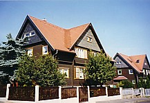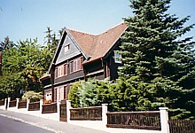

**_Fotos:_** _Holzhäuser auf der Alfred-Thiele-Straße_

## Altnaußlitz

Als Altnaußlitz wird seit 1871 der frühere Dorfkern von [Naußlitz](../../../sudwest/nausslitz/) bezeichnet. Bis 1903 findet sich die Schreibweise Alt-Naußlitz in den Adressbüchern. Trotz Abbrüchen nach 1945 und 1990 sind hier noch einige Bauerngüter erhalten geblieben, die jedoch heute ausschließlich Wohnzwecken dienen und in den letzten Jahren saniert wurden. Bedeutendstes und größtes Gehöft ist der nach seinem früheren Besitzer benannte Kaiserhof (Nr. 10). Mitte der 1990er Jahre wurde er zu einer Wohnanlage umgebaut.

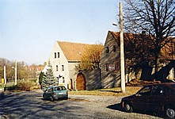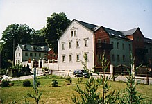

**_Fotos:_** _Dorfkern Altnaußlitz - Kaiserhof Altnaußlitz Nr. 10_

Nur noch in Resten erhalten blieb der frühere Dreiseithof Altnaußlitz 11. Das nach einer Inschrift an der einstigen Pforte auf das Baujahr 1782 datierte Gehöft befand sich einst im Besitz der Familie Pietzsch. Später übernahm die Familie Baumann das Anwesen. 1914 gründete Curt Baumann hier eine Einlegesohlen-Fabrik. Dafür erwarb er für 750 Reichsmark eine Nähmaschine und eine Handstanze und begann mit der Herstellung von Schuheinlagen und Trikot-Haarsocken. Der wirtschaftliche Erfolg ermöglichte ihm die Einstellung weiterer Mitarbeiter. 1939 beschäftigte die Firma in Naußlitz und einer Zweigniederlassung an der Tharandter Straße 69 400 Mitarbeiter. Einen weiteren Standort gab es ab 1943 in Mosbach. Nach 1945 verlagerte die Firma die gesamte Produktion nach Mosbach, wo sie unter dem Namen Bama zum Marktführer für Einlegesohlen in Europa wurde.

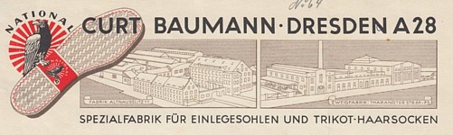

Der Dresdner Betrieb kam zunächst in treuhänderische Verwaltung und gehörte als VEB Dresola bis 1990 zum VEB Meißner Schuhfabrik. In den hierfür ausgebauten und erweiterten Gebäuden des Gehöfts entstanden bis zur Produktionseinstellung nach der Wende Einlegesohlen, Füßlinge und verschiedene Sportlederwaren. 2000 war auf dem Grundstück der Bau einer geriatrischen Klinik vorgesehen, für die ein Großteil des Dreiseithofes abgerissen wurde. Erhalten blieb das frühere Wohnhaus, das in ruinösem Zustand noch erhalten ist und unter Denkmalschutz steht.

Video: Rundgang im ehemaligen Baumann-Gut 2015

## Altwölfnitz

Der frühere Wölfnitzer Dorfplatz wurde nach Eingemeindung des Ortes 1903 in Altwölfnitz umbenannt. Von den
historischen Gehöften sind bis heute u. a. das ehemalige Freigut (Nr. 3) und das bis 1945 zum Kammergut Gorbitz gehörende Beigut (Nr. 2-4) erhalten geblieben. Beide Gebäude dienen heute nur noch Wohnzwecken.

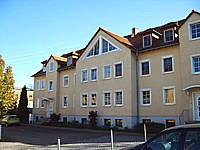

**_Foto:_** _Das zur Wohnanlage umgebaute frühere Beigut Altwölfnitz Nr. 2-4_

## Am Roßthaler Bach

Die Wohnsiedlung zwischen Clara-Zetkin-Straße und dem Naußlitzer Ortskern wurde ab 2003 auf dem Gelände einer
früheren Gärtnerei errichtet. Im Oktober 2004 erhielt der zur Erschließung der Siedlung angelegte Weg die Bezeichnung Am Roßthaler Bach.

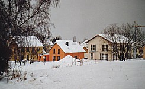

**_Foto:_** _Wohnsiedlung Am Roßthaler Bach_

## Am Stieglitzgrund

Die Straße Am Stieglitzgrund wurde 1925 am Rande des Wölfnitzer Dorfkerns angelegt und erhielt ihren Namen nach einer Flurbezeichnung. Die Doppelhäuser wurden von zwei Siedlungsgesellschaften in den Jahren 1925/26
errichtet. Eigentümer war der “Siedelungsverein Dresden-Löbtau e.V.”, der die Grundstücke in Erbbaupacht an die künftigen Nutzer vergab. 1946 wurde der Verein aufgelöst und die Häuser an die Bewohner übereignet.

## Annaberger Straße

Die heutige Annaberger Straße wurde um 1900 angelegt und nach den geografischen Gegebenheiten zunächst Bergstraße genannt. Nach der Eingemeinung von Naußlitz erhielt sie 1904 ihren jetzigen Namen nach der Stadt Annaberg im Erzgebirge.

## Binger Straße

Die Binger Straße entstand nach dem Ersten Weltkrieg beim Ausbau der Naußlitzer Siedlung und wurde im November
1926 nach der Stadt Bingen in Rheinland-Pfalz benannt. Das Straßenbild prägen zahlreiche unter Denkmalschutz stehende Holzhäuser der Christoph & Unmack AG aus Niesky.

## Bonner Straße

Die Bonner Straße entstand nach dem Ersten Weltkrieg am Rande der Naußlitzer Flur und wurde am 26. Oktober 1927 nach der Stadt Bonn benannt. Bis Mitte der 1930er Jahre entstanden hier Einfamilien- und Doppelhäuser.

## Burgwartstraße

Der Name Burgwartstraße weist auf den ehemaligen Burgwart Pesterwitz hin, der bereits 1068 erstmals erwähnt wurde und einst politisch - militärisches Zentrum der Region war. Von hier aus begann die deutsche Besiedlung und Christianisierung der Dörfer rund um Pesterwitz, zu denen auch Naußlitz zählte. Die Straße erhielt ihren Namen 1923.

## Dessauerstraße

1904 wurde die frühere Wölfnitzer Dorfstraße in Dessauerstraße umbenannt. Der Name erinnert an Fürst Leopold I. von Anhalt-Dessau (1676–1747)
, der auf Seiten Preußens an der Schlacht von Kesselsdorf 1745 teilnahm und dort einen Sieg über Sachsen und Österreicher errang. Wegen seiner strategischen Fähigkeiten wurde er auch als “der alte Dessauer”
berühmt. Die später zum Teil auftretende Bezeichnung Dessauer Straße wird mit der Stadt Dessau in Sachsen-Anhalt in Verbindung gebracht, ist jedoch historisch falsch.

## Düsseldorfer Straße

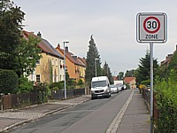Die Düsseldorfer Straße wurde Ende der Zwanziger Jahre angelegt und erhielt ihren Namen im August 1928 nach der Stadt Düsseldorf am Rhein. Auch die umliegenden Straßen auf Naußlitzer Flur, die zeitgleich entstanden, wurden nach Städten des Rheinlandes benannt. Hier errichtete hier der Verein “Siedlungsheim Dresden-Naußlitz” mehrere Ein- und Zweifamilienhäuser. Bauherren der genossenschaftlichen Wohnanlage waren meist Arbeiter, Beamte und Kriegsversehrte des Ersten Weltkriegs.

## Eifelweg

Der Eifelweg verbindet Lange Straße und Mülheimer Straße und erhielt im Mai 1929 seinen Namen nach dem Gebirgszug
der Eifel in Nordrhein-Westfalen. Um 1930 entstanden hier und in den benachbarten Straßen dreigeschossige Wohnblocks.
Eine grundlegende Sanierung der nach 1990 an einen privaten Investor verkauften Wohnanlage erfolgte zwischen 1993 und 1997.

## Gießener Straße

Die kurze Gießener Straße, eine Seitenstraße der Kasseler Straße wurde Mitte der 1930er Jahre beim Bau eines neuen Wohnviertels angelegt und im November 1936 nach der hessischen Universitätsstadt Gießen benannt.

## Hainichener Straße

Die Hainichener Straße entstand 1933 als Fortsetzung der Rüdesheimer Straße und erhielt im Juli 1934 ihren Namen nach der mittelsächsischen Stadt Hainichen.

## Hersfelder Straße

Die Hersfelder Straße wurde 1935 beim Ausbau eines kleinen Wohnviertels westlich der Kasseler Straße angelegt. Seit November 1936 ist sie nach der hessischen Stadt Hersfeld (seit 1949 Bad Hersfeld) benannt.

## [Kesselsdorfer Straße](../../../sudwest/lobtau/strassen_lobtau/kesselsdorfer_strasse/)

## Koblenzer Straße

Ursprünglich trug diese Straße nach einem hier wohnenden Gutsbesitzer den Namen Merbitzstraße. Julius Merbitz war ab
1879 Mitglied des Naußlitzer Gemeinderates und bis zur Eingemeindung des Ortes Gemeindeältester. Er unternahm um 1860 auch erfolglose Versuche, in Naußlitz ein Steinkohlebergwerk aufzuschließen. 1926 wurde die Merbitzstraße in
Koblenzer Straße umbenannt. Mit dieser Namensgebung wurde an die Tradition angeknüpft, Naußlitzer Straßen bevorzugt nach rheinischen Städten zu benennen.

## Mülheimer Straße

An der 1929 nach der Stadt Mülheim an der Ruhr benannten Mülheimer Straße entstand nach 1930 eine größere
Wohnsiedlung. Auch die angrenzenden Straßen Rhönweg und Eifelweg wurden zum gleichen Zeitpunkt von verschiedenen Baugenossenschaften mit Wohnhäusern bebaut.

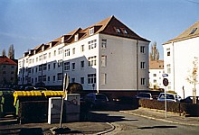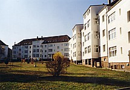

**_Fotos:_** _Wohnanlage an der Mülheimer Straße / Eifelweg_

## Olbernhauer Straße

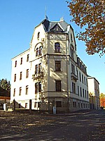
Ursprünglich trug diese Straße im Wölfnitzer Dorfkern den Namen des sächsischen Königs  Albert. 1904 wurde sie, um Verwechslungen mit anderen Albertstraßen in Dresden zu
vermeiden, in Rutowskystraße umbenannt. Ferdinand August Graf von Rutowsky (1702- 1764) war ein Sohn August des Starken und seiner türkischen Geliebten Fatima und nahm als
Befehlshaber der sächsischen Truppen an der Schlacht von Kesselsdorf 1745 teil.

1946 wurde die Straße in Olbernhauer Straße umbenannt. Neben der gewünschten Tilgung des
“militaristischen Namens” sollte mit der Benennung die Stadt Olbernhau geehrt werden, die im August 1945 als erste sächsische Kommune Geld für den Wiederaufbau Dresdens zur Verfügung gestellt hatte.

Markantestes Gebäude an der Olbernhauer Straße ist das [Landhaus](../../../sudwest/wolfnitz/) eines Dresdner Arztes, welches zu den schönsten
Zeugnissen des ländlichen Barocks in der Umgebung gehört. Das benachbarte Eckgebäude (Nr. 2 - _Foto_) wurde 1900
erbaut und sollte ursprünglich Sitz der Gemeindeverwaltung werden. Aus diesem Grund erhielt der Bau eine repräsentative
Fassade mit einigen Jugendstilelementen. Da Wölfnitz jedoch bereits 1903 nach Dresden eingemeindet wurde, wurde das Rathaus als solches nicht mehr benötigt, sondern diente ausschließlich Wohnzwecken. Eine Sanierung erfolgte 1995.

## Oskar-Mai-Straße

Die frühere Naußlitzer Kaiserstraße wurde 1899 nach Georg von Frundsberg in Frundsbergstraße umbenannt. Frundsberg (1473-1528) war
unter Kaiser Maximilian I. Führer der Landsknechte im Bauernkrieg und wurde 1502 zum Ritter geschlagen. Die Gebäude in diesem Bereich entstanden in den 20er und 30er Jahren durch den Verein “Siedlungsheim
Dresden-Naußlitz”. 1962 erfolgte die Umbenennung der Frundsbergstraße in Oskar-Mai-Straße. Oskar Mai (1892-1945) gehörte in den Zwanziger Jahren der örtlichen KPD-Gruppe an und wurde von den Nazis wegen seiner
Widerstandstätigkeit mehrmals verhaftet. 1945 kam er kurz vor Kriegsende im KZ Radeberg ums Leben.

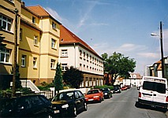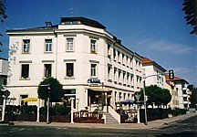

**_Foto:_** _Siedlungshäuser an der Oskar-Mai-Straße (links) und der Pietzschstraße (rechts)_

## Pietzschstraße

Da die Straße 1888 auf dem Grund und Boden des Naußlitzer Gutsbesitzers Julius Pietzsch angelegt wurde, erhielt sie den
Namen Pietzschstraße. Pietzsch, der selbst in Altnaußlitz wohnte, gehörte viele Jahre dem Gemeinderat des Dorfes an. 1879 entstand an der Pietzschstraße/Ecke Wendel-Hipler-Straße das erste [Naußlitzer Schulhaus](../../../sudwest/nausslitz/), welches später bis zu seinem Abriss als Gemeindeamt diente.

## Rüdesheimer Straße

An der nach der Stadt Rüdesheim am Rhein benannten Rüdesheimer Straße und ihren Nebenstraßen wurden Mitte der
Zwanziger Jahre 140 Holzhäuser errichtet. Die architektonisch interessanten Gebäude brachten der kleinen Siedlung den Beinamen “Holzhausen” ein.

## Saalhausener Straße

Die heutige Saalhausener Straße entstand bereits im Mittelalter und war Teil der wichtigen Verbindungsstraße zwischen
Dresden und Freiberg. Erst durch den Ausbau der Kesselsdorfer Straße nach 1810 verlor dieser Weg an Bedeutung und
wurde nur noch als Ortsverbindung zwischen Löbtau, Naußlitz, Roßthal und Pesterwitz genutzt. 1893 erfolgte die offizielle Benennung Naußlitzer Straße.
Nach der Eingemeindung erhielt die Straße den Namen Saalhausener Straße nach einem kleinen Dorf bei Freital.

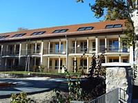Bereits 1899 war auf Naußlitzer Flur ein neues [Schulhaus](../../../sudwest/nausslitz/) errichtet worden. Zu gleicher
Zeit entstanden die meisten Gebäude im unteren Teil der Straße. Markant ist das Eckhaus an der Einmündung Rabenauer Straße, welches zu DDR-Zeiten Domizil der
Bäckerei Kuschicke, später der Gaststätte “Knolle” war (Nr. 9). In den Zwanziger und Dreißiger Jahren folgten auf den verbliebenen Freiflächen neue Wohnhäuser durch
verschiedene Bauvereine. Zur Versorgung der Anwohner wurden auch einige Ladenlokale eingerichtet, darunter in der “Runden Ecke” an der Langen Straße (Nr.
27c) die Verkaufsstelle des “Görlitzer Waaren-Einkaufs-Vereins”. Nach 1945 dienten die Räume als Konsum-Verkaufsstelle, nach 1990 als “Mocca-Milch-Eisbar” und Café
“Les Mademoiselles”. Auf der rechten Straßenseite gegenüber befindet sich ein Sportplatz sowie angrenzend die Kleingartensparte “Frohe Stunde” mit Gartenlokal. Architektonisch interessant ist die 1959 erbaute Kindertagesstätte
“Pusteblume” (Nr. 44), welche in zwischen 2009 und 2011 eine grundlegende Sanierung erfuhr _(Foto)._

## Wendel-Hipler-Straße

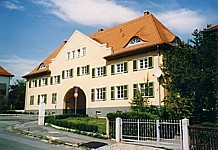Die Wendel-Hipler-Straße bildete einst die Grenze zwischen Naußlitz und Wölfnitz
und wurde deshalb Grenzstraße genannt. In den Zwanziger Jahren wurden hier Siedlungshäuser für Kriegsversehrte und deren Hinterbliebene errichtet. Erst 1953 erhielt die Straße ihren heutigen Namen, der an den bedeutenden Führer des
Bauernkrieges Wendel Hipler erinnert. Hipler versuchte, Ritterschaft und Städte für die Anliegen der Bauern zu mobilisieren und verstarb 1526 im Kerker in Heidelberg.

**_Foto:_** _Torhaus zur Siedlung an der Wendel-Hipler-Straße_

## Wiesbadener Straße

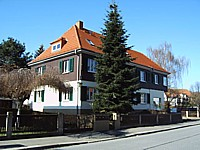Die
Wiesbadener Straße verbindet Löbtau und Naußlitz mit dem benachbarten Oberpesterwitz und wurde deshalb nach ihrem Ausbau 1896 zunächst Pesterwitzer Straße genannt. Um Verwechslungen mit einer gleichnamigen Straße in Gorbitz zu
vermeiden, erfolgte 1926 die Umbenennung in Wiesbadener Straße. Das Straßenbild prägen neben den Holzhäusern der Naußlitzer Siedlung mehrere Kleingartenanlagen,
darunter die mit nur sieben Gärten kleinste Sparte Dresdens “Kleiner Windfang”. Sie entstand 1982 und bewahrt bis heute ihre Selbstständigkeit. Das Foto zeigt das frühere
Naußlitzer Postamt an der Ecke zur Alfred-Thiele-Straße, welches heute als Wohnhaus dient.

Zwischen 1892 und 1960 existierte an der Wiesbadener Straße eine Ziegelei. Diese befand sich zunächst im Besitz der
Brüder Otto und Luis Küchler, ab 1937 von Rudolf Olbrich. 1960 wurde die Ziegelei geschlossen. Das Areal dient heute zum Teil als Kleingartenanlage.

## Williamstraße

Die Williamstraße wurde 1872 durch den Baumeister Ferdinand Fichtner angelegt und nach seinem Sohn William benannt.
Fichtner besaß mit seinen beiden Söhnen ein Architektur- und Baubüro in Dresden-Plauen und schuf u. a. den Fichteturm im
Westendpark. Die heutige Roßweiner Straße trug bis zur Eingemeindung von Naußlitz den Namen Albertstraße, benannt nach dem zweiten Sohn des Architekten. Im Haus Williamstraße 5 wohnte Ende des 19. Jahrhunderts. der Eisenbahner
Dittrich, der durch sein tragisches Schicksal als der [“schlafende Bremser von Naußlitz”](../../../sudwest/nausslitz/) bekannt wurde.

[Naußlitz auf OpenStreetMap](https://www.openstreetmap.org/search?query=Dresden+Nau%C3%9Flitz)

* * *

 \[ [Home](../../../index.html)\] \[ [Nord](../../../nord/)\] \[ [Nordwest](../../../nordwest/)\] \[ [Neustadt](../../../neustadt/)\] \[ [Nordost](../../../nordost/)\] \[ [West](../../../west/)\] \[ [Zentrum](../../../zentrum/)\] \[ [Südwest](../../../sudwest/)\] \[ [Süd](../../../sud/)\] \[ [Südost](../../../sudost/)\] \[ [Ost](../../../ost/)\] \[ [Register](../../../Register/register.html)\] \[ [Kontakt](../../../Kontakt/kontakt.html)\] \[ [Impressum](../../../impressum/)\]
