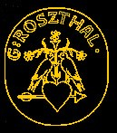
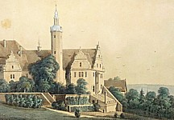
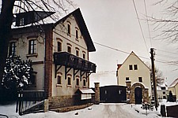
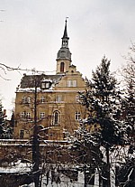

* * *

**Gemeindesiegel von Roßthal**

* * *

Das Platzdorf Roßthal entstand im Mittelalter und wurde 1319 erstmals als
Rosztyl urkundlich erwähnt. Die Herkunft des Namens könnte sowohl von einem slawischen Personennamen oder vom altsorbischen Wort Rozdel = Gabelung
abgeleitet sein. Die kleine Siedlung mit ihren neun Bauernstellen unterstand ursprünglich dem Meißner Domkapitel. Auch nach der Reformation blieb Roßthal
Eigentum eines nun evangelischen Dompropstes, der es 1628 dem kurfürstlichen Kammerdiener Johann Ullmann als Lehen übergab. In diesem Zusammenhang
wurde ein bereits bestehendes Vierhufengut zum Rittergut erklärt. Als Herrenhaus für den Besitzer entstand 1657 das [Schloss Roßthal](../../sudwest/rossthal/schloss_rossthal/) _(Lithografie)_.

Seit 1736 besaß die Familie von Nimptsch das Rittergut mit den zugehörigen Ländereien. Carl Siegmund von Nimptsch ließ das im Siebenjährigen Krieg
beschädigte Schloss erweitern und einen mit verschiedenen Kleinbauten ausgeschmückten Landschaftspark anlegen. Außerdem entstand auf Roßthaler Flur ab 1785 die Tagelöhnersiedlung [Neunimptsch](../../sudwest/rossthal/neunimptsch/), zu der auch die bereits vorhandenen “Roten Häuser” an der Pesterwitzer Grenze gehörten. Das
Rittergut Roßthal besaß eine landwirtschaftliche Nutzfläche von 224 Hektar, die vor allem von Häuslern aus Neunimptsch bewirtschaftet wurden. Noch 1826 waren die Bewohner dieser Siedlung zu jährlich 80-100 Tagen
Frondiensten verpflichtet. Auch nach Erlass der sächsischen Landgemeindeordnung 1838 behielt der Ort seinen Status
als selbstständiger Gutsbezirk ohne Gemeinderat und mit weitgehenden Rechten des Gutsherren. 1852 übernahm Carl
Friedrich August Krebs, Freiherr Dathe von Burgk, das Rittergut Roßthal, dessen Familie bis 1945 Besitzer der Gutsherrschaft blieb.

Roßthal und Neunimptsch wurden nach dem Ersten Weltkrieg 1918 zu einer Landgemeinde vereinigt und 1923 nach Dölzschen eingemeindet. Seit 1945 gehören beide Orte als
Stadtteile zu Dresden. Nach Enteignung des Rittergutes übernahm das Volkseigene Gut Gartenbau Pesterwitz die landwirtschaftlichen Nutzflächen. Im Schloss wurde zunächst die
“Landesverwaltung volkseigener Güter”, 1950 eine Berufsschule dieses Gutes eingerichtet. Außerdem hatte bis 1989 das Wissenschaftliche Zentrum der Abteilung Landwirtschaft und
Nahrungsgüterwirtschaft beim Rat des Bezirkes Dresden seinen Sitz in Roßthal. Hinzu kam eine Außenstelle des VEG Mastkombinat Dresden mit angeschlossener Quarantänestation.
Heute dienen die Gebäude als agrarwissenschaftlich orientiertes Gymnasium und Berufsschulzentrum für Agrarwirtschaft “Justus von Liebig”. Roßthal und Neunimptsch
konnten somit ihren dörflichen Charakter bis zur Gegenwart bewahren.

[_Weiterführende Literatur und Quellen_](../../impressum/quellenverzeichnis/)

 \[ [Home](../../index.html)\] \[ [Nord](../../nord/)\] \[ [Nordwest](../../nordwest/)\] \[ [Neustadt](../../neustadt/)\] \[ [Nordost](../../nordost/)\] \[ [West](../../west/)\] \[ [Zentrum](../../zentrum/)\] \[ [Südwest](../../sudwest/)\] \[ [Süd](../../sud/)\]
 \[ [Südost](../../sudost/)\] \[ [Ost](../../ost/)\] \[ [Register](../../Register/register.html)\] \[ [Kontakt](../../Kontakt/kontakt.html)\] \[ [Impressum](../../impressum/)\]
