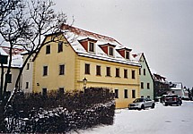
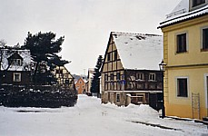
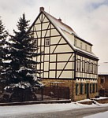

* * *

**Gemeindesiegel von Neunimptsch**

Die Tagelöhnersiedlung Neunimptsch entstand erst Ende des 18. Jahrhunderts auf
Roßthaler Flur. Im Mittelalter existierte an dieser Stelle ein Dorf Beerhut, welches jedoch um 1430 aus unklaren Gründen zur Wüstung wurde. Der Name dieses
Ortes lebt heute noch in der Straßenbezeichnung Beerenhut fort. 1785 begann der Roßthaler Rittergutsbesitzer Carl Albrecht von Nimptsch mit der Errichtung
einiger Drescherhäuser an der Ortsgrenze zu Niedergorbitz. Die kleinen Wohnhäuser dienten zur Unterbringung von Häuslern und Landarbeitern für die Felder des Rittergutes. Gemeinsam mit den sogenannten [“Roten Häusern”](../../../sudwest/rossthal/strassen_rossthal/) und den Jägerhäusern am Rande der Pesterwitzer Flur wurde die Siedlung zu einem
selbständigen Gutsbezirk zusammengefasst, der den Namen Neunimptsch erhielt. 1795 entstand am Ortsrand das Weinbergschlößchen Jochhöh, welches seit 1953 Seniorenheim der Stadt Freital ist.

Bis zur Ablösung der Frondienste nach 1830 waren die Bewohner des Ortes zu regelmäßigen Arbeiten auf den
Rittergutsfeldern verpflichtet. So mussten 1828 jede Frau 100 Tage, jeder Mann 81 Tage im Jahr ableisten, wobei
auch eine Ablösung durch Geldzahlungen möglich war. Bergleute durften sich in Neunimptsch erst nach 1816 ansiedeln,
da diese bei Krankheit und Berufsunfähigkeit der Gemeinde zur Last gefallen wären. Erst nach Begründung der Knappschaftskasse wurden diese Einschränkungen aufgehoben, was in der Folge zum Zuzug einiger
Bergarbeiterfamilien aus dem Plauenschen Grund führte. Nach 1880 entstanden an der Neunimptscher Straße einige Villen und Mietshäuser, darunter das wegen seiner Aussichtsterrasse stadtbekannte Café Grießbach. 1918 wurde
Neunimptsch mit Roßthal vereinigt, kam 1923 als Ortsteil zu Dölzschen und ist seit 1945 Stadtteil von Dresden.

**_Fotos:_** _alte Wohnhäuser in Neunimptsch - links an der Straße Beerenhut - rechts die Neunimptscher Straße_

 \[ [Home](../../../index.html)\] \[ [Nord](../../../nord/)\] \[ [Nordwest](../../../nordwest/)\] \[ [Neustadt](../../../neustadt/)\] \[ [Nordost](../../../nordost/)\] \[ [West](../../../west/)\] \[ [Zentrum](../../../zentrum/)\] \[ [Südwest](../../../sudwest/)\] \[ [Süd](../../../sud/)\] \[ [Südost](../../../sudost/)\] \[ [Ost](../../../ost/)\] \[ [Register](../../../Register/register.html)\] \[ [Kontakt](../../../Kontakt/kontakt.html)\] \[ [Impressum](../../../impressum/)\]
