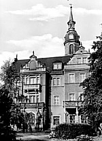
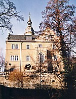

* * *

* * *

* * *

* * *

* * *

* * *

Schloss Roßthal wurde 1657 als Herrenhaus für den Besitzer des Rittergutes Alexander
von Krahe errichtet.  Seit 1736 besaß die Familie von Nimptsch dieses Gut. Unter der Regie des Direktors der Meißner Porzellanmanufaktur Carl Siegmund von Nimptsch
entstand ein Landschaftspark, der mit Wasserkünsten, romantischen Grotten und weiteren “Spielereien” ausgestaltet wurde. Um die Aussicht über das Land genießen zu
können, ließ Carl Siegmund  sogar den Schlossturm erhöhen. Schäden entstanden an der Anlage im Siebenjährigen Krieg durch plündernde Truppen. Auch beim Rückzug
französischer Soldaten nach der Schlacht bei Dresden am 27. August 1813 kam es in Roßthal zu Gefechten.

1858/59 wurde das Schloss nach Plänen des Architekten Carl Moritz Hänel im Stil der
deutschen Renaissance umgebaut und erhielt dabei sein heutiges Aussehen. Auftraggeber war der neue Inhaber der Gutsherrschaft Carl Friedrich August Krebs, der als Freiherr von Burgk zu den reichsten
Männern Sachsens gehörte. Im Park des Schlosses befindet sich seit dieser Zeit ein kleiner grottenartiger Bau mit
Zeltdach, der ursprünglich als Kapelle gedacht war, jedoch meist Einsiedelei genannt wurde. Bemerkenswert ist auch das Eingangstor zum Park, welches mit einem barocken Eisengitter abgeschlossen ist.

Ab 1931 befand sich im Schloß ein katholisches Stift. Während des Zweiten
Weltkrieges waren hier Flüchtlinge und Ausgebombte untergebracht. Nach 1945 wurde das Rittergut Roßthal im Zuge der Bodenreform enteignet und in Volkseigentum
überführt. Zeitweise hatte im Schloss die zentrale Verwaltung aller volkseigenen Güter Sachsens ihren Sitz. Die landwirtschaftlichen Flächen wurden vom VEG Pesterwitz übernommen. Zur Ausbildung von
Fachkräften entstand im Schloss 1950 eine Betriebsberufsschule für Landwirte mit Internat. Die durch einen Brand 1955 entstandenen Schäden konnten schnell wieder behoben werden. Nach 1990 wurde
diese Schule in ein Agrarwissenschaftliches Gymnasium umgewandelt. Außerdem besteht hier seit 1992 das landwirtschaftliche Berufsschulzentrum “Justus von Liebig”. Zwei
Jahre später begann der Bau eines neuen Lehrgebäudes mit Fachkabinetten.

* * *

 \[ [Home](../../../index.html)\] \[ [Nord](../../../nord/)\] \[ [Nordwest](../../../nordwest/)\] \[ [Neustadt](../../../neustadt/)\] \[ [Nordost](../../../nordost/)\] \[ [West](../../../west/)\] \[ [Zentrum](../../../zentrum/)\] \[ [Südwest](../../../sudwest/)\] \[ [Süd](../../../sud/)\] \[ [Südost](../../../sudost/)\] \[ [Ost](../../../ost/)\] \[ [Register](../../../Register/register.html)\] \[ [Kontakt](../../../Kontakt/kontakt.html)\] \[ [Impressum](../../../impressum/)\]
