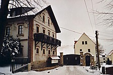
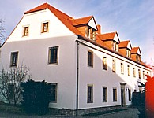
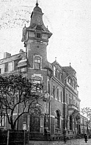
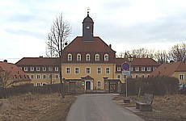
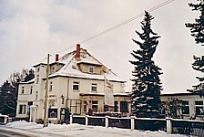
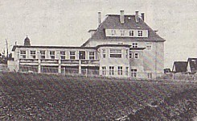
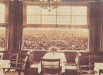

* * *

Altroßthal bildet den Mittelpunkt des früheren selbstständigen Gutsbezirkes Roßthal. Neben dem 1657 entstandenen [Herrenhaus](../../../sudwest/rossthal/schloss_rossthal/) sind hier auch noch einige Gebäude des Rittergutes erhalten geblieben. Bemerkenswert ist das frühere Gladewitz-Gut (Nr. 7) mit einer historischen Inschriftentafel von 1802.

**_Foto:_** _Bauerngehöfte in Altroßthal_

Der ungewöhnliche Straßenname Beerenhut im Ortsteil Neunimptsch erinnert an eine frühere mittelalterliche Siedlung mit Namen Beerhut, die um 1430 zur Wüstung wurde. Die Hintergründe
des Untergangs sind unklar, evtl. fielen die Bewohner einer Pestepedemie zum Opfer.  Noch bis 1667 wurde diese Gemarkung Bärenhut oder Bärenhaut genannt. An ihrer Stelle entstanden
Mitte des 18. Jahrhunderts einige Drescherhäuser für den Gutsbesitzer Günter Karl Albrecht von Nimptsch.

Ursprünglich wurde die Straße Roßthaler Straße benannt, bis im Oktober 1921 die
Umbenennung in An der Beerenhut erfolgte. Seit 1945 ist die verkürzte heutige Form gültig. Bis um 1930 befand sich hier der bekannte Gasthof Roßthal mit großem Saal und Gartenterrasse _(Foto)_
. Dieses Gebäude musste später dem Bau der Siedlung an der Rütlistraße weichen. Nach dem Ersten Weltkrieg waren auch einige Kleingärten entstanden.

Der Name Jochhöh geht auf das nahegelegene Jochhöhschlößchen _(Foto)_ zurück, welches sich bereits auf Pesterwitzer Flur befindet. Das Gebäude entstand 1795 als Weinbergshaus für den Roßthaler Rittergutsbesitzer Günther Carl Albrecht von
Nimptsch. Zum kleinen Ortsteil Jochhöh, ursprünglich Juchhe genannt, gehörten einst auch einige Weinberge, eine Winzerei und ein kleines Gasthaus. Das Schlößchen war ab 1847 für einige Jahre Wohnsitz des Freiherrn von Burgk und
wurde nach dessen Umzug nur noch als Lusthaus genutzt. Die vor dem Haus aufgestellten Böllerkanonen waren 1849 einzige schwere Bewaffnung der Aufständischen des Dresdner Maiaufstandes und befinden sich heute im Besitz des
Stadtmuseums. Ab 1953 diente das Jochhöhschlösschen als Seniorenheim der Stadt Freital, heute als Wohnhaus.

Der Name der kleinen Straße an der Ortsgrenze zu Niedergorbitz erinnert an die einst hier ansässige Bauernfamilie Kuntzsch. Neben den im 18. Jahrhundert entstandenen
Gutsarbeiterhäusern entstanden nach 1930 weitere Siedlungshäuser am Kuntzschberg.

Der Name der Verbindungsstraße zwischen Gorbitz und Roßthal geht auf den Roßthaler Rittergutsbesitzer Günther Karl Albrecht von Nimptsch zurück, der 1785
die ersten Drescherhäuser in diesem Bereich errichten ließ. Gemeinsam mit weiteren verstreut liegenden Gebäuden erhielt die Siedlung den Namen [Neunimptsch](../../../sudwest/rossthal/neunimptsch/).

Zu den wenigen erhaltenenen Sachzeugen der Entstehungszeit gehört ein Gedenkstein an der Neunimptscher Straße 3, der eine Adelskrone und die Jahreszahl 1804 trägt.
Die meisten der heutigen Mietshäuser wurden erst Ende des 19. Jahrhunderts erbaut.

Café Grießbach: Bekannt ist das hier gelegene Café Grießbach _(Foto)_
, welches seit seiner Eröffnung 1930 wegen seiner herrlichen Aussichtsterrasse zu den beliebtesten Ausflugslokalen der Umgebung gehört. Erster Eigentümer war die Familie
Grießbach, die den Betrieb nach kriegsbedingter Schließung 1946 wieder aufnahm und bis 1986 führte. Danach kam das
Lokal in den Besitz des Volksgutes Pesterwitz und wurde von wechselnden Pächtern geleitet. Unter weitgehender Wahrung der unter Denkmalschutz stehenden Innenausstattung erfolgten nach 1990 Umbau und Renovierungsarbeiten. Von der
Veranda und der angrenzenden Terrasse bietet sich ein schöner Blick über das Elbtal. Außerdem finden regelmäßig Tanzveranstaltungen statt.

**_Fotos:_** _Das Café Grießbach in den 1930er Jahren_

Die Siedlung Rote Häuser, unmittelbar an der Ortsgrenze zu Pesterwitz gelegen, entstand vermutlich im 18. Jahrhundert. Zu
den Häusern gehörten neben einer Schmiede mit Schankgerechtigkeit auch die sogenannten Jägerhäuser, die während der
Hofjagden als Unterkunft für die Jagdgesellschaft genutzt wurden. 1794 wurde diese Häusergruppe an die neu gebildete Siedlung Neunimptsch angeschlossen.

Die Siedlung an der Rütlistraße wurde Ende der Dreißiger Jahre an Stelle des abgerissenen Gasthofes Roßthal angelegt. Der
Name erinnert an die berühmte Bergwiese in der Schweiz, auf der die Gründung der Schweizer Eidgenossenschaft beschlossen wurde (“Rütlischwur”).

* * *

 \[ [Home](../../../index.html)\] \[ [Nord](../../../nord/)\] \[ [Nordwest](../../../nordwest/)\] \[ [Neustadt](../../../neustadt/)\] \[ [Nordost](../../../nordost/)\] \[ [West](../../../west/)\] \[ [Zentrum](../../../zentrum/)\] \[ [Südwest](../../../sudwest/)\] \[ [Süd](../../../sud/)\] \[ [Südost](../../../sudost/)\] \[ [Ost](../../../ost/)\] \[ [Register](../../../Register/register.html)\] \[ [Kontakt](../../../Kontakt/kontakt.html)\] \[ [Impressum](../../../impressum/)\]
