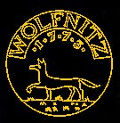
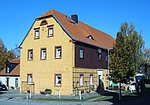
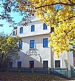
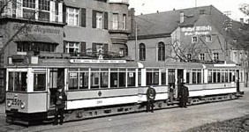

* * *

**Gemeindesiegel von Wölfnitz**

* * *

Der Bauernweiler Wölfnitz wurde 1357 erstmals als Wolfticz urkundlich erwähnt. Der
deutsch-slawisch zusammengesetzte Name bedeutet “Leute eines Wolf” und weist auf den Gründer des Ortes hin. Wölfnitz unterstand dem Vorwerk Gorbitz, für welches die
Bewohner des Dorfes verschiedene Dienste und Abgaben leisten mussten. Lediglich das Erbgut Wölfnitz, ab 1647 im Besitz eines kurfürstlichen Leibarztes, war ab 1666 von
allen Spann- und Handdiensten befreit. Der eigentliche Bauernweiler bestand nur aus wenigen Gehöften entlang der heutigen Straße Altwölfnitz. Größtes Anwesen im Ort war
das Beigut Nr. 2-4. Dieses Gehöft wurde bis zur Bodenreform 1946 vom Kammergut Gorbitz verwaltet. Nach dessen Auflösung wurden die Fluren an Neubauern aufgeteilt.

Am Rande des Dorfplatzes errichtete 1748 ein Dresdner Arzt ein Landhaus, welches mit seiner
schlichten Barockfassade und Rokokoelementen heute unter Denkmalschutz steht (Olbernhauer Straße 1). Die mit Muscheln und Blumenranken verzierte Kartusche über der Einfahrt nennt den
Namen des Anwesens: “Haus der Zufriedenheit”. Neben diesem Landhaus bestanden bis Ende des 19. Jahrhunderts nur wenige Gebäude. Zu diesen gehörte der um 1810 entstandene [Gasthof Wölfnitz](../../sudwest/Lobtau/Strassen_Lobtau/Kesselsdorfer_Strasse/kesselsdorfer_strasse.html) an der Kesselsdorfer Straße. Hier befand sich seit 1883 auch die Endstelle der
Straßenbahn. Als eine der letzten Strecken in Dresden wurde diese 1900 elektrifiziert.

Eine Besonderheit von Wölfnitz war, das das Dorf noch 1896 keinen eigenen Gemeinderat
besaß, sondern alle Gemeindeangelegenheiten von einer Versammlung der erwachsenen männlichen Bewohner geregelt
wurden. Im gleichen Jahr begann außerhalb des Dorfkerns der Bau von Mietshäusern an der Olbernhauer und Dessauer
Straße. Am 1. Januar 1903 kam Wölfnitz als Stadtteil zu Dresden. Nach der Eingemeindung wurden einige Kleingartenanlagen
geschaffen. 1925/26 entstanden Einfamilienhaussiedlungen Am Stieglitzgrund und der Wendel-Hipler-Straße.

**_Foto:_** _Straßenbahn-Endstelle Wölfnitz um 1935, im Hintergrund (rechts) der Gasthof Wölfnitz_

[_Weiterführende Literatur und Quellen_](../../Impressum/Quellenverzeichnis/quellenverzeichnis.html)

 \[ [Home](../../index.html)\] \[ [Nord](../../Nord/nord.html)\] \[ [Nordwest](../../Nordwest/nordwest.html)\] \[ [Neustadt](../../Neustadt/neustadt.html)\] \[ [Nordost](../../Nordost/nordost.html)\] \[ [West](../../West/west.html)\] \[ [Zentrum](../../Zentrum/zentrum.html)\] \[ [Südwest](../../sudwest/sudwest.html)\] \[ [Süd](../../Sud/sud.html)\]
 \[ [Südost](../../Sudost/sudost.html)\] \[ [Ost](../../Ost/ost.html)\] \[ [Register](../../Register/register.html)\] \[ [Kontakt](../../Kontakt/kontakt.html)\] \[ [Impressum](../../Impressum/impressum.html)\]
