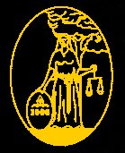
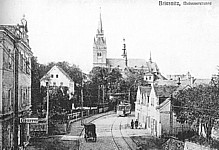
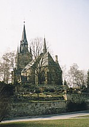
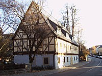
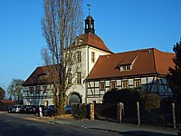
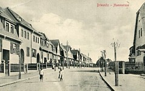
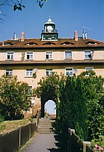
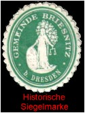
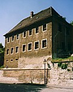
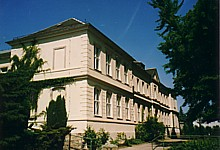

**Gemeindesiegel von Briesnitz**

**Schulen in Briesnitz:**

Briesnitz wurde 1071 erstmals als Bresnice erwähnt und war einst Standort einer
slawischen Kult- und Wallanlage. Der Ortsname wurde vermutlich vom slawischen “breza” abgeleitet, was übersetzt Birke bedeutet. Im Zuge der deutschen Ostkolonisation entstand in Briesnitz auf einem Bergsporn zwischen
Elbe und Triebe (Borngraben) ein deutscher Burgward, der den politischen und kirchlichen Mittelpunkt der Orte im oberen Elbtal bildete. Als militärischer
Stützpunkt sicherte die Anlage zugleich den wichtigen Elbübergang des “Bischofsweges” von Meißen nach Stolpen, der hier in einer Furt den Fluss überquerte. Reste der Wehranlage wurden 1991 bei Bauarbeiten an der [Meißner Landstraße](../../west/cotta/strassen_cotta/meissner_landstrasse/) entdeckt und sind heute Teil einer kleinen Freilichtanlage.

Mit Festigung der deutschen Herrschaft im Elbraum verlor der Burgward Briesnitz im 13.
Jahrhundert seine militärische Funktion, wurde jedoch 1269 Sitz eines Archidiakons (kirchlicher Würdenträger) und eines bischöflichen Gerichts. Zeitweise unterstanden 40 Orte
diesem “Dingstuhl”, dessen Entscheidungen im “Briesnitzer Rügenbuch” festgehalten wurden. Die um 1100 entstandene [Kirche](../../West/Briesnitz/Briesnitzer_Kirche/briesnitzer_kirche.html) _(Foto)_
mit ihrer Schule wurde noch bis ins 19. Jahrhundert von den Bewohnern der umliegenden Dörfern besucht. Mit der Reformation endete 1539 die
Herrschaft des Bischofs von Meißen in Briesnitz. Erst durch die in diesem Zusammenhang erfolgte Auflösung der beiden bestehenden bischöflichen Vorwerke konnte sich der Ort zum
Bauerndorf entwickeln und unterstand nun dem Amt Dresden. Mit Urkunde vom  6. November 1558 übergab Bischof Johann IX. von Meißen das große Vorwerk an die
Gemeinde Briesnitz, welche das Land daraufhin an Bauernfamilien verkaufte. 1590 gelangte auch das kleinere Vorwerk in den Besitz der Gemeinde. 1764 lebten zehn Gutsbesitzer, neun
Gärtner und sieben Häusler in Briesnitz. Von wirtschaftlicher Bedeutung waren neben der Landwirtschaft der Obst- und Weinanbau. Zeitweise soll es auf Briesnitzer Flur über 10.000 Weinstöcke gegeben haben.

Mehrfach betroffen war Briesnitz bei kämpferischen Auseinandersetzungen. Im
Zusammenhang mit der Schlacht bei Kesselsdorf bezog im Dezember 1745 ein österreichisches Korps unter Führung von Graf Grünnes am Südhang des Zschonergrundes seine Stellung. Dabei kam es auch zu Schäden im Dorf. 1759/60
waren österreichische Soldaten in der Umgebung stationiert. 1813 weilte der Überlieferung nach Napoleon im Ort und soll den Turm der Briesnitzer Kirche als
Erkundungsposten genutzt haben. Größere Auswirkungen hatte ein Brand des Schänkengutes im Jahr 1634, bei dem insgesamt fünf Güter in Mitleidenschaft gezogen wurden.

Im 18. Jahrhundert entdeckten wohlhabende Dresdner Familien die reizvolle Lage
am Elbbogen und erwarben hier Landbesitz. 1760 ließ der Oberst Römer ein [Gartenhaus](../../west/cotta/strassen_cotta/meissner_landstrasse/)
mit einem romantischen Park und einer Neptungrotte anlegen, der im Zuge des Eisenbahnbaus 1875 jedoch weitgehend zerstört wurde. 1769 entstand aus dem früheren Vorwerk das [“Bennogut”](../../West/Briesnitz/Strassen_Briesnitz/strassen_briesnitz.html)_(Foto)_, dessen Name an den sagenhaften
Meißner Bischof Benno erinnert. Dieses Gut war bis 1828 im Besitz des sächsischen Ministers Detlev Graf von Einsiedel bzw. seines Sohnes, ab 1840 der Familie
Schunck. 1893 erwarb der Cottaer Brauereiunternehmer Bürstinghaus das Anwesen und ließ einen neuen Park anlegen, der noch heute zu beiden Seiten der Meißner
Landstraße erhalten geblieben ist. Ende des 19. Jahrhunderts entstanden in Briesnitz weitere Mietshäuser und Gewerbebetriebe, die die Landwirtschaft zunehmend zurückdrängten. 1899 erhielt der Ort ein eigenes Wasserwerk.
1904 wurde bei Brunnenbohrungen an der Meißner Landstraße eine eisenhaltige Mineralquelle entdeckt, die 1910 zur Gründung der [“Briesnitzer Stahlquelle GmbH”](../../west/cotta/strassen_cotta/meissner_landstrasse/) führte. Das Wasser wurde als Tafel- und Heilwasser verkauft. Später
übernahm der Mineralwasserbetrieb “Bramsch” Abfüllung und Verkauf des Wassers.

Der wirtschaftliche Aufschwung und die wachsende Einwohnerzahl machten nun auch eine Verbesserung der
Verkehrsanbindung erforderlich. 1875 entstand die Bahnstrecke von Dresden über Cotta - Cossebaude nach Berlin.
Allerdings musste Briesnitz wegen der ungünstigen topografischen Lage auf eine eigene Station verzichten. Stattdessen
verkehrte ab 1875 eine privat betriebene Pferdeomnibuslinie von Briesnitz nach Dresden. Mit der Verlängerung der Straßenbahnstrecke vom Cottaer [Schusterhaus](../../West/Cotta/Strassen_Cotta/Hamburger_Strasse/Schusterhaus/schusterhaus.html) nach Cossebaude wurde diese 1906 überflüssig. Die Bahn nahm am
27\. September ihren Betrieb auf, erhielt 1938 eine neue Trassenführung entlang der Meißner Landstraße und wurde
1990 durch eine Buslinie ersetzt. Zeitweise besaß Briesnitz auch eine Dampfschiffstation sowie einen kleinen Hafen am Elbufer, über welchen vorrangig Ziegel und Kohle transportiert wurden.

Am 22. November 1911 konstituierte sich im Gasthof  Briesnitz die
gemeinnützige “Eigenheim-Siedelung Briesnitz-Dresden e.G.m.b.H.” zur Errichtung einer Eigenheimsiedlung auf Briesnitzer Flur. Nach Plänen der Architekten Ludloff und Stieger wurde ein Bebauungsplan zur Errichtung
einer Gartenstadt aufgestellt und mit dessen Umsetzung begonnen. Dafür mussten einige zuvor landwirtschaftlich genutzte Flächen von Briesnitzer Gutsbesitzern aufgekauft werden. Im Mai 1912 konnte an der Hammeraue
der Grundstein für das erste Haus gelegt werden. Bis zum Beginn des Ersten Weltkrieges entstanden insgesamt 138 Häuser mit Gärten, Spielplätzen und öffentlichen Grünflächen.

_( **Foto:** Straße Hammeraue um 1914)_.

Nach der Eingemeindung des Ortes am 1. April 1921 wurde diese Siedlung zwischen 1924
und 1936 erweitert. Zunächst errichtete man unter Leitung von Curt Herfurth noch einige Eigenheime, ab 1927 jedoch nur noch Reihenhäuser mit Mietwohnungen. Aus dieser Zeit
stammt das markante Torhaus mit Dachtürmchen. Die Leitung des letzten Bauabschnitts oblag dem Architekten Karl Willy Grunert, der vorrangig Mehrfamilienhäuser vorsah. Bei
ihrer Fertigstellung bestand die Briesnitzer Siedlung insgesamt aus 236 Einfamilien- und 128 Mehrfamilienhäusern. Der architektonisch interessante Baukomplex steht seit 2000 als
Zeugnis des sozialen Wohnungsbaus aus der ersten Hälfte des 20. Jahrhunderts unter Denkmalschutz. Die Häuser befinden sich in Privatbesitz bzw. gehören der Eisenbahner- Wohnungsbaugenossenschaft.

Weitere Wohnhäuser entstanden Ende der Zwanziger Jahre u.a. am Gottfried-Keller-Platz und als Lückenbauten auf zuvor landwirtschaftlich genutzten Flächen. Einen Eingriff in die historisch gewachsene Ortsstruktur stellte zudem die 1938 als Autobahnzubringer ausgebaute und neu trassierte Meißner Landstraße dar, deren Bau Teile des Bürstinghausparkes zum Opfer fielen. Erhalten sind in Briesnitz jedoch eine Reihe historischer Gebäude des alten Dorfkerns rund um die Kirche. Nach 1990 folgten außerdem einige moderne Wohnsiedlungen, u.a. auf der Briesnitzer Höhe. In Erinnerung an eine einst hier befindliche Obstplantage erhielt diese Wohnanlage den Namen “Pfirsichgarten”. Weitere Neubauten entstanden auf dem Gelände der ehemaligen Ziegelei Nötzold (Wohnpark "Alte Ziegelei") sowie am Felix-Dahn-Weg und der Wilhelm-Raabe-Straße.

### Schulen in Briesnitz

Bereits 1511 wurde erstmals ein Schulmeister in Briesnitz erwähnt. Nach Zerstörung des alten Schulhauses durch Blitzschlag entstand 1695 in der Nähe der Kirche ein Neubau, der auch von den Kindern der 27 Orte des Briesnitzer Kirchspiels besucht wurde. Das Gebäude (Alte Meißner Landstraße 67) ist noch erhalten und steht als ältestes Dresdner Schulhaus unter Denkmalschutz _(Foto)_. Um 1880 erfolgte ein Umbau zum Wohnhaus. Außerdem gab es hier noch bis zur Eingemeindung eine Arrestzelle für Gesetzesbrecher. Im Inneren befindet sich seit einigen Jahren eine kleine Ausstellung zur Briesnitzer Schulgeschichte. Die übrigen Räume dienen als Atelier und Wohnung des Eigentümers.

1880 errichtete die Gemeinde an der Merbitzer Straße 9 ein neues größeres
Schulgebäude. Zugleich entstanden auch in den Nachbarorten eigene Schulen, die zur Auflösung der bisherigen Schulgemeinde führten. Dennoch machten sich
bereits 1888 und 1898 Erweiterungen des Briesnitzer Schulhauses erforderlich. 1903 folgte der Bau einer Turnhalle, 1927 die Anlage eines Schulgartens.
1907-09 entstand in unmittelbarer Nachbarschaft ein weiteres für damalige Zeiten hochmodernes Schulgebäude mit sieben Klassenzimmern, einem Zeichensaal, Kochschule und Wannenbad. Auf dem Grundstück der früheren
Stadtgärtnerei wurde nach 1945 ein Sportplatz angelegt. Die beiden Briesnitzer Schulhäuser werden heute von der 76. Grund- und der 76. Oberschule genutzt.

### Gemeindeamt

Mit Inkraftsetzung der sächsischen Gemeindeordnung 1839 erhielt auch Briesnitz einen Gemeinderat. Anfangs tagte dieser in den Räumen des jeweiligen Gemeindevorstands, bevor man sich 1903 zur Einrichtung eines Amtslokals
entschloss. Zunächst wurden dafür Räume in der Kirchstraße 2 (heute Gottfried-Keller-Straße) angemietet. 1908
erwarb die Gemeinde das frühere Herrenhaus Dorfstraße 3 (Altbriesnitz) und baute es zum Gemeindeamt um. Bis zur Eingemeindung 1921 hatte in diesem Gebäude die örtliche Verwaltung ihren Sitz.
