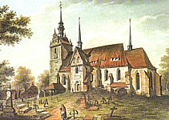
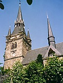

## Briesnitzer Kirche

Die erste Briesnitzer Kirche wurde vermutlich im Zusammenhang mit dem Bau des Burgwards um 1050 erbaut. Dabei handelte es sich wahrscheinlich zunächst um eine hölzerne Kapelle. Zuvor gab es hier bereits ein Heiligtum für die slawische Göttin Prizewa. Der wenig später folgende romanische Bau war eine der ersten frühchristlichen Kirchen Sachsens und spielte eine große Rolle bei der Christianisierung des oberelbischen Raumes. Zeitweise gehörten bis zu 26 Dörfer der Umgebung zum Briesnitzer Kirchspiel. Auch ein Friedhof existierte in ihrer unmittelbaren Umgebung. Diese Kirche an der “Eisernen Furt” über die Elbe wurde 1233 bei Kampfhandlungen zusammen mit dem Burgward zerstört. Reste des Gebäudes bezog man um 1550 in einen Scheunenbau ein, welcher noch bis ins 18. Jahrhundert existierte. Fundamentreste wurden erst 1993 wieder entdeckt und sind heute in einer kleinen Freilichtanlage an der [Meißner Landstraße](../../../West/Cotta/Strassen_Cotta/Meissner_Landstrasse/meissner_landstrasse.html) zu sehen.

**_Bild:_** _Die Briesnitzer Kirche vor dem Umbau 1882_

Die heutige Kirche entstand um 1260 und ist in ihren Grundzügen bis zur Gegenwart erhalten geblieben. Das Gebäude ist zweitältester Dresdner Sakralbau und übernahm die Aufgaben seines Vorgängers. Allerdings wählte man einen neuen Platz auf einem Bergsporn ca. 150 Meter nordwestlich des früheren Standorts. Aus der Frühzeit haben sich noch Teile des Chors und das in Kleeblattform dreigeteilte Ostfenster hinter dem Altar erhalten. Im 15. Jahrhundert erfolgten einige Umbauten an der Kirche, die wegen ihrer exponierten Lage bis heute ein Wahrzeichen des Dresdner Westens ist. Aus dieser Zeit stammen ein Marienfenster (heute in der Sakristei) und einige Holzplastiken. Der Taufstein der Kirche kam 1595 in das Gotteshaus.

Nach einem durch Blitzschlag entstandenen Brand erhielt der Turm 1602 ein neues Aussehen mit Renaissancegiebel sowie zwei neue Bronzeglocken. Eine dritte folgte im Jahr 1710. Leider mussten diese 1917 zum Einschmelzen abgegeben bzw. verkauft werden. Die kleinste Glocke, 1602 vom kurfürstlichen Büchsengießer Johann Hillger gegossen, läutet noch heute in der Kirche von Greifendorf im Striegistal. Die heutigen drei Stahlglocken wurden nach dem Ersten Weltkrieg in Lauchhammer gegossen und sollen künftig wieder durch Bronzeglocken ersetzt werden. 1622 erwarb die Gemeinde ihre erste Orgel, ein Werk des Dippoldiswalder Orgelbauers Salomon Schmidt. Diese blieb bis 1856 in Betrieb.

1881/82 entschloss sich die Kirchgemeinde zu einem Umbau im neogotischen Stil. Anlass waren baupolizeiliche Untersuchungen, welche schwere bauliche Schäden an der Holzkonstruktion des Dachstuhls und statische Probleme am Turm ergaben. Für die Planungen wurde der renommierte Architekt Gotthilf Ludwig Möckel gewonnen, der vergebens versuchte, die Gemeinde vom Erhalt des alten Kirchturms zu überzeugen. Unter
seiner Leitung erfolgte unter Einbeziehung der erhaltenswerten Bausubstanz ein Umbau im historisierenden neogotischen Stil. Dabei musste auch die hölzerne Kassettendecke mit Darstellungen aus dem Alten Testament einem Sandsteingewölbe weichen. Einige Bilder wurden von der Kirchgemeinde an den Besitzer des Tolkewitzer Tanzlokals [“Donaths Neue Welt”](../../../Ost/Tolkewitz/Strassen_Tolkewitz/Alttolkewitz/Donaths_Neue_Welt/donaths_neue_welt.html) verkauft und kehrten erst 1934 wieder in die Briesnitzer Kirche zurück, wo sie noch heute an der Empore zu sehen sind. Beim Umbau erfolgte eine Aufstockung des Kirchenschiffs um 1,80 Meter. Diese ist noch heute durch die neogotischen Sitzbogenmotive unterhalb der Dachkante deutlich erkennbar. Der Kirchturm erhielt statt seines Renaissanceaufbaus eine neue gotische Turmspitze mit Laterne und vier kleineren Ecktürmchen.

Im Inneren sind zahlreiche Sachzeugen der Geschichte erhalten geblieben, darunter die als Gorbitzer Halle bezeichnete Betstube des Kammergutsverwalters und einige Gemälde bzw. Grabsteine früherer Briesnitzer Pfarrer in
der Vorhalle. 1934 entdeckte man bei Restaurierungsarbeiten Reste mittelalterlicher Fresken. Die Bilder zeigen Szenen aus der Leidensgeschichte Christi und wurden vom Kunstmaler Hans Möller freigelegt. 1995 wurde in die
Kirche ein Orgelneubau der Firma Jehmlich eingebaut, welcher die alte Orgel von 1856 ersetzte. Das in den
historischen Prospekt integrierte Instrument besitzt 32 Register und 2.315 Orgelpfeifen. Unweit der Kirche befindet
sich auf dem Areal des Pfarrhofes das 1868 errichtete Diakonatsgebäude. Zwei weitere Gebäude im italienischen Villenstil werden bis heute als Gemeindesaal und Wohnung des Pfarrers genutzt.

## Briesnitzer Friedhöfe

Der heute meist als Innerer Briesnitzer Friedhof bezeichnete Begräbnisplatz entstand aus dem alten Kirchhof, der
vermutlich unmittelbar nach dem Kirchenbau um 1270 angelegt wurde. Hier wurden die verstorbenen Gemeindemitglieder der gesamten aus 26 Orten bestehenden Briesnitzer Parochie beerdigt. An den erforderlichen
Transport der Toten aus den umliegenden Dörfern erinnern umgangssprachliche Wegbezeichnungen wie Oberer Leichenweg und Ockerwitzer Leichenweg. Dieser Friedhof wurde mehrfach erweitert und mit einer Plänermauer
umgeben. Einige historische Grabsteine befinden sich heute aus Witterungsgründen in der Turmhalle der Briesnitzer
Kirche. Bemerkenswert ist das Eingangstor des Friedhofes, welches 1825 Motiv eines Gemäldes von Caspar David
Friedrich war. Die Parentationshalle stammt aus dem Jahr 1896. Auf dem 1910 angelegten Erweiterungsteil befindet
sich ein bereits 1919 geplantes, jedoch erst 1933 vollendetes Ehrenmal für die 83 im Ersten Weltkrieg gefallenen Männer des Ortes.

Da der alte Friedhof im 19. Jahrhundert nicht mehr den Anforderungen genügte, wurde 1879 an der Merbitzer Straße der sogenannte “Äußere Friedhof” angelegt. Wenig später fand hier die erste Beisetzung statt. Auch dieser
Platz wurde traditionell ummauert und bepflanzt. Interessant ist das von ihm selbst geschaffene Grabmal des Grafikers
und Bildhauers Reinhold Lange (1905-1957). Lange studierte ab 1925 an der Dresdner Kunstgewerbeakademie und war in der Nachkriegszeit zeitweise deren Rektor. Ab 1951 leitete er das Sächsische Volkskunstmuseum. Zu
den hier begrabenen Personen gehört auch die am 10. Juni 1950 verstorbene Lina Franziska Fehrmann, die als “Fränzi” um 1910 Modell und Muse der “Brücke”-Künstler Erich Heckel, Ernst Ludwig Kirchner und Max
Pechstein war. Ihre letzten Lebensjahre verbrachte sie in Omsewitz. 2011 wurde ihre Grabstelle mit einem neuen Gedenkstein versehen.
