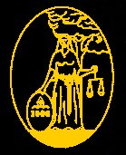
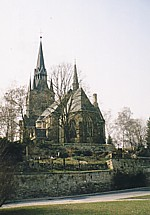
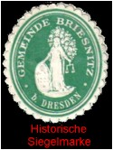

**Gemeindesiegel von Briesnitz**

* * *

Briesnitz wurde 1071 erstmals als Bresnica erwähnt und war Standort einer slawischen Wallanlage.
Der Ortsname wurde vermutlich vom slawischen “breza” abgeleitet, was übersetzt Birke bedeutet. Im Zuge der deutschen Ostkolonisation entstand in Briesnitz ein deutscher Burgward, der den
politischen und kirchlichen Mittelpunkt der Orte im oberen Elbtal bildete. Als militärischer Stützpunkt sicherte die Anlage zugleich den wichtigen Elbübergang des “Bischofsweges” von Meißen nach
Stolpen, der hier in einer Furt den Fluss überquerte. Reste der Wehranlage wurden 1991 bei Bauarbeiten an der [Meißner Landstraße](../../west/cotta/strassen_cotta/meissner_landstrasse/) entdeckt und sind heute Teil einer kleinen Freilichtanlage.

Mit Festigung der deutschen Herrschaft im Elbraum verlor der Burgward Briesnitz im 13. Jh. seine
militärische Funktion, wurde jedoch 1269 Sitz eines Archidiakons (kirchlicher Würdenträger) und eines bischöfliches
Gericht. Zeitweise unterstanden 40 Orte diesem “Dingstuhl”, dessen Entscheidungen im “Briesnitzer Rügenbuch” festgehalten wurden. Die um 1100 entstandene [Kirche](../../West/Briesnitz/Briesnitzer_Kirche/briesnitzer_kirche.html) mit ihrer Schule wurde noch bis ins 19. Jh. von den Bewohnern
der umliegenden Dörfern besucht. Mit der Reformation endete die Herrschaft des Bischofs von Meißen in Briesnitz. Erst
durch die in diesem Zusammenhang erfolgte Auflösung der beiden bestehenden bischöflichen Vorwerke 1559 konnte
sich der Ort zum Bauerndorf entwickeln und unterstand nun dem Amt Dresden. 1764 lebten zehn Gutsbesitzer, neun Gärtner und sieben Häusler in Briesnitz.

Im 18. Jh. entdeckten wohlhabende Dresdner Familien die reizvolle Lage am Elbbogen und erwarben hier Landbesitz. 1760 ließ der Oberst Römer ein [Gartenhaus](../../west/cotta/strassen_cotta/meissner_landstrasse/) mit einem romantischen Park und einer Neptungrotte anlegen, der im Zuge
des Eisenbahnbaus 1875 jedoch weitgehend zerstört wurde. 1769 entstand aus dem früheren Vorwerk das [“Bennogut”](../../West/Briesnitz/Strassen_Briesnitz/strassen_briesnitz.html),
dessen Name an den sagenhaften Meißner Bischof Benno erinnert. Dieses Gut war bis 1830 im Besitz des sächsischen
Ministers Detlev Graf von Einsiedel, ab 1840 der Familie Schunck. 1893 erwarb der Cottaer Brauereiunternehmer Bürstinghaus das Anwesen und ließ einen
neuen Park anlegen, der noch heute zu beiden Seiten der Meißner Landstraße erhalten geblieben ist. Ende des 19. Jh. entstanden in Briesnitz weitere Mietshäuser und Gewerbebetriebe, die die
Landwirtschaft weiter zurückdrängten. 1899 erhielt der Ort ein eigenes Wasserwerk. 1904 wurde bei Brunnenbohrungen
eine eisenhaltige Mineralquelle entdeckt, die 1910 zur Gründung der “Briesnitzer Stahlquelle GmbH” führte. Das Wasser
wurde als Tafel- und Heilwasser verkauft. Später übernahm der Mineralwasserbetrieb “Bramsch” Abfüllung und Verkauf des Wassers.

Am 22. 7. 1911 konstituierte sich
im Gasthof  Briesnitz eine gemeinnützige GmbH zur Errichtung einer Eigenheimsiedlung auf Briesnitzer Flur. Nach Plänen der Architekten Ludloff und Stieger wurde ein Bebauungsplan zur Errichtung einer
Gartenstadt aufgestellt und mit dessen Umsetzung begonnen. Bis zum Beginn des Ersten Weltkrieges entstanden hier 117
Häuser mit Gärten, Spielplätzen und öffentlichen Grünflächen. Nach der Eingemeindung des Ortes am 1. 4. 1921 wurde
diese Siedlung zwischen 1924 und 1939 erweitert. Der architektonisch interessante Baukomplex steht heute als Zeugnis
des sozialen Wohnungsbaus der ersten Hälfte des 20. Jh. unter Denkmalschutz. Erhalten sind außerdem eine Reihe historischer Gebäude des alten Dorfkerns rund um die Briesnitzer Kirche.

Schulen in Briesnitz:

Bereits 1511 wurde erstmals ein Schulmeister in Briesnitz erwähnt. Nach Zerstörung des alten Schulhauses durch
Blitzschlag wurde1685 in der Nähe der Kirche ein Neubau errichtet, der auch von den Kindern der 27 Orte des Briesnitzer Kirchspiels besucht wurde. Das Gebäude (Alte Meißner Landstraße 67) ist noch erhalten und steht als
ältestes Dresdner Schulhaus unter Denkmalschutz. Um 1880 erfolgte ein Umbau zum Wohnhaus.

1880 errichtete die Gemeinde an der Merbitzer Straße 9 ein neues größeres Schulgebäude. Zugleich entstanden auch in
den Nachbarorten eigene Schulen, die zur Auflösung der bisherigen Schulgemeinde führten. 1903 folgte der Bau einer Turnhalle, 1927 die Anlage eines Schulgartens.
Die für damalige Zeiten moderne Schule wurde 1909 erweitert und besaß sieben Klassenzimmer, einen Zeichensaal, Kochschule und Wannenbad. Auf dem Grundstück der früheren Stadtgärtnerei
wurde nach 1945 ein Sportplatz angelegt. Das Briesnitzer Schulhaus wird heute von der 76. Grund- und Mittelschule genutzt.

