## Altbriesnitz

Die frühere Dorfstraße von Altbriesnitz erhielt 1926 den Namen Altbriesnitz. Hier befindet sich der Kern des aus zwei
bischöflichen Vorwerken hervorgegangene Dorfes mit einigen historischen Gehöften, von denen das Bennogut das bedeutendste
ist. In einem dieser Gebäude, dem sogenannten Herrenhaus (Nr. 3) befand sich zwischen 1908 und 1921 das Gemeindeamt des Ortes.

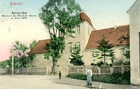Bennogut: Das Gut (Altbriesnitz Nr. 4) gehört zu den ältesten Gebäuden des Ortes und geht im Kern auf das frühere Vorwerk der Meißner Bischöfe zurück. Ein zweites
Vorwerk befand sich im Besitz des Archidiakons von Briesnitz. Mit der Reformation und der Säkularisierung des kirchlichen Besitzes wurden beide Vorwerke aufgelöst und
an ortsansässige Bauern vergeben. Das alte Bennogut fiel 1769 einem Brand zum Opfer und entstand daraufhin als Vierflügelanlage neu. Bauherr war der sächsische
Landweinmeister Heinrich Roos, der zuvor größere Teile der Ortsflur erworben hatte. Später befand es sich zeitweise im Besitz des sächsischen Ministers Detlev Graf von
Einsiedel, ab 1840 der Familie Schunck. 1993 erwarb der Cottaer Brauereibesitzer Bürstinghaus das Gut.

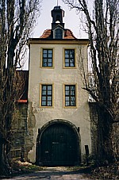Bemerkenswert ist das Torhaus _(Foto)_, an welches sich einst vier Flügel mit Wohn- und Nutzgebäuden anschlossen. Der Name Bennogut geht auf eine Darstellung des sagenhaften Meißner
Bischofs Benno zurück, die sich ursprünglich als Wetterfahne auf dem turmartigen Torhaus befand. Gegen dieses Symbol, was vom örtlichen Pfarrer und vielen Einwohnern als Ansatz zur
“Gegenreformation” gesehen wurde, regte sich heftiger Widerstand. Als die umstrittene Wetterfahne wenig später einem Gewittersturm zum Opfer fiel, löste sich das Problem von selbst.

Das Bennogut wurde zunächst landwirtschaftlich genutzt, später befanden sich hier nur noch Wohnungen. Leider gingen Teile des Gutes durch Verfall und Abriss verloren. 1991 erwarb die von
ehemaligen Mitarbeitern des VEB Denkmalpflege Dresden gegründete Firma Fuchs + Girke das Bennogut und ließ den Komplex nach historischem Vorbild teilweise sanieren. Viele Jahre dienten die
Gebäude als Werkstatt und Verwaltung des Betriebes. Heute befindet sich das Bennogut in Privatbesitz und soll zu einer Wohnanlage umgebaut werden.

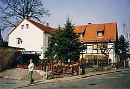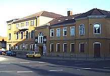

**_Fotos:_** _Dorfkern Altbriesnitz mit dem früheren Gasthof (rechts)_

## Gasthof Briesnitz

Die älteste Erwähnung eines Gastwirts in Briesnitz stammt aus dem Jahr 1286, wobei nähere Informationen fehlen. Später übernahm das sogenannte Schänkengut die Bewirtung der ortsansässigen Bevölkerung. Dieses besaß die
Erlaubnis zum Ausschank von verschiedenen Bieren sowie von Wein und genoß damit weitreichende Privilegien. 1634 brannte
das Schänkengut ab, wurde jedoch schon wenig später wieder aufgebaut. Das historische Gebäude an der Ecke Altbriesnitz /
Alte Meißner Landstraße wurde bis zum Bau des neuen Gasthofs gastronomisch genutzt und diente später bis zu seinem Abriss 1957 als Wohnhaus.

_“Der Schenck zu Brießnitz rüget, dass er ein Frey Schenckhauß habe, darinnen Er jährlich frey zu schencken hat, Wein und Bier, es sey Freybergisch: Dreßdnisch:_
_Pirnisch: Radebergisch: Meißnisch etc. wo und wie er es am nechsten erzeugen undt zu ihm bringen kann.”_

**Auszug aus den Briesnitzer Dorfrügen von 1648**

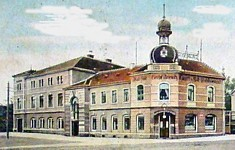1896 entstand der Gasthof in seiner heutigen Form für den Briesnitzer Gastwirt A.
Birnbaum. Baumeister war Heinrich Kühne, die Entwürfe stammten von Gustav Pietzsch. Zum Lokal gehörte nun auch ein Ballsaal für über 400 Personen, der bis
1945 für Bälle und ähnliche Tanzvergnügungen genutzt wurde. Besitzer des Gasthofes war bis 1913 August Ernst Binder, danach Gustav Diecke. Dieser ließ einige
Modernisierungen und Veränderungen vornehmen. Zeitweise firmierte der Gasthof nun unter dem Namen Dieckes Ball-Etblissement. Ab 1918 fanden im Saal regelmäßige
Kinovorführungen statt. Nach Zerstörung der großen Kinos der Innenstadt wurde in der Nachkriegszeit unter dem Namen “Film-Eck Briesnitz” ein reguläres Filmtheater
eingerichtet, welches noch bis in die 1980er Jahre in Betrieb war. In einem Nebenraum gab es Schulungen der Bezirksfilmdirektion Dresden für angehende Filmvorführer, welche hier die notwendigen Berechtigungscheine erwerben konnten.
Weitere Räumlichkeiten dienten der Kommunalen Wohnungsverwaltung Dresdens als Büros.  Heute wird der ehemalige Briesnitzer Gasthof unter dem Namen ”beatpol” (bis 2008 “Star Club”) für Diskotheken und Konzerte genutzt.

## Am Kirchberg

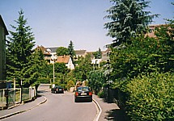
Die Straße Am Kirchberg verbindet Briesnitz mit dem Nachbarort [Kemnitz](../../../west/kemnitz/)
und wurde deshalb früher auch Kemnitzer Weg bzw. ab 1897 Kemnitzer Straße genannt. Bei Ausgrabungen wurden bronzezeitliche Funde gemacht, die eine Besiedlung des Gebietes
bereits um 1000 v. Chr. beweisen. Später soll sich hier eine Kultstätte der slawischen Göttin Priswiza befunden haben. Am 1. Januar 1907 erfolgte die Umbenennung in Kirchstraße, da die Straße unmittelbar an der [Briesnitzer Kirche](../briesnitzer_kirche/) vorbeiführt. Bereits zuvor
hatte es in Briesnitz und Cotta eine Kirchstraße gegeben, welche 1904  in Gottfried-Keller-Straße umbenannt worden war.

Der Kemnitzer Abschnitt trug um 1900 den Namen Gartenstraße. Hier lagen am Rande des Dorfkerns mehrere Gärtnereien. Im
Zuge des Ausbaus der Autobahnanschlussstelle Dresden-Altstadt wurden die meisten Gebäude 1935/36 abgerissen. Bereits 1926 war die Straße mit dem Briesnitzer Abschnitt vereinigt und ebenfalls Am Kirchberg benannt worden.

## Am Lehmberg

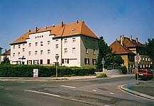
Der frühere Omsewitzer Weg erhielt seinen heutigen Namen Am Lehmberg 1926 nach einem alten Flurnamen. Zuvor wurde er seit dem 29. August 1897 offiziell Omsewitzer
Straße genannt. Nach der Eingemeindung von Omsewitz erfolgte 1930 die Einbeziehung der dortigen Briesnitzer Straße. Der lehmhaltige Boden um Briesnitz wurde einst von
mehreren Ziegeleien genutzt. Die größte Briesnitzer Ziegelei, die Ziegelei Nötzold, wurde 1886 gegründet und bestand bis 1926. Auf dem Gelände entstanden ab 1928
Wohnhäuser. Weitere Ziegeleibetriebe wurden noch bis in die Dreißiger Jahre von Gustav Heymann (Am Lehmberg 7) und Ernst Klopfer (Nr. 44) betrieben.

Ziegelei Nötzold: Das Unternehmen wurde 1886 von Maximilian Nötzold gegründet und gehörte mit bis zu 150 Arbeitern zu den größten Betrieben der Umgebung. Die Tongruben befanden sich zwischen Briesnitz und Omsewitz sowie westlich der heutigen Zschonerallee. Für die Verarbeitung und das Brennen der Ziegel entstanden mehrere Gebäude auf dem Areal zwischen Wilhelm-Raabe-Straße und Roquettestraße. Mit zunehmender Bebauung der Fluren und den sich erschöpfenden Tonvorkommen wurde der Ziegeleibetrieb jedoch nach dem Ersten Weltkrieg zunehmend unrentabel, so dass die Besitzer ihr Unternehmen 1926 an die Siedlergemeinschaft der Briesnitzer Eigenheimsiedlung verkauften. Diese nutzte die Ziegelei noch einige Jahre für den Eigenbedarf. 1937 erfolgte der Abriss der Gebäude und die Bebauung der Fläche mit Wohnhäusern. Weitere Neubauten entstanden 2016 mit dem Wohnpark "Alte Ziegelei"

## An der Wasserschöpfe

Der um 1900 angelegte Weg trug ursprünglich den Namen Turnerweg, da hier der Briesnitz-Cottaer Turnverein seine Turnhalle
besaß. Am 19. Februar 1926 wurde der Weg umbenannt. Der Name An der Wasserschöpfe erinnert an einen früheren Schöpfbrunnen, der sich einst hier befand und von einem heute verschwundenen Bach versorgt wurden. Der Brunnen bestand
aus einem hölzernen Schöpfrad, mit dessen Hilfe die Anwohner Wasser zur Versorgung ihrer Grundstücke entnehmen konnten.
Ende des 19. Jahrhunderts wurde der Bach unterirdisch verlegt und überwölbt. Für den letzten Abschnitt an der Hamburger Straße fanden dabei 1908 beim Abbruch der alten Augustusbrücke geborgene Steine Verwenung.

## Auf dem Eigen

Die Straße erhielt ihren Namen Auf dem Eigen am 26. Januar 1921. Die Namensgebung weist auf die ab 1912 entstandene
Briesnitzer Eigenheimsiedlung hin. Bauherr war die am 22. Juli 1911 gegründete Eigenheim-Siedelung Briesnitz-Dresden
e.G.m.b.H., die hier bis 1913 erste Wohnhäuser errichtete. In den 1920er und 30er Jahren wurde die Wohnanlage komplettiert.

## Auf der Scheibe

Die bereits 1904 angelegte Straße Auf der Scheibe erhielt ihren Namen 1910 nach einer früheren Flurbezeichnung, die bereits im
19\. Jahrhundert auf alten Karten verzeichnet ist. Die meisten Wohnhäuser wurden jedoch erst um 1928 errichtet. An Stelle der
zuvor üblichen Einfamilienhäuser entstanden hier mehrgeschossige Wohnblocks mit Mietwohnungen. Das Wohnhaus Nr. 12 mit
Relieftafeln an der Fassade steht unter Denkmalschutz. Vor Haus Nr. 11 erinnert seit 2009 ein Stolperstein an  Lina Marie
Schöbel (1900-1942). Die Dresdner Telefonistin lebte ab 1928 in der Psychiatrie und wurde 1942 in Großschweidnitz Opfer des Euthanasieprogramms der Nazis.

## Borngraben

Der Borngraben gehört zu den ältesten Briesnitzer Wegen und war letzter Teil des alten Bischofsweges, der von Meißen über
Klipphausen zur Briesnitzer Furt führte. Seinen Namen erhielt er 1913 nach einem einst auch Triebe genannten kleinen Bach, der früher auch zur Trinkwassergewinnung genutzt wurde. Im Zuge des Eisenbahnbaus 1875 sowie der Anlage der
Eigenheimsiedlung nach dem Ersten Weltkrieg wurde der Bach eingerohrt und fließt seitdem unterirdisch. Im Zusammenhang mit
dem Ausbau der Meißner Landstraße 1938 schüttete man den verbliebenen Abschnitt zwischen Altbriesnitz und Elbe zu. Die Wohnhäuser am Borngraben stammen aus den Jahren zwischen 1911 und 1938.

## Eigenhufe

Die Straße wurde 1913 angelegt und erhielt ihren Namen Eigenhufe nach dem alten deutschen Landmaß “Hufe”.  Hier entstanden 1912/13 zahlreiche Einfamilienhäuser der Briesnitzer Siedlergemeinschaft _(Foto)_.

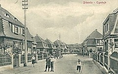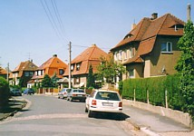

**_Fotos:_** _Blick in die Straße Eigenhufe um 1914 und 2010_

## Felix-Dahne-Weg

Der Felix-Dahn-Weg wurde 1936 kurz vor Vollendung der Briesnitzer Siedlung angelegt. Der am 11. November 1936 offiziell vergebene Name erinnert an den Historiker und Dichter Felix Dahn (1834-1912), der durch seinen historischen Roman “Ein Kampf um Rom” bekannt wurde. Auf dem Gelände der ehemaligen Ziegelei Nötzold wurden in den 1930er Jahren einige architektonisch interessante Rundhäuser errichtet. Hier befindet sich heute eine 2004/05 sanierte seniorengerechte Wohnanlage der Eisenbahner-Wohungsgenossenschaft EWG. Benannt wurde das “Gertrud-Oeser-Haus” nach der mit 106 Jahren ältesten Genossenschaftlerin, die kurz vor der Einweihung verstorben war. Weitere Wohngebäude errichtete die Genossenschaft ab 2016.

## Gottfried-Keller-Straße

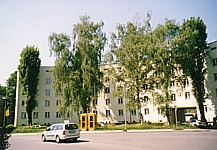
Die heutige Gottfried-Keller-Straße bestand bereits im 18. Jahrhundert und wurde von den Briesnitzer und Cottaer Bauern auf ihrem Weg zur Plauenschen Amtsmühle genutzt. Gleichzeitig
diente diese Verbindung den Cottaern als Kirchweg und als Weg zum Briesnitzer Friedhof, weshalb der Weg im Volksmund auch Unterer Leichenweg genannt
wurde. Offiziell trug sie seit dem 31. Mai 1897 den Namen Kirchstraße. 1904 erfolgte die Namensgebung nach dem schweizerischen Schriftsteller in Gottfried-Keller-Straße, die am 15. Januar 1931 auch auf einen angrenzenden Platz _(Foto)_ übertragen wurde. Gottfried Keller (1819-1890) ist als Verfasser zahlreicher Novellen und Romane wie “Der grüne
Heinrich” und “Die Leute von Seldwyla” bekannt. Die architektonisch interessanten Wohnblocks am Gottfried-Keller-Platz
wurden 1928-1930 errichtet und gehören heute zur Eisenbahner-Wohnungsbau-Genossenschaft. Markante öffentliche Bauten sind die [Grundschule “Am Leutewitzer Park”](../../../west/leutewitz/) (Nr. 40) und die auf Cottaer Flur gelegene katholische [St.-Marien-Kirche](../../../west/cotta/st__marien-kirche/) (Nr. 50).

## Hammeraue

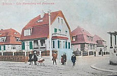Auch diese Straße wurde nach einem früheren Flurnamen benannt und erhielt ihre offizielle Benennung Hammeraue 1913. Bereits im Mai 1912 war hier die Grundsteinlegung für die ersten Wohnhäuser der Briesnitzer Siedlung erfolgt. Ende Juli konnte mit der Nr. 48 das erste Gebäude bezogen werden. Während der Bauzeit befand sich an der Ecke zur Merbitzer Straße eine vom Gastwirt Ernst Binder bewirtschaftete Kantine für die Arbeiter. Später wurden durch die Briesnitzer Siedlergesellschaft Grünflächen geschaffen, um so den Charakter der Gartenstadt zu unterstreichen. Das Bild (rechts) zeigt die Einmündung Hammeraue / Hammerberg kurz nach ihrer Fertigstellung.

## Heroldstraße

Die frühere Wettinerstraße entstand in den 1890er Jahren und wurde am 31. Mai 1897 offiziell nach dem sächsischen Königshaus benannt. Im Zusammenhang mit der Eingemeindung von Briesnitz erhielt sie am 1. Juni 1926 den Namen Heroldstraße nach dem Briesnitzer Pfarrer Johann Salomon Herold (1718-1795). Herold erwarb sich große Verdienste um die Entwicklung der Briesnitzer Kirchgemeinde und verfasste eine Chronik über die Geschichte des Gotteshauses. Sein Grab befindet sich auf dem Alten Briesnitzer Friedhof.

## Herweghstraße

Ebenso wie die benachbarte Heroldstraße entstand auch die Herweghstraße im letzten Jahrzehnt des 19. Jahrhnderts. Seit dem 31. Mai 1897 trug sie nach dem benachbarten Ort Leutewitz den Namen Leutewitzer Straße. Ihren heutigen Namen bekam sie am 19. Februar 1926 nach dem Lyriker Georg Herwegh (1817-1875). Herwegh verfasste zahlreiche politisch-revolutionäre Gedichte und nahm aktiv an der bürgerlichen Revolution 1848/49 teil.

## Marktweg

Der alte Verbindungsweg zwischen Briesnitz und dem Zschonergrund wurde früher als Zschonweg bezeichnet und erhielt erst
1910 seinen heutigen Namen. Bereits im 19. Jh. trug ein hier gelegenes Flurstück den Namen “Am Marktweg”, was auf die Bedeutung des Weges für den örtlichen Handel hinweist. Nach dem Ersten Weltkrieg entstanden
am Marktweg Eigenheime der Briesnitzer Siedlergemeinschaft. Im Haus Nr. 4 befand sich ab 1919 die Geschäftsstelle der Gesellschaft, bevor diese später zur Zschonerallee 1 verlegt wurde.

## Max-Sachs-Straße

Die Straße wurde 1910 als eine der ersten Erschließungsstraßen für die geplante Eigenheimsiedlung angelegt und nach einem
Flurnamen Hammerberg (eigentlich Hammelberg) genannt. In einem der hier entstandenen Einfamilienhäuser (Nr. 2) lebte bis zu
seiner Verhaftung 1935 der sozialdemokratische Politiker und Landtagsabgeordnete Max Sachs (1883-1935). Sachs starb wenig später an den Folgen von Misshandlungen durch die Gestapo im KZ Sachsenburg. 1945 wurde der Hammerberg ihm zu
Ehren in Max-Sachs-Straße umbenannt. An seinem früheren Wohnhaus erinnert eine Gedenktafel an den Politiker, welcher ab 1912 auch Redakteur der “Dresdner Volkszeitung” war. Außerdem mahnen seit 2011/12
vier “Stolpersteine” an Max Sachs, seine Ehefrau Maria und die Töchter Klara (Claire) Ehrmann und Edith Kaufmann.

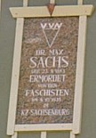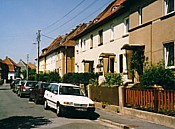

**_Foto:_** _Gedenktafel für Max Sachs am Wohnhaus Max-Sachs-Straße 2  - Blick in die Straße_

## [Meißner Landstraße](../../../west/cotta/strassen_cotta/meissner_landstrasse/)

## Roquettestraße

Die Roquettestraße wurde bis 1909 Schillerstraße bzw. Maximilianstraße genannt, bevor sie ihren heutigen Namen erhielt. Otto
Roquette (1824-1896) war zwischen 1853 und 1856 Lehrer an der Blochmannschen Erziehungsanstalt in Dresden und arbeitete später als Professor für deutsche Literatur und Geschichte in Berlin und Darmstadt.

## Schunckstraße

Die Schunckstraße erhielt ihren Namen 1897 nach der Briesnitzer Stifterin Helene Schunck (1846-1913), die sich für die
Armenfürsorge in der Gemeinde einsetzte und den ersten Briesnitzer Kindergarten gründete. Der Name der Familie ist auch mit dem [Schunck´schen Park](../../../west/cotta/strassen_cotta/meissner_landstrasse/) an der Meißner Landstraße verbunden, der heute jedoch nur noch teilweise erhalten ist.

## Schulberg

Die Straße erhielt ihren Namen 1926, da sie unmittelbar an der 76. Volksschule vorbeiführt. Das Schulgebäude entstand bereits
1909 als drittes Briesnitzer Schulhaus. Im Zusammenhang mit dem Bau der Briesnitzer Siedlung wurden an dieser Straße Hausgärten für die Bewohner angelegt, die heute als Kleingartenanlage “Schulberg” genutzt werden.

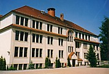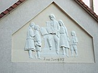

**_Foto:_** _Das dritte__Briesnitzer Schulhaus am Schulberg mit Relieftafel über dem Haupteingang_

## Sonnenlehne

Die Straße entstand 1912/13 im Zusammenhang mit dem Bau der Briesnitzer Siedlung und wurde nach ihrer Lage am Berghang Sonnenlehne genannt.

## Vierlinden

Ein kleiner ursprünglich mit vier Lindenbäumen besetzter Platz an der Ecke zur Eigenhufe war 1912 Anlass zur Namensgebung
der Straße Vierlinden in der neu entstandenen Eigenheimsiedlung Briesnitz. Die meisten Wohngebäude wurden zwischen 1911
und 1913 nach Plänen des Architekten Curt Herfurth errichtet. Nach dem Ersten Weltkrieg folgten die Häuser Nr. 16-22.

## Warthaer Straße

Die Warthaer Straße verbindet die Stadtteile Cotta, Briesnitz, Leutewitz und Omsewitz und erhielt ihren Namen nach den
Gemeinden Ober- und Niederwartha. Früher führte an dieser Straße ein Fußweg entlang des Briesnitzer Dorfbaches Wasserschöppe, an den heute noch der Straßenname ”An der Wasserschöpfe” erinnert. Nach dem Ausbau zur Straße ab 1890
wurde sie in Briesnitz und Cotta Heinrichstraße, in Leutewitz Schulstraße genannt. 1876 hatte der Schulverband Leutewitz - Omsewitz - Ockerwitz hier sein [Schulhaus](../../../west/leutewitz/) errichtet. Die Namensgebung Heinrichstraße ist auf den Vornamen des früheren
Cottaer Gemeindeältesten zurückzuführen.

Um Verwechslungen mit gleichnamigen Straße in anderen Stadtteilen zu vermeiden, wurde sie 1904 zunächst auf  Cottaer, ab
1926 auch auf Leutewitzer Flur in Warthaer Straße umbenannt. 1931 übertrug man den Namen auch auf die anschließende
frühere Ockerwitzer Straße in Omsewitz. Das Straßenbild prägen heute vor allem Mehrfamilienhäuser aus der Zeit um 1900. Da
viele der Gebäude im Erdgeschoss Ladenlokale besitzen, ist die Warthaer Straße bis zur Gegenwart als Einkaufsmeile der Anwohner von Bedeutung.

## Wilhelm-Raabe-Straße

Die früher Fürst-Bismarck-Straße genannte Straße erhielt 1926 ihren heutigen Namen Wilhelm-Raabe-Straße nach dem
deutschen Schriftsteller Wilhelm Raabe (1831-1910). 1859 weilte Raabe im Zusammenhang mit einer Bildungsreise für einige Monate in Dresden. Im Haus Nr. 2 gab es ab 1911 bis kurz nach Ende des Ersten Weltkrieges das
”Tonbild-Theater”, eines der ersten Kinos des Dresdner Westens.

## Wolfszug

Die Namensgebung Wolfszug erfolgte nach einem früheren Flurnamen im alten Briesnitz. Zuvor wurde der Weg Kohlweg bzw.
Ockerwitzer Leichenweg genannt. Grund dafür war die Nutzung der Verbindung zwischen Ockerwitz und Briesnitz für den
Kohlentransport der Zauckeroder Steinkohlegruben bzw. der Verstorbenen auf ihrem letzten Weg zum Briesnitzer Friedhof. Der  heutige Straßenname erinnert zugleich an die Briesnitzer [Sage vom Kroatenloch](../../../west/kemnitz/zschonergrund/), welche im nahegelegenen Zschonergrund
angesiedelt ist. Mit dem Bau dreier Doppelhäuser an dieser Straße endete 1914 der erste Bauabschnitt der Briesnitzer Siedlung. Erst in den Zwanziger Jahren konnten die verbliebenen Baulücken geschlossen werden.

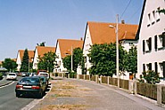

**_Foto:_** _Wohnhäuser an der Zschonerallee in der Briesnitzer Siedlung._
