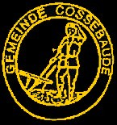

**Gemeindesiegel von Cossebaude**

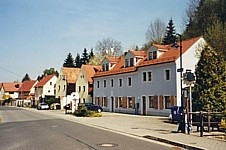Cossebaude gehört zu den ältesten Orten im oberen Elbtal und wurde 1071 in der sogenannten “Benno-Urkunde” erstmals erwähnt. Der Ortsname “Cozubudi” stammt aus dem slawischen und bedeutet übersetzt “Ziegenstall”. Andere Erklärungen deuten den Namen als „Siedlung der Leute, die mit Sensen (in die Erde) stechen“ oder „Siedlung der Leute, die Amseln aufspießen“. Im Zusammenhang mit der unter Historikern umstrittenen Schenkung von fünf Dörfern, unter ihnen Cossebaude, durch den slawischen Edelmann Bor an den sagenhaften Bischof Benno, kam der Ort unter die Herrschaft des Meißner Domkapitels.

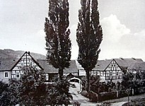Bereits im 11. Jahrhundert soll Benno hier den ersten Weinberg angelegt haben und damit den Cossebauder Weinbau begründet haben. Jahrhundertelang war dieser wichtigster Erwerbszweig der Einwohner des Ortes, der als 8. Obedienz dem Meißner Domstift unterstand. Um 1263 wurde erstmals ein Vorwerk erwähnt, welches jedoch 1492 bereits wieder aufgelöst wurde. Nach 1350 entstand in Cossebaude die bis heute erhaltene [Alte Kapelle](../../west/cossebaude/alte_kapelle/), die der heiligen Dorothea geweiht war und bis 1902 den Gemeindesaal der Cossebauder Christen beherbergte. Mit einem Erlass des Kurfürsten Moritz wurde ab 1560 auch der Obstbau in den Orten um Cossebaude eingeführt. Kurfürstliche Beamte verteilten dazu spezielles Saatgut in den Dörfern. Außerdem musste jedes frischvermählte Paar einen Obstbaum pflanzen.

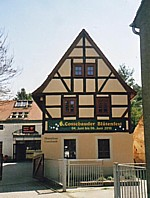Nach der Reformation kam der Ort in den Besitz des Prokuraturamtes Meißen, musste aber auch gegenüber dem Amt Dresden verschiedene Dienstpflichten leisten. Im 17.
Jahrhundert befand sich Cossebaude im Besitz des Geheimrates Dr. Aichmann, der den Weinbau zu neuer Blüte führte. Erst durch den Dreißigjährigen Krieg wurde diese
Entwicklung unterbrochen. In Folge der Ereignisse kam der Ort 1619 in die Hand des Kurfürsten und unterstand nun vollständig dem Amt Dresden. Zu den wichtigsten
Ereignissen in der Ortsgeschichte gehören die am 15. - 17. August 1645 in Cossebaude begonnenen Vorverhandlungen zum Friedensvertrag von Kötzschenbroda, der für Sachsen
den Dreißigjährigen Krieg beendete. An diesen erinnert der “Friedensstein” vor der gleichnamigen [Gaststätte](../../west/cossebaude/gasthof_cossebaude/) an der Meißner Landstraße. Im 18. Jahrhundert wohnte der
“gelehrte Bauer” Johann Ludewig (1715 - 1760) in Cossebaude, der sich u. a. mit Mathematik, Astronomie und Geometrie befasste. Ab 1754 übte er auch das Amt des Ortsrichters aus.

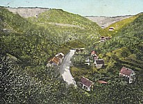Bis ins 19. Jahrhundert lebten die Bewohner des Dorfes vorrangig vom Obst- und
Weinbau sowie der Landwirtschaft. Ein Großteil der Cossebauder Fluren war zugleich Jagdrevier des Kurprinzen, was die wirtschaftliche Nutzung erheblich
behinderte. Erst nach der Reichsgründung von 1871 begann die Industrialisierung im Elbtal. Maßgeblich dazu bei trug die 1875 über Cossebaude geführte [Eisenbahnstrecke Dresden - Berlin](../../zentrum/friedrichstadt/dresden_-_berlin/) mit einer neuen [Elbbrücke](../../west/niederwartha/niederwarthaer_elbbrucke/) bei Niederwartha.
Mit der Reblauskatastrophe 1880/81 endete die Bedeutung des Weinanbaus für vorerst, obwohl noch bis 1945 einige gewerbliche Weingüter bestanden. Der stark
angewachsene Ort war nun als Industriegemeinde ein Zentrum der industriellen Bauwirtschaft. Zu den deutschlandweit bedeutendsten Firmen aus der Frühzeit des Betonbaus gehörten u. a. die in Cossebaude ansässigen Firmen [Windschild & Langelott](../../west/cossebaude/strassen_cossebaude/) (1889 gegründet) und [Dyckerhoff & Widmann](../../west/cossebaude/strassen_cossebaude/) (1890).
Bekannt waren auch die [Eisenwerke Meurer AG](../../west/cossebaude/eisenwerke_meurer/), welche 1903 ihren Sitz von Dresden nach Cossebaude verlegt
hatten. Die Tochter eines Cossebauder Eisenbahningenieurs, Erna Berger machte als Sopranistin Karriere und gehörte viele Jahre zum Ensemble der Semperoper.

1906 erhielt der Ort nach langwierigen Verhandlungen Straßenbahnanschluss nach Dresden. Ursprünglich war eine Verlängerung der 1899 eröffneten [Lößnitzbahn](../../nordwest/mickten/lossnitzbahn/) nach Kötzschenbroda über die Niederwarthaer Elbbrücke nach Cossebaude und von dort bis Cotta vorgesehen. Hier sollte der Übergang zur Dresdner Straßenbahn erfolgen. Aus
finanziellen und verkehrstechnischen Erwägungen entschied man sich jedoch für eine Verlängerung der bestehenden
Straßenbahnlinie nach Friedrichstadt über Cotta - Gohlis bis zum Endpunkt in Cossebaude. Am 27. September 1906 wurde diese neue Straßenbahnlinie
eröffnet. Behinderungen des Straßenverkehrs durch Rangierfahrten  und eine fehlende Wendeschleife für die modernen Einrichtungsfahrzeuge führten am 2. Dezember 1990 zur Einstellung des
Straßenbahnbetriebs, welcher durch eine Buslinie ersetzt wurde.

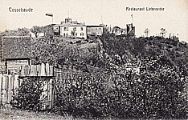Nicht nur die Einwohner Cossebaudes, sondern auch zahlreiche Dresdner
nutzten die neue Verkehrsverbindung vor allem an den Wochenenden. Die Obstbaumalleen und Hochflächen um den Ort waren ebenso wie die neu entstandenen Gaststätten um die Jahrhundertwende, vor allem zur Zeit der
Baumblüte, eines der beliebtesten Ausflugsziele der Dresdner Bevölkerung **_(Foto rechts:_** _ehem. Gasthaus Liebenecke)_. Zur Förderung des Tourismus
hatte sich 1883 ein Verschönerungsverein gegründet, der neue Wege anlegen ließ und 1906 einen Aussichtspunkt auf der Herrenkuppe schuf. An gleicher Stelle entstand 1913 ein Bismarckdenkmal. Zu den markanten Blickpunkten
am Elbhang gehörte auch das um 1890 für einen Industriellen errichtete “Weiße Schloss” im neogotischen Tudorstil sowie die heute geschlossenen Ausflugsgaststätte “Osterberg”.

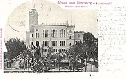

**_Foto:_** _Ausflugsgaststätte Osterberg (histor. Postkarte)_

Cossebaude blieb auch nach 1945
Industrie- und Wohnvorort Dresdens. Der Weinbau, der in den Nachkriegsjahren fast völlig zum Erliegen gekommen war, lebte in den 1960er und 70er Jahren wieder auf und wird heute sowohl
gewerblich als auch von Hobbywinzern betrieben. Am Rande des Ortszentrums entstanden in den 1970er und 80er Jahren Neubauten. Bereits 1970 waren Teile der Gemeinde [Leuteritz](../../west/mobschatz/leuteritz/) (Neu-Leuteritz), 1974 die Orte [Gohlis](../../west/gohlis/) und [Niederwartha](../../west/niederwartha/) nach Cossebaude eingemeindet worden. 1994 folgte [Oberwartha](../../west/oberwartha/). Cossebaude kam mit seinen
Ortsteilen am 1. Juli 1997 zu Dresden, besitzt bis heute jedoch als Ortschaft der Landeshauptstadt eine gewisse Selbstständigkeit.

Zu den bedeutendsten Bauvorhaben der letzten Jahre gehörte die neue [Straßenbrücke](../../west/niederwartha/niederwarthaer_elbbrucke/) in Niederwartha, mit deren Bau
im Jahr 2006 begonnen wurde. Die Einweihung des Bauwerks erfolgte am 12. Dezember 2011. Umstritten ist hingegen
der weitere Ausbau der durch den Ort führenden Bundesstraße  B6, welche künftig parallel zur Bahntrasse verlaufen soll, um so das Ortszentrum vom Durchgangsverkehr zu entlasten.

## Schulen in Cossebaude

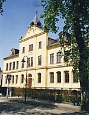Die erste Schule von Cossebaude entstand 1805 nach Einführung der Schulpflicht in Sachsen
und befand sich in einem noch erhaltenen Gebäude auf der [Talstraße](../../west/cossebaude/strassen_cossebaude/talstrasse/) 7\. Erst 1861 konnte
nach einem Umbau ein zweites Klassenzimmer eingerichtet werden. Das Schulhaus wurde damals von drei Klassen mit insgesamt ca. 200 Kindern genutzt. Im Zusammenhang mit dem
Einwohnerzuwachs nach 1880 wurde 1894 eine neue Schule auf der Bahnhofstraße errichtet und am 31. März eingeweiht. Architekt des Gebäudes _(Foto)_ war der einheimische
Baumeister Säurig. 1910/11 wurde dieses Schulhaus nochmals erweitert. Die Cossebauder Schule, die nach dem Luftangriff auf Dresden zeitweise auch als Notaufnahmelager für
Bombengeschädigte genutzt wurde, dient bis heute ihrem Zweck. Am 25. September 1971 erhielt sie den Namen Hans-Grundig-Oberschule. Im Jahr 2006 wurde das Gebäude um einen modernen Anbau an der Schulstraße ergänzt.

Eine weitere Schule befindet sich auf der Erna-Berger-Straße. Der DDR-Typenneubau entstand 1977/78 als Erweiterung der bestehenden Hans-Grundig-POS und wurde am 30. August 1978 feierlich eingeweiht. Mit Beginn des
Schuljahres 1992/93 erfolgte eine Trennung dieser Schule in eine Grund- und eine Mittelschule, so dass der Neubau
heute als Oberschule betrieben wird. Neben Cossebauder Kindern besuchen auch Schüler aus den umliegenden Orten diese Schule.

## Kraftwerk Cossebaude

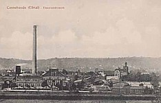Auf Initiative des Gemeindevorstehers von Cotta beschlossen die Vertreter
von Cotta, Leutewitz, Briesnitz, Kemnitz, Stetzsch, Oberwartha und Cossebaude am 26. Januar 1899 im Kemnitzer Gasthof die Gründung eines Gemeindeverbandes zum Bau eines eigenen Elektrizitätswerkes. Der
Zusammenschluss war erforderlich, da die zu erwartenden Ausgaben und Betriebskosten für die Einzelgemeinden allein nicht aufzubringen gewesen wären. Noch im gleichen Jahr schlossen sich auch Burgstädtel, Omsewitz,
Gohlis und Mobschatz dem Interessenverband bei, der nach einer Ausschreibung am 12. Dezember 1899 die Niedersedlitzer Firma Kummer & Co. mit dem Bau beauftragte.

Das Werk an der Cossebauder Bahnhofstraße entstand innerhalb eines Jahres und konnte bereits am 24. Dezember 1900 erstmals Strom an die angeschlossenen Haushalte und Industriebetriebe liefern. Die technische Ausstattung
bestand aus drei Kolbendampfmaschinen, die eine maximale Leistung von 400 kW erzeugten. Infolge technischer
Mängel und dem Konkurs der Herstellerfirma machten sich jedoch schon bald technische Veränderungen erforderlich. Betreiber des Werkes war der Gemeindeverband Elektrizitätswerk “Elbthal”. Per Vertrag war in den
Mitgliedskommunen bis 1943 die Errichtung eigener Werke untersagt. Die Baukosten beliefen sich seinerzeit auf über eine Million Mark.

## Bismarck-Ehrenmal

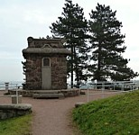Das Bismarck-Ehrenmal auf der Herrenkuppe entstand auf Anregung des “Ausschusses zur
Errichtung einer Bismarck-Ehrung” unter Vorsitz des Prokuristen des Eisenwerks Meurer, Paul Breßler im Jahr 1913. Die Grundsteinlegung erfolgte am 30. März und bereits am 22.
Juni 1913 konnte das Denkmal eingeweiht werden. Die Säule ist 4,5 Meter hoch und besteht aus Syenit und Muschelkalksteinbeton. Der Entwurf stammt vom Architekten
Rudolf  Kolbe, während die Ausführung dem Cossebauder Baumeister Säurig oblag. An der Seite befand sich einst eine von Richard König geschaffene Büste des Reichsgründers
sowie eine zugehörige Gedenktafel, welche jedoch nach 1945 entfernt wurde. Erst 2008 konnte diese durch eine neue Bronzetafel mit Bismarck-Relief ersetzt werden. Seit 1992 steht das Bauwerk unter Denkmalschutz.

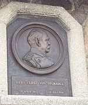Ursprünglich befand sich auf der Säule ein in deren Aufbau eingelassenes Feuerbecken,
welches zu Bismarcks Geburtstag und anderen hohen Staatsfeiertagen mit Holz, Koks und Magnesium befeuert werden konnte und weit über das Elbtal hin zu sehen war. Dieses
Becken wurde 1999 bei einer Sanierung des Denkmals wieder ergänzt und bis 2008 alljährlich zur Sommersonnenwende in Betrieb gesetzt, 2013 aus Brandschutzgründen
jedoch entfernt. Vom Denkmal bietet sich ein schöner Rundblick über das Elbtal und die Cossebauder Umgebung. Eine Informationstafel weist auf interessante Punkte in der Umgebung hin.
