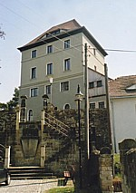
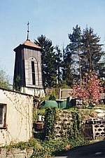
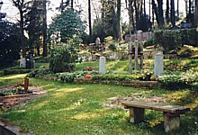
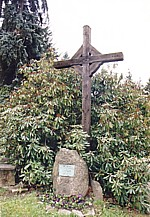

## Alte Kapelle

Die Alte Kapelle entstand vermutlich bereits im 13. Jahrhundert und gehört zu den ältesten Kirchen im oberen Elbtal. Ursprünglich war sie Teil eines 1263 erstmals genannten Vorwerkes. Die 1358 als “Pfarre” bezeichnete Kapelle wurde 1441 der heiligen Dorothea geweiht und unterstand bis zur Reformation dem Domstift Meißen. 1492 ließ Domprobst Johannes von Konigspergh das Vorwerk Cossebaude auflösen und gründete an seiner Stelle eine Weinbauern- und Häuslergemeinde, die er 1498 zum eigenen Kirchspiel erklärte.
Gleichzeitig ließ er ein Benefizium für diese Kapelle aussetzen, welches der Finanzierung der seelsorgerischen Arbeit diente. Die Alte Kapelle war zugleich auch Wohnsitz eines Priesters, der mit der Überwachung des Weinbaus und der damit verbundenen kirchlichen Abgaben zuständig war. Die Weihe einer neuen Kapelle im Erdgeschoss des Gebäudes ist für den 13. Mai 1527 durch den Weihbischof von Meißen belegt.

Erst etliche Jahre nach der Reformation, im Jahr 1578, wurde in dieser Kapelle der erste
evangelisch-lutherische Gottesdienst abgehalten. Anfang des 17. Jahrhunderts gelangte das Gotteshaus in Privatbesitz. Nach 1700 wurde der zweigeschossige spätgotische Kapellenbau aufgestockt und erhielt ein Walmdach _(Foto oben)_ . Seit 1901 ist die zuvor als Filiale zur Briesnitzer Kirche gehörende Gemeinde kirchlich selbstständig. Ein Jahr später ließ man den ehemaligen Maschinensaal der Weinpresse des Dorfes (Talstraße 9)
zum Betsaal umbauen. Die Alte Kapelle wird seitdem nicht mehr genutzt. 1921 erfolgte deren Umbau zum Wohnhaus.

Um der stark angewachsenen Gemeindemitgliederzahl Rechnung zu tragen, bezog die
Cossebauder Kirchgemeinde 1903 ihren neuen Betsaal, welcher als Provisorium nur eine einfache Ausstattung erhielt. Ein Jahr später kam im Garten des Grundstücks ein 12 Meter hoher Glockenturm hinzu _(Foto rechts)_
, in dem bis 1917 drei Bronzeglocken der Dresdner Gießerei Bierling läuteten. Das heutige Geläut, welches die im Ersten und Zweiten Weltkrieg
eingeschmolzenen Glocken ersetzt, stammt von 1999. Ursprünglich war geplant, auf diesem Areal hinter der Alten
Kapelle eine neue Kirche für den Ort zu bauen, was jedoch aus politischen und finanziellen Gründen scheiterte.

Nach der Wende erfolgte eine umfassende Sanierung des Betsaals, welcher am 24. Mai 1992 als Ev.-Luth. Kirche
Cossebaude offiziell geweiht wurde. Die Pläne für den Umbau stammen von Dr. Gerd Bürger. Im Inneren befinden sich ca. 200 Plätze im Saal und auf der Empore sowie eine kleine Rühle-Orgel. 2012 erwarb die Gemeinde eine
ursprünglich aus einer Chemnitzer Kirche stammende Jehmlich-Orgel.

## Bergfriedhof

Der Cossebauder Bergfriedhof entstand 1919 außerhalb des Ortes in ruhiger
Umgebung. Schon 1897 hatte es erste Bestrebungen gegeben, im Ort einen eigenen Begräbnisplatz anzulegen. 1910 ersuchte der Gemeinderat deshalb den Vorstand der Kirchgemeinde, die Anlegung eines Friedhofes wohlwollend zu
prüfen. Als Platz wählte man eine zuvor landwirtschaftlich genutzte Fläche im “Rausch”, einem zum benachbarten Brabschütz gehörenden Flurstück. 1916
begannen die Planungen für das Gelände. Aus einem Gestaltungswettbewerb ging der Berliner Architekt Prof. Dr. Bestelmeyer als Sieger hervor. 1918 erwarb die
Gemeinde das notwendige Grundstück. Das waldbestandene Hanggelände wurde terrassenförmig erschlossen und seit seiner Einweihung am 31. August 1919 als Begräbnisplatz für den Ort
genutzt. Die Bepflanzung erfolgte vorrangig mit Hecken und Rhododendronsträuchern, die der gesamten Anlage einen parkartigen Charakter verleihen. Eine Erweiterung des Friedhofes erfolgte 1938.

1922
entstand eine kleine Friedhofskapelle in Fachwerkbauweise. Ursprünglich sollte diese nur als Provisorium dienen und später durch eine größere ersetzt werden, was jedoch nicht
zustande kam. Das mehrfach erneuerte Gebäude wird deshalb bis heute für Trauerfeiern genutzt. Obwohl herausragende Grabdenkmale fehlen, ist der parkartige Friedhof wegen
seiner naturnahen Gestaltung sehenswert . Mehrere größere Grabstellen wurden als “Erbbegräbnisse” für verschiedene Cossebauder Familien angelegt. Außerdem gibt es einige
historische Grabsteine aus der Zeit vor dem Zweiten Weltkrieg. Geschaffen wurden diese von Steinmetzbetrieben im Ort sowie in Briesnitz und Gauernitz. Im Zweiten Weltkrieg
kamen mehrere Kriegergräber hinzu, u.a. die Grabstätte eines wegen seines Glaubens 1940 hingerichteten Gohlisers. Auch drei
polnische sowie belgische, italienische und ein ukrainischer Zwangsarbeiter fanden hier ihre vorerst letzte Ruhestätte. Nach dem Krieg wurden die sterblichen Überreste auf den [Nordfriedhof](../../../neustadt/albertstadt/nordfriedhof/)
bzw. in die Heimatländer überführt. Am Hauptweg erinnert ein Gedenkstein mit der Inschrift: „Den namenlosen Toten von 1945“ an die Opfer des Zweiten Weltkrieges.
