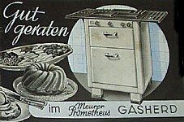
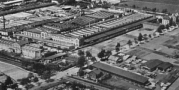
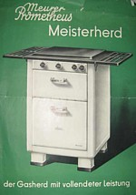

Die Eisenwerke Meurer gehen auf einen kurz nach der Reichsgründung 1871 entstandenen kleinen Handwerksbetrieb zurück. Gottlob Siegfried Meurer, Sohn eines Pfarrers, hatte das Unternehmen nach einer
technischen Ausbildung und mehrjähriger Tätigkeit in der Chemnitzer Maschinenfabrik Richard Hartmann gemeinsam mit seinem Bruder Gottlob Cölestin als Messingwarenfabrik gegründet. Anfangs fertigten die Brüder vor allem
Gewichte für Waagen, welche nach der Einführung des metrischen Systems in großer Stückzahl benötigt wurden. Während Siegfried Meurer die technische und kaufmännische Leitung des Betriebs übernahm, war sein Bruder
vorrangig als Handelsreisender aktiv und übernahm den Vertrieb der Ware.

Für ihr Unternehmen pachteten beide 1871 eine stillgelegte Mühle in der Nähe von Pirna, wo neben den erwähnten Gewichten auch verschiedene
Haushaltgeräte sowie Petroleumkocher hergestellt wurden. Nachdem dieser Betrieb durch einen Brand völlig zerstört worden war, erfolgte am 14. Oktober 1873 die Gründung der Firma G. Meurer. Zunächst befand sich der
Firmensitz in einem gepachteten Gartenhaus auf der Pillnitzer Straße 53 in der Pirnaischen Vorstadt. Wichtigstes Produkt des Betriebes war anfangs ein von Meurer selbst entwickelter und zum Patent angemeldeter
Spirituskocher, welcher weit über die Region hinaus verkauft wurde und zum guten Ruf der Firma beitrug.

Aus Platzgründen verlegten die Brüder 1879 ihren Betrieb in die Johannstadt, wo an der [Blumenstraße](../../../zentrum/johannstadt/strassen_johannstadt/blumenstrasse/) eine Halle mit Eisenschmelzerei und Kunstgießerei entstand. Hier
wurden fortan verschiedenste Gussteile wie Kamineinsätze, Ofenplatten, Kohlenkästen und Schirmständer hergestellt. Hinzu kam nach der Einführung von Stadtgas die Fertigung von Gaskochern sowie von Brat-, Back-, Bügel- und Heizapparaten, gasbeheizten Warmwasserspendern und ähnlichen Geräten. Bis
1890 wuchs die Zahl der Angestellten auf über 250 Arbeiter. Siegfried Meurer erwarb sich auch wegen seiner sozialen Verdienste hohe Anerkennung und richtete
eigens für seine Mitarbeiter eine Schankwirtschaft auf dem Betriebsgelände ein. 1907 wurde ihm der Titel eines Königlich-Sächsischen Kommerzienrates verliehen. Sein Grab befindet sich in der Familiengrabstätte im [Tolkewitzer Urnenhain](../../../ost/tolkewitz/johannisfriedhof/).

Nach Beschwerden einiger Anwohner musste sich Siegfried Meurer 1899 zur Verlegung der Firma verpflichten. 1901
konnten die ersten neu errichteten Betriebsgebäude in Cossebaude bezogen werden. Nach Schließung des Johannstädter
Betriebes wurde das Unternehmen am 1. Januar 1903 offiziell als Eisenwerk G. Meurer in Cossebaude eröffnet. Da Bruder Cölestin bereits 1891 aus privaten Gründen aus dem Unternehmen ausgeschieden war,
trat 1899 Meurers Sohn Conrad Arthur als neuer Teilhaber ein. Zuvor hatte er ein Ingenieurstudium an der Technischen Hochschule in Dresden
abgeschlossen. Neben seiner Tätigkeit im Familienbetrieb war er zugleich Vorstandsmitglied der Vereinigten Metallwarenfabriken AG Hamburg-Altona und gehörte ab 1929 deren Aufsichtsrat an.

**_Foto:_** _Luftaufnahme der Eisenwerke Meurer um 1930_

1909 wurden die Eisenwerke Meurer in eine Aktiengesellschaft umgewandelt. Ein Zweigwerk existierte bereits seit 1907 in Tetschen (Decin). Außerdem gab ab 1911
Montagewerke in Budapest und Barcelona. Zum Produktionsprogramm gehörten nun vorrangig Gaskocher, Herde und Gasheizöfen, welche unter dem Markennamen “Meurer - Prometheus”
verkauft wurden. Zwischen 1925 und 1928 wurden auf dem Cossebauder Betriebsgrundstück weitere Werkshallen
errichtet und der Betrieb somit noch einmal vergrößert. Im gleichen Jahr entstand in Königsbrück ein neues Emaillierwerk als Außenstelle.

Der im Zweiten Weltkrieg kaum beschädigte Betrieb wurde 1945/46 von der Roten Armee fast
vollständig demontiert. Wenig später folgte die Enteignung und Umwandlung in den staatlichen VEB Eisenwerk Cossebaude (ab 1955 VEB Wärmegerätewerk Dresden). Die Aktionäre verlagerten den Firmensitz hingegen 1949 nach
Hamburg, wo die Firma 1951 mit der Haller Koch- und Heizgeräte GmbH fusionierte und unter dem Namen Haller-Meurer-Werke AG bis
zum Konkursverfahren 1986 tätig war. Die Löschung der Gesellschaft aus dem Handelsregister erfolgte 1996. Der Cossebauder Betrieb nahm seine Produktion von Gasherden nach
Überwindung der Anfangsschwierigkeiten Mitte der 1950er Jahre wieder vollständig auf. Zu den Neuentwicklungen gehörte ein spezielles Herd-Anbausystem (ASCOBLOC), welches
1965 mit einer Goldmedaille der Leipziger Messe ausgezeichnet und in viele Länder verkauft wurde. Bis 1989 waren ca. 1.450 Mitarbeiter in Cossebaude beschäftigt.

Die politischen Veränderungen in der DDR führten 1990 zur Privatisierung der Firma, welche seitdem unter dem Namen
Gastro-Gerätebau Dresden GmbH tätig ist. Dank zahlreicher Modernisierungsarbeiten werden hier heute vorrangig komplette Kücheneinrichtungen für Restaurants und Großküchen gebaut und weiterhin unter der Markenbezeichnung
“ascobloc” verkauft.
