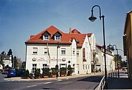
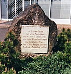
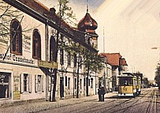

Der Gasthof Cossebaude entstand vermutlich bereits im 16. Jahrhundert und wurde früher auch “Zum Schwarzen Bären” genannt. Im Garten des
Gasthauses fanden am 15.-17. August 1645 die ersten Verhandlungen zwischen Sachsen und Schweden statt, die schließlich zum Friedensvertrag von Kötzschenbroda führten. Mit dessen Unterzeichnung endete für Sachsen der
Dreißigjährige Krieg. An das Ereignis erinnert heute ein Gedenkstein. Mitte der 1990er Jahre entstand an Stelle des früheren Gebäudes ein moderner Neubau, in dem heute das Hotel “Zum Friedensstein” die Tradition
des Hauses fortsetzt. Außerdem gibt es hier das südostasiatische Restaurant “Bali”.

**_Fotos:_** _Gasthof “Am Friedensstein” und Gedenkstein zum Friedensvertrag von 1645._

_**Inschrift:**_
_“In diesem Garten der alten Dorfschänke wurden am 15. u. 17. Aug. 1645 die ersten_

_Unterhandlungen zum Friedensschlusse des 30 jähr. Krieges zwischen Sachsen u. Schweden eröffnet._

## Neuer Gasthof

Der Neue Gasthof befand sich in unmittelbarer Nähe des alten Cossebauder Gasthofes an der Dresdner Straße. Im
Volksmund wurde das Lokal auch als “Grünes Ungeheuer” bezeichnet. Das Gebäude verfiel nach 1945 und stand
viele Jahre leer. 1998 wurde der frühere Neue Gasthof umfassend saniert und ist heute Sitz der Ortschaftsverwaltung und verschiedener gesellschaftlicher Einrichtungen.

**_Foto:_** _Gasthof Cossebaude und Straßenbahnendhaltestelle um 1910_
