## Albertplatz

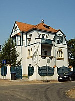
Ursprünglich trug dieser Platz ab 1915 den Namen König-Friedrich-August-Platz, welcher 1922 in Friedrich-August-Platz verändert wurde. Namensgeber war der letzte sächsische König
Friedrich August III. (1865-1932), der 1918 im Zuge der Novemberrevolution abdanken musste. 1946 erfolgte die Umbenennung in Liebknechtplatz. Karl Liebknecht (1871-1919) gehörte ab
1912 dem Deutschen Reichstag an und war 1918 einer der wichtigsten Führer der Novemberrevolution. Gemeinsam mit Rosa Luxemburg gründete er 1916 den Spartakusbund als Vorläufer der KPD.

1992 wurde der Liebknechtplatz nach dem sächsischen König Albert (1828-1902) in Albertplatz umbenannt, da hier bereits um 1900 ein Denkmal für den Wettiner aufgestellt worden war. Der
frühere König-Albert-Obelisk mit einer Büste des Königs fiel nach dem Zweiten Weltkrieg der Bilderstürmerei zum Opfer.

Die Platzanlage aus der Zeit vor dem Ersten Weltkrieg ist hingegen noch weitgehend erhalten.  Bemerkenswertestes Bauwerk ist die unter Denkmalschutz stehende Villa Albertplatz 1 _(Foto)_
. Außerdem befindet sich in der Mitte des Platzes ein Stein mit der Inschrift:

_“Wanderer hemme den Schritt und höre_

_was ich dich frage:_

_Glaubst du der Gegend Reiz sei hier auf einmal erschöpft?_

_Nein hier beginnet er erst und freudig wirst du ihn schauen._

_Geh nur zum Wald und zum Tal, suche die Wege dort auf.”_

## Albrechtshöhe

Der Straßenname Albrechtshöhe geht auf den sächsischen Herzog Albrecht zurück, der hier oft zur Jagd unterwegs war und
der Überlieferung nach die Anhöhe gekauft und einem Jagdhelfer und seiner Verlobten als Dank für treue Dienste geschenkt
haben soll. Albrecht der Beherzte regierte von 1464 bis 1500 und ist Begründer der albertinischen Linie der Wettiner. Ursprünglich gehörte die Albrechtshöhe zur Gemarkung [Leuteritz](../../../west/mobschatz/leuteritz/) (Neu-Leuteritz) und kam erst im Zuge einer
Gemeindereform 1972 zu Cossebaude. Der frühere Straßenname Albrechtstraße wurde 1992 in Albrechtshöhe verändert.

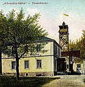Gaststätte Albrechtshöhe: Die Gaststätte entstand Ende des 19. Jahrhunderts auf der gleichnamigen Anhöhe und war einst ein beliebtes Ausflugslokal. Zuvor waren die Hänge
überwiegend für den Weinbau genutzt worden, an den noch heute Überreste alter Weinbergsmauern erinnern. Nach dem Auftreten der Reblaus erfolgte die Umwandlung der
Flächen in Obstplantangen, die Cossebaude vor allem zur Zeit der Baumblüte zum beliebten Ausflugsziel vieler Dresdner und ihrer Gäste machten.

Das Lokal im Ortsteil Neuleuteritz besaß neben den Gasträumen und einer Terrasse auch einen
hölzernen Aussichtsturm, von dessen Plattform sich ein weiter Ausblick über das Elbtal  und bis in die Sächsische Schweiz bot. Dieser musste später jedoch wegen Baufälligkeit abgetragen
werden, wodurch die Albrechtshöhe deutlich an Attraktivität einbüßte. Kurz nach dem Zweiten Weltkrieg endete der Gaststättenbetrieb und das Gebäude wurde zum Wohnhaus.

## Am Hegereiter

Die Straße Am Hegereiter geht auf einen alten Hangweg an der Weinbergstraße zurück und wurde 1932 benannt. Mit der
Namensgebung wird an Cossebaudes Tradition als Jagdrevier der sächsischen Kurfürsten erinnert. Dieses Gebiet nahm einst große Teile der Fluren zwischen [Zschoner-](../../../west/kemnitz/zschonergrund/) und [Tännichtgrund](../../../West/Oberwartha/Tannichtgrund/tannichtgrund.html) ein und wurde von einem Hegereiter betreut. Der Hegereiter
war ein dem Hegemeister unterstellter Beamter, dem die Kontrolle und Beaufsichtigung des Reviers und des Wildbestandes oblag.

## Am Kirschberg

Die kurze von der Oberen Bergstraße abzweigende Sackgasse wurde Anfang der Dreißiger Jahre von dem Besitzer eines
hier gelegenen Grundstücks ausgebaut und 1932 Am Kirschberg benannt. Die Namensgebung orientiert sich an den zahlreichen Kirschbaumplantagen in diesem Gebiet. Nach Einstellung des Weinbaus Ende des 19. Jahrhunderts galt
Cosssebaude als ein Zentrum des Kirschenanbaus im Dresdner Raum.

## Am Osterberg

Die kurze Straße am Albertplatz erhielt 1991 ihren Namen nach dem nahegelegenen Osterberg. Um 1880 entstand hier ein
schlossartiges Gebäude im Tudorstil, welches nach Erteilung einer entsprechenden Genehmigung als Gaststätte genutzt
wurde. Erster Gastwirt war der Besitzer der Oberwarthaer Brauschänke, der den Osterberg wegen seiner beeindruckenden Fernsicht zu einem beliebten Ausflugsziel machte. Das Gebäude wurde nach 1945 als Wohnheim genutzt und ab 2011 zum
Wohnhaus umgebaut.

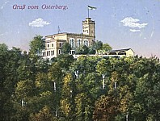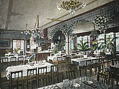

**_Fotos:_** _Historische Ansichten der Gaststätte “Osterberg”_

## August-Bebel-Straße

Die August-Bebel-Straße wurde Ende des 19. Jahrhunderts im Wohnviertel am Bahnhof angelegt und zunächst Mittelstraße
genannt. Kurz darauf entstanden hier Mietshäuser für die wachsende Arbeiterschaft der Gemeinde. Später erhielt sie nach dem deutschen General und Reichspräsidenten den Namen Paul-von-Hindenburg-Straße. 1945 erfolgte die Umbenennung
in August-Bebel-Straße. August Bebel (1840-1913) war ein deutscher Arbeiterführer und gehörte bis zu seinem Tod als
Abgeordneter der SPD dem Deutschen Reichstag an.

## Bahnhofstraße

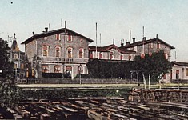
Die Cossebauder Bahnhofstraße wurde im Zusammenhang mit dem Bau der 1875 eröffneten Eisenbahnstrecke [Dresden - Berlin](../../../zentrum/friedrichstadt/dresden_-_berlin/) angelegt.
Zunächst nur als Haltepunkt bezeichnet erhob man die Station wegen ihrer Bedeutung 1888 zum Bahnhof und errichtete in diesem Zusammenhang das noch heute erhaltene Empfangsgebäude, welches unter Denkmalschutz steht _(Foto)_
. Hier wurde am 19. Oktober 1900 die bekannte Sopranistin Erna Berger als Tochter eines Eisenbahningenieurs geboren.

Unweit des Bahnhofs befindet sich seit 1894 das Cossebauder [Schulhaus](../../../west/cossebaude/)
(Bahnhofstraße 5). Das Gebäude entstand nach Plänen des ortsansässigen Baumeisters Säurig und wurde 1910–1911 nochmals erweitert. Heute nutzt es die Grundschule des Ortes. Auch das
Postamt des Ortes hatte seinen Standort früher an der Bahnhofstraße (Nr. 10). Im östlichen Teil siedelten sich hingegen Gewerbebetriebe wie das Elektrizitätswerk “Elbtal” (Nr. 15) und die [Eisenwerke Meurer AG](../../../west/cossebaude/eisenwerke_meurer/) (Nr. 16) an.

## Bischof-Benno-Weg

Der Bischof-Benno-Weg im oberen Teil von Cossebaude erinnert an den sagenumwobenen Meißner Bischof Benno
(1010-1106), der im Jahr 1066 sein Amt übernahm. Zu den zahlreichen Legenden über ihn gehört auch, dass Benno den Weinbau im Raum Cossebaude eingeführt haben soll, was sich historisch jedoch nicht belegen lässt. Erstmals ist der
Straßenname im Jahr 1916 erwähnt.

## Bismarckplatz

Der Bismarckplatz wurde um 1890 als Mittelpunkt eines neuen Wohngebietes in der Nähe des Bahnhofes angelegt und nach
Reichskanzler Otto von Bismarck (1815-1898) benannt. Im zu Ehren gibt es in der Mitte des Platzes seit 1895 eine Bismarckeiche. Platzanlage und umliegende Gebäude stehen unter Denkmalschutz.

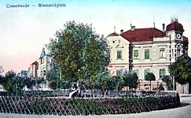

**_Foto:_** _Bismarckplatz mit Bismarckeiche um 1912_

## Brabschützer Straße

Die heutige Brabschützer Straße ist Teil eines alten Verbindungsweges zwischen Cossebaude und dem benachbarten [Brabschütz](../../../West/Mobschatz/Brabschutz/brabschutz.html), welcher im [Lotzebachtal](../../../west/oberwartha/strassen_oberwartha/lotzebachstrasse/)
beginnt und von dort zur Albrechtshöhe und weiter in den Nachbarort führt. In alten Karten ist dieser Weg auch als Fleischerweg verzeichnet.

## Brauergasse

Die Brauergasse, früher auch Pflaumengässel genannt, verdankt ihren Namen der alten Cossebauder Brauerei. Das
Unternehmen wurde einst als Klosterbrauerei gegründet und um 1900 vom Braumeister Schirmer geführt. Wirtschaftliche
Gründe führten nach dem Ersten Weltkrieg zur Einstellung der Produktion. Die noch erhaltenen Gebäude an der Ecke zur Dresdner und zur Hauptstraße sollen künftig zu einer Wohnanlage umgebaut werden.

## Breitscheidstraße

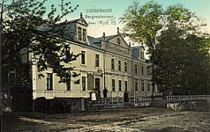
Die heutige Breitscheidstraße entstand Ende des 19. Jahrhunderts und ist seit 1899 in den Ortsplänen verzeichnet. Aufgrund ihrer Lage erhielt sie den Namen Untere
Bergstraße, während die parallel verlaufenden Wege als Bergstraße bzw. Obere Bergstraße bezeichnet wurden. An ihrem östlichen Ende befand sich mit dem Berg-Restaurant eine von mehreren Gaststätten des Ortes. Das Lokal besaß einen
großen Ballsaal, eine Kegelbahn und einen großen schattigen Biergarten _(Foto)_.

1934 wurde die Untere Bergstraße nach dem 1930 erschossenen SA-Sturmführer
und “Vorkämpfer” der nationalsozialistischen Bewegung  Horst Wessel (1907-1930) in Horst-Wessel-Straße umbenannt und wenig später bis zum Grünen Weg verlängert. 1945 erhielt sie den
Namen des sozialdemokratischen Politikers Rudolf Breitscheid (1874-1944). Breitscheid gehörte als Abgeordneter des linken Flügels der SPD von 1920 bis 1933 dem Reichstag an und kam 1944 im Konzentrationslager Buchenwald bei einem
Luftangriff ums Leben. An der Breitscheidstraße stehen mehrere Gebäude aus der Zeit der Jahrhundertwende unter Denkmalschutz.

## Brunnenweg

Der Brunnenweg im Cossebauder Ortsteil Neu-Leuteritz entstand zur Erschließung des Wohnviertels rund um die frühere
Gaststätte Albrechtshöhe.  Seinen Namen erhielt er nach dem Brunnenbach, einem kleinen Gewässer, welches zunächst in den Rauschebach mündet und dann weiter zum Lotzebach fließt.

## Dresdner Straße

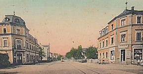
Die heutige Dresdner Straße ist Teil der für Dresden wichtigen Verkehrsverbindung durch das Elbtal nach Meißen (Bundesstraße B 6) und in alten Stadtplänen auch als Meißner Straße verzeichnet. Heute trägt
der Abschnitt zwischen der Flurgrenze von Gohlis / Stetzsch und der Cossebauder Hauptstraße offiziell den Namen Dresdner Straße, während ihre Fortsetzung in Richtung Niederwartha weiterhin [Meißner Straße](../../../west/niederwartha/strassen_niederwartha/)
genannt wird. Neben einigen Wohnhäusern im Ortszentrum und dem [Cossebauder Gasthof](../../../west/cossebaude/gasthof_cossebaude/) prägten bis in jüngste Vergangenheit zahlreiche Gewerbebetriebe das Straßenbild. Im heute als Wohnhaus genutzten
Gebäude Dresdner Straße 11a befand sich einst das Cossebauder Gemeindeamt mit Sparkasse. Eine weitere Gaststätte mit dem Namen “Deutsches Haus” existierte vor dem Zweiten Weltkrieg auf der Dresdner Straße 38.

Dyckerhoff & Widmann (Nr. 40): Ein bedeutendes Unternehmen in Cossebaude war die Firma Dyckerhoff & Widmann, die
hier ab 1890 eine Niederlassung besaß. Die 1865/69 von Wilhelm Gustav Dyckerhoff, seinem Sohn Eugen und dessen Schwiegervater Gottlieb Widmann gegründete Firma mit zahlreichen Niederlassungen im In- und Ausland gehört zu den Pionieren des Betonbaus und errichtete zahlreiche Brücken, Hallen und Großbauten aus diesem neuartigen Baustoff. Der
Stammsitz des Unternehmens befand sich in Wiesbaden, später in Berlin. In Cossebaude wurden vorrangig Beton- und Stahlbetonelemente gefertigt und dann per Bahn an ihren Bestimmungsort gebracht. 1946 erfolgte die Überführung des
Zweigwerkes Cossebaude in Volkseigentum, die Aktiengesellschaft ging später im Baukonzern DYWIDAG auf. Seit 2011 befindet sich auf dem Grundstück das Gerätehaus der Freiwilligen Feuerwehr Cossebaudes.

Windschild & Langelott (Nr. 42): Das Unternehmen mit Zweigbetrieben in ganz Deutschland betrieb in Cossebaude seit
1889 eine “Cementwaarenfabrik” und gehörte zu den bedeutendsten Bauunternehmen in Deutschland. Das Tätigkeitsfeld erstreckte sich vom Kanalbau über technischen Anlagen der Wasserversorgung bis zu Talsperren und Eisenbahnbauwerken.
Heute erinnert noch die unter Denkmalschutz stehende “Rote Villa” (Nr. 42) an den Betrieb, dessen Sitz sich heute in Oldenburg befindet.

## Die Eichbergstraße

Die Eichbergstraße verbindet Cossebaude mit dem Ortsteil Albrechtshöhe und dem benachbarten [Leuteritz](../../../west/mobschatz/leuteritz/). Ihren Namen
erhielt sie nach einer Flurbezeichnung. Erstmals wird sie im Cossebauder Adressbuch von 1900 genannt. Bemerkenswert
sind die ehemalige Bahnmeisterei und die Wohnhäuser Eichbergstraße 3 und 10, welche unter Denkmalschutz stehen. Im Haus Nr. 2 gab es in den 1930er Jahren die Gaststätte “Zur Linde”.

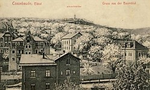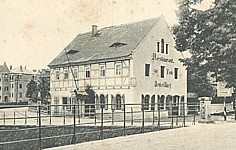

**_Fotos:_** _Blick zur Eichbergstraße und zur Alberthöhe, rechts die Gaststätte “Zur Linde”_

## Erna-Berger-Straße

Die erst zu DDR-Zeiten angelegte Erna-Berger-Straße erinnert an die in Cossebaude geborene Opernsängerin Erna Berger
(1900–1990). Als Koloratursopranistin gehörte sie ab 1926 viele Jahre dem Ensemble der Dresdner Oper an, gastierte aber auch regelmäßig im In- und Ausland und wirkte in einigen Filmen mit. Ende der 1970er Jahre entstanden hier
mehrgeschossige Wohnblocks sowie ein Neubau für die Cossebauder Schule (heute Mittelschule).

## Gnomenstieg

Der Gnomenstieg geht auf einen einstigen Weinbergsweg zurück. Bis heute haben sich hier Reste historischer Bruchsteinmauern zum Schutz der Rebstöcke vor Erosion und kühlen Winden erhalten. Bemerkenswert ist das frühere
Weinbergschlößchen (Nr. 13) mit einer reliefgeschmückten Toranlage. Am Gnomenweg befindet sich seit 1913 das Cossebauder [Bismarckdenkmal](../../../west/cossebaude/), von dessen Plateau sich ein beeindruckender Rundblick über das Elbtal und die
Lößnitzhänge bietet.

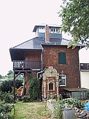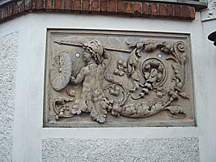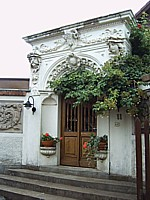

_Fotos: Weinbergsschlösschen Gnomenstieg 13 mit Toranlage und Relieftafel_

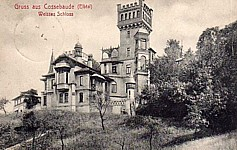Nr. 4: Als eines der Wahrzeichen von Cossebaude gilt das abseits des Gnomenstiegs am Elbhang stehende “Weiße Schloss”. Es wurde 1890 als Villa
eines Fabrikanten im neogotischen Tudorstil erbaut. Nach dem Ersten Weltkrieg wohnte hier zeitweise der Besitzer der Dresdner [Zigarettenfabrik “Yenidze”](../../../Zentrum/Friedrichstadt/Strassen_Friedrichstadt/Weisseritzstrasse/Yenidze/yenidze.html) Hugo
Zietz. Nach 1945 erfolgte ein Umbau des Gebäudes, wobei leider ein Teil der historischen Innenausstattung verloren ging. 2004 wurde das “Weiße Schloss”
versteigert und im Anschluss restauriert. Im parkartigen Garten steht die mit einem Stammumfang von ca. 6,50 Metern mächtigste Rotbuche Dresdens.

## Grenzstraße

Die erstmals im Adressbuch von 1900 erwähnte Grenzstraße liegt auf der Flurgrenze zwischen Cossebaude und Niedergohlis und erhielt deshalb ihren Namen. Ihre Fortsetzung in Gohlis und wird dort Gartenstraße genannt.

## Hangweg

Der Hangweg ist ein nach seiner Lage benannter Wanderweg, der in der Ortsmitte vom Gnomenstieg in westlicher Richuung abzweigt und parallel zum Lotzebach am Hang bis zur Niederwarthaer Flurgrenze führt.

## Hauptstraße

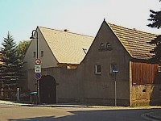Die Hauptstraße bildet gemeinsam mit der nach der Eisenbahnüberführung anschließenden [Talstraße](../../../west/cossebaude/strassen_cossebaude/talstrasse/) das historische Zentrum Cossebaudes. Bis heute haben sich hier einige Gebäude der dörflichen Vergangenheit erhalten. Bemerkenswert sind u.a. die Bauernhöfe Nr. 3, 4, 5 _(Foto)_, 6 (Lehmann-Gut von 1728), 7 (Baumschule Teschendorff), 8 und 11, welche teilweise noch Fachwerk aufweisen und ursprünglich meist klassische Dreiseithöfe mit Wohnhaus, Auszugshaus und Scheune waren. Seit 1997 erinnert an der Hauptstraße eine Marmorbüste an die in Cossebaude geborene Opernsängerin Erna Berger.

Nr. 1 (Braugut): Das nach seiner früheren Nutzung Braugut genannte Gehöft entstand im Kern bereits im 16. Jahrhundert und wurde in der zweiten Hälfte des 17. Jahrhunderts in heutiger Form umgebaut. Der Gebäudekomplex besteht aus Wohnhaus, einem Stallgebäude für die Unterbringung von Pferden und Schweinen sowie dem einstigen Brauereigebäude. Um 1900 befand sich die Brauerei im Besitz des Braumeisters Schirmer. Erhalten blieben bis heute einige Lagerkeller, ein früher zur Trocknung der Braugerste genutzter Turm sowie ein 15 Meter tiefer Hofbrunnen. Nach dem Ersten Weltkrieg wurde der Braubetrieb eingestellt und das Gehöft nur noch zu Wohnzwecken genutzt. Eine unfassende Sanierung erfolgte ab 2011, wobei zahlreiche historische Details, u.a. Holzbalkendecken und Gewölbe, einige Wandmalereien sowie ein Bärenrelief im Haupttreppenhaus erhalten blieben.

## Heinrich-Mann-Straße

Die Heinrich-Mann-Straße entstand Ende des 19. Jahrhunderts im Zusammenhang mit dem Ausbau des Wohnviertels am Bahnhof und wurde von 1900 bis 1945 Heinrichstraße genannt. Ihren heutigen Namen erhielt sie nach dem deutschen Schriftsteller Heinrich Mann (1871-1950), dessen bekanntester Roman “Der Untertan” ist.Zu den historischen Gebäuden an der Straße gehört neben einigen Wohnhäusern aus der Zeit um die Jahrhundertwende die frühere Villa des Besitzer der Chemischen Fabrik Cossebaude (Nr. 8). Im Haus Heinrichstraße 17 hatte einst die Wettin-Apotheke ihr Domizil.

## Käthe-Kollwitz-Straße

Ebenso wie ihre Nachbarstraßen wurde die Käthe-Kollwitz-Straße um 1900 im Zusammenhang mit dem Bau des neuen
Wohnviertels am Bahnhof angelegt. Vor 1945 trug sie den Namen Bismarckstraße. Bis heute prägen Gründerzeithäuser das
Straßenbild rund um den Bismarckplatz. Ihren heutigen Namen erhielt die Straße nach der deutschen Malerin und Grafikerin Käthe Kollwitz (1867-1945), welche mit ihren Anti-Kriegs-Darstellungen international bekannt wurde.

**_Foto:_** _Blick in die Cossebauder Bismarckstraße um 1910_

## Krumme Gasse

Die Krumme Gasse führt vom Lotzebachtal hinauf zur Liebenecke, wo sich der Überlieferung nach die Wiege des Cossebauder Weinbaus befunden haben soll. Im unteren Teil blieben bis heute einige historische Wohnhäuser aus der
Vergangenheit Cossebaudes als Bauern- und Winzerdorf erhalten.

## Ludwigstraße

Die Ende des 19. Jahrhunderts angelegte östlichste Querstraße des Bahnhofsviertels wurde zunächst Fabrikstraße genannt,
da sich hier mehrere Gewerbeunternehmen befanden. Später erfolgte die Umbenennung in Ludwigstraße. Johann Ludewig
(1715–1760) lebte im Gehöft Talstraße 6 und befasste sich als „gelehrte Bauer“ mit Astronomie, Geometrie und Naturwissenschaften.

## Obere Bergstraße

Im Zusammenhang mit der Bebauung des Areals südlich der Bahnstrecke wurden Ende des 19. Jahrhunderts, ausgehend von der Eichbergstraße drei Erschließungsstraßen angelegt, welche nach ihrer Lage die Namen Untere Bergstraße, Bergstraße und Obere Bergstraße erhielten. Am Ende der Unteren Bergstraße gab es vor dem Ersten Weltkrieg das “Berg-Restaurant”.

Mit Machtergreifung der Nationalsozialisten entschied sich die Gemeinde zur Umbenennung der Unteren und der Oberen Bergstraße. Erstere wurde nach dem 1930 bei Auseinandersetzungen mit den Kommunisten erschossenen Berliner SA-Sturmführer Horst Wessel benannt, während die Obere Bergstraße den Namen Leo-Schlageter-Straße erhielt. Leo Schlageter (1894-1923) gehörte Anfang der Zwanziger Jahre einer radikalen rechten Gruppierung an und wurde wegen seiner Beteiligung an mehreren Sprengstoffanschlägen 1923 von einem französischen Militägericht zum Tode verurteilt. Nach 1933 galt er als einer der “Vorkämpfer” der nationalsozialistischen Bewegung und wurde entsprechend geehrt.

Bereits kurz nach Kriegsende wurden beide Straßenbezeichnungen wieder aufgehoben. Während die Untere Bergstraße den Namen Breitscheidstraße erhielt, wurde die Obere Bergstraße nach dem KPD-Führer Ernst Thälmann in Thälmannstraße umbenannt. Seit 1990 trägt die Obere Bergstraße wieder ihren ursprünglichen Namen. Zahlreiche der hier stehenden Wohngebäude wurden unter Denkmalschutz gestellt.

## Schulstraße

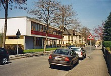Die Schulstraße wurde Ende des 19. Jahrhunderts angelegt und erhielt ihren Namen
nach dem hier befindlichen und 1894 eingeweihten Cossebauder [Schulhaus](../../../west/cossebaude/). Heute nutzt die Grundschule das nach 1990 sanierte und um einen modernen Anbau _(Foto)_
erweiterte Gebäude. Zwischen 1933 und 1945 trug die Schulstraße den Namen Adolf-Hitler-Straße.

**_Foto:_** _Blick in die Schulstraße mit der neuen Schule_

## [Talstraße](../../../west/cossebaude/strassen_cossebaude/talstrasse/)

## Weinbergstraße

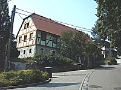Die Weinbergstraße zweigt von der Cossebauder Talstraße ab und führt in mehreren
Kurven hinauf zum Hochplateau von Oberwartha. Ihren Namen erhielt sie nach dem einst hier betriebenen Weinbau, dessen Geschichte sich bis ins 13. Jahrhundert zurück verfolgen
lässt. Zur Blütezeit zog sich das Anbaugebiet von der Herrenkuppe am Gnomenstieg über die Liebenecke, den Bischof-Benno-Weg bis zu den Hängen des Lotzebachtals.

Ende des 19. Jahrhunderts verlor der Weinbau, einerseits durch die Einschleppung der Reblaus, aber auch durch die zunehmende Konkurrenz anderer Anbaugebiete, an Bedeutung und wurde bis
zum Ersten Weltkrieg weitgehend eingestellt. In der Folgezeit entstanden in den früheren Weinbergen Villen und Wohnhäuser. Aus dieser Zeit blieben auch an der Weinbergstraße einige
Gebäude erhalten, welche heute unter Denkmalschutz stehen. Im oberen Teil erinnert in einer kleinen Grünanlage ein Gedenkstein an den Begründer der Turnbewegung Friedrich Ludwig Jahn.

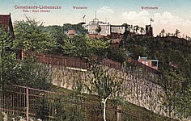Liebenecke: Als “Liebenecke” wird der älteste nachweisbare Weinberg
Cossebaudes bezeichnet. Erstmals wurde die Lage 1296 als “Lybenecke” urkundlich erwähnt. Der Überlieferung nach gehen Weinberg und Name auf den Meißner Bischof Benno zurück, der den Standort an einem Felsvorsprung
persönlich gewählt und mit den Worten “Das ist eine liebe Ecke” für den Rebenanbau ausgesucht haben soll. Später gab es hier ein beliebtes Ausflugslokal.
Unter dessen Besitzer Karl Henke entwickelte sich die “Liebenecke” Ende des 19. Jahrhunderts zum Ziel für Wochenendbesucher und Wanderer. Henke ließ das
Areal mit verschiedenen Attraktionen, Aussichtsterrassen und der künstlichen Ruine “Wettinturm” ausstatten. In den Gasträumen waren Vitrinen mit frühgeschichtlichen Funden der Umgebung und einem
Fragment der alten Meißner Postmeilensäule zu sehen. Nach dem Zweiten Weltkrieg wurde der Restaurantbetrieb eingestellt.

## Weinsberger Platz

Der Platz wurde auf einer früheren Brachfläche als Festplatz des Stadtteils angelegt und am 26. Juni 2011 offiziell eingeweiht.
Mit der Namensgebung Weinsberger Platz wird an Cossebaudes Partnergemeinde in Baden-Württemberg erinnert, welche
u.a. bei der Hochwasserkatastrophe von 2002 zahlreiche Hilfsmaßnahmen unterstützte. Auf die partnerschaftlichen Kontakte zu Weinsberg weist auch eine im Zuge der Einweihung des Platzes geschaffene Basaltstele hin.
