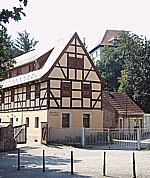
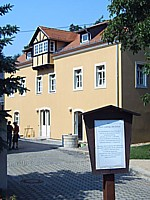
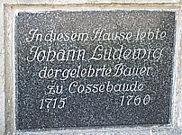
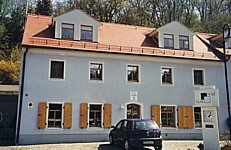
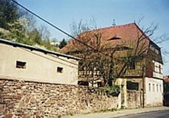

Der an die Hauptstraße anschließende Straßenabschnitt südlich der Eisenbahnstrecke trägt den
Namen Talstraße und führt durch das [Lotzebachtal](../../../../west/oberwartha/strassen_oberwartha/lotzebachstrasse/) in Richtung Brabschütz. Hier haben sich noch
zahlreiche Sachzeugen der Cossebauder Geschichte erhalten. So finden sich im unteren Teil noch mehrere historische Wohngebäude aus dem 18. und 19. Jahrhundert. Im oberen Teil der Straße
prägen hingegen Siedlungshäuser aus der Zeit nach dem Ersten Weltkrieg das Straßenbild.

## Heimathaus (Nr. 5/5a)

Bemerkenswert ist das historische Gehöft Nr. 5/5a, welches nach seiner
Sanierung heute das Vereinshaus des Heimat- und Verschönerungsvereins Cossebaude beherbergt _(Foto oben)_. Auch das Kinder- und Jugendhaus “Alte Feuerwehr” hat hier sein Domizil.

## Alte Schule

Im Nachbarhaus (Nr. 7) befand sich bis 1894 die [alte Schule](../../../../west/cossebaude/) des Ortes. Diese erste Schule von Cossebaude
entstand 1805 nach Einführung der Schulpflicht in Sachsen. 1861 konnte nach einem Umbau ein zweites Klassenzimmer
eingerichtet werden. Das Schulhaus wurde damals von drei Klassen mit insgesamt ca. 200 Kindern genutzt. Seit dem Umzug der Schule im Jahr 1894 dient das Gebäude als Wohnhaus.

Nr. 6:
Schräg gegenüber befindet sich das Bauerngut Nr. 6. Hier lebte im 18. Jahrhundert der “gelehrte Bauer” Johann
Ludewig, der sich mit Astronomie, Mathematik und anderen Naturwissenschaften befasste. Für Aufsehen unter den
Dorfbewohnern sorgte er im Jahr 1753, als er eine eintretende Sonnenfinsternis vorherberechnete. An ihn erinnert seit 1893 ein vom Cossebauder Verschönerungsverein gestifteter Gedenkstein mit Schriftttafel.

**_Fotos:_** _Ehemaliges Wohnhaus von Johann Ludewig mit Gedenktafel_

## Steinernes Haus

Zu den ältesten Sachzeugen der Ortsgeschichte gehört das sogenannte “Steinerne Haus”(Nr. 7a). Das Gebäude entstand vermutlich im 13. Jahrhundert an Stelle einer mittelalterlichen Wehranlage und diente ab 1578 als
evangelische [Kapelle](../../../../west/cossebaude/alte_kapelle/) Cossebaudes. Die umliegenden Bauten bildeten den Wirtschaftshof eines Vorwerks, welches 1263
erstmals genannt und 1492 aufgelöst wurde. Sein heutiges Aussehen erhielt das Steinerne Haus bei einem Umbau um 1700.
1902 entschied sich die Kirchgemeinde zur Aufgabe ihrer alten Kapelle, in der im Folgejahr der letzte Gottesdienst
stattfand. 1921 erfolgte der Umbau zum Wohnhaus. Am Treppenaufgang erinnert ein Denkmal an die Gefallenen des Ersten Weltkriegs.

Nr. 9: Ursprünglich gehörte dieses Grundstück dem Cossebauder Bergvoigt und war ab 1620 Standort der fiskalischen
Weinpresse. Mit Niedergang des Weinbaus wurde diese nicht mehr benötigt und der ehemalige Maschinensaal an die
Kirchgemeinde veräußert. 1903 fand im hier eingerichteten neuen Gemeindesaal der erste Gottesdienst statt. 1989 konnte
mit dem Umbau des Gebäudes zur Kirche begonnen werden. In diesem Zusammenhang sanierte man auch den 1904 errichteten Glockenturm im Garten, der dabei ein neues Bronzegeläut mit drei Glocken erhielt.

Nr. 8:
Dieser Gutshof, bestehend aus Haupt- und Wirtschaftsgebäude wurde einst auch als Weingut genutzt. Im Keller des denkmalgeschützten Anwesens haben sich noch Reste des einstigen Weinkellers erhalten.

Talmühle (Nr. 10): Die historische Wassermühle, deren genaues Entstehungsjahr
unbekannt ist, diente einst als Mahlmühle der Einwohner von Cossebaude, Gohlis und Kötzschenbroda und befand sich im Besitz des Meißner Domkapitels. Später
wurde sie von wechselnden Pächtern betrieben. Die Einstellung des Mahlbetriebs erfolgte 1950. Das zuletzt als Wohnhaus dienende baufällige Gebäude musste Ende der 1990 Jahre abgerissen werden.

## Talschänke (Nr. 29)

In diesem heute nur noch Wohn- und Gewerbezwecken dienenden Gebäude _(Foto rechts)_
befand sich einst die Gaststätte “Talschänke”. Sie war eines von mehreren Ausflugslokalen, welche in der Zeit um die Jahrhundertwende entstanden, um die zahlreichen
Ausflügler zu versorgen. Nach 1945 erfolgte die Einstellung des Gaststättenbetriebes.

Herrenhaus (Nr. 60): Das Gebäude entstand
um 1635 als Weinschänke des Kurfürsten und war zugleich Sitz eines Weingutes. Die Keller des Gebäudes wurden zu dieser Zeit als Lagerraum für die Weinfässer genutzt. Nach Einstellung des Weinbaus diente das
Herrenhaus u. a. als Lazarett und Sitz verschiedener Gewerbebetriebe. Später befand sich in den Räumen eine Ballettschule. In den 1970er Jahren wurde das denkmalgeschützte
Herrenhaus saniert. Haupt- und Nebengebäude sowie die auf dem Areal gelegenen Weinbergsanlagen stehen unter Denkmalschutz.

Nr. 62: Dieser Weinberg mit seiner Hofanlage gehörte ursprünglich zum fiskalischen Weingut des Herrenhauses. Um 1600
wurde er unter Regie des Cossebauder Weinbauexperten Dr. Aichmann als Musterweinberg mit Treppenanlage mit
Trockenmauern errichtet. Für das Jahr 1610 ist erstmals ein Ertrag von umgerechnet 2000 Litern Wein in den Annalen
vermerkt. Der Winzerhof mit Trockenmaueranlage und Einfriedung steht unter Denkmalschutz. Nach 1990 erwarb der Winzer Rolf Fehrmann das Grundstück und betreibt hier auf ca. 4 Hektar Anbaufläche Weinbau. Die vorhandenen
Gebäude wurden 2000 saniert und ausgebaut.

Nr. 64-66:
Auch dieses Grundstück geht auf einen früheren Weinberg zurück. Die gesamte Anlage mit ländlichem Wohnhaus, einer Villa mit Eckturm sowie die Weinbergsterrassen und -treppen stehen unter Denkmalschutz.

Nr. 65: In diesem Gebäude befand sich vor dem Zweiten Weltkrieg die Gaststätte “Zur Turnhalle”. Heute dient das unter
Denkmalschutz stehende Gebäude als Wohnhaus und Sitz einer Firma für Förderanlagen.

Nr. 105-07: Das Doppelhaus wurde nach dem Ersten Weltkrieg für die Baugenossenschaft Dresden Land errichtet.
Bemerkenswert ist auch die benachbarte Reihenhausanlage Talstraße 109-119 mit ihrer für den Dresdner Raum untypischen Bruchsteinverkleidung.
